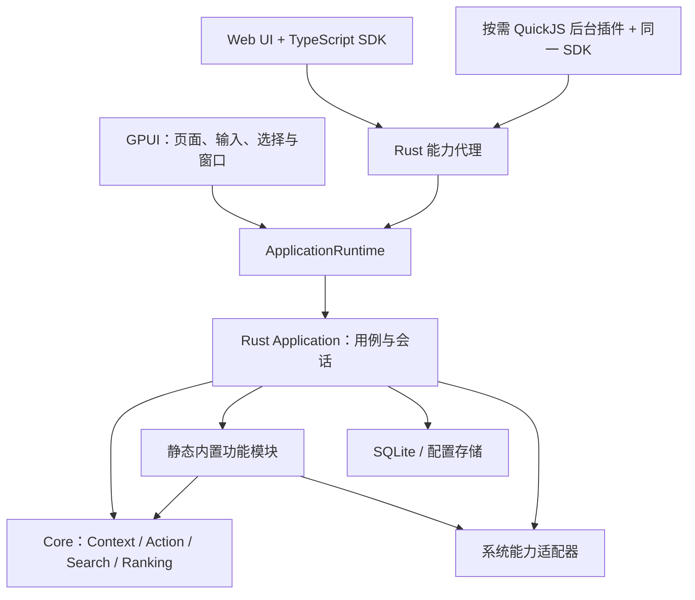

# Anywhere

**理解当前操作对象的桌面启动器。** 搜索应用和动作，从当前应用、选中文本、文件或 URL 直接执行下一步。

[使用指南](docs/usage.md) · [架构](docs/architecture.md) · [开发与构建](docs/development.md) · [插件开发](docs/plugin-development.md) · [路线图](docs/roadmap.md) · [更新记录](CHANGELOG.md)

## 项目状态

当前为 **V0.14 GPUI 开发预览**。macOS 15+ 产品界面已由原生 GPUI 实现，Rust Core 继续负责 Context、Action、匹配、排序、授权和执行；旧的嵌入 UI、桥接层和对应宿主代码已从工作树移除。完整发布、签名公信和实机辅助技术矩阵尚未完成；开发构建不等于正式发行。

V0.14 已接入[应用历史与动作排序](docs/mvp-gpui.md)：通用文件读取器 + 官方配置 / JS 转换，共享历史页已接入 18 个来源，覆盖 JetBrains、VS Code 同类编辑器、Sublime Text 和 Obsidian 最近仓库。支持默认路径检测、自定义路径、逐来源 Action 开关与可信用户适配；Obsidian 最近笔记暂缓接入，多实例仍待验证；浏览器历史、书签与 Tab 管理调整为[后续独立功能](docs/browser-feature.md)。

| 平台 | 状态 |
|---|---|
| macOS 15+ | 主要开发和验证平台；从源码构建本机架构的 GPUI App |
| Windows / Linux | 共享 Rust crate 保留编译和测试检查；尚未交付 GPUI App |

本地开发包使用持久本机签名，手动 GitHub 打包使用独立 CI 开发签名；公开分发所需的签名、公证、安装升级和完整辅助功能矩阵仍需验收。当前进度见 [GPUI 技术方案与验收](docs/mvp-gpui.md)，更早的界面阶段记录只作为[历史证据](docs/archive/README.md)。

**下载提示：** GitHub 的 [`latest` 历史预览](https://github.com/FantasyDream/Anywhere/releases/tag/latest) 是 2026-09-18 的 V0.3 开发包，不包含当前 GPUI 产品，也不代表当前 Windows 支持状态。当前版本请从源码构建；新版预览尚未上传 Release。

## 能做什么

- **应用与动作搜索**：启动或切回应用，搜索当前应用的可用菜单，通过 Scope 筛选领域动作。
- **Context 动作**：读取 Finder 选中项 / 目录、选中文本、浏览器当前 URL 和近期剪贴板；支持路径、URL 与项目类型识别。
- **文件搜索**：Spotlight 快速结果加完整文件名遍历，支持隐藏文件、类型过滤、稳定追加与按需 Quick Look，不建立长期全盘索引。
- **剪贴板历史**：本机保存和检索文本、图片、文件列表及可读取格式；另有独立置顶的 GPUI 悬浮窗，支持连续复制。采集默认关闭。
- **开发工具**：Git 常用动作、Maven / Gradle / Node / Cargo 与 Spring Boot 动作，长任务可返回查看输出与停止。
- **快捷键与语言**：自定义 Action / 全局 / Context 快捷键，支持简体中文、English、全拼与首字母搜索。
- **应用历史**：在对应 Current App 中自动出现 IDEA、VS Code、Sublime Text、Obsidian 等来源；设置中可检测、自定义路径或停用来源。接入与限制见[来源指南](docs/application-history-sources.md)。
- **Web 插件预览**：可信本地包、明确权限、统一主题与 TypeScript SDK；JSON Workspace 作为普通插件实现。

终端 / PTY、插件进程隔离、插件市场和浏览器历史暂未交付。第三方 Context 目前仅支持按需解析获准输入；文件及剪贴板预览使用按需 macOS Quick Look；其他平台的原生预览尚未实现。

## 快速使用

首次打开后驻留菜单栏，可点击状态栏 `A` 或使用全局快捷键恢复。默认快捷键：

| 按键 | 操作 |
|---|---|
| `⌘⌥Space` | 当前应用：展示当前环境可用的动作 |
| `⌘Space` | 全局搜索：查找应用与动作 |
| `↑` / `↓`、`Enter` | 选择、执行 |
| `Tab` / `Shift+Tab` | 前后切换 Scope；文件页切换类型 |
| `⌘K` | 在支持此快捷键的页面查看更多对象操作 |
| `Esc` | 清空查询、返回上一层，最后隐藏窗口 |

例如，输入“文件搜索”或 `wjss` 进入文件页；在 Git 项目目录唤醒后执行 Git Status 或 Copy Branch Name。选中文本或新复制内容仅在能识别具体 Context，或被已批准且启用的 Web 工具命令匹配时自动填入；剪贴板有效期为 15 秒。输入法组词期间 GPUI 不抢占字符输入、方向键、Enter 或 Esc。

有查询或工具页面的 Launcher 隐藏后保留状态 15 秒；空白首页重新采集当前环境。Clipboard Shelf 与后台任务使用各自窗口生命周期。

权限按功能开启：辅助功能用于菜单 / 选中文本，自动化用于 Finder / 浏览器，磁盘授权限制文件搜索范围。某个来源不可用时，其他功能仍可使用。完整操作、权限、数据位置和限制见[使用指南](docs/usage.md)。

## 架构



Rust 负责识别、匹配、排序、执行、授权和资源预算；GPUI 负责呈现与交互；AppKit、Quick Look 和 WebKit 适配保持为薄边界。第一方模块编译期自动注册，第三方插件通过独立包与统一 TypeScript SDK 接入：WebView 运行界面，按需 QuickJS 运行后台 Context / Action，权限与生命周期统一由 Rust 管理。

代码定位先看 [AGENTS.md](AGENTS.md)。详见[架构与代码地图](docs/architecture.md)、[Context 模型](docs/context-model.md)及[插件开发指南](docs/plugin-development.md)。

## 从源码构建

需要 macOS 15+、Xcode Command Line Tools、[指定版本的 Rust/Cargo beta 预发布工具链](rust-toolchain.toml)、Python 3.10+、Node.js 22+ / npm，以及持久本机签名身份。

```bash
source scripts/env.sh
scripts/setup-local-signing.sh  # 仅首次创建本机签名身份时执行
scripts/build-macos.sh
scripts/run-macos.sh
```

产物为 `build/Anywhere.app`。运行 `scripts/check.sh` 执行完整工程检查；快速 UI 门禁为 `scripts/check-gpui.sh`。构建、打包、生成物、测量与发布流程见[开发指南](docs/development.md)和[发布检查](docs/releasing.md)。

## 参与与支持

- 提交问题或改进建议：[GitHub Issues](https://github.com/FantasyDream/Anywhere/issues)。请附版本、复现步骤和脱敏截图。
- 贡献代码：[CONTRIBUTING](CONTRIBUTING.md)；交流规则：[CODE_OF_CONDUCT](CODE_OF_CONDUCT.md)。
- 使用问题：[SUPPORT](SUPPORT.md)；漏洞或敏感信息：[SECURITY](SECURITY.md)，不要公开上传完整剪贴板、Context 正文或凭据。
- 文档总览：[docs/README](docs/README.md)。旧阶段与性能采样保留在[历史归档](docs/archive/README.md)。

## 许可证

项目采用 [MIT License](LICENSE)，与 Cargo workspace 及插件 SDK 的既有声明一致。第三方依赖保留各自许可证；随 App 附带的许可材料位于 `Contents/Resources/Licenses/`，仓库中的补充材料见 [resources/licenses](resources/licenses)。
