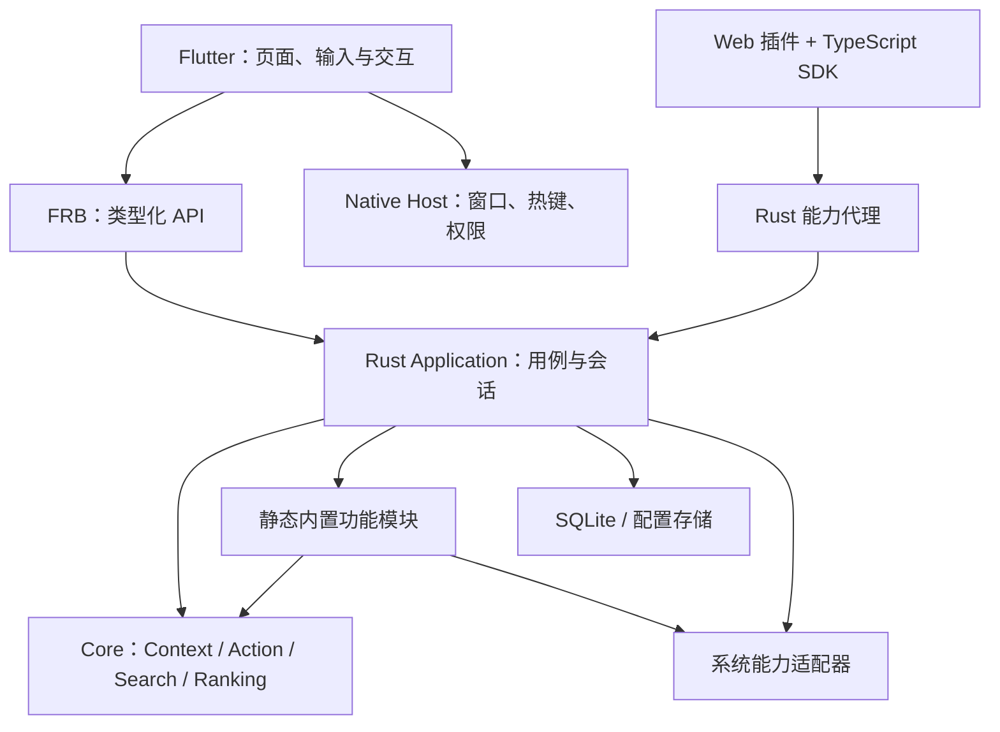

# Anywhere

**理解当前操作对象的桌面启动器。** 搜索应用和动作，从当前应用、选中文本、文件或 URL 直接执行下一步。

[使用指南](docs/usage.md) · [架构](docs/architecture.md) · [开发与构建](docs/development.md) · [插件开发](docs/plugin-development.md) · [路线图](docs/roadmap.md) · [更新记录](CHANGELOG.md)

## 项目状态

当前为 **V0.13 开发预览，工程与本轮常规 macOS 验收已收尾**：基于中英国际化和拼音检索，增加剪贴板定时暂停、保留期限与可靠性检查。已知 SDK 警告、WebKit GPU 保留及未验收矩阵见 [V0.13 MVP](docs/mvp-v0.13.md)。版本和构建号以 [pubspec.yaml](apps/flutter/pubspec.yaml) 为准；开发构建不等于正式发行。

V0.14 正在 `codex/dev-0.14` 验证[应用历史原型](docs/mvp-v0.14.md)：通用文件读取器 + 官方配置 / JS 转换，共享历史页已接入 IDEA / VS Code 合成来源。当前自动检测 IDEA / VS Code 的标准历史文件，也支持自定义路径、Action 开关与可信用户适配配置；浏览器、Obsidian 与多 Profile 仍在后续计划。

| 平台 | 状态 |
|---|---|
| macOS 12+ | 主要开发和验证平台；从源码构建本机架构的 App |
| Windows / Linux | 部分共享代码有编译与测试检查，尚未交付可用 App |

本地开发包使用持久本机签名，手动 GitHub 打包使用独立 CI 开发签名；公开分发所需的签名、公证、安装升级和完整辅助功能矩阵仍需验收。当前进度见 [V0.13 MVP](docs/mvp-v0.13.md)，上一阶段验收见 [V0.12 MVP](docs/mvp-v0.12.md)。

**下载提示：** GitHub 的 [`latest` 历史预览](https://github.com/FantasyDream/Anywhere/releases/tag/latest) 是 2026-09-18 的 V0.3 开发包，不包含本页介绍的 V0.12 功能，也不代表当前 Windows 支持状态。当前版本请按下文从源码构建；新版预览尚未上传 Release。

## 能做什么

- **应用与动作搜索**：启动或切回应用，搜索当前应用的可用菜单，通过 Scope 筛选领域动作。
- **Context 动作**：读取 Finder 选中项 / 目录、选中文本、浏览器当前 URL 和近期剪贴板；支持路径、URL 与项目类型识别。
- **文件搜索**：Spotlight 快速结果加完整文件名遍历，支持隐藏文件、类型过滤、稳定追加与固定右侧预览，不建立长期全盘索引。
- **剪贴板历史**：本机保存和检索文本、图片、文件列表及可读取格式；另有支持连续复制的常驻悬浮窗。采集默认关闭。
- **开发工具**：Git 常用动作、Maven / Gradle / Node / Cargo 与 Spring Boot 动作，长任务可返回查看输出与停止。
- **快捷键与语言**：自定义 Action / 全局 / Context 快捷键，支持简体中文、English、全拼与首字母搜索。
- **应用历史原型**：每个应用有独立 Action，如“IDEA 最近项目”“VS Code 最近项目与文件”；在对应 Current App 中自动出现，全局搜索也可找到；默认自动检测来源文件，设置中可自定义路径或关闭来源，支持标题 / 路径 / 拼音匹配。接入与限制见[来源指南](docs/application-history-sources.md)。
- **Web 插件预览**：可信本地包、明确权限、统一主题与 SDK；JSON Workspace 作为普通插件实现。

终端 / PTY、第三方 ContextProvider、插件市场和浏览器历史暂未交付。文件预览以元数据和有界文本为主。

## 快速使用

首次打开后驻留菜单栏，可从菜单进入设置。默认快捷键：

| 按键 | 操作 |
|---|---|
| `⌘⌥Space` | 当前应用：展示当前环境可用的动作 |
| `⌘Space` | 全局搜索：查找应用与动作 |
| `↑` / `↓`、`Enter` | 选择、执行 |
| `Tab` / `Shift+Tab` | 前后切换 Scope；文件页切类型，兼容 Ctrl 组合 |
| `⌘K` | 选中对象的更多操作 |
| `Esc` | 清空查询、返回上一层，最后隐藏窗口 |

例如，输入“文件搜索”或 `wjss` 进入文件页；在 Git 项目目录唤醒后执行 Git Status 或 Copy Branch Name。选中文本 / 新复制内容仅在能识别具体 Context，或被已批准且启用的 Web 工具命令匹配时自动填入；剪贴板有效期为 15 秒。输入法组词期间不抢分类切换键。

有查询或工具页面的 Launcher 隐藏后保留状态 15 秒；空白首页重新采集当前环境。悬浮剪贴板与后台任务有各自生命周期。

权限按功能开启：辅助功能用于菜单 / 选中文本，自动化用于 Finder / 浏览器，磁盘授权限制文件搜索范围。某个来源不可用时，其他功能仍可使用。完整操作、权限、数据位置和限制见[使用指南](docs/usage.md)。

## 架构



Rust 负责识别、匹配、排序、执行和资源预算；Flutter 负责呈现与交互；系统差异留在平台适配层。第一方模块编译期自动注册，第三方 Web 插件通过独立包和受限能力接入。

详见[架构与代码地图](docs/architecture.md)、[Context 模型](docs/context-model.md)与[Web 插件设计](docs/web-plugin-design.md)。

## 从源码构建

需要 macOS 开发工具、Rust stable、[指定版本的 Flutter](.flutter-version)、Python 3.10+、Node.js 22+ / npm，以及持久本机签名身份。

```bash
source scripts/env.sh
scripts/setup-local-signing.sh  # 仅首次创建本机签名身份时执行
scripts/build-macos.sh
scripts/run-macos.sh
```

产物为 `build/Anywhere.app`。运行 `scripts/check.sh` 执行完整工程检查；普通构建无需重新生成 FRB 绑定。独立构建、打包、生成物、测量与发布流程见[开发指南](docs/development.md)和[发布检查](docs/releasing.md)。

## 参与与支持

- 提交问题或改进建议：[GitHub Issues](https://github.com/FantasyDream/Anywhere/issues)。请附版本、复现步骤和脱敏截图。
- 贡献代码：[CONTRIBUTING](CONTRIBUTING.md)；交流规则：[CODE_OF_CONDUCT](CODE_OF_CONDUCT.md)。
- 使用问题：[SUPPORT](SUPPORT.md)；漏洞或敏感信息：[SECURITY](SECURITY.md)，不要公开上传完整剪贴板、Context 正文或凭据。
- 文档总览：[docs/README](docs/README.md)。旧阶段与性能采样保留在[历史归档](docs/archive/README.md)。

## 许可证

项目采用 [MIT License](LICENSE)，与 Cargo workspace 及插件 SDK 的既有声明一致。第三方依赖保留各自许可证；随 App 附带的许可材料位于 `Contents/Resources/Licenses/`，仓库中的补充材料见 [resources/licenses](resources/licenses)。
