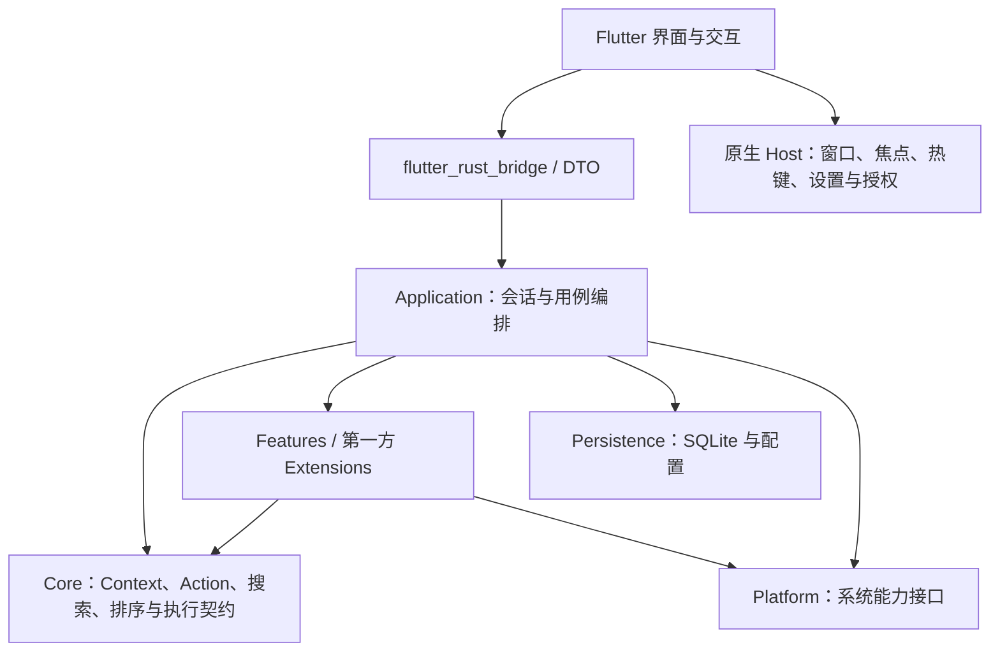

# Anywhere

**从当前操作出发的桌面 Launcher。** Anywhere 读取前台应用、选中文本、文件或网页等上下文，推荐可执行的动作；也可以搜索应用、动作、文件和收藏目录。

例如：在 Finder 中打开项目目录后唤醒 Anywhere，可以打开终端、复制路径、查看 Git 状态或运行项目测试。复制一段 JSON 后唤醒，可以直接格式化并复制结果。

当前处于 **V0.9 开发阶段**，主要支持 macOS。界面使用 Flutter，业务逻辑使用 Rust；Windows 尚未交付可用版本。

[使用指南](#使用指南) · [架构设计](#架构设计) · [构建与开发](#构建与开发) · [文档导航](docs/README.md) · [路线图](docs/roadmap.md)

## 使用指南

### 1. 启动与授权

打开 `Anywhere.app`。首次启动会显示 Launcher，之后通过快捷键或菜单栏打开；菜单栏还提供 Settings 和 Running Tasks。

部分能力需要系统授权，可根据使用场景开启：

| 权限 | 用途 | 设置入口 |
|---|---|---|
| 辅助功能（Accessibility） | 读取与执行应用菜单、读取选中文本、识别支持的 IDE 项目窗口 | macOS 系统设置 → 隐私与安全性 → 辅助功能 |
| 自动化（Automation） | 读取 Finder 目录 / 选中项，以及 Safari、Chrome、Edge 的当前网页 | macOS 系统设置 → 隐私与安全性 → 自动化 |
| 目录访问 | 搜索用户指定的目录 | Anywhere Settings → Search |
| 完全磁盘访问（可选） | 扩大受保护目录的可访问范围 | macOS 系统设置 → 隐私与安全性 → 完全磁盘访问 |

文件搜索在启动和修改搜索范围时准备目录授权，查询只使用可访问的范围。受保护或无法读取的位置会跳过；完全磁盘访问需要用户在系统设置中开启。

未授权的来源不会阻止其他功能。例如，缺少辅助功能权限时隐藏应用菜单，仍可使用不依赖该权限的动作。在 Settings → Context 查看上次采集状态，并独立开关各个来源。

### 2. 三种操作方式

| 方式 | 如何进入 | 用途 |
|---|---|---|
| **Current App** | 默认按 `⌘⌥Space` | 操作当前环境，搜索应用菜单及适用的目录、Git、开发项目等动作 |
| **Global Search** | 默认按 `⌘⌥⇧Space`，或通过搜索图标菜单切换 | 搜索应用、动作和收藏目录，查找 File Search 等工具入口 |
| **内容输入** | Current App 唤醒时自动填入可识别的选中文本或新复制内容 | 操作这份内容，例如复制 URL、格式化 JSON、打开路径 |

Current App 聚合当前环境的所有可用动作。顶部的 **Folder、Git、Rust 等 Scope** 用于缩小动作范围；切换 Scope 保留查询。菜单保留在当前应用中，可通过 **Browse Menus…** 按层级浏览，也可直接搜索菜单名称。

内容输入的优先级是：

1. 当前应用中能解析为 URL、JSON、真实文件 / 目录等具体 Context 的选中文本。
2. 距今不超过 **15 秒**、复制时间可确认，且能解析为具体 Context 的剪贴板内容。
3. 普通文本、无效对象或没有可用内容时，进入 Current App。

输入框会显示内容来源，只解析该内容，不混入前台应用的环境 Context。启动前已有、无法确认复制时间的剪贴板内容不会自动填入。

内容输入时按 `Esc` 清空内容并返回 Current App，再按 `Esc` 进入空白 Global Search。更多规则见 [Context 输入与导航](docs/context-input-navigation.md)。

### 3. 键盘操作

以下为 macOS 默认键位。两个唤醒快捷键和 Action 快捷键都可以在 Settings → Shortcuts 修改。

| 按键 | 操作 |
|---|---|
| `⌘⌥Space` | 唤醒 Current App |
| `⌘⌥⇧Space` | 唤醒 Global Search |
| `↑` / `↓` | 选择候选项 |
| `Enter` | 执行动作、打开对象或进入子菜单 |
| `⌘K` | 打开选中对象的二级 Actions；支持菜单浏览时也可进入菜单 |
| `Ctrl+Tab` / `Ctrl+Shift+Tab` | 切换 Scope；文件搜索中切换文件类型 |
| `→` / `←` | 输入为空时进入 / 返回菜单；有输入时保留光标移动 |
| `Esc` | 清空查询、返回上一级或关闭窗口，具体顺序取决于当前页面 |
| `⌘W` / `⌘M` | 关闭 / 最小化 Settings、Running Tasks 独立窗口 |

Launcher 不使用单独的 `Tab` / `Shift+Tab` 遍历控件。重复当前唤醒入口可隐藏窗口，点击其他窗口也会隐藏。

**隐藏后的状态恢复：**

- 有查询、文件搜索页、菜单 / 二级操作、执行输出或已选的非 Current App Scope 时，保留操作状态 **15 秒**。
- 空白 Global Search 或 Current App 首页再次唤醒，按本次入口重新采集前台应用。
- 超过 15 秒清理 Launcher 会话。已经启动的后台任务继续运行。

详见 [Launcher 交互与状态保留](docs/launcher-interaction.md)。

### 4. 常用场景

| 场景 | 操作示例 |
|---|---|
| 启动应用 | Global Search 输入应用名，例如 `chrome`，选择后按 Enter |
| 当前应用菜单 | Current App 输入菜单名称，或进入 Browse Menus… |
| Finder 目录 / 文件 | 唤醒后选择 Open Terminal Here、Copy Path、Open Directory 或 Open File |
| Git 仓库 | 搜索 Git Status、Git Diff、Git Log、Git Staged Diff、Git Branches |
| 复制 Git 信息 | Copy Branch Name、Copy Commit Hash、Copy Short Commit Hash、Copy Repository Path、Copy Remote URL |
| 网页 / URL | 在支持的浏览器唤醒，或输入完整 HTTP(S) URL，选择打开或复制 |
| JSON | 输入或复制 JSON，选择 Format JSON、Minify JSON、Copy Formatted JSON |
| 收藏目录 | 目录 Context 中执行 Save Directory；Global Search 按名称、`saved` 或 `bookmark` 查找 |

选中收藏目录后按 `⌘K` → **Forget Saved Directory** 可移除收藏，不删除磁盘目录。当前最多保存 100 个目录。

相同目标的动作会合并来源；剪贴板已包含相同 URL 或路径时，对应复制动作隐藏。不同目标仍保留来源标注。

路径需要真实存在，支持绝对路径、`~` / `~/…` 和中文全角 `～/…`，主目录简写会展开为实际路径。文件名中的空格与波浪号保留；不展开 `~其他用户`、环境变量或 shell 表达式，也不把裸域名自动推断为 URL。IDEA 项目目录识别需要窗口暴露明确路径；VS Code、Cursor / ChatGPT 对话项目目录尚未接入。

### 5. 文件搜索

1. 打开 Global Search，输入 `files`、`File Search` 或“文件搜索”。
2. 选择 **File Search**，按 Enter 进入文件页面。
3. 输入至少一个字符，搜索文件名或路径；用类型栏筛选文件、文件夹、文档、PDF、图片、音频、视频、压缩包和代码等类型。
4. 用 `↑` / `↓` 选择。右侧固定预览跟随选择，Enter 打开，`⌘K` 查看对象操作。

文件页沿用主窗口的搜索栏、候选列表和底栏。结果连续追加，已显示的行不会因后续命中反复重排，没有分页操作。`Esc` 先清空文件查询，再返回父页面；返回按钮直接返回父页面。

在 Settings → Search 可以：

- 开关文件搜索，设置搜索目录（每行一个绝对路径，留空使用 Home）。
- 开关隐藏文件；新配置默认包含隐藏文件。
- 按目录名配置排除项，例如 `node_modules`。排除会缩小搜索范围。
- 为保存的搜索目录授权，按需要打开完全磁盘访问设置。

搜索结合 **Spotlight 快速结果与完整文件名遍历**，无需安装 `rg`。遍历包含未索引文件和被 `.gitignore` 忽略的文件；隐藏文件受设置控制。符号链接本身可列出，不沿链接继续遍历目标。可搜索范围受目录设置、排除项和系统权限限制。

当前预览提供元数据与有界文本读取，文本最多 64 KiB；PDF、图片、音视频等尚无完整富预览。候选图标按文件类型分类，不生成逐文件缩略图。

可为 File Search 配置一个普通 Action 快捷键，并按需开启 Global，直接从其他应用进入文件页。

### 6. 开发项目与后台任务

目录 Context 会进一步识别项目类型，提供相应动作：

| 项目 | 动作 |
|---|---|
| Rust / Cargo | Cargo Check、Cargo Test、按明确 package / binary 目标运行 |
| Maven | Maven Test、Maven Package |
| Gradle | Gradle Build、Gradle Test |
| Node | `package.json` 声明的 scripts，按项目配置选择 npm / pnpm / yarn |
| Spring Boot | 项目声明支持时提供 Maven / Gradle Run |

Maven、Gradle 优先使用项目 wrapper。识别阶段只读取项目标记及必要元数据；真正启动命令发生在执行 Action 时。

构建、测试和运行进入后台进程会话。通过菜单栏 **Running Tasks** 查看状态、stdout / stderr、退出码或停止任务。关闭 Launcher / 任务窗口不停止任务；退出 Anywhere 会停止任务。

当前会话只在应用运行期间保留，尚不提供交互式 PTY 终端或应用重启后的任务恢复。

### 7. 自定义快捷键与扩展

**快捷键：** Settings → Shortcuts → Action shortcuts 支持固定动作绑定、Global 开关、按应用 / Context 分派的意图，以及配置导入 / 导出。触发时重新解析适用对象：一个目标直接执行，多个目标先选择，缺少 Context 时不执行。

动态应用菜单的原快捷键用于显示提示，当前不支持长期自定义绑定；菜单也暂不记录使用频次，避免不稳定菜单身份关联旧记录。

**扩展：** Settings → Extensions 管理第一方模块及已安装的声明式插件。

- 第一方模块包括 JSON、URL、Git、Maven、Gradle、Node、Rust、Spring Boot、收藏目录。
- 用户插件放入 `~/Library/Application Support/Anywhere/plugins/`，支持 `*.toml` 或子目录中的 `manifest.toml`；安装或修改后点击 **Reload**。
- v2 / v3 插件先 **Review permissions → Allow & enable**。撤销权限或关闭模块后，相关候选与快捷键失效；绑定配置保留以便重新启用。
- 外部 v2 插件支持声明式复制、打开 URL / 文件；v3 首先增加 Host 渲染的 Detail / KeyValue，只展示有界纯文本。插件仍不执行用户脚本。

示例：[v1 搜索插件](plugins/examples/search.toml)、[v2 复制插件](plugins/examples/copy-v2.toml)、[v3 Detail 插件](plugins/examples/context-detail.toml)。搜索示例中的 `example.com` 是占位地址，需要自行配置；应用不自动安装 Web Search 插件。

### 8. 本地数据

macOS 数据目录：`~/Library/Application Support/Anywhere/`。

| 文件 / 目录 | 内容 |
|---|---|
| `settings.json` | 唤醒键、Action 快捷键、来源开关及搜索设置 |
| `usage.sqlite3` | 动作 ID、Context 类型、来源应用、成功执行次数与时间 |
| `extensions.json` | 模块开关和插件能力授权 |
| `extension-storage.sqlite3` | 按模块隔离的持久数据，例如主动收藏的目录路径 |
| `plugins/` | 用户安装的声明式插件 |
| `launcher.log` | 运行诊断和耗时日志，每次启动覆盖 |

Usage 不保存输入正文或文件路径。Context 正文属于临时会话；文件搜索命中存入查询临时文件，切换查询或会话清理时释放，不维护长期文件索引。

## 架构设计

### 1. 分层与职责



| 层 | 负责的内容 |
|---|---|
| **Flutter Host** | 页面、键盘 / 鼠标交互、焦点、查询草稿、选择与返回位置、设置展示、图标缓存 |
| **Rust Application** | 激活、Context 采集协调、查询更新、快照发布、动作执行、扩展生命周期 |
| **Rust Core** | 平台无关的模型与算法：Context Graph、匹配、Ranking、Scope、执行资格与存储契约 |
| **Features / Extensions** | 应用发现、文件工具，以及 JSON、Git、项目识别等具体领域能力 |
| **Platform Adapter** | 应用 / 系统上下文读取、系统搜索、打开文件 / URL、剪贴板、进程等 OS 能力 |
| **macOS Native Host** | Swift / AppKit 窗口、玻璃材质、系统热键、权限和生命周期适配 |

Flutter 不重新识别 Context、匹配动作或计算排序。Swift Host 不解析业务输入或执行项目动作。`core/` 不依赖 Flutter，也不导入 `application/`、`features/`、`extensions/`、`persistence/`；装配集中在 Application。

业务 API 通过 FRB 调用 Rust；窗口、热键和目录授权等 Host 服务通过平台无关的 `DesktopHost` / MethodChannel 接口调用。

### 2. 核心概念

| 概念 | 含义 |
|---|---|
| **Context** | 被操作的数据或环境，例如目录、URL、JSON、Git 仓库；带来源与派生关系 |
| **ContextProvider** | 从已有 Context 轻量识别并产生新的 Context，不启动构建任务 |
| **Action / ActionBundle** | 动作定义及其适用类型、别名、可用性、执行 Handler |
| **Candidate** | 当前查询中可选择的一行，绑定具体执行对象；与可持久保存的业务 ActionId 分开 |
| **CandidateSource** | 提供候选的统一接口，同步来源和异步来源共用查询与生命周期约束 |
| **Scope** | 可见动作的搜索范围；Current App 聚合环境动作，其他 Scope 筛选领域 |
| **Ranking** | 综合查询匹配、来源、优先级和成功执行历史排序 |
| **ExecutionSession** | 已启动后台进程的生命周期，独立于 Launcher 的查询与显示状态 |

Context 决定“对什么执行、哪些动作适用”，Scope 决定“当前搜索哪些动作”。一个目录可以派生 Git 与 Node Context，也能同时产生多个 Scope 下的动作。

### 3. 从唤醒到执行

```text
唤醒请求
  → 预留 Session，冻结前台应用身份
  → 读取目录、选中项、选中文本、浏览器 URL、剪贴板等来源
  → InputMode 决定本次使用环境 Context 还是输入 Context
  → ContextProvider / Context Graph 轻量识别与派生
  → Action + CandidateSource 产生候选
  → Scope 过滤与 Ranking
  → 提交不可变快照，Flutter 渲染
  → 用户选择后复验资格，执行 Action
  → 成功时记录 Usage，长任务进入 ExecutionSessionManager
```

原应用身份在 Launcher 显示前冻结，避免窗口抢焦点后采集到 Anywhere 自己。来源异步完成时补充快照；采集失效安全跳过，不猜测另一个应用的对象。

并发状态由不同版本共同约束：

- **SessionId**：区分激活会话。
- **Revision**：区分查询输入。
- **SnapshotSeq**：区分同一输入的后续更新。
- **Catalog / Execution epoch**：使动作重载或隐藏前的旧执行凭据失效。
- **Host generation**：拒绝过期的窗口显示 / 隐藏回调。

快照在锁内复制输入，在锁外匹配与排序，发布时复验版本。执行时只接受已提交、仍有效的候选；后台 worker 开始副作用前再次检查。隐藏撤销待执行资格，已启动进程继续由会话管理器持有。

### 4. 搜索、扩展与资源管理

**搜索：** 应用、动作和收藏目录进入统一候选体系；文件搜索作为 Action 打开独立查询工作区，复用 Launcher 界面及对象操作。Spotlight 提供早期结果，完整遍历补充命中；查询临时存储保存结果，Host 按批次读取。取消、去重、类型过滤与稳定追加由 Rust 负责，Flutter 使用虚拟列表及共享数据块显示。

**扩展：** 第一方 Rust 模块通过 `FirstPartyExtension` / `FeatureContribution` 提交 Provider、ActionBundle、动态动作或 CandidateSource。Host 通过能力清单审批 `HostServices`，按模块分配 Storage；模块查询使用有界内存快照，写入采用 SQLite 事务。配置变更替换动作、Provider 和来源，撤销旧执行资格并同步快捷键。

第一方模块是编译进应用的受信任代码，静态 Trait 仍是内部接口；能力检查不等于进程沙箱，也不是稳定的第三方 Native ABI。外部 TOML 插件使用单独的受限声明式协议。

**资源：** 慢速系统读取放在 blocking worker，旧查询取消或丢弃迟到响应；图标缓存有界。文件搜索不在内存中建立长期全盘索引；文本预览和任务输出都有读取 / 保留上限。Settings 与 Launcher 共享 Flutter engine，Running Tasks 的窗口 engine 按需创建。macOS 保留 Impeller，材质根据系统能力降级。

### 5. 代码地图与扩展入口

```text
apps/flutter/
├── lib/launcher/       UI 编排、激活、导航、状态恢复、快捷键与文件工作区
├── lib/settings/       设置草稿、快捷键配置、扩展状态与授权界面
├── lib/ui/             共享样式、图标和组件
├── lib/infrastructure/ Host 接口、窗口与图标缓存等适配
├── lib/src/rust/       FRB 生成绑定
└── macos/Runner/       原生窗口、热键、权限、设置与菜单栏

crates/
├── anywhere-protocol/       共享模型、事件与声明式协议
├── anywhere-core/src/
│   ├── core/                算法与契约
│   ├── application/         用例、会话、装配与快照发布
│   ├── features/            基础产品能力及兼容导出
│   ├── extensions/          第一方领域模块
│   └── persistence/         历史、扩展配置及隔离存储
├── anywhere-platform/       OS 接口、适配器与进程 / 文件搜索实现
├── anywhere-plugin/         Manifest 发现、验证及模板处理
└── anywhere-bridge-flutter/ FRB API、初始化与 DTO 转换

extensions/             第一方模块 Manifest
plugins/examples/       外部声明式插件示例
resources/              键码、文件类型和运行策略的共享配置
scripts/                构建、打包、生成与架构检查
```

新增能力通常从相应契约接入：

- 新 Context 类型：定义模型，实现 ContextProvider，加入模块贡献。
- 新动作：定义 ActionSpec / Handler，随 ActionBundle 注册。
- 新搜索来源：实现 CandidateSource 或 AsyncCandidateSource。
- 新 OS 能力：扩展 Platform 或 DesktopHost，在平台适配器实现。
- 新 Host 工具页面：通过 HostViewNavigator 注册路由，复用共享 UI 与对象导航。

业务与界面已隔离平台细节；移植 Windows 仍需补齐原生窗口、热键、权限、应用上下文、文件搜索适配与实机验收。

## 构建与开发

### 环境

- macOS 12 或以上，以及 Apple Command Line Tools。
- PATH 上的 Rust stable / Cargo。
- 与 [.flutter-version](.flutter-version) 一致的 Flutter SDK。
- Python 3，用于生成与检查脚本。
- 可复用的代码签名身份。

构建采用 Flutter assemble、swiftc 和 codesign，生成本机架构的 App，不需要 CocoaPods 或在 Xcode GUI 中打开工程。

### 本机构建

在仓库根目录执行：

```bash
source scripts/env.sh
# 首次开发时创建本机签名身份，已有身份可跳过。
scripts/setup-local-signing.sh
scripts/build-macos.sh
scripts/run-macos.sh
```

产物为 `build/Anywhere.app`。也可从 Finder 打开该 App；更新时先退出旧实例，避免同时运行多个开发包。

构建默认复用 `Anywhere Local Code Signing` 身份，避免每次构建改变签名身份。请保留该钥匙串证书；使用其他身份可设置 `ANYWHERE_CODESIGN_IDENTITY`。本机签名供本地开发使用，对外分发的签名与公证另行处理。

独立构建与打包：

```bash
ANYWHERE_APP_OUTPUT="$PWD/build/Anywhere-dev.app" scripts/build-macos.sh
scripts/package-macos.sh build/Anywhere-dev.app
```

打包生成 App 对应的 ZIP 和 SHA-256 文件，并检查版本与签名一致性。

### 检查与生成

```bash
# 完整工程检查：Native、Rust、架构规则、Flutter analyze / tests。
scripts/check.sh

# 仅运行 Rust 测试。
cargo test --workspace --locked
```

修改 FRB 公开 API 后重新生成绑定：

```bash
cargo install flutter_rust_bridge_codegen --version 2.11.1 --locked
cargo install cargo-expand --locked
scripts/generate-bridge.sh
```

已生成绑定随源码提交，普通构建不需要生成器。键码、文件类型、运行策略修改后使用对应的 `scripts/generate-*.py` 同步生成代码；完整检查包含漂移校验。

## 进一步阅读

- [架构详细说明](docs/architecture.md)：模块依赖、快照、执行与资源生命周期。
- [Context 模型](docs/context-model.md) / [菜单动作](docs/current-app-actions.md)：对象关系与身份安全边界。
- [统一 Launcher 交互与状态保留](docs/launcher-interaction.md)。
- [插件协议](docs/plugin-protocol.md) / [V0.9 MVP](docs/mvp-v0.9.md)：当前扩展实现及验收范围；[V0.8 收尾](docs/mvp-v0.8.md) 保留上一阶段证据。
- [路线图](docs/roadmap.md)：后续 Extension API、插件 UI、Web 插件与终端方向。
