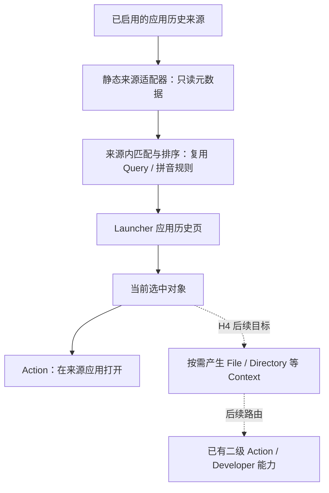

# 应用历史

状态：**V0.14 原型验证中，尚未全部收尾**。当前已有 18 个配置化来源，覆盖 IDE / 编辑器及 Obsidian 最近仓库，安装默认开关、实际接入与限制见[来源指南](application-history-sources.md)。最近笔记、多实例和对象工作流仍需逐项验证。具体分层与构建证据见 [V0.14 技术方案](mvp-v0.14.md)。

2026-10-25 用户将浏览器历史、书签与 Tab 管理调整为[后续独立浏览器功能](browser-feature.md)，不再作为 V0.14 收尾条件。本文保留部分早期研究线索，但不将浏览器能力列为本模块待实现项或已交付功能。

本模块为应用最近对象提供同一套来源适配和共享页面，不为每个 App 新建 Feature、Scope 或常驻脚本运行时；每次读取按需创建并释放有界 QuickJS 实例。浏览器模块将独立装配并复用公共交互，不依赖本模块的业务服务。

下文区分现有行为与后续目标：当前历史页仅提供来源内搜索、原应用打开、复制路径 / URI 和刷新；配置实例选择、对象 Context 及其更多操作仍是 H3 / H4 的设计目标。当前接口及限制以[来源指南](application-history-sources.md)为准。

## 1. 产品范围

| 来源类别 | 首批目标 | 对象示例 | 默认主操作 |
|---|---|---|---|
| 最近项目 / 工作区 | JetBrains 系列、Android Studio、VS Code 同类编辑器 | 文件夹、工作区文件、项目 | 用对应编辑器打开 |
| 最近文件 | VS Code 同类编辑器、Sublime Text | 普通文件、工作区文件 | 用对应编辑器打开 |
| 笔记应用 | Obsidian | 已实现最近仓库；最近笔记另做可行性验证 | 按仓库 ID 打开；笔记路由后续验收 |
| 后续来源 | 文档 / PDF / 设计应用 | 各应用明确提供的最近对象或收藏 | 由对应适配器声明打开方式 |

项目、文件、工作区和仓库保留各自类型，不将仓库列表冒充最近笔记。某来源只提供最近顺序时保留其顺序，不把配置文件的修改时间冒充每条记录的使用时间。

“支持更多应用”意味着逐个适配其真实来源和打开协议，不承诺自动读取所有软件，也不从磁盘修改时间或截图猜测使用历史。

## 2. 入口与交互

- 每个应用 / 来源提供独立 Action，例如 **IDEA 最近项目**、**VS Code 最近项目与文件**；标题与别名由来源配置声明，各自支持既有 Action 快捷键。
- 使用现有 Launcher 的二级页面、搜索框、候选行、选中态和更多操作。首页不常挂一排历史记录，保持应用 / 动作搜索的主体结构。
- 在对应 Current App 中无需输入关键词即匹配该应用的 Action；全局检索可按名称找到各独立入口。打开后固定到该来源，未配置时提示配置，不退回其他应用。保持 Current App / Global Search 的 Scope 契约。
- 页面复用主窗口搜索头与列表；不显示全部应用或跨应用切换。后续记录类别、配置实例 / Vault 的应用内筛选收进适用的更多操作，不添加一套顶层 Scope。
- 空查询显示最近对象；输入后搜索标题、路径等来源允许的元数据。匹配 / 拼音 / 排序复用现有 Rust 能力，不能让不匹配的固定记录混进结果。
- Enter 在来源应用打开本地对象，远端条目直接复制 URI；当前 ⌘K 提供复制路径 / URI 与刷新。用其他应用打开、文件位置和项目相关动作属于 H4 目标。回退与 Esc 沿已有导航规则，保留上层查询与选择。
- 列表说明只保留必要来源，如 `VS Code · 工作区`、`IDEA · 项目`、`Obsidian · 工作 Vault`。默认不加载网页、笔记正文、远程图标或新增空白预览大面板。
- 结果连续展示、可键盘浏览，不增加手动翻页按钮。后台追加不抢焦点或反复重排已显示记录；改变查询 / 筛选才重新排序。

历史页管理使用；来源启停、配置实例 / Vault、范围、访问授权和缓存控制放在设置。沿用剪贴板 / 文件工具的配置分工。

## 3. 与 Context 的关系



历史是**候选数据来源**，Context 是**当前操作对象的事实**。打开历史页不会把全部网页 / 项目 / 笔记塞进 Graph，也不在每次唤醒时遍历全部历史库。

H4 的目标是在选中对象打开更多操作时，按需构造明确的对象 Context：URL 复用 URL 动作；本机项目目录验证后可继续派生 Git / 构建能力；工作区文件不能直接当作项目根目录；远端 URI 不转成本机路径。继承本次来源授权，执行仍复验对象与资格。

历史中的“来自 IDEA”只标识该条记录的应用归属，不替换唤醒前冻结的 Current App，也不证明它就是当前正在编辑的项目。此能力与[当前窗口项目目录读取](developer-actions.md)分开。

现有 Launcher Usage 继续保持命令使用统计，不因本功能改成保存所有 URL / 路径的明文活动日志。剪贴板历史保持自身采集、存储、入口与暂停策略，不迁移进一个无界的全局历史数据库。

## 4. 最小统一模型与模块边界

设计上需要一组普通数据模型，不立即将以下字段发布为第三方协议：

```text
HistoryEntry
├─ id                         稳定对象身份
├─ sourceId / applicationId    来源适配器与应用
├─ profileId / containerId     Vault / 编辑器配置实例
├─ collection / kind           项目、工作区、文件、仓库
├─ title / subtitle            显示与检索元数据
├─ target                      类型化 URL / 本机路径 / 工作区 / 应用 URI
├─ lastUsedAt? / sourceOrder?  真实时间或来源顺序
└─ sourceRevision              本次读取快照身份
```

1. **Rust Feature**：来源注册、条目模型、过滤、去重、排序和对象 Actions。第一方适配器随 App 编译；新应用按实际需求添加配置与受限纯 JS 转换，通用读文件和执行预算由宿主管理；不引入 WebView 解析历史。
2. **Application**：设置与授权、异步查询、取消、快照提交、执行路由；复用 Session / Revision、来源失效和有界 worker 机制。
3. **来源读取适配器**：Feature 声明契约，Persistence 实现 SQLite / JSON / XML 的只读适配，Application 注入；Feature 不导入具体 Persistence。格式差异留在适配器，不向通用搜索暴露每个 App 的表名和配置键。本版不安装 Companion，本地格式不可靠的来源明确降级。
4. **Platform / Native Host**：定位已授权 App / 配置根目录、OS 文件访问、应用打开与必要的协议路由。来源身份及相对路径规则由适配配置声明，系统差异由 Platform 提供；特定类型的打开协议在 Rust 执行边界校验。
5. **Flutter**：统一页面、来源标签、筛选、授权设置和可恢复错误，不解析来源数据库、IDE 配置或决定项目类型。

外部数据库不能复用本 App 数据库的初始化入口：现有历史仓库会设置权限、创建表并执行迁移。来源读取必须另用只读连接 / 适配器，禁止对浏览器或编辑器数据运行本 App 的初始化、迁移或清理逻辑。

接入新应用只应增加来源描述、读取映射、打开规则及 fixture / 集成测试；不修改主窗口的来源分支，也不复制另一套 Ranking。适配器的最小接口按首批来源验证后固定，不先建立万能插件 API。

### 身份与打开语义

- ID 至少区分来源应用、配置实例 / Vault、集合和源条目身份；标题、列表位置和本次扫描顺序不参与身份。
- 同一文件或工作区来自不同应用 / 配置实例时保留来源；不能去重后随意选择应用。同名 Obsidian 仓库使用稳定仓库 ID 区分。
- 默认回到来源应用。精确回到编辑器配置实例 / Vault 的能力须单独验证；只能保证应用级打开时如实显示，不能静默使用默认应用并声称恢复了原配置实例。
- 本机目标执行前检查存在性和适用类型；App 不可用、记录删除、来源被禁用或查询过期时拒绝旧执行资格。未知协议不作为任意命令执行，路径用结构化参数传递。
- 多根工作区、远程 SSH / WSL / 容器 URI 保留原类型。首版可明确标为不支持，不能当成本机不存在文件或直接截取 URI 路径。

## 5. 来源可行性与技术取舍

以下是 2026-10-23 的官方文档 / 源码核对，尚未做本机数据验证。源码中的内部存储格式不等于对外稳定 API；实现时要固定已测试的版本 fixture。

### 已移出本版的浏览器研究

以下保留 2026-10-23 的研究线索，实施范围与接入方式现以[独立浏览器规划](browser-feature.md)为准；不是 V0.14 的剩余工作清单。

Chromium 源码分别维护历史数据库与书签存储；内部格式不是公开稳定协议，不能预设所有版本都可直接解析同一种 JSON。计划先验证明确版本与 Profile 的只读本地适配，未知或不可读格式明确降级，不接触 Cookie、密码或认证材料。[历史实现](https://github.com/chromium/chromium/blob/main/components/history/core/browser/history_database.cc)、[书签实现](https://github.com/chromium/chromium/blob/main/components/bookmarks/browser/bookmark_storage.cc)

官方扩展分别提供 history / bookmarks API，并要求对应权限。这是遇到本地格式不可靠时可评估的 Companion 路径，不代表外部 App 可直接调用浏览器内部 API。Chrome 与 Edge 发行版仍需分别验收，不能只凭同为 Chromium 宣称全兼容。[history](https://developer.chrome.com/docs/extensions/reference/api/history)、[bookmarks](https://developer.chrome.com/docs/extensions/reference/api/bookmarks)

SQLite 来源默认按需使用有界只读事务，不备份整份历史库；实测确需独立快照时再采用 SQLite Backup 并限制磁盘、时间与缓存寿命。Backup 不能绕过源库访问条件。不直接复制一个正被写入的数据库主文件并假定它一致，不迁移、修复或切换源库 journal 模式。[SQLite Online Backup](https://sqlite.org/backup.html)

### VS Code

官方源码保存 `history.recentlyOpenedPathsList`，区分工作区、文件夹与文件，并保留 URI / 远程信息。计划按已测版本读取共享存储，不能将所有记录简化成文件夹。打开使用经过验证的应用路由 / 官方 CLI，避免依赖用户已在 PATH 安装 `code`。[最近记录实现](https://github.com/microsoft/vscode/blob/main/src/vs/platform/workspaces/electron-main/workspacesHistoryMainService.ts)、[打开方式](https://code.visualstudio.com/docs/configure/command-line)

### IntelliJ IDEA

当前官方源码通过 `RecentProjectsManager` 持久化 `recentProjects.xml`，有路径、显示信息和最近状态。计划以只读配置适配器为主，区分不同 IDE 安装 / 版本配置；不依赖菜单是否展开，也不猜测标题中的同名项目。打开复用正式应用入口或经过验证的命令行方式。[最近项目实现](https://github.com/JetBrains/intellij-community/blob/master/platform/platform-impl/src/com/intellij/ide/RecentProjectsManagerBase.kt)、[命令行入口](https://www.jetbrains.com/help/idea/working-with-the-ide-features-from-command-line.html)

### Obsidian

官方插件 API 的 `Workspace.getLastOpenFiles()` 提供最近 10 个文件名；URI 支持定位 Vault / 笔记。API 在 Obsidian 插件环境内使用，不是外部进程接口。读取本地 workspace 元数据作为本版待验证方案；格式不可靠的版本明确不支持，不把文件修改时间当作打开时间。Companion 作为后续独立选项，不自动纳入 V0.14。[API 定义](https://github.com/obsidianmd/obsidian-api/blob/master/obsidian.d.ts)、[Obsidian URI](https://help.obsidian.md/Extending+Obsidian/Obsidian+URI)

Vault 及配置目录由用户选择或可靠来源定位。Obsidian 允许修改默认 `.obsidian` 配置目录，不能硬编码一个配置目录后宣称覆盖所有 Vault；首版只读已授权位置的最近记录元数据。[配置目录](https://help.obsidian.md/configuration-folder)

## 6. 性能、隐私与正确性

- 已安装应用的 Action 默认开启，未安装默认关闭，手动设置优先；启用来源只检测元数据位置，使用对应 Action 时才读取来源。配置实例 / Vault 需明确选择，不因已安装而自动遍历全部记录。
- 授权与路径选择在启用 / 设置阶段完成；搜索期间不突然申请权限。权限失效时该来源降级并给出恢复入口，其他来源仍可使用。
- 只读取匹配所需元数据，不爬网页、不扫描笔记正文、不解密凭据。复用的 Web SDK 不因此获得整份历史的读取权限。
- 来源只读。“在 Anywhere 隐藏”只能修改本机覆盖设置，必须与“删除来源 App 的记录”区分；首版不写回外部数据库或配置。
- 不建设全量跨应用永久索引，不常驻所有条目。小型最近列表采用有界、可失效的元数据快照；大历史库按查询有界读取，取消不提前释放仍工作的读取槽。
- 内部可使用游标批次，UI 不分页。词法 / 拼音匹配覆盖范围与读取上限必须可说明，不能先截断少量历史再声称检索了全部记录；超时、未知格式、权限拒绝和部分结果与真正空结果分开。
- 外部记录可能被清理、重命名或更新。刷新来源时使旧快照、选中对象和缓存资格失效；停用 / 撤销清理内存快照与临时文件，不能通过长期镜像保留用户已删除的浏览记录。
- 缓存预算覆盖元数据、SQLite 页、临时快照和图标；Profile 数量不能无限乘上单来源额度。首版不常驻文件监听器，先按需读取并测量，再决定是否需要监听。
- 日志不输出完整 URL、路径、书签或笔记名称。候选身份 / Usage 不应成为隐式的第二份浏览历史存储。

## 7. V0.14 的小步实施

| 工作包 | 交付 | 验收重点 |
|---|---|---|
| H1 共同框架 + IDEA / VS Code 最近项目 | 统一来源模型、每应用独立历史 Action、共享页面、来源设置和在原 App 打开 | Unicode / 空格、工作区与目录区别、App 多版本、失效路径、全键盘、取消与旧结果 |
| 原 H2：已移出 V0.14 | 历史、书签与实时 Tab 管理改为[独立浏览器阶段](browser-feature.md) | 不作为本版收尾前置，未实现 |
| H3 Obsidian 最近笔记 | 显式 Vault、本地最近元数据可行性门槛及 URI 打开 | 多 Vault、非默认配置目录、仅有顺序的记录、重命名 / 删除、不读取正文；不可靠版本明确降级 |
| H4 通用对象动作与收尾 | 当前选中对象按需解析 Context，复用复制 / 文件位置 / Git 等动作；清理与交付 | 不把全部历史变成环境 Context；不新增专属 Scope；停用不泄露旧对象；逐来源支持矩阵；更多应用后续单独排期 |

H1 已验证共同接口并扩展为 18 个配置化来源；H3 最近笔记与 H4 对象操作分别验证，不把 Obsidian 仓库支持等同于最近笔记已完成。原 H2 不再保留在本版实施路径中；详细当前边界和证据见 [V0.14 技术方案](mvp-v0.14.md)。各步先完成代码和自动化，最后集中构建与 UI 验收，使用明确的合成来源；计划本身不授权读取真实私人历史或新增系统权限。无需等第三方 ContextProvider、Terminal 或插件热加载。
