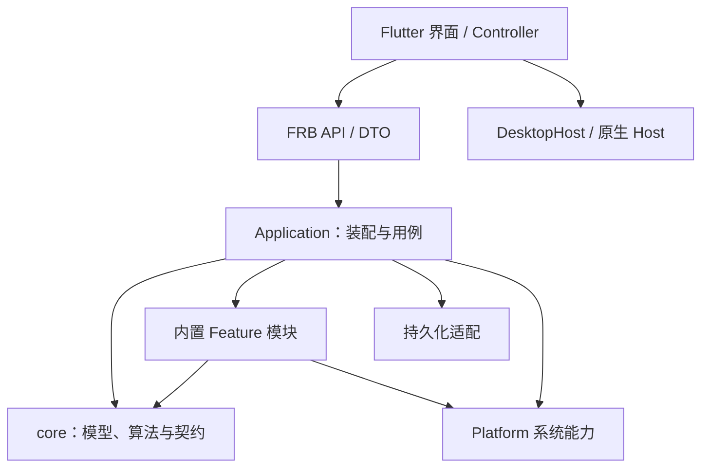

# 架构

当前实现：V0.10 剪贴板历史开发中，基于 V0.9 内置功能模块；最后核对：2026-10-17。使用入口见 [README](../README.md)，专题文档见 [文档导航](README.md)。

已确认转向内置功能模块，按 [迁移路线图](feature-module-roadmap.md) 分阶段实施。P01 集中构造与身份检查；P02 由模块自己的 registration.rs 声明功能，Cargo 编译时自动发现并生成 features/catalog 使用的目录，迁移阶段保留既有功能身份与顺序；JSON 延期后 V0.9 交付 8 个可配置内置功能，V0.10 增加 clipboard 模块。P03 将内置描述改为 Rust FeatureDescriptor，移除内置 TOML 和协议解析，状态显示统一使用 Cargo workspace 构建版本。P04 将收藏目录拆为 repository / service，FeatureServices 持有具体 service，移除 ExtensionState / Any 状态恢复。没有运行期扫描或加载。P05c 已删除旧 FirstPartyExtension / ExtensionRuntime / ExtensionManager / Reload；Native 只在启动绑定贡献，设置与业务数据刷新单独管理。

## 分层



| 层 | 职责 | 约束 |
|---|---|---|
| `anywhere-protocol` | Context 类型、展示状态、事件、声明式 Manifest | 共享传输模型，不保存 OS 对象 |
| `anywhere-core/core` | Context Graph、Action、候选、Ranking、SessionFacts、ExecutionSession、Storage 契约 | 不导入 application / 内置 Feature 模块 / persistence，不依赖 Flutter |
| `anywhere-core/application` | 激活、输入、采集协调、快照、执行、功能策略与装配 | 协调用例，不决定像素或原生窗口外观 |
| `features` | 应用、文件工具和第一方领域能力 | 用 Provider / Bundle / Source 贡献，不另建 Launcher 流程 |
| `persistence` | Usage、扩展偏好、模块存储实现 | 数据读写与锁、事务、恢复策略集中管理 |
| `anywhere-platform` | OS-neutral Trait、上下文采集、系统搜索、资源打开、剪贴板、Git 与进程后端 | 原生调用与系统差异留在适配器 |
| `anywhere-plugin` | TOML 发现、校验、模板与有界 UI 数据生成 | 不执行任意脚本或决定界面布局 |
| `anywhere-bridge-flutter` | 初始化、公共 Facade、FRB DTO 转换 | 不复制识别、排序、执行规则 |
| Flutter / Native Host | 页面、导航、输入、焦点、设置、热键、窗口与授权 | Flutter 不匹配业务动作；Swift 不解析输入或运行项目 Action |

业务调用使用 `flutter_rust_bridge`；窗口、设置、热键与目录授权使用 `DesktopHost` / MethodChannel。系统提供 `paths` 和 `capabilities`，共享界面不猜动态库路径或材质能力。跨平台契约见 [平台接入](platform-portability.md)。

## 代码组织

```text
crates/anywhere-core/src/
├── core/           模型与算法；context / action / search / ranking / session / execution
├── application/    activate、update_query、execute、session_runtime、source_runtime
├── features/       applications、filesystem、text、url、git、developer、saved_directories、clipboard
│                   编译期 catalog、FeatureDescriptor、服务绑定与策略
└── persistence/    usage、extensions、module_storage、clipboard

apps/flutter/lib/
├── launcher/       Controller、ActivationFlow、导航、Session / FileWorkspace 协调器
│                   ShortcutCoordinator、ObjectActionCoordinator、HostViewNavigator
├── tools/          静态 ToolPageRegistry、ToolPageSession、共享 ToolPageShell
├── features/       功能自己的页面、展示会话与静态注册（当前 clipboard）
├── plugins/        Legacy Detail / KeyValue 兼容 Body（纯数据）
├── settings/       设置草稿、保存队列、快捷键与扩展状态
├── ui/             AppStyle、图标与公共组件
├── infrastructure/ DesktopHost、窗口、生命周期、图标缓存与运行策略
└── src/rust/       已生成的绑定

apps/flutter/macos/Runner/  原生窗口、设置存储、热键、授权、材质与任务窗口
plugins/examples/          外部声明式插件示例
resources/                 键码、文件类型与运行策略的公共配置
```

## 激活与 Context

1. Host 收到唤醒请求，先保留前台应用焦点。
2. Flutter 同步预留 SessionId，再异步激活；首屏尚未返回也可以取消。
3. Rust 冻结前台应用身份，启动独立的上下文采集、应用目录加载与历史读取。慢速系统调用放在 blocking worker。
4. InputMode 决定种子：Environment 使用应用环境；Content / Search 只解析显式输入；FileSearch 使用文件工作区；全局动作绑定使用 CapturedEnvironment。
5. Provider 顺序派生 Context，预算截断后后台继续；来源结果按会话资格补充。
   自动填入从同一 ProviderRegistry 的轻量规则目录读取当前启用识别器，发布锁外识别，返回前复验策略 / catalog，避免过期开关与迟到建议。
6. 提交首份快照后显示窗口，后续通过 snapshot wait / delta 发布更新。

目录采集按 Session 单飞，不能因用户输入改变而再次读取“现在的前台应用”。失效应用身份安全跳过目录；不重试到已经取得焦点的 Launcher 或另一应用。详见 [Context 模型](context-model.md) 和 [默认输入策略](context-input-navigation.md)。

## 快照、取消与执行资格

| 身份 / 版本 | 区分什么 |
|---|---|
| SessionId | 激活会话 |
| Revision | 同一会话的输入 / 查询模式变更 |
| SnapshotSeq | 同一 Revision 的后续补充 |
| BusinessActionId | 使用记录与可持久配置中的动作 |
| ExecutionCandidateId | 已提交候选及其具体对象 |
| Catalog version / Execution epoch | 动作定义变更、隐藏与恢复后的执行资格 |
| Feature policy snapshot | 内置功能开关 / 恢复资格，请求持有同一 Arc 身份 |
| Host generation | 原生显示、隐藏与迟到回调 |

发布采用“锁内复制不可变输入和版本 → 锁外匹配 / 排序 → 锁内复验并发布”。索引、历史和 Registry 共享不可变快照；并发提交改变输入时重新计算，旧 Session / Revision 的结果直接丢弃。

执行仅接受当前已提交凭据，排队 worker 开始副作用前再次验证；进程计划生成后、spawn 前也检查版本。副作用成功后仍记 Usage，即使窗口已隐藏。菜单另有 discovery token，不能把可重扫的菜单 ActionId 当作永久身份；见 [菜单安全契约](current-app-actions.md)。

隐藏工作区的 15 秒生命周期由 LauncherSessionCoordinator 管理。Controller 在通知界面隐藏前建立保留信息；重复隐藏保持幂等，异步恢复在挂起 / 恢复等待后重查期限与策略。到期清理先取走该次保留记录，等待后核对 generation / SessionId，避免清理新会话；每次隐藏持有自己的挂起 Future，新旧到期任务各自结束。空根页唤醒仍重新采集当前应用。


隐藏撤销待执行资格。已有操作保留 15 秒，恢复使用新 epoch；空白首页按本次入口新建 Session。已启动进程由 ExecutionSessionManager 持有，不随查询或窗口隐藏终止；应用退出会结束任务。交互详见 [Launcher 契约](launcher-interaction.md)。

## Sources 与文件工作区

`SourceCatalog` 原子持有基础和扩展的 `SourceSet`，同步 / 异步来源具有统一目录寿命。通用 `source_runtime` 负责 admission、取消、批次和迟到结果拒绝；`file_workspace` 负责文件类型、冻结、追加和进度。

普通应用 / Action / 收藏目录共用 Candidate 与公共 Ranking Facts、Usage、时钟。文件工具作为普通 Action 打开，结果有专门的稳定顺序与连续读取，不进入环境 Context Scope。

Spotlight 返回早期候选，Rust 完整遍历允许范围；查询临时存储保存命中并外部排序，已显示前缀保持稳定。对象二级动作按选中目标延迟生成，复验原执行对象。Host 接收 replacement、append 或 metadata delta，不重新匹配文件。

Flutter 的 `StableList` 共享 256 条不可变块，索引按块复用，仅为访问到的候选包装行；Revision 或 list version 改变时拒绝无效尾部。完整契约见 [文件搜索](file-search.md)。

## 剪贴板功能模块

| 位置 | 职责 |
|---|---|
| `features/clipboard/{history,service,content}.rs` | 存储契约、采集与执行资格、元数据及有界预览 |
| `persistence/clipboard.rs` | SQLite 事务、迁移、配额、去重和摘要 / 原始数据读取；不生成预览 |
| `anywhere-platform/clipboard` | clipboard-rs 格式读写和监听；macOS 薄适配提供权限、代数与大小检查 |
| Flutter `features/clipboard/` | 两个界面的静态注册、查询 / 选择 / 焦点、共享列表与预览 |
| Flutter `infrastructure/clipboard_*_backend.dart` | 类型化 Bridge 适配；使用和配置接口分离 |
| Flutter `settings/clipboard_*` | 采集、清空、自动填入配置及异步保存协调 |
| Native `ToolWindowController` | 悬浮窗置顶、生命周期和返回目标应用焦点 |

剪贴板历史作为编译内 `clipboard` 模块贡献普通 Action，通过 `NativeTool` 路由到统一 `ToolPageRegistry`。`HistoryRepository` 声明存储契约，独立 SQLite 实现负责有界落盘与摘要查询；`HistoryService` 控制开关、采集代数、去重写入和清理期间的 epoch。系统读取在业务锁外完成，写入前复验 epoch。Platform 使用 clipboard-rs 统一格式读写与变化监听；macOS 薄适配仅提供代数、权限和大小检查。一次复制的多种表示以 SQLite BLOB 保存，指纹去重并复验实际内容；旧纯文本 schema 事务迁移且保留 ID。缩略图解码在 Rust 生成并限制尺寸和分配，Flutter 只接收单条有界预览。正文不进入通用 Context / Usage，Host 不持有全部历史正文。Flutter 仅管理查询、选择与单条预览，并拒绝过期响应。独立悬浮窗由另一个普通 Action 路由到 `ToolWindowRegistration`，原生 `ToolWindowController` 只负责置顶、生命周期和返回目标应用焦点。窗口按需创建独立 Flutter engine，调用共享 Rust Application 的同一 HistoryService，不重新初始化存储或开启采集；界面复用 ClipboardHistorySession / Page / Preview。窗口关闭销毁其 engine，最小化暂停摘要刷新；Launcher 的 15 秒保留规则不会关闭该窗口。采集开关、清空和唤醒自动填入统一位于 Settings → Clipboard，使用页后端仅暴露查询、详情、复制和单条删除；独立设置后端通过轻量状态 DTO 读取状态，不查询历史列表。设置关闭等待变更和读回完成。完整范围见 [V0.10 MVP](mvp-v0.10.md)。

剪贴板界面通过功能目录内的 `registration.dart` 贡献页面 / 窗口工厂，`builtin_tool_pages.dart` 仅负责组合；Launcher 不判断剪贴板业务 ID。测试夹具位于 `test/support`，测试入口不互相导入。

每个展示会话只允许一个详情请求，快速选择合并为最新目标；Rust 服务在读取正文之前串行准入，防止多个窗口并发解码。解码不持有存储 / 策略锁，完成后复验 epoch 与条目是否仍存在。文本在复制到临时预览之前截断，避免对整个大正文再分配一份内存。

后台刷新在提交结果时保留最新选中 ID，增加其他条目不重新解码当前正文。临时查询失败保留已有结果，后续成功自动清除提示；查询变化、禁用、删除后返回的旧预览不会覆盖当前选择。整理结论与测试证据见 [V0.10 MVP](mvp-v0.10.md)。

## 第一方模块与持久化

`BuiltinFeature` 通过 FeatureContribution 提交 Provider / Bundle / Factory，启动时通过 FeatureBindings 接入已绑定的类型化服务动作与来源。BuiltinCatalog 保存编译内目录，不保留重建模块的工厂 / 生命周期；编译期目录构造器只用于启动与测试。第二次装配同一 Application 被拒绝。内部 Trait 不是第三方 Native ABI 或进程沙箱。

SettingsService 协调独立 FeatureSettings 与 LegacyPluginSettings，持久化成功后发布贡献选择，推进执行资格并取消旧会话；源码与 Handler / Source 不重新绑定。FeatureServices 持有具体 SavedDirectoriesService；数据 Refresh 更新其 repository / cache，坏 DB 替换后使用同一 service 接入新绑定，不让旧 action 通过脱离当前数据的句柄写入。SQLite IMMEDIATE 事务继续合并最新已提交数据；失败不覆盖坏数据，查询不持有磁盘事务锁。

旧声明式插件仅启动发现 / 注册。新批准或未在启动可读的批准修复需要重启激活，开关和撤销即时过滤已装载定义。Refresh 复验已有定义，不发现新增插件；变更 / 移动后停止旧动作，重启后重新审查。外部来源有明确 plugin:<id> 贡献归属与独立选择，Native 恢复模式不会误关闭其他批准。对应 DTO 暂保留兼容名称，界面使用 Features / Refresh。

P05a 将设置分为 `FeaturePreferences` / `features.json` 与 `PluginPreferences` / `extensions.json`。首次启动从旧 `first-party:<id>` 禁用键生成新文件，旧键和批准仍保留在旧文件；有效的新文件是原生开关的唯一依据。创建迁移文件禁止覆盖已有目标，多实例启动遇到已创建文件会读取现有内容。有效未知功能 ID 保留，模块重新引入时继续应用其开关。

FeaturePolicySnapshot 是不可变 Arc，只有内置配置或恢复资格改变时推进 generation；外部批准 / 普通 Refresh 不推进该 generation。P05b 在注册时显式记录贡献归属，基础文件 / 文本贡献不属于可关闭模块；动态动作继承 Factory 归属，快捷键读取同一有效注册表，配置边界过滤 Provider / Actions / Sources。恢复旧注册表也须经过当前策略过滤。

Application 在会话发布边界安装与 SettingsService 相同的策略 Arc，保存失败保留旧快照 / 候选 / 会话。请求捕获策略身份，Core 的通用 ExecutionGuard 不导入产品策略；快照提交和执行也复验，避免不同 SettingsService 的相同 generation 误当作同一配置。变化取消旧策略下整个会话的异步等待，Graph 不折叠迟到结果、隐藏恢复不继承旧候选。排队的 Git / Developer blocking worker 开始前检查资格；已经开始的 OS I/O 不强制中断，工作者继续负责自己的资源 / admission 清理。已启动执行任务独立运行。P06 已将自动填入接到同目录的轻量 InputRecognizer；P05c 已退役目录重建框架。

两类设置分别进入只读恢复，不覆盖损坏或未知 schema 文件；有效内置配置不因外部配置损坏而关闭，外部配置也可在内置配置损坏时单独修改。若新文件尚不存在且旧配置不可读，无法可靠迁移旧开关，内置功能同样只读关闭。基础 Launcher / 设置继续可用。写入前复验对应文件，已损坏、移除或与所读配置不同则拒绝该修改并要求 Refresh；每次操作只写其中一个文件，失败不发布新目录 / 策略。该复验不构成对任意外部编辑器的文件事务锁。

配置操作无论成功还是失败，都重新校验快捷键资格；不确定资格时注销按键。修复后 Refresh 恢复设置 / 数据；未启动装载的外部定义需重启激活。协议见 [扩展与插件](plugin-protocol.md)。

## 原生工具页与旧 UI 协议兼容

外部 v3 Manifest 的 render_detail 使用 Protocol `ui::DetailView`；Plugin 负责 schema、模板与展开后的内容预算，Core 在普通执行 worker 内先检查 ui.render grant 后生成 `HostView::PluginDetail`。原 Session / Revision / catalog 校验与 Usage 路径不另建副本。

Bridge 将内容转成 typed `PluginDetailDto`，不将 UI JSON 塞进 output_text。HostViewNavigator 接收已校验执行结果；P07 的静态 ToolPageRegistry 选择具体会话与原生 Body，ToolPageShell 管理共享布局 / 返回 / 焦点。Flutter Legacy Body 只渲染字段和纯文本，不匹配 Context 或重做插值。Launcher 保留底层查询 / Scope / 选中项，返回仅关闭视图；隐藏仍使用统一 15 秒生命周期。未知版本 / 超限在进入 UI 前失败。能力批准绑定完整定义，变更 / 撤销沿设置策略发布失效旧会话。

## Native Tools 与操作

ToolPageRegistry 选择编译内 Flutter 会话，ToolPageShell 统一布局、返回、焦点和 IME。当前实际页面为内部文本结果与旧 Detail 兼容视图，Launcher 不包含领域页面分支。NativeTool 保留普通页面 ID / 输入的类型化路由契约，未知或歧义路由拒绝打开；它不是第三方 UI DSL。`features/tools.rs` 的工具 EntrySource 复用普通 Action 搜索，不依赖文件领域。

## 扩展入口与验证

- 新 Context：定义类型和值，实现 ContextProvider 并贡献注册。
- 新 Action：ActionSpec / Handler / Bundle；执行能力与绑定资格显式声明。
- 新来源：CandidateSource / AsyncCandidateSource；沿用 Ranking 和生命周期。
- 新工具页面：HostViewNavigator 注册路由，复用导航、共享 UI 和对象 Actions。
- 新系统能力：扩展 Platform / DesktopHost，实现各平台适配器。

`scripts/check-architecture.py` 检查 Cargo 依赖及 core 模块反向导入；行为由公开 Facade、平台和 Widget 回归覆盖。完整门禁是 `scripts/check.sh`。自动化通过不代替真实键盘、权限、窗口、升级及 Windows 验收；当前记录见 [V0.9 MVP](mvp-v0.9.md)。


### 延期的 JSON 工具

JSON 改在未来 WebView 插件机制完成后实现。当前已移除原生工作区、内置 Provider / Actions / 注册入口、Flutter 页面和专用桥接操作；仅供该工具使用的 FeatureOperation / worker 框架同时移除，避免零业务消费者的执行体系常驻 Core。通用页面注册 / Shell、结果导航、会话 / 策略 / 执行 epoch 与既有 worker admission 继续服务现有业务。

`json.document` / `core.json` 的 matcher 归一、ContextValue 数据类型与旧 Usage 迁移保留兼容；旧 `core.json.*` 动作 ID 不分配给其他动作。现有禁用键、快捷键配置和历史不主动删除，但无法找到当前目标的快捷键不会注册 / 执行，旧插件不能委托已退役动作。新的 Web 插件阶段再决定业务处理与 Host 的接口。

### 系统编辑菜单与输入模型

原生 Edit 菜单通过 NativeEditMenu 向当前 key window 对应的 Flutter engine 发送 anywhere/editing 编辑指令；Launcher / Settings 共用 engine，Running Tasks 使用自己的 engine。每个 engine 的 DesktopEditMenu 根据当前 Focus 调用 Flutter Actions，统一处理 Undo / Redo / Cut / Copy / Paste / Select All，文本、选区和撤销历史保存在 Flutter 编辑模型中。没有活动 Flutter 窗口时原生菜单不转发，无焦点 / 未知指令不会修改输入。业务处理继续由 Rust 执行。
