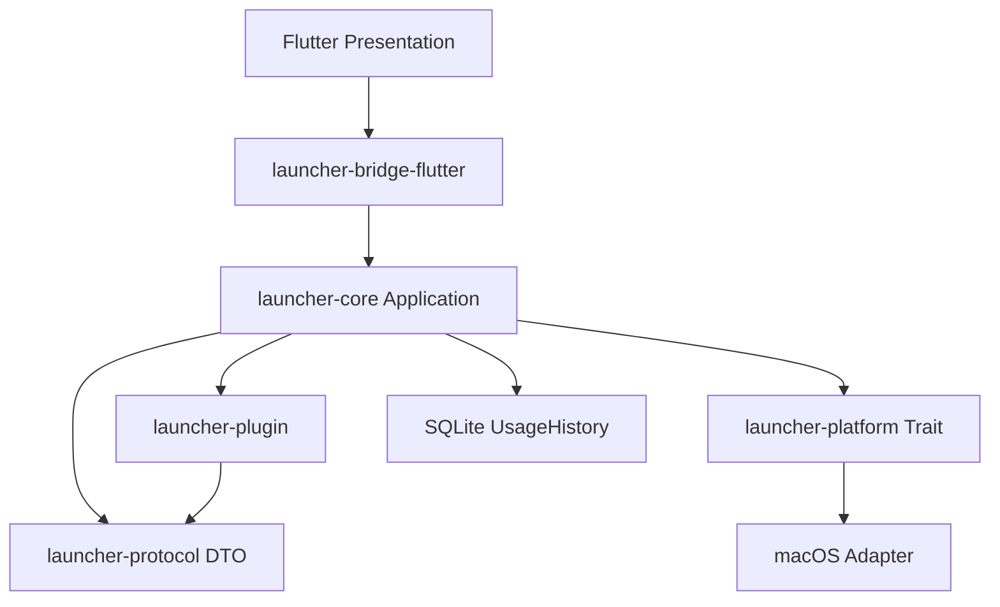

# 架构



## 边界

| 模块 | 职责 |
|---|---|
| launcher-protocol | 稳定、可序列化的 Context/Action/State/Manifest/Event DTO |
| launcher-core | Session、输入 Resolver、Context Graph、Registry、Matcher、Ranking、执行调度、UsageHistory |
| launcher-platform | OS-neutral Platform Trait，以及 macOS 的 NSWorkspace / open / osascript / pbcopy，以及 Windows 的 Shell COM / ShellExecute / Unicode Clipboard 实现 |
| launcher-plugin | TOML 发现、校验、模板展开，不执行脚本，不提供 UI |
| launcher-bridge-flutter | Facade 初始化、FRB 绑定、显式 DTO 转换 |
| apps/flutter | 仅展示完整 Rust 状态、键盘、选中 index、Focus 和窗口可见性 |

`launcher-core` **禁止依赖 launcher-bridge-flutter、Flutter、Dart、WebView、任何 UI 框架**。`scripts/check-architecture.py` 检查真实 Cargo 依赖图。macOS/Windows 原生能力实现只在 launcher-platform；Core 中没有 Objective-C、AppleScript、COM、条件编译或进程命令。

Swift Host 只创建一个承载 FlutterViewController 的窗口，注册 Carbon 热键、控制焦点和菜单栏。它不解析用户输入，不捕获上下文，不执行动作。MethodChannel 只传送窗口生命周期和基础设施目录；语义状态通过 flutter_rust_bridge 传输。

## 激活及输入时序

1. 热键到达 Swift Host，记录 monotonic clock；此时不激活 NSApp、不显示窗口。
2. Dart 调用 Rust `activate()`；Core 先递增 SessionId，使之前工作失效。
3. FrontmostApplicationProvider 通过 Platform 捕获原前台应用。
4. CurrentDirectoryProvider 通过 Platform 获取应用目录。macOS Adapter 识别 Finder，Windows Adapter 识别资源管理器及捕获的 HWND；其他应用和虚拟页面返回 None；真实权限或执行错误仍生成诊断。
5. Core 完成 enrichment、匹配和 ranking，提交完整 LauncherState。
6. Flutter 接收完整状态后调用 Host `show`，才改变前台应用。Host 显式启动隐藏窗口的引擎；ready/show 不等待隐藏窗口的绘制帧，避免启动互相等待。

每次输入变化递增 Revision。Core 在开始工作前原子发布 `(SessionId, Revision)`，在 Provider 完成后、状态提交前重复验证。过期结果返回 None，不更新状态。Flutter 同时检查 session、revision 和窗口 generation，防止桥接响应、执行结果或隐藏后的回调覆盖新界面。

非空输入仅用 UserInput Context 匹配动作和生成展示摘要；环境快照仍保留供清空输入及 source_app 历史使用。空白输入与空输入相同。该选择在 Core 中完成，UI 不按业务类型过滤动作。

Host 在窗口失去 key 或应用失活时立即隐藏，并发送携带 generation 的 dismiss。Dart 在任何 await 之前使 generation 失效、清空状态并请求 deactivate；Host 拒绝旧 generation 的 show/resize/hide。每次唤醒都是新 Session。

窗口默认宽 648、高 64；Flutter 按动作数量计算高度，每行 52，最多 7 行，额外动作滚动。总高度不超过 520，Host 应用高度时保持顶边位置。输入解析期间保留不可执行的上次已提交列表，只在新结果提交后调整高度；空结果不构建动作区，错误提示和 JSON 预览按需占用空间。macOS 的 NSVisualEffectView 提供窗口后方的原生毛玻璃；窗口和 Flutter 原生背景透明，毛玻璃 mask 与内容裁切保持相同圆角，Flutter 只叠加半透明底色和控件。交互变更见 [ADR 003](decisions/003-transient-launcher.md)。

可执行 ActionId 包含 Session/Revision；只有当前已提交列表中的 ID 才能执行。输入开始变化即清空可执行列表。执行中不持有 Session 锁，耗时 OS 调用和 SQLite 在 blocking worker 中运行。

## 执行与排序

内建和插件都进入 `CommandRegistry → type matcher → rank → execution → Platform`。插件不拥有自己的排序分支。`execute_builtin` 只能指向注册表中的内建命令，而且 matcher 必须兼容，不允许递归调用插件。

分值是确定性的：

```text
semantic: Text=100, 其他已匹配类型=400
source: UserInput=1000, ApplicationContext=300, ForegroundApplication=0
base_priority: -50..50
frequency: 2 × min(count, 20)
recency: 20 (<1h), 10 (<1d), 5 (<7d), 0
```

固定时间和历史快照下，相同输入得到相同顺序。相同分数按 command_id、context_id 稳定排序。最大历史加分不会覆盖语义优先级；非空输入时 Ambient 已被排除，不参与竞争。等价对象的显式输入保留自己的来源，避免被环境上下文吞掉。

## 异步扩展点

`ContextProvider` 支持 Immediate / AsyncLocal。Network / Ai 只保留枚举值，注册会拒绝，不实现对应能力。Core 的 `subscribe(session_id)` 提供带版本检查的事件接收器；ContextAdded、ActionsUpdated、ProviderCompleted、ProviderFailed 均有版本信息。MVP UI 使用 Facade 返回的完整状态；后续渐进 enrichment 可接入同一订阅接口，无须把规则移到 UI。

目前 enrichment 按 priority / provider_id 顺序运行。深度限制为 3、每个版本的同一 Provider/Context 最多调用一次、最多 128 个节点。扩展为并行调度前应先测量；不得删除版本校验。

## 构建

Flutter 官方的 [macOS 构建目标](https://github.com/flutter/flutter/blob/stable/packages/flutter_tools/lib/src/build_system/targets/macos.dart) 生成 Dart AOT App.framework 和 FlutterMacOS.framework，`scripts/build-macos.sh` 用 swiftc 编译窗口 Host 并装配签名应用。桥接使用 [flutter_rust_bridge](https://cjycode.com/flutter_rust_bridge/)。构建策略的环境原因见 [ADR 001](decisions/001-workspace-and-host.md)。

替换 Host UI 只需调用 Core Facade、转换 protocol DTO 并实现 Presentation；不修改 Core 领域架构。将来新增 OS Adapter 时在 Platform Trait 后实现；Windows 已添加独立 Adapter 和 Flutter runner；Linux 未实现。Windows 构建状态及适配边界见 [ADR 004](decisions/004-windows-and-renderer.md)。
