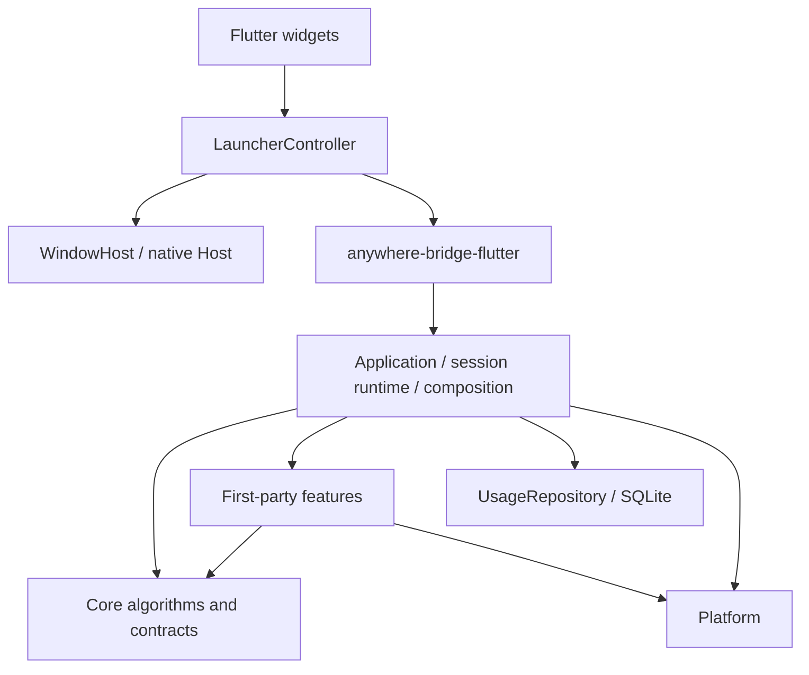

# 架构

Rust 负责上下文、搜索、排序、动作执行与历史；Flutter 负责展示和交互状态；原生 Host 负责窗口、焦点与热键。保留现有五个 crate，不为未来功能提前增加服务、运行时或协议。



## 代码组织

```text
crates/anywhere-core/src/
├── core/
│   ├── context/       ContextProvider、注册表、顺序 Context Graph
│   ├── action/        描述、Bundle、Handler 契约、匹配、可用性、声明式执行
│   ├── search/        Query、Candidate、CandidateSource、排序与 Scope 构建
│   ├── ranking/       打分、UsageRepository 契约
│   └── session/       只读 SessionFacts 与归属规则
├── application/
│   ├── composition.rs       内建动作、Provider、候选来源及种子装配
│   ├── launcher_service.rs  公共 Facade、索引与历史协调
│   ├── session_model.rs     私有会话状态
│   ├── session_runtime.rs   私有解析、预算、快照提交
│   ├── activate.rs          激活用例
│   ├── update_query.rs      输入用例
│   └── execute.rs           执行用例
├── features/          applications、filesystem、git、json、url、text
└── persistence/       SQLite UsageRepository

apps/flutter/lib/
├── main.dart                         初始化和桥接装配
├── launcher/
│   ├── launcher_controller.dart     异步生命周期、版本校验、选中项与 Scope 状态
│   ├── launcher_view_state.dart     只读展示状态、可见行和高度
│   ├── launcher_screen.dart         输入、焦点、键盘、列表、预览的组合
│   └── widgets/candidate_row.dart   候选行和图标展示
├── infrastructure/
│   ├── window_host.dart             类型化 MethodChannel
│   └── application_icon_cache.dart  有界图标缓存和过期响应处理
└── src/rust/                         FRB 生成代码和 DTO
```

`lib/launcher_screen.dart` 暂时保留为兼容导出，不承载逻辑。Session model/runtime 是 Application 的内部实现，不对桥接或测试开放可变状态。

新增 Context 通过 `ContextProvider` 和 feature 注册点加入；新增当前类型的第一方动作在 feature 中定义 `ActionSpec` 与 `ActionHandler`，随 Bundle 注册。新增候选来源实现 `CandidateSource`，由 Application 装配，沿用同一个搜索、排序、Scope 与提交路径。

`CandidateTarget` 目前只有类型明确的 `Action` 和 `LaunchApplication`；通用 Candidate 不持有具体 `IndexedApplication`。它是进程内实现，不是承诺稳定的 Extension API。出现新的执行模型时再拓展，当前没有字符串字段包或通用 Invocation 注册层。

## 边界与约束

- `anywhere-protocol`：可序列化的 Context / Action / State / Manifest / Event DTO。
- `anywhere-core`：框架契约与算法、产品用例、第一方 feature、存储适配。
- `anywhere-platform`：OS-neutral Trait 与 macOS 实现，包括应用发现路径和扫描策略。
- `anywhere-plugin`：TOML 发现、校验及模板展开，不执行脚本、不提供 UI。
- `anywhere-bridge-flutter`：Facade 初始化、FRB 入口和 DTO 转换。

`core/` 生产模块不导入 `application`、`features`、`persistence`。`scripts/check-architecture.py` 同时检查这一模块规则和 Cargo 可达依赖没有 UI/Flutter bridge；它是轻量静态护栏，行为边界仍由 Facade 测试验证。

Swift Host 不解析输入或执行动作。MethodChannel 只传窗口生命周期和基础设施目录；业务状态通过 FRB 传递。Flutter Controller 不复制 Rust 的识别、匹配和排序规则。

## 激活、输入与取消

1. Host 接到唤醒请求，暂不显示窗口，避免丢失原前台应用。
2. Flutter 调用同步 `begin_activation()` 预留 SessionId，立即使旧工作失效；随后异步调用 `activate_session(id)`。关闭时即使首屏尚未返回，也已经有 SessionId 可取消。
3. Core 在 blocking worker 捕获前台应用、Git 可用性和剪贴板；每次返回都验证 session。Git 捕获任务失败记入 diagnostics 且不写入 `git` Fact，不会再被当成 `false`。目录捕获绑定原应用并在 Session 内单飞，应用索引独立后台加载。
4. 历史读取在 `spawn_blocking` 中完成，返回 scoped/global usage 不可变快照；失败以空历史继续并记录 diagnostics，不能阻塞 async worker。
5. 顺序 Context Graph 受首份快照预算 40ms 和 pending Provider grace 400ms 控制；预算不意味着能中断已经运行的原生阻塞调用。首屏截断后后台继续解析。
6. Core 提交首份快照，Flutter 才调用 Host show。后续通过 `wait_for_snapshot` 接收更高 snapshot_seq。

版本分工：SessionId 区分唤醒；Revision 区分输入；SnapshotSeq 区分同一输入的追加快照；Host generation 防止旧窗口消息重新显示/隐藏新窗口。旧结果只丢弃，不能撤销新 session。

输入开始时发布新的 `(SessionId, Revision)` 并清空可执行候选。稳定 Candidate ID 表示业务身份，不包含会话版本；执行仍必须同时提供当前 session、revision 和已提交候选 ID。`latest_state` 只暴露仍有效的已提交快照。

提交分为“锁内取版本与不可变输入 → 锁外匹配/排序 → 锁内复验并发布”。应用目录与历史通过 Arc 快照共享。同版本另一提交先完成时重新计算，避免索引刷新覆盖 late context。执行前及 blocking worker 真正开始时分别检查版本；副作用完成后仍记录成功历史，避免失焦隐藏导致使用记录丢失。

Controller 用 hidden / activating / ready / resolving / executing 表达阶段，统一管理取消。图标请求带 epoch，旧回调不能重新填充已清空缓存或删除新请求；缓存最多保留 128 个图标。

## 当前搜索与 Scope 行为

最新交互以 [Scope / Menu 规范](scope-group-menu-design.md) 为准。Context Graph 保留对象、来源、血缘与执行节点；不直接成为 Scope。没有 Subject 对象模型或 Context 选择标题。Finder 多选采集与图插入仍保留集合血缘重映射，稳定 ContextKey 和执行目标用于 Core 数据与 Offer 归属。

Current App 是完整可见 Action 的聚合入口，包括所有领域和来源，不要求存在菜单动作；其他 Scope 来自 Action 的 group_id，只有有可见动作的 Group 才展示。Action Group 不绑定 ContextType；Disabled 保留原因，Hidden 不进入候选/Scope/目录。菜单属于 app.<bundle_id>，普通应用启动 Candidate 属于 Universal Search，不生成 Scope。应用名查询不会把全部菜单带出，应用名加动作关键词可直达具体菜单。

`LauncherState` 发布查询匹配候选、完整 Action Offer、scopes 和 selected_scope。Scope 元数据使用完整可见动作，不被查询临时删减。`update_scoped_input` 为同一 Session 发起新 Revision，保留唤醒时的系统捕获和缓存；ActionMatcher 在匹配、可用性和打分前应用 Scope 边界：捕获的 Current App ID 聚合全部 Action，其他 Scope 按 Group 硬过滤；动作原 Group、Context、ID 与 Usage key 不变。Scope 查询不运行应用索引和其他 Universal 来源；SearchEngine 在排序前对排名与兜底来源复核同一边界，排除非 Action 候选。当前应用菜单浏览从完整 Offer 中只取该应用菜单，不为层级导航增加 Revision 或 Usage。

- **入口与查询**：Current App 默认选应用 Scope，缺少动作时为 None；Universal 默认 None。同入口再按一次关闭，切入口保留查询。Ctrl+Tab / Ctrl+Shift+Tab 循环可见分组，不包含 None。Scope 激活后查询保持在该域，无匹配时 Enter 不隐式扩大范围。
- **菜单三态**：空查询最多 7 个推荐动作加 Browse Menus；输入后扁平搜索 Current App 的全部可用 Action（领域 Scope 只搜索其 Group）；Browse 根据 menu_path 的父路径生成子菜单和叶子候选。标题为叶子动作名，副标题为菜单路径。动态菜单推荐使用通用标题规则与真实历史，全部菜单始终可被搜索和浏览。
- **Host 状态**：input、scopeId、actionPath、selectedId；actionPath null 是首页、[] 是菜单根、非空是子页。输入时忽略浏览边界但保留路径，清空后恢复；Scope 切换保留 Query 并清浏览路径。Esc 清查询、返回菜单（一级返回首页）、清 Scope、关闭。左右键仅在空输入且导航适用时被使用。
- **顺序与异步更新**：Current App 内部预留首位，不为无动作应用显示空 chip；其他 Group 按实际执行的 frecency、最大动作 base_priority、稳定 group_id 初始化排序。Session 槽位冻结，迟到 Group 追加，Hidden Group 只暂时退出展示。用户移动选择后按稳定 Candidate ID 保持目标；迟到可用动作只在用户尚未操作时可使 Current App 成为默认 Scope。

执行缓存同时保留查询候选和完整 Offer，Action ID、Candidate ID、Usage key、Session/Revision 以及原生菜单复验沿原路径处理；Host 不猜执行参数。操作浏览、Scope 切换、查询都不计 Usage。旧 Revision、旧 Session、过期菜单定位继续拒绝执行。辅助权限缺失只隐藏菜单，不影响目录、Git 或应用搜索。

ActionSearch 装配 ActionMatcher、额外 CandidateSource 和 TextFallbackSource。Group 标题由 Bundle 注册；声明式 execute_builtin 只能包装已注册原生 Handler，复制 AvailabilityRule，保留自己的 ID/标题/分组/历史。Hidden 不会从文本兜底重新加入。Core 负责业务、匹配、可用性、Ranking 与 Scope 元数据；Flutter 只负责显示与菜单导航。

SessionFacts 是本次唤醒的只读快照，查询变化不重新读取剪贴板或检测 Git。已知键目前是 `clipboard`（Text）和 `git`（Flag）。规则引用未知键或类型不符会在注册时拒绝；快照写入同样校验，不能通过 `from_map` 绕过。Copy Path / Copy URL 通过同一 `hide_if(clipboard)` 规则隐藏重复复制；URL 上下文将剪贴板文本去掉首尾空白后解析为 URL 再比较，路径和普通文本仍精确比较。URL 查询参数、片段、非默认端口不同不会误判为相同。剪贴板缺失或读取失败不触发“内容重复”隐藏，读取失败写入诊断（含 Fact 名和原因，不含剪贴板正文）。Git 明确为 false 时 Disabled，原因为「Git 不可用」；捕获任务失败导致键缺失时 Disabled，原因为「无法确认 Git 是否可用」。`Enabled` 只是本次快照的展示判断，不是执行授权。

打分保持现有规则：Exact / Prefix / WordPrefix / Substring 为 4000 / 3000 / 2000 / 1000；其余打分项总和封顶 950。频次每次 8 分，最多 160；最近使用最多 30。同分按 command/bundle ID 和稳定候选 ID 排序。文本兜底使用低分带并放在真实匹配之后。

## 平台与扩展取舍

V0.4 来源的错误由平台层 `ContextReadError` 返回，不通过诊断字符串猜测权限。Core 直接使用协议的 `ContextCaptureStatus`，保留无内容、权限拒绝、控件不支持、实例变化、超时、大小限制、选中项限制和读取失败的区别；Flutter 根据安全状态元数据提示或展示设置。Finder 目录与选区使用同一有界读取路径，实例在读取前后复验，AppleScript 错误正文不进入日志。

设置页只保留上次唤醒的来源/状态/时间，不保留旧 Context 正文。可恢复的异常在 Launcher 提示，空选区和不支持的控件留在设置页，避免正常唤醒被警告淹没。权限恢复只打开系统设置，不更改授权；下一次唤醒重新采集。剪贴板只在 macOS 能明确报告拒绝时展示权限拒绝，其他不可读情况报告不可用。

应用目录由 `Platform::installed_applications` 提供，Core 只负责可搜索字段、别名和去重。macOS 从用户/系统 Applications 扫描。每次激活发起一次后台扫描，后完成的旧扫描会被丢弃；首屏不等索引，索引发布后重建当前快照。手动刷新、TTL、文件监听留待实际需求。

Provider 仍顺序执行、深度最多 3、节点最多 128，同版本 Provider/Context 去重。没有网络/AI 分类、并行 scheduler 或消息总线。

Git 检测只读元数据。执行通过类型化 Status/Log/Diff 和固定 argv，不经任意 shell；保留超时、输出上限和禁用外部 diff/fsmonitor 的规则。

后续交付顺序及架构调整时机以 [产品路线图](roadmap.md) 为准。当前 V0.4 Context 来源和 Scope / 菜单交互工程收尾已完成，真实应用及权限矩阵见 [验收记录](v0.4-context-acceptance.md)；远期能力不在本次预建。

## 构建

`.flutter-version` 是本地与 CI 共用的版本声明；`scripts/check-flutter.py` 校验 PATH 上的 SDK 并打印 framework/engine/Dart revision。`scripts/env.sh` 只配置本地 clang/swift 缓存，不注入项目内 SDK。当前版本为官方 Flutter 3.47.4。

`scripts/check.sh` 运行 Rust fmt、workspace tests、Clippy、架构检查及 Flutter analyze/tests。远端是否通过必须以实际运行记录为准。

macOS 继续使用 Flutter assemble + swiftc 的自定义 Host，生成并签名 App.framework、FlutterMacOS.framework 与 Rust 动态库。新增原生插件数量足以需要标准插件装配时，再评估 Xcode runner。macOS 显式启用 Impeller。

### Current App 原生菜单

菜单动作使用统一 Session ActionRegistry 和普通 feature handler；不可用菜单映射 Hidden，菜单与既有应用环境动作共用 Current App Scope，权限缺失只移除菜单能力。发现任务通过 generation 防止旧结果回写，执行重新校验应用实例并定位菜单。详细边界见 [Current App 菜单动作](current-app-actions.md)。
