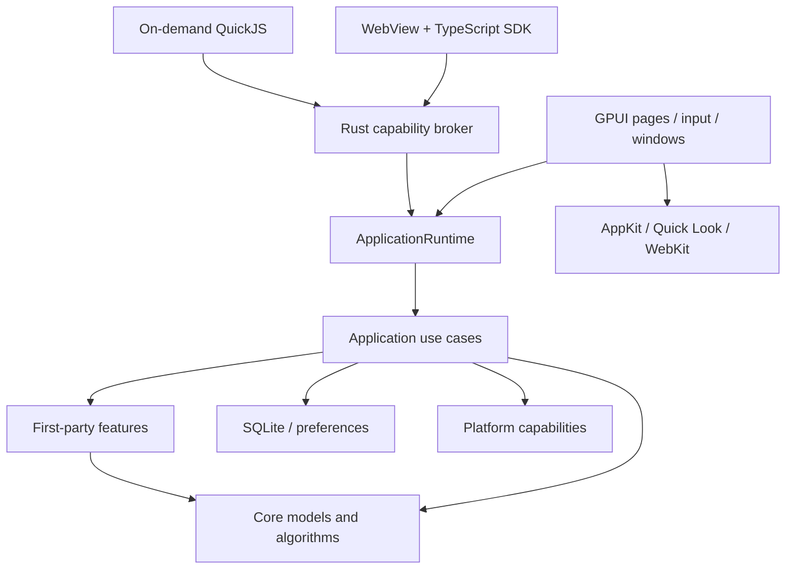

# 架构与代码地图

当前源码为 V0.14 macOS 15+ GPUI 开发预览。Rust Core 决定业务语义，GPUI
呈现并处理输入，AppKit / Quick Look / WebKit 只提供系统适配。最后核对：
2026-11-17。

产品入口是 `apps/gpui/src/app.rs`。当前范围与证据见
[GPUI 技术方案与验收](mvp-gpui.md)，窗口、焦点和输入契约见
[GPUI 产品架构](archive/gpui-migration.md)。

## 分层



| 层 | 职责 | 约束 |
| --- | --- | --- |
| `anywhere-protocol` | Context、Action、Candidate、Launcher、执行和 Web 协议模型 | 传输模型；不保存 OS 对象 |
| `anywhere-core/core` | Context Graph、候选、Ranking、SessionFacts、ExecutionSession | 不依赖 application、Feature 或平台实现 |
| `anywhere-core/application` | 激活、Context 采集、查询、快照、取消、执行和装配 | 协调用例；不决定像素或窗口外观 |
| `frontend_runtime` | Application、设置、Usage、剪贴板与 Web document 的共同所有权 | 不拥有窗口、IME 或页面导航 |
| `features` | 应用、文件、文本、URL、Git、Developer、剪贴板与应用历史 | 静态注册；通过贡献接入统一目录 |
| `persistence` | Usage、设置、历史、剪贴板、模块存储与 Web 包 | 有界读写、事务与损坏恢复 |
| `anywhere-platform` | 系统目录、前台应用、Context、文件搜索、剪贴板、资源、菜单与 Git | 窄能力接口；OS 差异留在适配器 |
| `apps/gpui` | 页面、选择、焦点、设置、窗口、状态栏、热键与 Web 文档 | 消费 Core 排序与资格；不复制业务策略 |
| `packages/plugin-sdk` | Web UI、按需后台任务和权限受限 API | 不直接取得文件或进程权限 |

外观和能力分开表达：`capabilities.backdrop` 仍兼容旧 Host 的能力探测，生产外观使用
`anywhere/appearance` 的 `DesktopAppearanceSnapshot`。每个窗口 token 绑定一个 native source；
完整快照带 revision、明暗、对比、减少透明度 / 动态、系统强调 / 焦点色和实际表面。Dart 只负责
呈现选择，macOS `AppearanceHost` / `WindowMaterial` 负责 AppKit 材质，Windows Host 后续负责
DWM。旧消息、旧文档的晚回主题和未知协议均有不透明降级。

`anywhere/memory-pressure` 只传 warning / critical 枚举。Dart 清理 ImageCache 非 live 项和
可重建编码图标；Rust 查询、15 秒会话、执行资格、Web handle 与活动 Widget 不随之销毁。
`ANYWHERE_PROFILE_UI=1` 时，既有 performance sample 增加只含数字的候选、分块、图标、
ImageCache、engine / document 和 DTO 尾部计数。

## 代码组织

```text
crates/anywhere-core/src/
├── core/            Context / Action / Candidate / Search / Ranking / Session
├── application/     activate, query, snapshot, execution, settings, Web ownership
│   └── frontend_runtime/  GPUI-facing shared service composition
├── features/        第一方能力、编译期 catalog 与策略
└── persistence/     SQLite、配置、剪贴板、应用历史与 Web 包

apps/gpui/src/
├── app.rs           产品壳、主窗口、状态栏、热键及独立 Shelf / Running Tasks 窗口
├── launcher/        Snapshot gate、页面模型、独立工具窗壳（tool_windows.rs）、图标缓存与视图（controllers/、pages/、settings/）
├── settings/        设置展示模型
├── host/            数据路径、运行时分派、快照投影、原生借用协调、偏好、热键与目录授权
├── platform/        跨平台门面与 macOS（platform/macos/、material/、preview.rs）系统边界
├── l10n/            共享本地化的 Rust 投影
└── ui/              设计 tokens 投影与 theme
```

第一方能力在启动时绑定一次；设置或外部数据刷新只更新策略和业务数据，不重建
模块生命周期。第三方包使用独立安装批准和 SDK。第三方 Context 限定为
`plugin.<package-id>.*`，脚本输出不能转换为原生文件权限。

## 启动与依赖

`apps/gpui/src/main.rs` 先验证 macOS 15+，再启动 GPUI application。
`app.rs` 先创建隐藏的 Starting 窗口和状态栏壳，随后由独立启动线程打开共享
runtime；Ready 后才注入缓存设置、偏好和热键。Starting / Failed 状态不能预留
Session 或执行动作。`app.rs` 最终创建：

- `LiveLauncher` 与 `ApplicationRuntime`；
- 主 GPUI 窗口；
- `NSStatusBar` 状态项；
- 全局热键控制器；
- 按需打开的独立 Clipboard Shelf 与 Running Tasks 窗口；
- 窗口关闭、清理和状态栏恢复路径。

`LiveLauncher` facade 位于 `apps/gpui/src/host/runtime/mod.rs`，在 blocking
runtime 上执行 Core 服务；同目录按 Launcher、Actions、Settings、Clipboard、
Application History、Tasks 和 Web 拆分请求方法。`host/runtime_support.rs`
负责启动偏好应用、目录恢复和领域快照到 GPUI DTO 的纯投影。同步设置或系统
操作不得阻塞渲染线程。产品路径由
`apps/gpui/src/host/mod.rs` 构造，默认数据目录是
`~/Library/Application Support/Anywhere`。

GPUI 内的 Session / revision / snapshot gate / stream cancellation 由
`launcher/view/live_state.rs` 持有；File Search、Clipboard、Application History、
Tasks 的页面工作态由 `launcher/model.rs`、`launcher/pages.rs` 与
`launcher/pages/tasks.rs` 持有。文件分页在 `launcher/view/controllers/file_search.rs`
复用 Launcher 快照门禁。Tasks 列表只由任务订阅发布。WebView / document / ack
状态由 `launcher/view/web_surface.rs` 持有。根视图负责
路由和跨页意图；activation / retention 位于 `view/navigation.rs`，按键与 IME
优先级位于 `view/input.rs`，Settings 草稿 / 保存 / 关闭控制器位于
`view/settings/controller.rs`。原生通道采用有界 admission；激活、恢复、分页和后续 follow
统一把完整 Launcher 快照表达为 `Arc<LauncherState>`，单次回复只投递一个结果。

## 激活与 Context

1. UI 在展示任何窗口前预留 Session。
2. Rust 冻结当前前台应用身份，启动 Context、应用目录与历史读取。
3. InputMode 决定初始种子：Environment、Content、Search 或 FileSearch。
4. Provider 派生 Context；来源读取在 blocking worker 中完成。
5. 首份快照提交后显示或更新窗口；迟到 Context 以新的
   `SnapshotSeq` 继续发布。
6. 查询变化推进 `Revision`，旧结果在发布前按 Session / revision / snapshot
   游标复验。

当前应用读取按 Session 单飞。Launcher 或其他已取得焦点的应用不会成为新的
“来源应用”。缺失某项权限时只移除对应来源，其他动作继续运行。

已安装应用目录由 `application/application_index.rs` 独立刷新。最多进行一次扫描并保留
一个待执行请求。扫描中的连续激活合并为最新请求，已有目录仍可供当前查询使用。

## 快照、取消与执行

| 身份 / 版本 | 区分什么 |
| --- | --- |
| `SessionId` | 一次激活 |
| `Revision` | 同一会话的输入或查询模式变化 |
| `SnapshotSeq` | 同一 revision 的迟到补充 |
| `BusinessActionId` | Usage 与持久配置中的动作 |
| `ExecutionCandidateId` | 已提交候选及具体目标 |
| Catalog version / execution epoch | 定义、开关或权限变化后的执行资格 |
| Host / preview generation | 窗口、Quick Look 或 Web 文档替换 |

快照流程采用“锁内复制不可变事实 → 锁外匹配 / 排序 → 锁内复验并发布”。
GPUI 的顺序门禁在 `apps/gpui/src/launcher/snapshot_gate.rs`。

执行请求在排队前冻结候选、来源应用、Session / revision、执行 epoch、功能策略
与目标 token。worker 在副作用前再次复验。执行成功即使窗口已隐藏仍记录 Usage。
隐藏窗口立即撤销待执行资格；已经启动的子进程由 ExecutionSession 独立持有。

空动作列表由 Rust 比较 Usage、最近使用、相关性和稳定 ID。关键词、文件和历史
结果保持各自契约；GPUI 只过滤当前 Scope 并限制可见行。

## 文件与预览

`features/filesystem/scan.rs` 持有查询寿命，子模块分别负责查询、范围、记录、
遍历、写入预算（`storage.rs`）、进度和分页；`result_store.rs` 维护连续外部排序。已显示前缀必须稳定，
查询切换后旧结果不能追加。

系统索引提供早期结果，完整目录遍历补充其余命中。磁盘授权在读取前复验；
文件、目录、工作区文件和远程 URI 保持不同类型。Quick Look 通过
`apps/gpui/src/platform/preview.rs` 管理 generation；关闭回调只作用于当前预览，
完成后恢复当前页面输入焦点。详见[文件搜索](file-search.md)和
[系统预览](native-preview.md)。

## 剪贴板与应用历史

剪贴板采集默认关闭。启用后，文本、图片、文件列表与可读取格式存入 SQLite；
查询、去重、配额和原始数据读取由持久化层负责。Clipboard History 是主窗口工具，
Clipboard Shelf 是独立的置顶 GPUI 窗口，两者复用同一策略与结果模型。

应用历史通过 `source.json` / `transform.js` 读取一个选定外部来源，运行有界纯
JS 转换并形成普通候选和对象动作。它与 Launcher Usage、剪贴板历史是三类独立
数据。来源执行前重新读取并核对目标；失效或歧义时拒绝打开。详见
[应用历史](application-history.md)和[来源指南](application-history-sources.md)。

## 设置与系统适配

设置草稿、已保存值和保存结果分开管理。每个操作在 blocking runtime 中执行，
成功后才更新已保存快照；失败保留可重试状态。

- 热键：`apps/gpui/src/host/hotkeys.rs`，持有真实注册状态和最近错误，注册失败恢复旧绑定；菜单提示按实际注册投影，设置页保留诊断并允许重试。
- 原生启动配置与外观更新：`apps/gpui/src/host/native_window.rs` 通过 AsyncApp 的可失败窗口更新探测借用边界，释放借用后再执行可能同步触发 resize 的 AppKit 操作，最后返回 GPUI 更新页面。嵌套事件循环中借用尚未释放时等待重试；窗口关闭或 owner 释放时取消。普通 GCD 异步入队不能作为 GPUI 借用已释放的保证。
- 目录：`apps/gpui/src/host/directory_access.rs`，使用安全范围书签。
- 登录项：`apps/gpui/src/host/login_item.rs` 对照系统状态应用保存值。系统操作失败可在通用设置独立重试，直接使用已保存的启动偏好。显式数据目录下跳过系统操作。
- 状态栏与窗口：`apps/gpui/src/platform/mod.rs` 与 `apps/gpui/src/platform/macos/`。
- Quick Look：`apps/gpui/src/platform/preview.rs`。
- Web document：`apps/gpui/src/web_tool.rs` 与 `launcher/view/`。

这些适配器的自动化只证明输入输出与清理顺序。物理权限、IME、系统批准与 WebKit
helper 行为必须按[验收矩阵](mvp-gpui.md#物理桌验矩阵)单独记录。

## Web 插件

安装时 Rust 验证 Manifest、资源、摘要和权限。批准后 WebView 只访问固定 origin
与已验证资源；页面通过受限 JSON 字符串帧 IPC 进入统一 broker。Rust 拥有文档 handle、
请求资格、预算和取消，GPUI 只挂载视图和转发生命周期事件。

替换文档会推进 generation。旧页面的资源请求、ack、状态事件或关闭回调不能影响
新文档。Web 包损坏只移除可选 Web 能力，不阻断 Launcher 启动。按需 QuickJS 使用
同一能力代理，当前仍为进程内执行；进程隔离尚未交付。

## 扩展入口

- 新 Core Context：定义类型与值，注册 Provider，并通过贡献接入策略。
- 新 Action：定义 ActionSpec / Handler / Bundle，声明执行能力与绑定资格。
- 新候选来源：实现 CandidateSource / AsyncCandidateSource，复用 Ranking 与寿命。
- 新页面：使用 typed `HostView::NativeTool` 路由，在 GPUI 页面层映射已知类型；
  未知或歧义 ID 明确拒绝。
- 新系统能力：先增加窄 Platform 接口，再由各平台适配器实现。
- 新第三方能力：统一通过 `.awplugin` Web 包、TypeScript SDK、Manifest 与权限代理接入；旧声明式 TOML 插件已下线。

## 验证

```sh
scripts/check-gpui.sh
scripts/check.sh
git diff --check
```

`check-architecture.py` 验证 Cargo 依赖与 Core 反向导入。自动化通过不代替真实
键盘、权限、窗口、Quick Look、WebView、VoiceOver、资源趋势或跨平台桌面产物。

## 本轮组织与通信约定

GPUI 工具列表采用 `uniform_list`，仅投影可见行。设置的七类表单位于
`apps/gpui/src/launcher/view/settings/`；设置决策在 controller 中，原生窗口延迟
变更经 `host/native_window.rs` 避免重入 GPUI 的窗口借用。macOS adapter 按
window、status_item、observers、activation 拆分，以原生 identifier 查找窗口。
Clipboard Shelf 与 Running Tasks 独立于主窗口，关闭会释放各自实体。

Core Launcher 状态只由 watch 发送最新不可变快照；已移除无生产消费者的旧
LauncherEvent 广播。动作结果与有限请求仍用有界通道，不缓存过期执行资格。
历史 Usage、单来源应用历史和剪贴板历史继续各自存储。

SessionCoordinator 封装 Session 锁与 execution epoch；Resolver 的准备 / 复验和
`session_runtime/publication.rs` 的快照组装分开。完整提交与文件进度快路径都在
同一组 Session / policy 锁内通过 `publish_state` 投递 watch。普通对象和应用历史
对象共用请求票据、借用 Usage 查询、动作匹配及发布复验；历史对象保留自己的
来源、路径和执行守卫。

空查询 offers、Scopes 和快捷键目录使用有界单项缓存，键包含动作注册表、Context、
Facts、Usage 与排名时钟。动态工厂包含请求版本，静态 offers 在使用时绑定回当前
Context；缓存不能授权旧执行。开发者 Project 的字符串属性仍是现有捕获元数据契约，
没有在本轮增加 Core 对 Node / Cargo 类型的反向依赖。

Finder / 浏览器固定只读脚本在串行 OSA 组件内缓存编译，外部 Apple Event 绑定
捕获的 PID；每次发送与返回均复验进程启动身份，并设置事件和解释器执行期限。
首次 OSA 编译与系统授权仍需独立桌验。资源打开统一通过 NSWorkspace，保留
选定 JetBrains 安装的显式参数交接。
