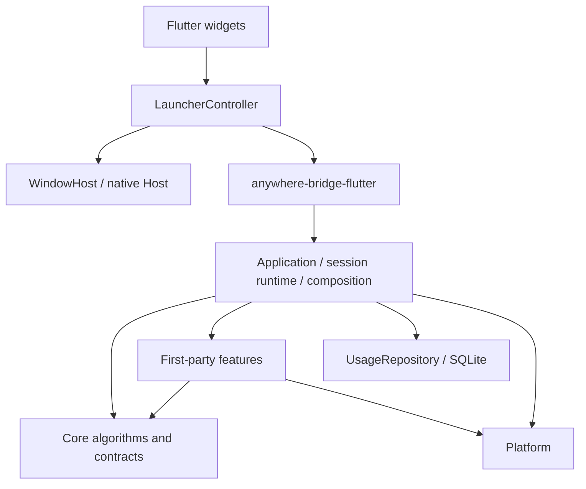

# 架构

Rust 负责上下文、搜索、排序、动作执行与历史；Flutter 负责展示和交互状态；原生 Host 负责窗口、焦点与热键。保留现有五个 crate，不为未来功能提前增加服务、运行时或协议。



## 代码组织

```text
crates/anywhere-core/src/
├── core/
│   ├── context/       ContextProvider、注册表、顺序 Context Graph
│   ├── action/        描述、Bundle、Handler 契约、匹配、可用性、声明式执行
│   ├── search/        Query、Candidate、CandidateSource、排序与 Scope 构建
│   ├── ranking/       打分、UsageRepository 契约
│   └── session/       只读 SessionFacts 与归属规则
├── application/
│   ├── composition.rs       内建动作、Provider、候选来源及种子装配
│   ├── launcher_service.rs  公共 Facade、索引与历史协调
│   ├── session_model.rs     私有会话状态
│   ├── session_runtime.rs   私有解析、预算、快照提交
│   ├── activate.rs          激活用例
│   ├── update_query.rs      输入用例
│   └── execute.rs           执行用例
├── features/          applications、filesystem、git、json、url、text
└── persistence/       SQLite UsageRepository

apps/flutter/lib/
├── main.dart                         初始化和桥接装配
├── launcher/
│   ├── launcher_controller.dart     异步生命周期、版本校验、选中项与 Scope 状态
│   ├── launcher_view_state.dart     只读展示状态、可见行和高度
│   ├── launcher_screen.dart         输入、焦点、键盘、列表、预览的组合
│   └── widgets/candidate_row.dart   候选行和图标展示
├── infrastructure/
│   ├── window_host.dart             类型化 MethodChannel
│   └── application_icon_cache.dart  有界图标缓存和过期响应处理
└── src/rust/                         FRB 生成代码和 DTO
```

设置、插件状态、来源状态与草稿关闭入口属于 `settings/settings_controller.dart`；应用退出由 `infrastructure/application_lifecycle.dart` 协调。SettingsScreen 仅依赖 SettingsController 和关闭回调。LauncherController 保留共享引擎中的页面切换及 Launcher 会话/查询状态。

原生 Host 装配 `HotKeyService`、`SettingsStore`、`LauncherWindowCoordinator` 与 `TasksWindowController`。Settings/Launcher 继续共享一个 Flutter engine，任务窗口独立且按需创建。AppDelegate 保留系统菜单、通知、generation 门禁和基础设施装配。快捷键键码/录制键/显示标签来自 `resources/hotkey-keymap.json`，`scripts/generate-keymap.py --check` 阻止 Dart/Swift 映射漂移。

`lib/launcher_screen.dart` 暂时保留为兼容导出，不承载逻辑。Session model/runtime 是 Application 的内部实现，不对桥接或测试开放可变状态。

新增 Context 通过 `ContextProvider` 和 feature 注册点加入；新增当前类型的第一方动作在 feature 中定义 `ActionSpec` 与 `ActionHandler`，随 Bundle 注册。新增候选来源实现 `CandidateSource`，由 Application 装配，沿用同一个搜索、排序、Scope 与提交路径。

`CandidateTarget` 目前只有类型明确的 `Action` 和 `LaunchApplication`；通用 Candidate 不持有具体 `IndexedApplication`。它是进程内实现，不是承诺稳定的 Extension API。出现新的执行模型时再拓展，当前没有字符串字段包或通用 Invocation 注册层。

## 边界与约束

- `anywhere-protocol`：可序列化的 Context / Action / State / Manifest / Event DTO。
- `anywhere-core`：框架契约与算法、产品用例、第一方 feature、存储适配。
- `anywhere-platform`：OS-neutral Trait 与 macOS 实现，包括应用发现路径和扫描策略。
- `anywhere-plugin`：TOML 发现、校验及模板展开，不执行脚本、不提供 UI。
- `anywhere-bridge-flutter`：Facade 初始化、FRB 入口和 DTO 转换。

`core/` 生产模块不导入 `application`、`features`、`persistence`。`scripts/check-architecture.py` 同时检查这一模块规则和 Cargo 可达依赖没有 UI/Flutter bridge；它是轻量静态护栏，行为边界仍由 Facade 测试验证。

Swift Host 不解析输入或执行动作。MethodChannel 只传窗口生命周期和基础设施目录；业务状态通过 FRB 传递。Flutter Controller 不复制 Rust 的识别、匹配和排序规则。

## 激活、输入与取消

1. Host 接到唤醒请求，暂不显示窗口，避免丢失原前台应用。
2. Flutter 调用同步 `begin_activation()` 预留 SessionId，立即使旧工作失效；随后异步调用 `activate_session(id)`。关闭时即使首屏尚未返回，也已经有 SessionId 可取消。
3. Core 在 blocking worker 捕获前台应用、Git 可用性和剪贴板；每次返回都验证 session。Git 捕获任务失败记入 diagnostics 且不写入 `git` Fact，不会再被当成 `false`。目录捕获绑定原应用并在 Session 内单飞，应用索引独立后台加载。
4. 历史读取在 `spawn_blocking` 中完成，返回 scoped/global usage 不可变快照；失败以空历史继续并记录 diagnostics，不能阻塞 async worker。
5. 顺序 Context Graph 受首份快照预算 40ms 和 pending Provider grace 400ms 控制；预算不意味着能中断已经运行的原生阻塞调用。首屏截断后后台继续解析。
6. Core 提交首份快照，Flutter 才调用 Host show。后续通过 `wait_for_snapshot` 接收更高 snapshot_seq。

版本分工：SessionId 区分唤醒；Revision 区分输入；SnapshotSeq 区分同一输入的追加快照；Host generation 防止旧窗口消息重新显示/隐藏新窗口。旧结果只丢弃，不能撤销新 session。

输入开始时发布新的 `(SessionId, Revision)` 并清空可执行候选。ActionId 表示业务动作；Candidate ID 表示当前可执行行。同一目录版本内查询重排和跨 Launcher Session 保持行身份；菜单行另外携带 discovery token，动作定义重载后携带 catalog version，拒绝旧快照选择请求。执行仍必须同时提供当前 session、revision 和已提交候选 ID。`latest_state` 只暴露仍有效的已提交快照。

提交分为“锁内取版本与不可变输入 → 锁外匹配/排序 → 锁内复验并发布”。应用目录与历史通过 Arc 快照共享。同版本另一提交先完成时重新计算，避免索引刷新覆盖 late context。执行前及 blocking worker 真正开始时分别检查交互版本和动作目录版本；进程规划结束后、spawn 前再次复验。Registry 重载不终止已启动的 ExecutionSession；副作用完成后仍记录成功历史，避免失焦隐藏导致使用记录丢失。

Controller 用 hidden / activating / ready / resolving / executing 表达阶段，统一管理取消。图标请求带 epoch，旧回调不能重新填充已清空缓存或删除新请求；缓存最多保留 128 个图标。

## 当前搜索与 Scope 行为

### V0.6 Action Shortcuts

用户 ActionShortcut 与 Candidate 的原应用 shortcut 展示字段分开。Host 保存带版本的业务动作/键位配置；Rust 的配置目录只暴露可持久绑定的动作和 Context 类型，不暴露捕获对象。触发时 `resolve_action_binding` 在当前完整 Offer 中解析 Enabled 候选，并复验 Session/Revision、目录版本、采集完成和持久绑定策略；一个目标走原 execute，多个目标由用户选择。绑定不保存 Candidate/Context 身份，不因 Scope 或查询把适用动作排除。Dart 通过请求代次拒绝迟到解析，并在设置保存队列中校验冲突；原生存储边界再检查键位、数量、唯一性和唤醒键冲突。固定动作全局触发在隐藏时预留新 Session，显示窗口前采集前台身份，再由 Rust `wait_action_binding` 在 5 秒内等待完整图/补充采集，原子返回快照与精确候选。UI 用 generation/revision 保护迟到完成，退出先撤销会话再关任务。Carbon 对动作键独占注册固定动作/意图配置 ID（原有唤醒键保留共享注册），发送配置元数据快照供 Dart 拒绝编辑后的旧消息，事件 ID 不复用并等待释放才接受下一次按下；设置期间暂停动作键，恢复时保留两个唤醒键。版本 4 使用通用 HID 键位与语义修饰位，并保留版本 3 的意图条件；版本 1 保持 local，版本 2 保持其 global 生效范围。意图条件选择由 Rust 在当前 Session 锁下完成，应用 + Context 优先于单条件再优先于通用规则；同优先级强制选择（含同目标去重），已选规则不可执行时整次失败，不降级另一命令。Context 条件同时约束实际执行节点类型；Context 图中的另一类型不能用于执行不相干对象。Core 以当前基础 Registry 与 ContextActionFactory 声明的持久身份判断注册支持状态，与当前对象的 Enabled/Hidden 状态分开。Flutter 在启动、保存和插件重载后同步业务 ID 支持列表；原生仅注册受支持的固定动作或仍含受支持规则的意图，撤销时释放系统键位、保留配置，恢复时重新注册且不复用事件 ID。动态脚本暂未捕获不会被误判为插件撤销。保存新配置携带其支持列表，注册失败同时回退配置和支持状态；异步同步附带配置快照，Host 拒绝过时写入。Settings 关闭前先恢复动作键，失败时清理部分注册并留在原页；正常退出不依赖键位恢复。macOS 录制只读取活跃设置窗口内的键码/修饰位，取消和回复以请求 ID 与前端代次保护。离开项目的配置只用保存的展示元数据编辑，不改变业务身份或增加执行权限。后续验收要求见 [V0.6 MVP](mvp-v0.6.md)。

最新交互以 [Scope / Menu 规范](scope-group-menu-design.md) 为准。Context Graph 保留对象、来源、血缘与执行节点；不直接成为 Scope。没有 Subject 对象模型或 Context 选择标题。Finder 多选采集与图插入仍保留集合血缘重映射，稳定 ContextKey 和执行目标用于 Core 数据与 Offer 归属。

Current App 是完整可见 Action 的聚合入口，包括所有领域和来源，不要求存在菜单动作；其他 Scope 来自 Action 的 group_id，只有有可见动作的 Group 才展示。Action Group 不绑定 ContextType；Disabled 保留原因，Hidden 不进入候选/Scope/目录。菜单属于 app.<bundle_id>，普通应用启动 Candidate 属于 Universal Search，不生成 Scope。应用名查询不会把全部菜单带出，应用名加动作关键词可直达具体菜单。

`LauncherState` 发布查询匹配候选、完整 Action Offer、scopes 和 selected_scope。Scope 元数据使用完整可见动作，不被查询临时删减。`update_scoped_input` 为同一 Session 发起新 Revision，保留唤醒时的系统捕获和缓存；ActionMatcher 在匹配、可用性和打分前应用 Scope 边界：捕获的 Current App ID 聚合全部 Action，其他 Scope 按 Group 硬过滤；动作原 Group、Context、ID 与 Usage key 不变。Scope 查询不运行应用索引和其他 Universal 来源；SearchEngine 在排序前对排名与兜底来源复核同一边界，排除非 Action 候选。当前应用菜单浏览从完整 Offer 中只取该应用菜单，不为层级导航增加 Revision 或 Usage。

- **入口与查询**：Current App 默认选应用 Scope，缺少动作时为 None；Universal 默认 None。同入口再按一次关闭，切入口保留查询。Ctrl+Tab / Ctrl+Shift+Tab 循环可见分组，不包含 None。Scope 激活后查询保持在该域，无匹配时 Enter 不隐式扩大范围。
- **菜单三态**：空查询最多 7 个推荐动作加 Browse Menus；输入后扁平搜索 Current App 的全部可用 Action（领域 Scope 只搜索其 Group）；Browse 根据 menu_path 的父路径生成子菜单和叶子候选。标题为叶子动作名，副标题为菜单路径。动态菜单推荐使用通用标题规则；身份未经验证的菜单不消费或写入持久历史，全部菜单始终可被搜索和浏览。
- **Host 状态**：input、scopeId、actionPath、selectedId；actionPath null 是首页、[] 是菜单根、非空是子页。输入时忽略浏览边界但保留路径，清空后恢复；Scope 切换保留 Query 并清浏览路径。Esc 清查询、返回菜单（一级返回首页）、清 Scope、关闭。左右键仅在空输入且导航适用时被使用。
- **顺序与异步更新**：Current App 内部预留首位，不为无动作应用显示空 chip；其他 Group 按实际执行的 frecency、最大动作 base_priority、稳定 group_id 初始化排序。Session 槽位冻结，迟到 Group 追加，Hidden Group 只暂时退出展示。用户移动选择后按稳定 Candidate ID 保持目标；迟到可用动作只在用户尚未操作时可使 Current App 成为默认 Scope。

执行缓存同时保留查询候选和完整 Offer，Action ID、Candidate ID、Usage key、Session/Revision 以及原生菜单复验沿原路径处理；Host 不猜执行参数。操作浏览、Scope 切换、查询都不计 Usage。旧 Revision、旧 Session、过期菜单定位继续拒绝执行。辅助权限缺失只隐藏菜单，不影响目录、Git 或应用搜索。

ActionSearch 装配 ActionMatcher、额外 CandidateSource 和 TextFallbackSource。Group 标题由 Bundle 注册；声明式 execute_builtin 只能包装已注册原生 Handler，复制 AvailabilityRule，保留自己的 ID/标题/分组/历史。Hidden 不会从文本兜底重新加入。Core 负责业务、匹配、可用性、Ranking 与 Scope 元数据；Flutter 只负责显示与菜单导航。

SessionFacts 是本次唤醒的只读快照，查询变化不重新读取剪贴板或检测 Git。已知键目前是 `clipboard`（Text）和 `git`（Flag）。规则引用未知键或类型不符会在注册时拒绝；快照写入同样校验，不能通过 `from_map` 绕过。Copy Path / Copy URL 通过同一 `hide_if(clipboard)` 规则隐藏重复复制；URL 上下文将剪贴板文本去掉首尾空白后解析为 URL 再比较，路径和普通文本仍精确比较。URL 查询参数、片段、非默认端口不同不会误判为相同。剪贴板缺失或读取失败不触发“内容重复”隐藏，读取失败写入诊断（含 Fact 名和原因，不含剪贴板正文）。Git 明确为 false 时 Disabled，原因为「Git 不可用」；捕获任务失败导致键缺失时 Disabled，原因为「无法确认 Git 是否可用」。`Enabled` 只是本次快照的展示判断，不是执行授权。

打分保持现有规则：Exact / Prefix / WordPrefix / Substring 为 4000 / 3000 / 2000 / 1000；其余打分项总和封顶 950。频次每次 8 分，最多 160；最近使用最多 30。同分按 command/bundle ID 和稳定候选 ID 排序。文本兜底使用低分带并放在真实匹配之后。

## 平台与扩展取舍

V0.4 来源的错误由平台层 `ContextReadError` 返回，不通过诊断字符串猜测权限。Core 直接使用协议的 `ContextCaptureStatus`，保留无内容、权限拒绝、控件不支持、实例变化、超时、大小限制、选中项限制和读取失败的区别；Flutter 根据安全状态元数据提示或展示设置。Finder 目录与选区使用同一有界读取路径，实例在读取前后复验，AppleScript 错误正文不进入日志。

设置页只保留上次唤醒的来源/状态/时间，不保留旧 Context 正文。可恢复的异常在 Launcher 提示，空选区和不支持的控件留在设置页，避免正常唤醒被警告淹没。权限恢复只打开系统设置，不更改授权；下一次唤醒重新采集。剪贴板只在 macOS 能明确报告拒绝时展示权限拒绝，其他不可读情况报告不可用。

应用目录由 `Platform::installed_applications` 提供，Core 只负责可搜索字段、别名和去重。macOS 从用户/系统 Applications 扫描。每次激活发起一次后台扫描，后完成的旧扫描会被丢弃；首屏不等索引，索引发布后重建当前快照。手动刷新、TTL、文件监听留待实际需求。

Provider 仍顺序执行、深度最多 3、节点最多 128，同版本 Provider/Context 去重。没有网络/AI 分类、并行 scheduler 或消息总线。

Git 检测只读元数据。执行通过封闭的 `GitOperation`（Status、Log、Diff、StagedDiff、Branches、BranchName、CommitHash、ShortCommitHash、RemoteUrl）和固定 argv，不经任意 shell；保留超时、输出上限和禁用外部 diff/fsmonitor 的规则。复制分支/哈希/remote URL 只接受完整单值；失败不写剪贴板、不计 Usage。remote 先选 origin 或唯一名字，再读默认 fetch URL，两个只读命令共享截止；不联系网络。Copy Repository Path 直接使用仓库根目录，不依赖 Git 命令。新动作由 Git ActionBundle 注册，复用 Scope、快捷键与执行凭证，不在 Provider 或查询阶段执行 Git，详见 [Git 常用动作](git-actions-v0.6.md)。

IDEA 项目目录沿 `Platform::application_directory` 接入：macOS Adapter 只读取捕获应用实例的聚焦窗口标题；共享 Rust 解析器验证明确路径与 `.idea` 目录，继续使用 session 单飞 DirectoryMemo 与已有 Directory/Git/Developer Providers。Core 与 Flutter 不识别 IDEA bundle、标题格式或 AX API。多目录 Editor/Agent Bridge 尚属设计，见 [探索与接入边界](editor-agent-context.md)。

后续交付顺序及架构调整时机以 [产品路线图](roadmap.md) 为准。V0.4 Context 来源和 Scope / 菜单交互工程收尾已完成，真实应用及权限矩阵见 [验收记录](v0.4-context-acceptance.md)。V0.5 当前交付与后续范围见 [MVP](mvp-v0.5.md)。

### V0.5 独立进程会话

- `features/developer` 为 Rust、Maven、Gradle、Node 分别注册普通 `ContextProvider`。每种类型独立查找最多 32 层祖先的最近 manifest；同一目录可以同时产生多个项目 Context，某个 Provider 失败不阻断其他类型。Node 的 package.json 读取限 256 KiB，识别阶段不执行项目工具。
- `ContextValue::Project` 保存根目录、功能提供的展示名称与安全能力属性；Core 不根据项目类型硬编码显示名称。Node 发布已声明的脚本名、工具类型与能力布尔属性，Rust 发布有界发现的 package/binary；脚本正文留在项目文件内。`RequireContextProperty` 通过内存属性控制动作可见性，匹配、排序和 Scope 复用既有流程。
- `ContextActionFactory` 具有模块 ID，根据当前快照的安全属性纯生成动态动作与诊断；developer 通过共享的类型化 Node/Cargo 元数据适配读写属性，非法字段/版本/能力产生带 Provider/Factory 身份的诊断，合法空能力保持正常。Registry 在快照局部物化，基础 Registry 不累积项目脚本。生成的 ActionDescriptor 和 Owned Handler 随 Candidate 持有；仍使用统一 Matcher、Scope、Ranking、执行凭证和使用历史。动态 ID 按工具/脚本名或 package/binary 编码，重扫和跨 Session 稳定。
- Spring Boot 从 Maven/Gradle Context 推导 `java.spring_boot`，只识别本地显式插件声明，不运行 effective-POM、Gradle DSL 或分析远端父项目。
- Action 使用绝对工具路径、独立参数和少量环境覆盖规划 `ProcessRequest`，执行前复验 manifest 与 npm 脚本。Maven/Gradle 查找祖先 wrapper；没有执行位时把 wrapper 路径作为 `/bin/sh` 的文件参数，不使用 `sh -c`。工具按继承 PATH、用户工具目录和系统目录查找，不执行 shell 初始化脚本；子进程继承环境，补充工具 PATH 和缺失的 SDKMAN JAVA_HOME。
- `ExecutionOutput` 可以返回进程计划；Application 在已有执行凭证检查之后再次复验，再交给 `core/execution/ExecutionSessionManager` 启动。启动成功记录 Action 使用次数，任务最终失败不会抹去用户已启动过动作的记录。
- `ExecutionSessionId` 与 Launcher SessionId/Revision 分离。管理器属于 Application 生命周期；Launcher 失焦、隐藏、查询变化和再次唤醒都不取消进程。最多 4 个并发、32 个保留结果；只淘汰已完成会话。stdout/stderr 各保留最后 128 KiB，不落盘，也不写进诊断或使用历史。
- `anywhere-platform::process::OwnedProcess` 负责实际子进程、非阻塞管道和进程组。worker 有界读取两种输出，停止或应用正常退出时杀掉所属进程组并回收主进程；非交互任务完成也清理残留子进程。PTY、stdin 和后台守护进程留到后续阶段。
- Flutter 任务窗口只调用列表、详情、停止和移除接口。列表不传输出；可见时每 500 ms 刷新选中会话详情，隐藏或最小化后停止轮询，初始化完成也保留最新可见性；用代次检查拒绝旧选择或旧窗口的迟到结果。
- macOS Host 按需创建独立 Flutter 窗口/engine，任务窗口不随 Launcher 失焦隐藏。窗口关闭后释放视图与 engine，进程仍由同一个 Rust Application 持有；菜单栏 Running Tasks 可再次进入。退出应用等待 Rust 停止会话后再完成终止。

## 构建

`.flutter-version` 是本地与 CI 共用的版本声明；`scripts/check-flutter.py` 校验 PATH 上的 SDK 并打印 framework/engine/Dart revision。`scripts/env.sh` 只配置本地 clang/swift 缓存，不注入项目内 SDK。当前版本为官方 Flutter 3.47.4。

`scripts/check.sh` 运行 Rust fmt、workspace tests、Clippy、架构检查及 Flutter analyze/tests。远端是否通过必须以实际运行记录为准。

macOS 继续使用 Flutter assemble + swiftc 的自定义 Host，生成并签名 App.framework、FlutterMacOS.framework 与 Rust 动态库。新增原生插件数量足以需要标准插件装配时，再评估 Xcode runner。macOS 显式启用 Impeller。

### Current App 原生菜单

菜单动作使用统一 Session ActionRegistry 和普通 feature handler；不可用菜单映射 Hidden，菜单与既有应用环境动作共用 Current App Scope，权限缺失只移除菜单能力。发现任务通过 generation 防止旧结果回写，执行重新校验应用实例并定位菜单。详细边界见 [Current App 菜单动作](current-app-actions.md)。

### V0.6 身份与绑定前置契约

内部 ExecutionCandidateId 只用于已提交执行缓存，BusinessActionId 用于成功使用记录及持久绑定。对外 DTO 保持字符串兼容。ActionRegistry::persistent_binding 只返回当前目录存在且 Handler 明确允许绑定的业务动作与 Context 类型；execute_builtin 包装动作还检查被包装 Handler 的绑定资格。菜单 Handler 显式拒绝长期绑定，独立于 records_usage；应用菜单 shortcut 是显示标签，不是 Launcher 或全局快捷键配置。

当前 V0.6 已实现快捷键配置、冲突回退与固定动作 Context 调用；按应用/Context 路由的意图配置已接入；插件撤销与恢复后的系统注册联动已接入，真实系统验收待完成。隐藏时全局入口重新捕获 Context，解析当前 Candidate 后走既有执行凭证校验。

## 默认唤醒与输入图

Scope 继续表示既有动作范围，Host 不添加文本来源 Scope 或并列入口。默认唤醒由 `ActivationPrefill` 根据成功采集的正文、来源设置和剪贴板年龄选择内容；选中文本优先，剪贴板有效期为 15 秒。

Core 的 `InputMode` 在激活前或新 Revision 中确定图的来源：Environment 保留当前应用及 Finder/浏览器环境，Content 仅由输入派生并使用空查询，Search 仅解析显式输入并进行搜索。显式全局动作激活使用 CapturedEnvironment，保留完整采集图。模式过滤发生在 Provider seeds 与提交处，Scope 匹配和执行凭证仍走原有流程。

macOS 平台只观测 pasteboard changeCount，以单调时钟跟踪新复制的年龄；重复读取不更新时间，启动前内容年龄未知。捕获正文只用于当前输入；Settings 丢弃正文和年龄，仅保留来源状态。详细契约见 [Context 输入与默认唤醒](context-input-navigation.md)。

## 共享 UI 与窗口材质

所有页面使用 `lib/ui/AppStyle` 与共享组件，功能层只决定内容、动作和页面状态。Settings/Execution 不依赖 Launcher 候选行来获得通用 keycap 或样式。Host 使用 `WindowMaterial` 创建相同的 AppKit 背景材质，窗口控制、Scope 与 Context 逻辑沿原有边界。设计与验证见 [UI 系统梳理](ui-system-v0.6.md)。

`AppIcons` 集中定义语义图标，统一使用 Cupertino 字体资源；`AppToolbar` 与 `AppSidebarItem` 提供工具栏和导航项。内容列表使用蓝色选中背景，分类导航使用中性灰；新增页面沿用共享主题与组件，不在功能层另建色板。设置列表中的快捷键编辑组件保留稳定 key，动态插入状态提示时不会销毁持有弹窗结果的所有者。

设置页和其弹窗通过 `settings/SettingsStyle` 继承共享视觉规则并收紧桌面控件尺寸；`SettingsToggleRow` 将内容、来源状态及开关放在同一背景中，控件独立提供点击/键盘与语义。设置窗口内容使用稳定底色，避免背后窗口和整行悬停造成视觉分割。布局重构不改变 SettingsController 的保存队列、草稿或关闭保护。

窗口材质层在 macOS 26+ 将 Flutter 内容放入原生 `NSGlassEffectView.contentView`；旧系统回退到 `NSVisualEffectView`。`WindowMaterialController` 作为根控制器持有原 Flutter controller，Launcher/Settings 重用并移动同一个 host，以保留引擎、响应链和窗口生命周期。Root 材质几何与内容所有权由原生测试保护。


## 平台无关边界

共享业务通过 `Platform` 接口采集和执行，不识别 Finder 的应用 ID。文件管理器适配器声明 `file_selection_supported` 并提供 `selected_file_paths`；保留 `FinderSelection` / `captureFinderSelection` 作为既有 DTO 与记录的兼容名称。默认目录扫描以适配器的 `is_application_entry` 判断入口，`.app` 判断仅位于 macOS 实现。Bridge 通过 `native_platform()` 组装，未实现的系统适配器返回明确错误。

Flutter Controller 依赖 `DesktopHost`；`WindowHost` 是 MethodChannel 实现。启动通过 `RuntimePaths` 获取动态库、数据和插件路径，不猜测 dylib、Frameworks 或用户目录。Launcher 和 Tasks 使用同一协议，Tasks 只要求 library 路径。`DesktopEnvironment` 集中字体、命令键、标题栏留白和 Host 背景/录制能力；没有背景能力或系统降低透明度时，用不透明根背景承托共享透明组件。材质本身仍可由原生 Host 提供。

`actionShortcutVersion=4` 的 keyCode 是 USB HID keyboard usage（支持集合由 keymap 生成），modifiers 为 Control=1 / Alt=2 / Shift=4 / Meta=8；物理键与逻辑字符分离。版本 1–3 的 Carbon 数据仅在迁移器和 macOS Host 中读取。macOS 内部转换回 Carbon 后注册，保存、导出到 Dart 和录制响应都使用通用编码。Meta 保持 Meta，跨平台不会自动变成 Control；页面标准命令则在 macOS 使用 Command、Windows 使用 Control。未知版本/键位不能猜测注册，未知文件版本不能覆盖。

Git 的 argv、进程执行、限时排空和报告完全复用 Rust 标准库。Developer Action 只描述工具/参数/目录，GUI PATH、Java 环境和 wrapper 解释位于 platform 的工具服务。ProcessRequest 与会话生命周期保持通用；Unix 进程组/非阻塞管道集中在 `process/unix.rs`，未实现进程树后端的平台在启动子进程前拒绝，不退化成只杀父进程。详见 [跨平台架构与接入契约](platform-portability.md)。


## V0.7 异步文件来源

慢来源实现 `AsyncCandidateSource`，自行声明查询适用条件；`application/search_sources.rs` 处理防抖、等待上限、Session/Revision 取消和批次提交。搜索结果作为本 Revision 的有界输入推进 `inputs_epoch`，经 `ReadySource` 进入现有排序与快照发布；同步 CandidateSource 继续处理内存来源。Context 完成与快捷键解析不等待文件来源。

`Platform.search_files` 的查询、数量和取消回调保持跨平台；macOS Adapter 使用固定参数的 mdfind/NUL 管道，不读正文、不建索引。阻塞 worker 持有单查询信号量，取消等待不会提前释放正在查询的槽位；取消或超时设置 worker 的停止标志并回收查询进程。

文件结果使用 `CandidateKind::File` 与既有打开动作。它们不进入 Context Graph、Context offers 或 Scope；快照重建时重新验证当前动作定义与 Availability，执行时复验路径与类型。隐藏与新 Revision 清除批次；文件名不进入排名日志，Usage 只记录业务动作/类型。范围、固定策略及尚未完成的来源设置与反馈见 [V0.7 MVP](mvp-v0.7.md)。

## 展示缓存与资源预算

LauncherViewState 只缓存自身快照的派生结果，控制器按完整展示输入复用该对象；输入、Scope、导航、候选或状态改变时失效，隐藏时释放。图标更新仅通知应用行。任务摘要的 output_revision 与输出在同一个锁内提交；Flutter 值比较摘要，仅在所选详情变化时读取正文，并且无变化时不通知 UI。缓存预算与轮询间隔集中在 infrastructure 和 Execution Sessions 中；功能组件不自行设置全局缓存策略。具体限制和验证见 [V0.6 性能与资源策略](performance-v0.6.md)。
