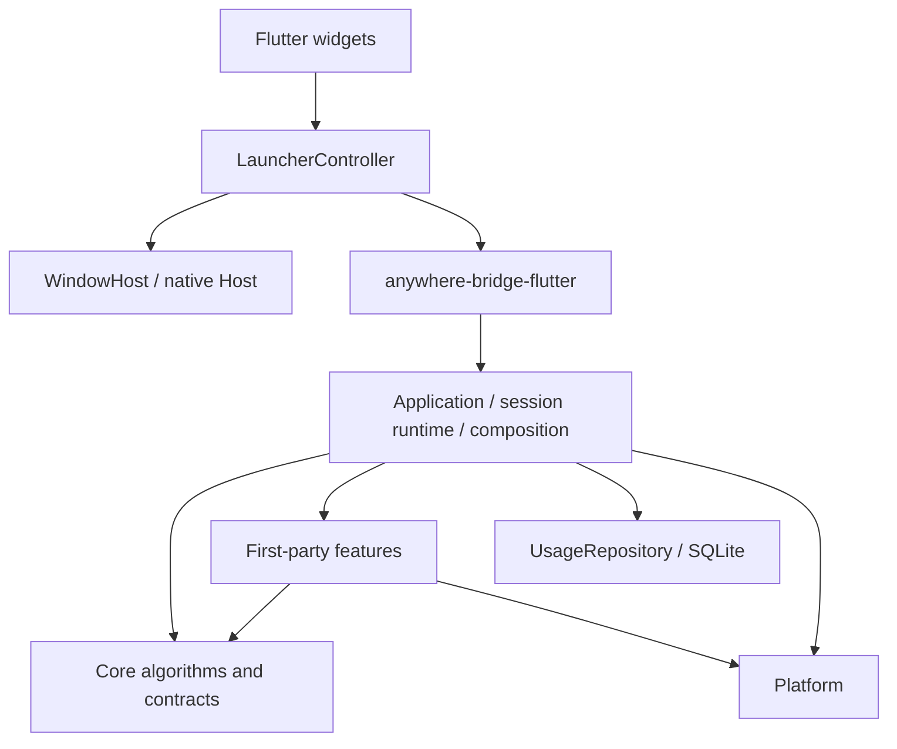

# 架构

Rust 负责上下文、搜索、排序、动作执行与历史；Flutter 负责展示和交互状态；原生 Host 负责窗口、焦点与热键。保留现有五个 crate，不为未来功能提前增加服务、运行时或协议。



## 代码组织

```text
crates/anywhere-core/src/
├── core/
│   ├── context/       ContextProvider、注册表、顺序 Context Graph
│   ├── action/        描述、Bundle、Handler 契约、匹配、可用性、声明式执行
│   ├── search/        Query、Candidate、CandidateSource、排序与 Scope 构建
│   ├── ranking/       打分、UsageRepository 契约
│   └── session/       只读 SessionFacts 与归属规则
├── application/
│   ├── composition.rs       内建动作、Provider、候选来源及种子装配
│   ├── launcher_service.rs  公共 Facade、索引与历史协调
│   ├── session_model.rs     私有会话状态
│   ├── session_runtime.rs   私有解析、预算、快照提交
│   ├── activate.rs          激活用例
│   ├── update_query.rs      输入用例
│   └── execute.rs           执行用例
├── features/          applications、filesystem、git、json、url、text
└── persistence/       SQLite UsageRepository

apps/flutter/lib/
├── main.dart                         初始化和桥接装配
├── launcher/
│   ├── launcher_controller.dart     异步生命周期、版本校验、选中项与 Scope 状态
│   ├── launcher_view_state.dart     只读展示状态、可见行和高度
│   ├── launcher_screen.dart         输入、焦点、键盘、列表、预览的组合
│   └── widgets/candidate_row.dart   候选行和图标展示
├── infrastructure/
│   ├── window_host.dart             类型化 MethodChannel
│   └── application_icon_cache.dart  有界图标缓存和过期响应处理
└── src/rust/                         FRB 生成代码和 DTO
```

`lib/launcher_screen.dart` 暂时保留为兼容导出，不承载逻辑。Session model/runtime 是 Application 的内部实现，不对桥接或测试开放可变状态。

新增 Context 通过 `ContextProvider` 和 feature 注册点加入；新增当前类型的第一方动作在 feature 中定义 `ActionSpec` 与 `ActionHandler`，随 Bundle 注册。新增候选来源实现 `CandidateSource`，由 Application 装配，沿用同一个搜索、排序、Scope 与提交路径。

`CandidateTarget` 目前只有类型明确的 `Action` 和 `LaunchApplication`；通用 Candidate 不持有具体 `IndexedApplication`。它是进程内实现，不是承诺稳定的 Extension API。出现新的执行模型时再拓展，当前没有字符串字段包或通用 Invocation 注册层。

## 边界与约束

- `anywhere-protocol`：可序列化的 Context / Action / State / Manifest / Event DTO。
- `anywhere-core`：框架契约与算法、产品用例、第一方 feature、存储适配。
- `anywhere-platform`：OS-neutral Trait 与 macOS/Windows 实现，包括应用发现路径和扫描策略。
- `anywhere-plugin`：TOML 发现、校验及模板展开，不执行脚本、不提供 UI。
- `anywhere-bridge-flutter`：Facade 初始化、FRB 入口和 DTO 转换。

`core/` 生产模块不导入 `application`、`features`、`persistence`。`scripts/check-architecture.py` 同时检查这一模块规则和 Cargo 可达依赖没有 UI/Flutter bridge；它是轻量静态护栏，行为边界仍由 Facade 测试验证。

Swift/Windows Host 不解析输入或执行动作。MethodChannel 只传窗口生命周期和基础设施目录；业务状态通过 FRB 传递。Flutter Controller 不复制 Rust 的识别、匹配和排序规则。

## 激活、输入与取消

1. Host 接到唤醒请求，暂不显示窗口，避免丢失原前台应用。
2. Flutter 调用同步 `begin_activation()` 预留 SessionId，立即使旧工作失效；随后异步调用 `activate_session(id)`。关闭时即使首屏尚未返回，也已经有 SessionId 可取消。
3. Core 在 blocking worker 捕获前台应用、Git 可用性和剪贴板；每次返回都验证 session。Git 捕获任务失败记入 diagnostics 且不写入 `git` Fact，不会再被当成 `false`。目录捕获绑定原应用并在 Session 内单飞，应用索引独立后台加载。
4. 历史读取在 `spawn_blocking` 中完成，返回 scoped/global usage 不可变快照；失败以空历史继续并记录 diagnostics，不能阻塞 async worker。
5. 顺序 Context Graph 受首份快照预算 40ms 和 pending Provider grace 400ms 控制；预算不意味着能中断已经运行的原生阻塞调用。首屏截断后后台继续解析。
6. Core 提交首份快照，Flutter 才调用 Host show。后续通过 `wait_for_snapshot` 接收更高 snapshot_seq。

版本分工：SessionId 区分唤醒；Revision 区分输入；SnapshotSeq 区分同一输入的追加快照；Host generation 防止旧窗口消息重新显示/隐藏新窗口。旧结果只丢弃，不能撤销新 session。

输入开始时发布新的 `(SessionId, Revision)` 并清空可执行候选。稳定 Candidate ID 表示业务身份，不包含会话版本；执行仍必须同时提供当前 session、revision 和已提交候选 ID。`latest_state` 只暴露仍有效的已提交快照。

提交分为“锁内取版本与不可变输入 → 锁外匹配/排序 → 锁内复验并发布”。应用目录与历史通过 Arc 快照共享。同版本另一提交先完成时重新计算，避免索引刷新覆盖 late context。执行前及 blocking worker 真正开始时分别检查版本；副作用完成后仍记录成功历史，避免失焦隐藏导致使用记录丢失。

Controller 用 hidden / activating / ready / resolving / executing 表达阶段，统一管理取消。图标请求带 epoch，旧回调不能重新填充已清空缓存或删除新请求；缓存最多保留 128 个图标。

## 当前搜索与 Scope 行为

没有 All Scope；`scope = None` 是全局/综合模式。搜索引擎一次产出全量候选，Scope 是硬过滤，Ranking 只负责 Scope 内排序。

- **双入口**：Current App Launcher（macOS `⌘⌥Space`，Windows `Ctrl+Alt+Space`）在有 Visible Action 时默认选中 Current App Scope；否则 `scope = None`。Universal Launcher（同一组合加 Shift）默认 `scope = None`。已打开时，同一入口再按一次关闭，另一入口原地切换并保留 Query。托盘/菜单提供两项。
- Current App 没有 Visible Action 时不出现在 Scope 条。首屏没有、用户未改 Scope 且 Query 仍空时，迟到的 Current App 会自动选中。
- Scope 激活后输入只搜该 Scope，不会自动退出；切 Scope 保留 Query。`scope = None` 时输入才进入 Universal Search（Apps + Actions）。空输入：Current App 是当前应用 Action 首页，Universal 是综合 Context Home。
- `Ctrl+Tab` / `Ctrl+Shift+Tab` 循环真实 Scope，`scope = None` 不参与；回到全局用 Esc。Esc 分层：清 Query → 解除 Scope → 关闭 Launcher。
- Scope 顺序：Current App 固定第一，其余按 Group 已执行 Action 的 frecency → `group_rank` → id。Session 内顺序冻结，Late Scope 只追加；Query 暂时去掉某个 Group 时保留槽位。Scope 是否存在由 Visible Actions 决定。应用启动候选只出现在 `scope = None`。

空输入是 Context Home，Flutter 每屏默认展示最多 7 条；保留用户选中的稳定 ID。搜索结果可滚动。非空输入同时进行对象识别和查询匹配；显式输入对象的动作保留，环境动作需要匹配查询。

动作与应用通过同一个 SearchEngine。ActionSearch 装配 ActionMatcher、额外候选来源及 TextFallbackSource；SourceStage 只表达现有 ranked/fallback 两个阶段，不包含未来调度策略。Scope 成员关系由 Visible Candidates 构建，Ranking 只排序候选。

Group ID 集中在 `core/action/group.rs`，动作分组由 Bundle 声明。声明式插件 `execute_builtin` 只能引用已注册的原生 Handler，注册和执行均检查 matcher 兼容性，不允许递归引用声明式插件。包装动作在注册时复制目标的 `AvailabilityRule`，保留插件自己的 ID、标题、分组和使用记录；非包装的 v1 动作保持默认 Enabled。TextFallbackSource 与 ActionMatcher 共用同一求值函数：Hidden 不进入候选，也不能从兜底路径重新加入；Disabled 保留原因，执行入口拒绝。

SessionFacts 是本次唤醒的只读快照，查询变化不重新读取剪贴板或检测 Git。已知键目前是 `clipboard`（Text）和 `git`（Flag）。规则引用未知键或类型不符会在注册时拒绝；快照写入同样校验，不能通过 `from_map` 绕过。剪贴板缺失或读取失败不触发“内容重复”隐藏，读取失败写入诊断（含 Fact 名和原因，不含剪贴板正文）。Git 明确为 false 时 Disabled，原因为「Git 不可用」；捕获任务失败导致键缺失时 Disabled，原因为「无法确认 Git 是否可用」。`Enabled` 只是本次快照的展示判断，不是执行授权。

打分保持现有规则：Exact / Prefix / WordPrefix / Substring 为 4000 / 3000 / 2000 / 1000；其余打分项总和封顶 950。频次每次 8 分，最多 160；最近使用最多 30。同分按 command/bundle ID 和稳定候选 ID 排序。文本兜底使用低分带并放在真实匹配之后。

## 平台与扩展取舍

应用目录由 `Platform::installed_applications` 提供，Core 只负责可搜索字段、别名和去重。macOS 从用户/系统 Applications 扫描，Windows 从开始菜单扫描 `.lnk`，启动保留快捷方式本身的参数与工作目录语义。每进程一次后台扫描，首屏不等索引；发布后重建当前快照。手动刷新、TTL、文件监听留待实际需求。

Provider 仍顺序执行、深度最多 3、节点最多 128，同版本 Provider/Context 去重。没有网络/AI 分类、并行 scheduler 或消息总线。

Git 检测只读元数据。执行通过类型化 Status/Log/Diff 和固定 argv，不经任意 shell；保留超时、输出上限和禁用外部 diff/fsmonitor 的规则。

未来 V0.3 菜单发现先增加平台适配和真实 Action 来源，再决定动态动作生命周期；V0.4/V0.5 复用 Provider/Bundle；V0.6 才定义稳定 Extension API；V0.7 才定义 Host-rendered UI 协议和可选 WebView 边界。V1.0 的大型能力不在本次预建。

## 构建

`.flutter-version` 是本地与 CI 共用的版本声明；`scripts/check-flutter.py` 校验 PATH 上的 SDK 并打印 framework/engine/Dart revision。`scripts/env.sh` 只配置本地 clang/swift 缓存，不注入项目内 SDK。当前版本为官方 Flutter 3.47.4。

`scripts/check.sh` 运行 Rust fmt、workspace tests、Clippy、架构检查及 Flutter analyze/tests；GitHub Actions 在 macOS/Windows 校验后才打包 Windows。远端是否通过必须以实际运行记录为准。

macOS 继续使用 Flutter assemble + swiftc 的自定义 Host，生成并签名 App.framework、FlutterMacOS.framework 与 Rust 动态库。新增原生插件数量足以需要标准插件装配时，再评估 Xcode runner，见 [ADR 001](decisions/001-workspace-and-host.md)。两端显式启用 Impeller，验证边界见 [ADR 004](decisions/004-windows-and-renderer.md)。

### Current App 原生菜单

菜单动作使用统一 Session ActionRegistry 和普通 feature handler；不可用菜单映射 Hidden，菜单与既有应用环境动作共用 Current App Scope，权限缺失只移除菜单能力。发现任务通过 generation 防止旧结果回写，执行重新校验应用实例并定位菜单。详细边界见 [Current App 菜单动作](current-app-actions.md)。
