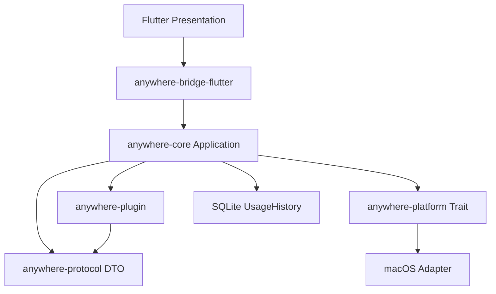

# 架构



## 边界

| 模块 | 职责 |
|---|---|
| anywhere-protocol | 稳定、可序列化的 Context/Action/State/Manifest/Event DTO |
| anywhere-core | Session、输入识别 Provider、Context Graph、应用索引、Registry、Matcher、Group/Scope、Availability、Ranking、执行调度、UsageHistory |
| anywhere-platform | OS-neutral Platform Trait，以及 macOS 的 NSWorkspace / open / osascript / pbcopy，以及 Windows 的 Shell COM / ShellExecute / Unicode Clipboard 实现 |
| anywhere-plugin | TOML 发现、校验、模板展开，不执行脚本，不提供 UI |
| anywhere-bridge-flutter | Facade 初始化、FRB 绑定、显式 DTO 转换 |
| apps/flutter | 仅展示完整 Rust 状态、Scope Bar、键盘、稳定选中 ID、Focus 和窗口可见性 |

`anywhere-core` **禁止依赖 anywhere-bridge-flutter、Flutter、Dart、WebView、任何 UI 框架**。`scripts/check-architecture.py` 检查真实 Cargo 依赖图。macOS/Windows 原生能力实现只在 anywhere-platform；Core 中没有 Objective-C、AppleScript、COM、条件编译或进程命令。

Swift Host 只创建一个承载 FlutterViewController 的窗口，注册 Carbon 热键、控制焦点和菜单栏。它不解析用户输入，不捕获上下文，不执行动作。MethodChannel 只传送窗口生命周期和基础设施目录；语义状态通过 flutter_rust_bridge 传输。

## 激活及输入时序

1. 热键到达 Swift Host，记录 monotonic clock；此时不激活 NSApp、不显示窗口。
2. Dart 调用 Rust `activate()`；Core 先递增 SessionId，使之前工作失效。
3. Core 通过 Platform 捕获原前台应用，并读取一次剪贴板文本快照。
4. Core 为这个 Session 启动单飞的目录捕获（绑定原应用身份），同时从标准目录后台扫描应用索引。
5. Core 运行顺序 Context Graph，直到完成或到达 `first_snapshot_budget`（默认 40ms）。若预算到期时还没有解析出任何可用 Context 且仍有 Provider 在飞行中，首屏最多再等 `first_content_grace`（默认 400ms），避免打开一个空窗口要求用户先输入；超过 grace 仍照常提交截断快照。随后提交首份 LauncherState。
6. Flutter 接收状态后调用 Host `show`，才改变前台应用。Host 显式启动隐藏窗口的引擎；ready/show 不等待隐藏窗口的绘制帧，避免启动互相等待。
7. 若第 5 步被预算截断，后台任务继续解析并提交更高 `snapshot_seq` 的快照；Flutter 通过 `wait_for_snapshot` 接收。

每次输入变化递增 Revision，并使 `snapshot_seq` 归零重新计数。Core 在开始工作前原子发布 `(SessionId, Revision)`，在 Provider 完成后、状态提交前重复验证。过期结果返回 None，不更新状态。Flutter 同时检查 session、revision、snapshot_seq 和窗口 generation，防止桥接响应、执行结果或隐藏后的回调覆盖新界面。

非空输入做两件事：对象识别和查询匹配。识别到的对象动作始终保留；环境 Context 的动作只有在匹配查询时才出现；普通文本搜索是最后兜底的候选。空白输入进入 Context Home，只显示当前 Context 的动作（最多 7 条）。该选择在 Core 中完成，UI 只切换 Core 预计算的 Scope 候选列表。

Host 在窗口失去 key 或应用失活时立即隐藏，并发送携带 generation 的 dismiss。Dart 在任何 await 之前使 generation 失效、清空状态并请求 deactivate；Host 拒绝旧 generation 的 show/resize/hide。每次唤醒都是新 Session。

窗口默认宽 648、高 64；Flutter 按动作数量计算高度，每行 52，最多 7 行，额外动作滚动。总高度不超过 520，Host 应用高度时保持顶边位置。输入解析期间保留不可执行的上次已提交列表，只在新结果提交后调整高度；空结果不构建动作区，错误提示和 JSON 预览按需占用空间。macOS 的 NSVisualEffectView 提供窗口后方的原生毛玻璃；窗口和 Flutter 原生背景透明，毛玻璃 mask 与内容裁切保持相同圆角，Flutter 只叠加半透明底色和控件。交互变更见 [ADR 003](decisions/003-transient-launcher.md)。

可执行 ActionId 包含 Session/Revision；只有当前已提交列表中的 ID 才能执行。输入开始变化即清空可执行列表。执行中不持有 Session 锁，耗时 OS 调用和 SQLite 在 blocking worker 中运行。

## 分组

`group_id` 常量集中在 cache 注册表（`command::groups`），排序加成、Scope 成员和标签都引用同一处；「哪些动作属于 Git」由 `command::is_git_action` 与执行器保持一致，测试锁定两者不会分叉。两个 Copy Path 动作同属 `folder`，因为它们对路径做同一件事。

## 执行与排序

内建和插件都进入 `CommandRegistry → applicability → availability → query match → rank → group/scope → execution → Platform`。插件不拥有自己的排序分支。`execute_builtin` 只能指向注册表中的内建命令，而且 matcher 必须兼容，不允许递归调用插件。执行接口是 `execute(session_id, revision, candidate_id)`，Core 只接受当前已提交且 Enabled 的候选。

分值是确定性的：

```text
query_match: Exact=4000, Prefix=3000, WordPrefix=2000, Substring=1000
context_relevance: UserInput=200, ApplicationContext=120, ForegroundApplication=30；搜索时减半
semantic: Text=40, 其他已匹配类型=90
base_priority: -50..50
frequency: 8 × min(count, 20)，上限 160
recency: 30 (<1h), 15 (<1d), 8 (<7d), 0
home bonus: 环境来源 +200，Git 仓库上的 git 分组再 +40
```

非查询项之和被限制在 950 以内，低于最低的查询匹配档位（Substring = 1000），因此更高的匹配层级永远胜过使用历史。固定时间和历史快照下，相同输入得到相同顺序；同分先按 command_id 再按稳定候选 ID 排序。文本兜底候选（Web Search 与文本插件）使用 100..600 的低分带并排在列表末尾，不会被真实匹配挤出。

`frequency` 的权重必须足以改变顺序，否则使用历史只是装饰：早先权重为 2 时，用了 7 次的动作仍然输给只用了 1 次但 `base_priority` 高 30 的动作，实机报告为「执行多次但不上升」。现在一次使用约等于 8 点，重复 8 次即超过任一 `base_priority` 的最大差距（50），因此习惯能压过默认优先级；而 `base_priority` 在没有任何使用记录时仍然决定初始顺序。

Context Home 与搜索使用不同的权重：Home 提高 context/usage 的相对权重，搜索时 `query_match` 最高。环境来源（含 Finder 捕获目录及其派生 Git 仓库）和显式归属某应用的动作构成 Current App Scope；应用启动候选只出现在 All。

等价对象的显式输入保留自己的来源，避免被环境上下文吞掉；同 command、同规范对象只保留一行，但合并来源归属，避免去重后丢失 Scope 成员关系。

## 异步扩展点与首屏

`ContextProvider` 只有一种执行语义：可能阻塞的本地工作。没有 Network / AI 分类，也没有并发 Scheduler。Provider 不感知超时；`Resolver` 负责顺序 step、预算和 late publication。`Application::subscribe` 继续提供带版本检查的事件接收器；桥接层另外暴露 `wait_for_snapshot`，让 Flutter 在不轮询的情况下接收 late context。

深度限制为 3、每个版本的同一 Provider/Context 最多调用一次、最多 128 个节点。扩展为并行调度前应先测量；不得删除版本校验。

## 应用索引

应用搜索不走 Context Graph。macOS 启动后后台扫描 `~/Applications`、`/Applications`、`/System/Applications`（有界深度，不进入 `.app` 内部），从 bundle 读取 `bundle_id`、显示名和规范路径。同一 `bundle_id` 的重复安装按根目录顺序、路径长度、字典序选一个；不同 bundle_id 的同名应用分别保留。索引只在进程内存在，不持久化、不监听文件系统；首屏不等它。

每个索引项暴露名称、bundle_id、规范路径、图标来源（bundle 路径，按需取回）和 usage 行 ID。图标只为可见候选懒加载并在宿主侧有界缓存，失败时回退语义图标，且不影响排序或执行。usage 行 ID 由 bundle_id 在同一处派生，避免记录与读取漂移。

## Git 执行边界

仓库检测只读文件系统元数据。执行时 Platform 接受类型化的 Status/Log/Diff 操作，使用固定 argv 和仓库 root 作为工作目录，不经 shell，不接受任意命令模板。运行禁用 pager、颜色、external diff/textconv 和 fsmonitor，清理可能覆盖目标仓库的环境变量，并同时读取 stdout/stderr，5 秒超时、1 MiB 上限、截断有提示。Git 缺失时对应 Action 显示 Disabled 而不是消失。

## 构建

Flutter 官方的 [macOS 构建目标](https://github.com/flutter/flutter/blob/stable/packages/flutter_tools/lib/src/build_system/targets/macos.dart) 生成 Dart AOT App.framework 和 FlutterMacOS.framework，`scripts/build-macos.sh` 用 swiftc 编译窗口 Host 并装配签名应用。桥接使用 [flutter_rust_bridge](https://cjycode.com/flutter_rust_bridge/)。构建策略的环境原因见 [ADR 001](decisions/001-workspace-and-host.md)。

替换 Host UI 只需调用 Core Facade、转换 protocol DTO 并实现 Presentation；不修改 Core 领域架构。将来新增 OS Adapter 时在 Platform Trait 后实现；Windows 已添加独立 Adapter 和 Flutter runner；Linux 未实现。Windows 构建状态及适配边界见 [ADR 004](decisions/004-windows-and-renderer.md)。
