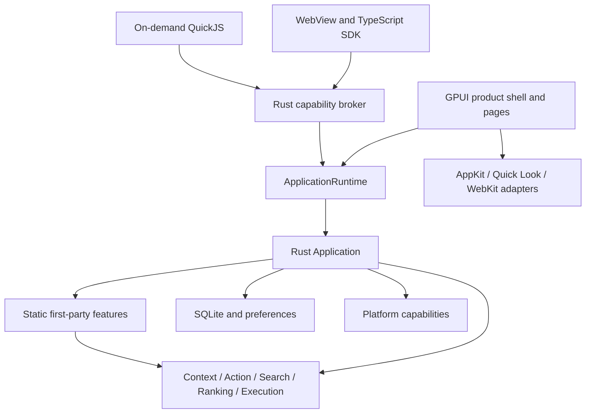

> 历史归档：以下记录保留原日期与当时的实施状态。当前契约以 [架构](../architecture.md)、[UI 设计](../ui-design.md)与[验收](../mvp-gpui.md)为准。

# GPUI 产品架构与迁移契约

状态：macOS 15+ GPUI 开发预览。产品现在只有一个 UI 实现、一个应用入口和一套
macOS Bundle；Rust Core 继续拥有识别、匹配、排序、授权与执行。最后核对：
2026-11-13。

这是当前架构说明，不是待执行阶段计划。发布范围和当前证据见
[GPUI 技术方案与验收](../mvp-gpui.md)；更早的界面实现与逐构建材料只用于历史
追溯，位于[归档](README.md)。

原界面基准、后台唤醒问题、已实施修复和剩余桌验项见
[界面对齐与后台唤醒方案](gpui-ui-alignment-plan.md#实施记录2026-11-12)。

## 固定边界

| 层 | 责任 | 入口 |
| --- | --- | --- |
| GPUI 产品壳 | 主窗口、独立 Clipboard Shelf、状态栏恢复、全局热键、页面与焦点 | `apps/gpui/src/app.rs` |
| Launcher 展示 | Scope、菜单浏览、选择、文件与历史结果、设置、任务和插件页 | `apps/gpui/src/launcher/` |
| Shared frontend runtime | Application、设置、Usage、剪贴板与 Web document 所有权 | `crates/anywhere-core/src/application/frontend_runtime/` |
| Rust Application | 激活、查询、快照、取消、执行资格与服务装配 | `crates/anywhere-core/src/application/` |
| Rust Core | Context Graph、Action、匹配、排序、会话与执行契约 | `crates/anywhere-core/src/core/` |
| Features / Persistence | 第一方能力、数据库与有界配置读取 | `crates/anywhere-core/src/features/`、`persistence/` |
| Platform / macOS bridge | AppKit、Quick Look、WebKit、热键、登录项和目录书签的薄适配 | `crates/anywhere-platform/`、`apps/gpui/src/platform/`、`apps/gpui/src/host/` |
| Web plugins | WebView UI、按需 QuickJS 后台任务与统一能力代理 | `packages/plugin-sdk/`、`plugins/examples/` |



GPUI 可以筛选已排序的展示结果、限制可见行、维护选择与导航，但不能复制
Context 识别、Action 可用性、授权、排序、执行资格或 Web 生命周期策略。
AppKit 适配器接收明确的显示、隐藏、保存、预览与文档操作，不解析查询或执行
业务动作。

## 产品身份

| 项目 | 值 |
| --- | --- |
| 应用名 | `Anywhere` |
| Bundle ID | `dev.anywhere.launcher` |
| 最低系统 | macOS 15.0 |
| App 输出 | `build/Anywhere.app` |
| 可执行文件 | `Contents/MacOS/Anywhere` |
| 数据目录 | `~/Library/Application Support/Anywhere/` |
| 构建入口 | `scripts/build-macos.sh` |
| 快速 UI 门禁 | `scripts/check-gpui.sh` |

数据、插件和预览模式变量均使用 `ANYWHERE_*` 前缀。显式数据或插件目录必须是
绝对路径，不能是文件系统根目录或包含 `..`；校验失败时启动失败，不静默回退到
其他产品目录。

## 已接入的 GPUI 表面

- 主 Launcher：Universal / Current App、Scope、菜单与子菜单、默认列表、查询、
  禁用项、通知、对象操作和执行结果。
- 文件搜索：类型过滤、连续结果、进度、对象操作和按需 Quick Look。
- 剪贴板：History、暂停与策略设置；Shelf 使用独立
  `WindowKind::Floating` 窗口，重复打开时激活已有窗口。
- Settings：热键、Context、搜索目录、剪贴板、应用历史、内置 Feature、语言与
  登录项。
- Application history：来源筛选、配置、默认检测、保存反馈和对象动作。
- Running Tasks、Plugin Detail 与未知 NativeTool 明确错误页。
- Web 包安装审查、启停、WebView、固定 origin、IPC、ack、主题注入和 teardown。
- 菜单栏搜索图标提供 Current App、Universal Search、Settings 和 Quit；
  两个搜索项使用当前语言并显示配置快捷键。全局热键唤醒并记录
  `hotkey_to_visible_ms`。

## 顺序与资格

每次异步快照至少携带以下身份：

1. UI 预留 `SessionId`。
2. Rust Core 为输入变化分配 `Revision`，同一 revision 的迟到补充推进
   `SnapshotSeq`。
3. GPUI 发起请求时提高最低可接受 revision。
4. 只有当前 session、revision 不低于请求值且
   `(revision, snapshot_seq)` 游标更新的快照可以提交。
5. 已提交状态继续等待迟到 Context，直到查询代次、窗口代次或会话失效。
6. 执行请求携带当前已显示 revision；结果只作用于当前窗口代次。

实现位于 `apps/gpui/src/launcher/snapshot_gate.rs`。相关回归：

- `accepts_only_monotonic_snapshots_for_the_reserved_session`
- `a_new_request_rejects_snapshots_before_its_revision`

Host 侧 `runtime/` 把 facade 与 Launcher、Actions、Settings、Clipboard、
Application History、Tasks、Web 请求分开；`runtime_support.rs` 只做偏好应用和
领域值到展示 DTO 的转换。激活、恢复、输入、分页和 follow 都投递
`Arc<LauncherState>`，SnapshotGate 仍是唯一提交闸门。单次结果不能借“最新值”
语义覆盖，执行与 Web 文档身份继续逐项校验。

启动时 GPUI 先进入 Starting 状态并创建隐藏壳，独立线程打开 runtime、SQLite、
插件目录和目录授权；Ready 后一次注入缓存的设置 / 偏好并注册热键。Failed 只
显示错误，不创建 Session。`LiveLauncher` 退出时用 background shutdown 释放
Tokio runtime，避免 AppKit 主线程等待 worker。

旧候选、旧 Session、旧设置或旧 Web 文档的迟到结果不得覆盖新状态。稳定的
Action ID 不单独构成执行授权。

## 输入、焦点与窗口

- 应用以 `LSUIElement` / Accessory 身份启动，Launcher 初始 `show=false`、
  `focus=false`。Launcher 使用 nonactivating `NSPanel`、floating level、
  所有 Space 与 full-screen auxiliary 行为，不显示交通灯或 Dock 图标。
- 呼出期间保持 Accessory policy，并调用
  `NSRunningApplication.activateWithOptions(.ActivateAllWindows)`；没有成功获得
  key 时在 60 ms / 280 ms 重试。AppKit 样式只在变化时重设，并在重设后恢复
  `GPUIView` first responder；下一主循环再聚焦当前 GPUI editor。
- 初始窗口位置直接由 GPUI bounds 设定；AppKit 样式在启动回调返回后应用，
  避免同步 move / resize 回调在 GPUI 可变借用期间重入。每次实际呼出前重新
  将窗口锚定到当前屏幕可用区域顶部。
- 输入法 `prefer_character_input` 活动时，GPUI 根视图让字符、Enter、Esc 和方向
  键先由输入法处理。
- 隐藏有查询或工具页面的 Launcher 后，状态保留 15 秒；空白首页再次唤醒时
  重采当前环境。隐藏立即撤销待执行副作用。
- `ActionResult.close_window` 在 Quick Look 与 Web 文档清理完成后隐藏窗口。
- Quick Look 回调携带 generation；关闭预览后焦点回到当前页面编辑器，而不是
  无条件回到首页。
- Clipboard Shelf 使用专用 floating 配置，保留普通标题栏交通灯、可缩放和
  `hidesOnDeactivate=false`。Esc 和系统关闭都走同一清理路径，失焦不关闭，主
  窗口只保留窗口句柄。重复打开会先恢复最小化窗口，并按 Flutter 契约定位到
  鼠标所在屏幕右下角；“复制并返回”在复制完成时复验 Shelf 仍为 key window。
- Launcher、文件搜索和内容页失焦后隐藏。Settings 与 Running Tasks 使用 normal
  level、默认 Space 和普通窗口失焦行为，可以被其他应用覆盖。Quick Look 可见时
  暂停 Launcher 的失焦判断。
- 菜单栏点击和全局热键都通过产品壳恢复窗口。Launcher 的系统关闭执行产品清理
  后隐藏；Settings 的系统关闭进入 GPUI 的保存 / 放弃草稿路径。
- Clipboard History 与 Application History 的空结果保留页头操作入口；应用
  历史不可打开的条目提供复制 / 刷新回退菜单，对象 Actions 末尾固定 Refresh。
- Web Tool 页头提供宿主 Actions，可重新打开同一 invocation 或返回搜索；旧
  document Actions 在 teardown 时全部清除。聚焦 WebView 的无组字 Esc 由
  bootstrap 捕获为 host frame，经当前 document 句柄校验后返回 Launcher；
  输入法组字仍先交回 WebKit。

这些规则的单元测试只能证明状态与路由。物理 IME、真实 key window、材质、系统
预览、WebKit helper 回收和状态栏点击仍需独立桌面验收。

## 生成物

以下文件只能由生成器写入：

- `apps/gpui/src/l10n/generated.rs`
  - 来源：`resources/localization/`
  - 生成：`python3 scripts/generate-gpui-localizations.py`
- `apps/gpui/src/ui/design_tokens.rs`
  - 来源：`resources/design-tokens.json`
  - 生成：`python3 scripts/generate-design-tokens.py`
- `resources/file-types.json` 及各运行时策略的既有生成输出
  - 使用对应 `scripts/generate-*.py`；运行 `--check` 验证漂移。

本地化、设计参数、原生文案和功能目录的源文件变化必须同时更新生成物。完整
检查会重新生成到临时位置并比较，不运行过时生成器的 CI 会失败。

## 修改流程

开始前运行：

```sh
git status --short --branch
scripts/check-gpui.sh
```

修改展示状态时先在 `launcher/model.rs` 建立可测试语义，再由
`launcher/view/` 映射 GPUI 组件。不要把业务判断写进 `on_click` 闭包。
异步结果使用可控顺序测试覆盖旧
session、旧 revision、窗口代次替换和关闭回调。

完成前运行：

```sh
scripts/check-gpui.sh
cargo test --workspace --locked
cargo clippy --workspace --all-targets --locked -- -D warnings
scripts/check.sh
git diff --check
```

macOS 发布构建再运行：

```sh
scripts/build-macos.sh
codesign --verify --deep --strict build/Anywhere.app
plutil -lint build/Anywhere.app/Contents/Info.plist
otool -L build/Anywhere.app/Contents/MacOS/Anywhere
```

自动化、签名和包结构通过后，再按
[GPUI 技术方案与验收](../mvp-gpui.md#物理桌验矩阵)执行物理桌面矩阵。
