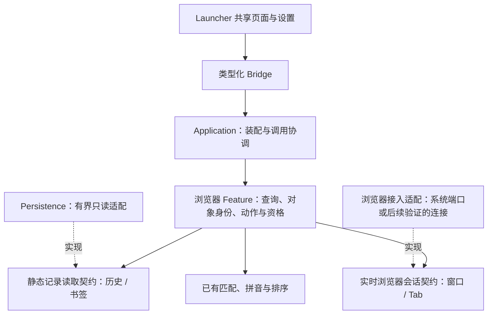

# 浏览器功能规划

状态：**后续独立内置功能，版本待定，尚未实现**。2026-10-25 用户要求将浏览器历史、书签与 Tab 管理放在同一阶段考虑，不为赶应用历史适配而零散接入。原 V0.14 的 H2a / H2b 移至本计划，不再作为 V0.14 收尾条件。

现有 Safari / Chrome / Edge 当前页 URL Context 继续保持原职责。它不代表已经接入浏览历史、书签或标签页管理。本计划不授权读取真实私人历史、安装浏览器扩展或新增系统权限；验收先用合成 Profile、书签和标签页。

## 目标与入口

先验证 Chrome 和 Edge，各浏览器分别记录能力与支持版本，不由共用格式推断全部兼容。其他浏览器按实际需求增加。

| 对象 | 首批使用方式 | 身份与限制 |
|---|---|---|
| 标签页 | 检索、切换到指定标签页 / 窗口、关闭单个标签页 | 绑定浏览器连接、Profile、窗口和 Tab 身份；同 URL 的多个标签页分别保留 |
| 书签 | 搜索标题、URL、文件夹，回到来源浏览器打开 | 保留 Profile、文件夹和源条目身份；首版只读，不修改源书签 |
| 历史记录 | 搜索已有访问元数据，回到来源浏览器打开 | 明确读取范围与完成状态；首版不删除源历史、不推断无痕记录 |
| 后续 Tab 操作 | 固定 / 取消固定、移动到窗口、静音、显式批量整理 | 逐项验证接入方式；不可用时隐藏，不用模拟菜单或猜测索引执行 |

按浏览器提供普通 Action，例如“Chrome 标签页”“Chrome 书签”“Chrome 历史记录”。复用 Current App 匹配、Global Search、Action 快捷键和主窗口二级页面；不新增 Scope，不在首页常挂一排浏览器按钮。浏览器未安装时 Action 默认关闭，手动开关优先；安装状态不等于数据访问授权。

每页聚焦一种任务。Enter 对标签页执行切换，对静态记录执行来源打开；关闭、固定、移动等放入选中项的更多操作。使用现有 ↑↓、Enter、⌘K、Esc 和分类切换规则，不新增一套快捷键体系。无权限、无匹配、没有记录与来源暂时断开分别呈现。

## 模块边界

浏览器能力作为独立静态 Feature 装配，与 `application_history` 并列。可复用统一查询、匹配、页面组件和经过验证的读取基础，不直接依赖另一个 Feature 的业务服务，也不把实时 Tab 操作塞进历史转换脚本。

- **Rust Feature**：对象模型、来源策略、检索、去重边界、执行前复验；静态记录与实时状态分别管理生命周期。
- **Application**：装配读取器与浏览器接入端口，协调配置、授权、取消和查询提交。
- **Persistence / Platform**：分别承担静态元数据读取与系统打开 / 实时操作；接入方式在可行性验证后选择，不提前固定协议或增加空框架。
- **Flutter**：复用工具页、候选行、分类、选择与更多操作；不解析浏览器数据库或承担连接、Profile 与 Tab 身份判断。

已有 JSON / SQLite 有界读取和纯转换可作为静态记录适配的起点。真正出现第二个消费者时再提取共享基础设施，不复制一套数据库客户端；当前每来源 4,096 条的小列表限制不能拿来宣称搜完大型浏览历史。纯转换脚本继续没有实时浏览器、文件、网络或进程 Host API。

## 正确性、资源与权限

- Tab 标题、URL、顺序均不能单独作为执行身份。关闭前重新确认目标仍属于原浏览器会话 / 窗口，连接重建或 ID 失效使旧候选过期；不能误操作新占用相同 ID 的标签页。
- 书签和历史中的同 URL 跨 Profile 保留来源。应用级打开、精确 Profile 打开、激活已有 Tab 是不同结果；不能用默认浏览器打开后声称恢复了原 Profile。
- 仅在用户使用对应 Action 时按已选择范围读取记录。实时标签页默认随页面按需获取 / 刷新；隐藏或断开后撤销旧执行资格，不默认常驻轮询全部浏览器状态。
- 来源访问、实时控制及可能需要的连接分别说明和配置；未授权只降级该能力，不在输入查询时突然申请一批权限，不扩大第三方 Web 插件现有授权。
- 大历史采用有界批次与取消，UI 连续展示、不手动分页、不反复重排已显示结果。不建立永久全量浏览索引，不常驻全部记录或加载网页 / 远程 favicon；缓存、连接和临时数据分别限额。
- 不读取 Cookie、密码或网页正文；完整 URL、标题与 Profile 不写入命令 Usage 或日志。关闭、撤销和来源删除清理临时快照，不能通过镜像保留已被用户删除的历史。

## 小步交付

| 步骤 | 范围 | 验收门槛 |
|---|---|---|
| B0 接入可行性 | 比较实时 Tab 与静态来源的可用接入方式，建立 Chrome / Edge 能力矩阵 | 身份、权限、Profile / 窗口边界、断开与资源释放均可说明；未验证的操作不进入支持清单 |
| B1 基本 Tab 管理 | 普通 Action、搜索列表、切换窗口 / Tab、单项关闭 | 相同 URL 多标签、窗口变化、关闭后 ID 复用、连接重建、操作前失效、全键盘与鼠标路径 |
| B2 书签 | 来源范围、文件夹信息、检索与来源打开 | 嵌套文件夹、同 URL 多 Profile、未知格式、并发替换、打开路由准确；Chrome / Edge 分开验收 |
| B3 历史记录 | 大库查询、稳定连续结果、取消、限额与来源打开 | 活跃 SQLite / WAL 或所选接入方式的变更、未命中、拼音覆盖、部分结果、不同规模合成数据及内存 / 临时磁盘样本 |
| B4 Tab 整理 | 根据 B0 结果补固定、移动、静音与必要批量动作 | 操作可追溯到准确对象、局部失败不会误操作其他标签页；不用高风险批量动作凑功能数量 |

每步先实现与自动化，再构建，最后统一实机验收；不以成功启动浏览器代替目标 Tab / Profile 已实际打开。B1–B3 的具体先后可在 B0 证据下调整，不承诺尚未验证的技术可行性。该阶段的版本号及相对插件开发体验的排期另定；当前先完成 V0.14 的应用历史边界、问题修复和验收。

## 既有研究线索

原应用历史计划在 2026-10-23 核对过 Chromium 历史 / 书签内部存储与浏览器扩展 API。它们仅作为后续 B0 的研究起点，实施时需重新核对版本与权限，不能视为外部 App 已可调用或现已完成的能力：

- [原产品研究与 Context 边界](application-history.md)
- [原 V0.14 分层、读取与资源预算](mvp-v0.14.md)
- [Chromium 历史存储](https://github.com/chromium/chromium/blob/main/components/history/core/browser/history_database.cc)、[书签存储](https://github.com/chromium/chromium/blob/main/components/bookmarks/browser/bookmark_storage.cc)
- [Chrome history API](https://developer.chrome.com/docs/extensions/reference/api/history)、[bookmarks API](https://developer.chrome.com/docs/extensions/reference/api/bookmarks)

公开选型、依赖或协议均未冻结；不因文档规划提前新增后台服务、扩展安装、权限或插件接口。
