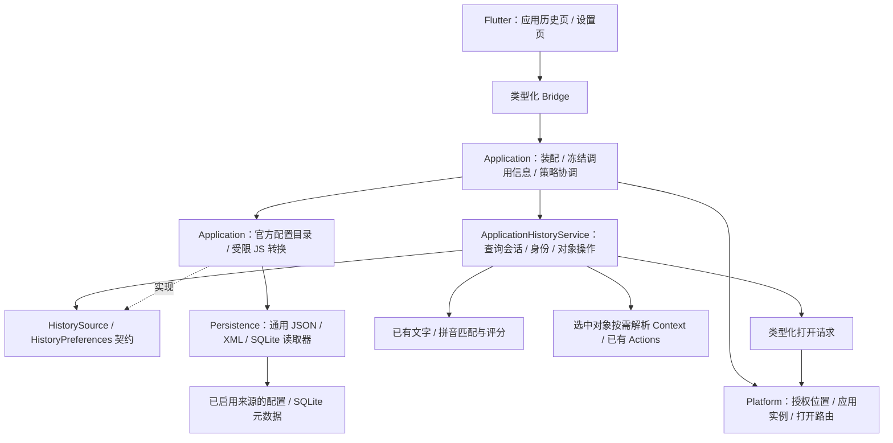

# V0.14 技术方案：应用历史与对象操作

状态：**当前原型已扩展为 18 个配置化来源，V0.14 尚未收尾**。分支 `codex/dev-0.14`，基于 V0.13 收尾提交 `c76287d`，当前源码版本 `0.14.0+8`。安装默认开关、当前接口及限额见[来源配置与脚本](application-history-sources.md)，逐构建验收在本文后半部分。

2026-10-25 用户调整：浏览器历史、书签与 Tab 管理移至[后续独立阶段](browser-feature.md)，原 H2a / H2b 不再作为 V0.14 收尾条件。现有当前页 URL Context 保持不变；浏览器功能仍未实现。本次调整只更改范围和排期，不将其余未验收工作标为完成。

## 1. 本版决策

将应用历史作为一个静态内置模块 `application_history`，按来源提供每应用独立 Action，复用 Launcher 二级页面。Rust 通用读取器读取所选文件，来源配置及纯 JS 脚本解释应用格式，统一返回历史条目；新增官方来源通常只增加配置和脚本。IDEA / VS Code 契约已扩展到其他 IDE / 编辑器；Obsidian 已有最近仓库，最近笔记仍需通过元数据可行性门槛。浏览器单独设计，不塞入来源转换脚本。

- 复用主窗口、ToolPageShell、候选行、图标、更多操作、Tab 和 15 秒隐藏规则；不增加 Scope、常驻首页区域或默认全局快捷键。
- Rust 管理来源、授权设置、查询、身份与执行；Flutter 只管理页面呈现、输入、选择和焦点；Platform 管理系统目录、应用身份、访问和打开路由。
- 来源业务数据只读。没有手动配置时，仅开启已安装应用的 Action，手动开关与自定义路径优先；安装状态不是读取全部历史的授权。进入页面和执行时都检查有效资格。
- 小列表按需读取；首轮使用受限 QuickJS 运行随 App 发布的官方纯转换脚本，取代原先“每应用一个 Rust 解析器”的方案。不建立永久历史镜像，不创建 WebView 或常驻 Node，现在允许可信本机适配配置复用同一契约，启动时加载并由用户配置覆盖同 ID 内置定义，不恢复模块热加载。大历史分批、Companion 和第三方分发另行验证。
- 浏览器书签与历史统一进入独立浏览器阶段；Anywhere 自有收藏、删除外部历史、跨设备同步和远端工作区打开继续单独排期。

## 2. 当前代码可以复用什么

| 已有实现 | 复用方式 / 缺口 |
|---|---|
| `features/module.rs`、`catalog_generated.rs`、`FeatureServices` | 静态注册、类型化服务绑定、启停策略；新增一个模块，不恢复内置热加载 |
| `features/tools.rs` 的 EntrySource | 让入口参与普通 Action 匹配及用户自定义快捷键，不在首页永久追加候选 |
| `core/search` 与 `core/ranking` | 复用文字、多词、拼音匹配及公共评分基础；页面另有来源时间 / 顺序，不能把命令 Usage 当浏览历史 |
| `ToolPageRegistry` / `HostView::NativeTool` / ToolPageShell | 注册一个原生二级页；沿用现有返回、焦点、IME 和材质，不添加应用专用顶层视图类型 |
| `features/clipboard` 的服务 / Flutter backend 分层 | 参考类型化端口和迟到响应守卫；不复用其历史数据库、采集器、TTL 或条数上限 |
| `features/filesystem` 的连续结果经验 | 复用取消、稳定显示和查询期临时存储原则；其 ScanStore / RankedHit 依赖文件路径，不能直接当通用历史存储 |
| `Platform::open_file_in_application/open_url_in_application` | 已有指定应用打开端口；精确配置实例与 Profile 路由仍需分别验收，不用默认打开后切换焦点冒充来源打开 |

本轮此前没有跨应用历史读取实现；现已新增下面标注的 H1 原型。`editor_context.rs` 中 IDEA 路径读取只解释当前窗口明确给出的路径；最近项目不用于推断当前窗口 Context。现有架构门禁禁止 Feature 导入具体 persistence 或 Application，新增模块沿用该规则。

## 3. 总体结构



计划的代码归属：

```text
anywhere-core/src/
  features/application_history/   model、source 契约、service、query、actions、registration
  persistence/application_history.rs  通用 JSON / XML / SQLite 只读读取
  application/application_history/  官方包装配与纯 JS 运行适配
anywhere-platform/src/application_history/  系统位置发现、访问校验、指定应用打开
anywhere-bridge-flutter/src/api/application_history.rs  DTO 与薄转发
apps/flutter/lib/
  features/application_history/  registration、session、page、列表呈现
  infrastructure/application_history_backend.dart  Rust 端口适配
  settings/                     来源配置界面
anywhere-core/resources/application-history/<source>/
  source.json、transform.js      应用格式及转换，不定义 UI
```

以上为职责划分，部分路径已由原型创建，其余仍属计划。Feature 依赖读取 / 转换契约，Application 注入官方包执行适配，Persistence 只执行通用只读读取，不运行脚本。具体表名、键和应用身份放在来源配置，格式提取放在转换脚本；通用 Core、Flutter 和 Platform 不解析各应用业务数据库。

入口改为 `core.application_history.<source-id>.open`，对应应用 Context 自动匹配，独立支持全局检索和快捷键；共享页面为 `application.history`，Action 传入固定来源与本地化标题。旧原型的统一 `core.application_history.open` 移除。FeatureServices 持有一个共享服务，适配器代码在启动时一次注册。设置只选择允许读取的来源实例；停用时撤销会话与缓存，不重建或卸载模块。服务即使已创建，也不能绕过功能策略或来源设置。

下面第 4–9 节保留应用历史的目标与早期预算，浏览器专属部分已移交独立阶段。原型当前每来源使用一个自动检测或自定义文件，支持完整有界小结果、应用级打开与复制；不包含多实例路由、浏览器大历史或对象 Context。当前接口和限额以[来源指南](application-history-sources.md)及末尾验证记录为准。

## 4. 模型、端口与身份

| 模型 | 必须表达的内容 |
|---|---|
| SourceInstance | 适配器、应用安装实例、配置实例、Profile / Vault、集合、授权位置、设置 epoch |
| HistoryEntry | 来源、源对象键、类别、标题 / 可检索元数据、类型化目标、真实时间或来源内顺序 |
| OpenTarget | 本地目录、普通文件、工作区文件、Vault 与笔记；远端 URI 独立保留且首版不执行，不转成本地路径 |
| ReadSnapshot | 来源身份、schema / 格式、读取代数、完成程度；不是单独一个 mtime |
| HistoryQuery | 服务实例身份、页面会话、查询 revision、App / 集合 / Profile 过滤、取消票据；不能只比对可能重复的数字 generation |
| QueryStatus | Loading、Ready、Partial、PermissionRequired、UnsupportedFormat、Unavailable；空结果另由 Ready + 空列表表达 |
| EntryHandle | 当前会话内的对象句柄，绑定源快照与设置 epoch；Flutter 不能用自填 URL / 路径替换目标 |
| OpenResult | 已提交到指定应用、目标不可用或路由不支持；精确 Profile / Vault 与仅应用级打开分开报告 |

公共端口围绕 `open_session → update_query → read_batch → entry_actions / execute → close_session`，设置另有 `discover → validate → save_sources`。具体函数签名在 H1 两个真实来源闭环后固定，不先发布第三方 SDK。

稳定 ID 区分应用实例、配置实例、Profile / Vault、集合及源对象；源 ID 缺失时可使用类型化目标生成身份。标题、翻译、列表位置不参与身份。数字行 ID 可能被复用，不能单独授予执行资格；句柄还绑定当次目标与源身份，执行前重新读取并比对。

本模块不跨配置实例或应用聚合去重。浏览器多 Profile / 历史 / 书签去重由独立阶段定义。同一来源中可按完整目标去除重复记录；URL 不随意删除参数、片段或改写路径。本地路径遵循所在平台的大小写 / 符号链接语义，不统一强转小写。

## 5. 来源接入与开源复用

| 来源 | 读取方案 | 打开与交付边界 |
|---|---|---|
| IDEA | 只读 `recentProjects.xml`，解析已测 schema 的项目路径 / 名称 / 真实时间或顺序 | 绑定明确的 IDE 安装与配置实例，用对应应用打开；菜单不作为主要数据源 |
| VS Code | 只读应用状态存储中的最近记录；区分文件夹、workspace 文件、普通文件与远端 URI | 通过已定位应用的正式入口 / 随包 CLI 打开，不依赖 PATH 中存在 `code`；未知远端 URI 暂不执行 |
| Obsidian | 显式选 Vault 与配置目录；只适配能从本地元数据验证的最近列表 | 使用编码后的 Obsidian open URI；无可靠元数据时标为该版本不支持，不扫描正文或以 mtime 伪造历史 |

已核对的上游证据：IDEA 声明 `recentProjects.xml`，VS Code 保存 `history.recentlyOpenedPathsList`，并区分 workspace / folder / file。[IDEA 源码](https://github.com/JetBrains/intellij-community/blob/master/platform/platform-impl/src/com/intellij/ide/RecentProjectsManagerBase.kt)、[VS Code 源码](https://github.com/microsoft/vscode/blob/main/src/vs/platform/workspaces/electron-main/workspacesHistoryMainService.ts)

VS Code 官方 CLI 支持文件夹 / 工作区与 Profile，但指定不存在的 Profile 会创建新配置。因此仅路由到已验证的既有配置，读取数据的配置实例不自动等于打开使用的 Profile。[官方 CLI](https://code.visualstudio.com/docs/configure/command-line)

以下为已移出本版的早期研究：Chromium 有独立的网页历史表和书签存储实现；实施决策以[浏览器规划](browser-feature.md)为准，不能作为 V0.14 未完成项。这是版本适配的依据，不是公开稳定协议。Chrome 与 Edge 分别维护测试矩阵，未知 schema / 不可读格式不猜测解析。[历史元数据](https://github.com/chromium/chromium/blob/main/components/history/core/browser/url_database.cc)、[书签存储](https://github.com/chromium/chromium/blob/main/components/bookmarks/browser/bookmark_storage.cc)

Obsidian 官方插件 API 提供最近 10 个文件，但不能从外部 App 直接调用；可自定义配置目录。外部本地读取仍是待验证适配，不能仅凭 API 声明已经支持。[插件 API](https://github.com/obsidianmd/obsidian-api/blob/master/obsidian.d.ts)、[配置目录](https://help.obsidian.md/configuration-folder)、[打开 URI](https://help.obsidian.md/Extending+Obsidian/Obsidian+URI)

依赖优先沿用当前仓库：

| 技术 | 选择 |
|---|---|
| SQLite | 现有 `rusqlite 0.32`；需要取消检查时开启 `hooks`，不增加第二套 SQLite 客户端或 ORM |
| JSON / XML | 现有 `serde_json` / `roxmltree`；限制输入、深度和条目长度，未知字段可忽略，未知结构不能冒充空列表 |
| URL / 路径 | 现有 `url` 与 Platform 路径能力；不手写 URI 编解码 |
| 搜索 / 拼音 | 当前 Rust Query / SearchFields / pinyin；不在 Dart 或适配器再维护一套算法 |
| 临时存储 | 现有私有临时目录与 `tempfile`；大历史有需要时用当前 rusqlite 做查询期缓冲 |
| 异步 / 取消 | 当前 Tokio、ExecutionContext、epoch 和 worker admission；不新增运行时 |

2026-10-25 方案修订：新增精确锁定的 `rquickjs 0.14.0`，不开启自定义分配器；官方脚本独立 Runtime、32 MiB 堆 / 256 KiB 栈和 250ms 中断预算，宿主验证输出。首轮为进程内受控调用，不作为不可信第三方脚本沙箱。来源数据输入、取消与查询代数继续由 Rust 管理；具体原型边界见[作者指南](application-history-sources.md)。

`rusqlite` 已提供 progress handler，中断正在执行的 SQLite 工作无需手写 C FFI；原型已启用 bundled / hooks / limits。[固定版本实现](https://github.com/rusqlite/rusqlite/blob/v0.32.1/src/hooks/mod.rs)

## 6. 外部数据的读取规则

SQLite 使用独立只读连接、参数化固定 SELECT、短事务和短 busy 等待；不复用剪贴板 / 模块数据库初始化入口，不迁移或修复源库，不改变源 journal 模式，不执行 checkpoint、ATTACH 或来自数据的 SQL。

活跃 WAL 数据不能只复制主文件；`immutable=1` 也不能用于仍会变化的来源来绕过一致性检查。只读 WAL 对旁文件有访问条件，缺少必要访问时返回来源不可用，不偷偷扩大权限。[SQLite WAL](https://sqlite.org/wal.html)

**首版默认不备份整个浏览器历史库**。若特定来源实测必须快照，才用 SQLite Backup API 创建有磁盘 / 时间限额的私有短期快照；Backup 仍需要成功读取源连接，不能解决所有锁或权限问题，也不能作为源库无限膨胀时的默认回退。[SQLite Backup](https://sqlite.org/backup.html)

JSON / XML 打开后有界读取，原型在同一文件句柄检查长度和修改时间，拒绝已检测到的截断或修改；这不是完整的原子快照或文件替换检测，执行时还须重新读取核对目标。文件元信息用于提示失效，不能当作跨重启的执行身份。笔记相对路径不得逃出所选 Vault；授权配置指向位置变化时重新校验，不按旧地址继续读取。

## 7. 查询、排序与性能

小型最近列表 / 书签在页面按需读取，匹配标题、路径 / URL 与来源允许的文件夹信息。浏览历史采用游标批次，先产生可用首批，再继续查找；SQL 预筛选只有在能证明不遗漏最终匹配时才使用。不能先取最近若干条再称为搜索全部历史，也不能让 SQL LIKE 过滤掉只通过拼音命中的标题。

空查询按来源分组，组内用真实最近时间或来源顺序；没有时间的书签不伪装成最近访问。非空查询先按现有匹配质量，再按来源内的真实时间 / 稳定顺序。已显示前缀冻结，后台只整理未显示尾部；选择绑定 ID，追加结果不抢焦点。改变查询 / 过滤才重新排序，不承诺边搜索边维持全局最优排序。

UI 自动连续加载，没有手动分页。小列表先用有界内存；后续大来源确有需要时，命中的元数据可进入查询会话专属的临时结果缓冲，Flutter 仅保留滚动窗口。源扫描不能因用户尚未滚动而长时间持有读事务。缓冲不是永久索引，重启不恢复浏览记录。

以下是实现起点，需基准验证后调整，不是当前测量结果或总 RSS 承诺：

| 项目 | 初始预算 / 目标 |
|---|---|
| 全局来源读取 | 最多 2 个 blocking worker；同一配置实例串行；有界待处理队列 |
| 批次 | 每批最多 128 条且不超过 256 KiB，传输队列最多 2 批 |
| SQLite 页缓存 | 每连接目标 2 MiB，禁用不受控 mmap；进度回调检查取消 / 截止时间 |
| 页面驻留 | 最多 512 条摘要；加载 / 释放窗口与滚动位置关联，避免完整结果常驻 Dart |
| 文档输入 | 单个 JSON / XML 暂定 8 MiB 上限；同时最多一个文档解析，记录解析峰值 |
| 临时结果 / 可选快照 | 本功能全局磁盘预算 64 MiB；默认不复制源库；关闭 / 撤销后清理，异常退出遗留下次启动清理 |
| 单源读取截止 | 暂定 5 秒；需要更长时先测量，不以超时冒充搜索完成 |
| 可用首批目标 | 常见项目库 p95 ≤150ms 为待验证目标；分别记录冷 / 热与未命中，不把空加载帧算通过；浏览历史基准另归独立阶段 |

超过预算或截止时间必须报告 Partial / TooLarge 等事实；只在所选来源全部读完后标记完整。全量历史、任意拼音、无自建索引三者同时成立时，不能承诺所有大库都是毫秒级。优先保持输入和取消流畅，再以实测决定优化，不提前复制整个浏览器数据库或常驻拼音索引。

worker 实际退出前仍持有 admission，取消只撤销发布资格并请求 SQLite 中断。退出 / 隐藏立即取消读取并关闭连接；15 秒保留只保留有界页面状态，恢复时复验源与策略，超时销毁。设置撤销、来源删除立即清除其缓存与临时结果，即使页面隐藏也生效。

## 8. 打开、Context 与持久化边界

打开必须经过 Application / Feature 服务复验：功能启用、来源授权、页面会话、源对象仍存在、目标未变和应用安装身份。Platform 接收 `OpenRequest` 之类的类型化请求，构造受支持的系统路由或固定 argv；外部记录不能携带任意可执行命令。

精确 Profile / Vault 路由须验证后声明。只有应用级路由时，界面明确说明“不保证原 Profile”，由用户显式选择该操作；不静默改用默认浏览器。不支持的路由仍可提供适用的复制动作。成功提交到应用与确认目标页面实际加载分开记录，不把进程启动成功当作业务完成。

更多操作仅将当前对象转成现有 URL / File / Directory Context。工作区文件先保持 File，多根目录不随意选第一个；远端 URI 不转成本地目录。来源应用归属不替换冻结 Current App，不把全部历史塞进 Graph。派生 Git / Developer 动作仍复验路径和现有执行资格。

来源启用、配置位置和选择的集合使用现有 ModuleStorageHost 的独立命名空间持久化，带 schema 与保存失败的恢复语义；模块总开关仍使用 FeaturePreferences。源历史 / 查询结果不进入模块 KV、命令 Usage 或日志。普通 Action 只记功能级使用，候选对象 ID 不成为 URL / 路径的另一份持久活动日志；这项约束需要数据库断言测试。

第一方内部的来源配置与第三方 Web grant 分开：不为本功能开放通用 history.read、任意 SQL 或文件读取 SDK，也不扩大现有插件能力。

## 9. 界面与键盘

- 入口：各应用独立 Action，例如 IDEA 最近项目、VS Code 最近项目与文件；别名和本地化标题由来源配置声明，快捷键各自设置。
- 页面：既有搜索头与单列候选，不常驻空白预览。来源应用图标和类别角标共用现有缓存 / 语义图标，不请求远程 favicon。
- 范围：打开后固定到入口所属应用 / 来源，移除全部应用入口及跨应用筛选；后续集合、Profile / Vault 仍属于该应用内筛选。
- 默认：以本次冻结 Application Context 匹配该应用的 Action，首页自动展示。未配置只提示启用该来源，不回退到别的应用，也不读取历史反推前台应用。
- 操作：↑↓选择、Enter 打开、⌘K 更多操作；提示放在选中行。Esc 逐层退出操作面板 / 筛选，再返回上层 Launcher，保留上层查询与选择。
- 状态：首次无来源显示一个“配置来源”入口；无匹配、没有记录、来源不可用分开呈现。局部失败收进来源状态，不用技术报错横幅遮住正常候选；配置仍只在设置页管理。
- 中文 / 英文、IME、15 秒恢复沿用现有组件；新增文案走 ARB，Dart 不解析 SQL 错误字符串或决定源格式。

Action 的应用适用性由纯 Context 规则评估；NativeTool 输入携带固定来源与标题，页面打开后不再读取当前焦点或自行选择应用。新增普通模块入口和页面注册即可，主窗口不按 IDEA / 浏览器业务 ID 分支。

## 10. 分步交付与验收

| 顺序 | 范围 | 必须完成后再进入下一步 |
|---|---|---|
| H1a | 最小模型、静态注册、服务绑定、来源设置、IDEA 与主窗口页面闭环 | 合成 XML、空间 / Unicode 路径、目录失效、开关撤销、键盘和旧响应回归；不先搭无消费者的大全框架 |
| H1b | VS Code 本地目录 / workspace / file，验证第二个来源后固定契约 | 多安装 / 数据实例、URI 类型、配置身份和指定应用打开；远端记录明确降级 |
| 原 H2a / H2b：移出 | 浏览历史 / 书签与 Tab 管理进入[独立浏览器阶段](browser-feature.md) | 版本待定，不作为 V0.14 完成前置，尚未实现 |
| H3 | Obsidian 本地元数据可行性验证，再做最近笔记与 URI | 多 Vault、自定义配置目录、最近顺序、路径逃逸、删除 / 重命名；不可靠版本明确不支持，Companion 不自动进入本版 |
| H4 | 当前对象按需 Context、现有二级 Actions、清理与交付 | 旧对象和旧设置不能执行，普通 Usage 不含目标，首轮完整自动化、构建、最后统一 UI 验收 |

每步独立提交，Google / 官方语言规范继续生效。新增共享 DTO 时运行 `scripts/generate-bridge.sh` 并编译 Bridge；完成实现与单元测试再构建，最后集中做真实界面验收。首次本机来源验收使用合成 Profile / Vault / 配置实例；计划本身不授权读取私人历史或新增系统权限。

本轮不重新开启 VoiceOver；V0.13 已知 SDK 关闭消息与 GPU 保留继续单独记录，不混入新功能通过声明。Windows 保留平台端口和 fixture 覆盖，未经 Windows 实机验证不宣称已交付。

H1 已扩展到 18 个来源；H3 已有 Obsidian 最近仓库，最近笔记和 H4 对象工作流仍需逐项验证。原 H2a / H2b 已移出。标准路径自动检测已作为 H1 增量实现；每来源仍只有一个有效元数据文件，不支持多 Profile / 安装实例选择、浏览历史流式查询或对象 Context 操作；这些设计、预算和性能目标不能列为已交付能力。


## 第一轮原型验证（2026-10-25）

- 通用 JSON / XML / SQLite 只读读取器、随包配置 / 纯 JS 转换、IDEA / VS Code 小来源、类型化 Bridge、历史页和手动来源设置已实现。每来源最多 4,096 条完整有界结果，当前只有一个真实读取槽；H2 的流式批次和窗口化尚未实现。
- `scripts/check.sh` 通过：Rust / 原生 / Web / 架构 / 生成物 / 文档 / Dart analyze 与 405 项 Flutter 测试。Core 单元测试 272 通过、1 项既有忽略；MVP 集成 189 通过、4 项既有忽略。忽略项不属于本轮通过声明。
- 新增 10 项 Rust 来源 / 脚本 / 取消 / 持久化回归，以及 5 项 Flutter 页面 / IME 模拟 / 生命周期 / 来源保存回归；原有剪贴板关闭失败测试复现了跨设置等待竞争，现已修复。设置关闭先捕获全部在途结果，再等待，避免漏掉已完成的失败。
- 首轮 Release 测量仅使用 500 条 IDEA + 500 条 VS Code 合成记录；每种查询 30 次。Rust 读取、JS 转换和匹配 p95 为约 9–15.5ms；整个测量进程峰值 RSS 22,904,832 字节（约 21.8MiB）。不包含 Flutter、Bridge 传输、输入防抖或物理显示，不能当成 App RSS / 首帧指标。
- 本段记录时尚未完成本轮原生界面验收、真实来源格式矩阵或实际来源应用打开。真实中文输入法与物理组合键不以 Widget 测试替代；浏览器、Obsidian、多安装 / Profile、自动发现与对象 Context 仍待后续步骤。


Build 1 合成来源界面已验证中文 / 拼音 / 路径查询、Tab 切来源，以及操作菜单的方向键 / 回车刷新。自动化 ⌘K 与原生组合键投递仍不可靠，未据此改变真实键盘语义；不把自动粘贴中文称为真实 IME 验收。发现改变查询 / 来源后旧选中项可能留在屏幕外，Build 2 改为新查询 / 来源选首项，手动刷新保留对象身份并滚动可见，新增定向 Widget 回归通过。Build 2 全量与界面复验另记。


Build 2 工程门禁：`scripts/check.sh` 全部通过，Flutter 406 项通过；新增历史模块定向用例共 6 项通过，其他 Rust / 原生 / Web / 架构门禁与上文相同。历史查询基准见[结构化结果](benchmarks/application-history-v0.14-build1-2026-10-25.json)，对应 Rust 源码提交 `1239659`，Build 2 仅调整页面交互与构建号，未改变该读取 / 匹配路径。


### Build 2 界面与包（首轮结束）

源码 `0427269`，`0.14.0+2`；生成 `Anywhere-0.14-preview-build2.app`、arm64 ZIP 与 SHA-256，持久本机签名及严格包验证通过，Impeller 保持开启。包为本地开发预览，未上传 GitHub Release。

独立合成目录下已验证：普通 Action 搜索 / 回车进入页面；中文粘贴查询、路径查询；Tab 切 IDEA / VS Code；方向键选择；从单条结果切回全部来源及新查询后首项可见；设置页关闭 / 重新启用 VS Code 来源、保存并读回，以及关闭设置。Build 1 还验证了拼音检索和操作菜单方向键 / 回车刷新。原生截图位于本机忽略的 `build/ui-v0.14-build2/`，结构化记录见[验收结果](benchmarks/application-history-acceptance-v0.14-build2-2026-10-25.json)。

没有读取私人历史，验收实例关闭 Context 捕获、文件搜索和剪贴板采集。自动化粘贴不代替真实中文 IME，⌘K 自动投递不可靠，不算物理组合键通过；真实来源格式、多安装路由和实际来源应用打开仍未验收。最后退出验收实例时 Mac 锁定，已通过核对路径后关闭本轮测试进程；不宣称本轮正常退出 / 退出后内存验收通过。


## Build 3：修正为每应用独立入口

2026-10-25 用户明确要求每应用独立 Action，并在对应 Current App 中自动匹配。本节替代 Build 1 / 2 的统一历史入口与跨应用筛选；上文逐构建验收保留为历史证据。

来源配置新增 `action` 元数据，启动装配自动生成稳定业务 ID；纯应用适用性规则只读取冻结 Context，不调用系统或执行脚本。IDEA（含 CE）只匹配 IDEA Action，VS Code 只匹配 VS Code Action，其他应用首页不展示这两个入口；明确全局检索 / 快捷键仍可选择具体应用。继续复用现有 Current App Scope，不增加 History 或应用专用新 Scope。

共享页面从 NativeTool 路由接收来源与本地化标题，只查询该来源，移除跨应用标签与不再使用的列表来源读回。未配置时不允许回退到另一已启用来源。快捷键候选去掉与更具体 Context 重复的空入口，避免同一 Action 弹出两个目标。


工程验收：`scripts/check.sh` 完整通过，Core 单元 274 通过 / 1 项既有忽略，MVP 集成 190 通过 / 4 项既有忽略，Flutter 407 项通过（历史页定向 7 项）。新增真实 Launcher 服务路径回归：IDEA / VS Code 无关键词显示自己的入口、不显示另一应用入口，快捷键分别只有一个目标，NativeTool 路由固定来源，关闭整个功能后旧入口不能执行；来源查询缺失时不回退。独立 Action 和具体 Context 的重复空入口同时在 Web 共享路径回归。此处尚未记录 Build 3 原生界面与真实应用数据验收。


Build 3 App / arm64 ZIP 与 SHA-256 已生成，源码 `3cb6b00`，版本 `0.14.0+3`；持久签名、严格包 / 归档 / 版本校验通过，Impeller 保持启用。独立合成来源实例已启动，但第一次原生 UI 读取即被 Mac 锁屏阻断，未将 Build 1 / 2 的界面结果套用于本次更改。已核对进程路径并关闭本轮测试实例；源码和自动化证明上述应用匹配逻辑，Build 3 实机界面与实际来源打开仍待复验。[本轮结构化记录](benchmarks/application-history-actions-v0.14-build3-2026-10-25.json)。


## 原应用打开专项验证（2026-10-25）

当前已实现 IDEA 本地项目目录、VS Code 目录 / 工作区文件 / 普通文件的指定应用打开：重新读取来源并核对目标后，选择唯一匹配的安装应用，通过平台端口提交；不使用默认文件关联。远端 URI 当前仅能复制。Chrome / Edge 历史和书签尚未接入，不属于已支持或本轮通过范围。

新增 `application/application_history/open_tests.rs`，使用记录器验证真实服务路径而不启动 OS 应用：四种本地目标正确提交原应用及原路径，中文 / 空格路径完整；远端只复制、不打开；应用缺失 / 多安装歧义、目标被替换 / 类型改变、来源关闭均在提交前拒绝。历史相关 Core 定向测试 14 项及 Launcher 集成 1 项通过，Core all-targets Clippy、Rust 格式与架构检查通过。仅添加测试和记录，产品二进制仍为 Build 3；不将这组记录器测试当作实际窗口验收。

已只读核对安装元数据：IntelliJ IDEA 2026.2.3、Visual Studio Code 1.143.0。准备了独立合成 IDEA 项目、VS Code 目录、两根工作区和文本文件，Context / 剪贴板采集关闭，未读取个人历史。首次检查 IDEA 原生窗口时工具报告 Mac 锁定，已请求解锁；实际打开和目标窗口、原 Profile / Vault 仍未确认。[专项验证记录](benchmarks/application-history-opening-v0.14-build3-2026-10-25.json)。


## Build 4：原应用打开实机复验

2026-10-25，先完成代码及完整自动化检查，再构建并进行原生界面验收。Build 3 补验确认 IDEA 正确打开合成项目；首次 VS Code 回车尝试未确认目标窗口，桌面工具长时间无响应后报告锁屏，用户也反馈没有该目录窗口，不计通过。Build 4 重新逐项操作，不能用前次打开请求代替窗口证据。

发现并修复 Current App 首页可见性问题：历史 Action 已匹配，但前台应用 Context 权重低于派生项目 Context，被首页数量上限截掉。空查询时，明确属于当前应用且非菜单的入口与该应用项目动作使用相同 Context 权重；菜单仍按原规则推荐，关键词检索评分不变，Scope 逻辑不变。历史入口的基础优先级改为评分允许的 50，替代原先会被截断到 50 的 90。Launcher 集成回归使用同时含 Git / Rust 标记的合成项目，确认候选超过首页容量时自己的历史入口仍在前五项，另一应用入口不出现；去掉修复可复现失败。

`scripts/check.sh` 全部通过：Core 单元 276 通过 / 1 项既有忽略、MVP 集成 190 通过 / 4 项既有忽略、Flutter 407 通过，原生、Web、Clippy、架构与生成物检查通过。既有忽略项不属于本轮通过声明。Build 4 App、arm64 ZIP 与校验文件已生成，版本 `0.14.0+4`，持久签名及严格包校验通过，Impeller 保持开启；未上传 GitHub Release。

最新构建实机通过以下合成来源用例：

- IDEA 项目在 IntelliJ IDEA 中打开，窗口标题与项目树目录一致；IDEA 同时含 Git / 文件夹 / Rust 动作时，首页无需搜索即显示 IDEA 最近项目。
- VS Code 目录在 Code 中打开，窗口标题和文件树指向准确目标；自己的 Current App 首页显示独立历史入口。
- 方向键选择并回车打开 `.code-workspace`，Code 将其识别为 Workspace，文件树显示两个预期根目录。
- 方向键选择并回车打开普通文本文件，Code 编辑器的路径、标签和合成正文一致。

只读取独立合成来源文件，未读取私人应用历史；剪贴板、选中文本、浏览器页面和 Finder 选中项采集关闭。用于复验首页竞争的当前项目目录识别仍有效。验收后关闭本轮合成项目 / 工作区窗口并通过菜单正常退出 Anywhere，核对测试进程已退出。未进行真实中文 IME、物理组合键、退出内存、多安装或 Profile / Vault 验收。浏览器历史与书签尚未实现，远端目标仍仅能复制。[Build 4 结构化结果](benchmarks/application-history-opening-v0.14-build4-2026-10-25.json)。


## Build 5：自动检测与自定义来源

2026-10-25 根据用户要求，已支持来源默认检测标准配置目录，保留手动路径和关闭能力。路径规则由官方 `source.json` 声明，Platform 仅提供系统配置根目录，Persistence 执行有界元数据检测；Feature 决定模式和有效来源，Flutter 只显示结果及发送模式 / 路径设置。未新增依赖，复用已有 `glob` 库匹配单层目录名，不全盘搜索或创建后台监听。

IDEA / CE 支持版本目录通配，VS Code 检测默认用户数据目录。多个配置选择最近修改的文件，路径作为稳定次序；不声称已实现精确 IDE 版本 / Profile 绑定。非标准目录、便携版或检测失败仍可指定文件。设置显示自动、自定义、未找到或关闭状态，可重新检测 / 保存自定义路径；空自定义路径不能提交。

新配置默认自动检测；schema 1 已有路径迁移为自定义，原先关闭的来源保持关闭。schema 2 持久保存模式而不固定自动路径；自定义路径失效时不偷偷回退。启动、历史页打开和设置读取可重新检测，逐字查询复用已选路径；配置或检测路径改变才撤销选择资格，未变化的设置读取不清空有效选择。检测不解析历史正文，查询与执行继续沿用有界读取和重验证。

自动化使用独立合成配置根目录，覆盖多版本选择、缺失后创建、自动 / 手动 / 关闭模式、旧设置迁移、手动路径失效拒绝回退、逃逸链接和扫描规则限制。设置 Widget 覆盖中英文及自动 / 手动 / 关闭 / 恢复流程。工程与原生界面状态见本节末尾。


### 用户适配与 Action 开关增量

研究 `utools-recent-projects` 后，采用通用来源包 + 可复用内置解析器，不直接复制上游代码。内置与用户均使用 `source.json` / `transform.js`，用户目录在 App 数据目录下，可从设置打开；同 ID 优先覆盖内置定义，或用 `extends` 复用 IDEA / VS Code 读取器与脚本。完整自定义配置只覆盖现有 JSON / XML / SQLite 读取与本地目录 / 文件 / 工作区目标，不宣称任意应用或浏览器均已适配。用户脚本为可信本机配置；没有文件、网络或进程 Host API，资源限制不等于进程沙箱。

加载在启动完成，编辑后重启生效。配置错误只让应用历史降级，其他功能继续运行；不忽略坏覆盖后偷偷使用旧适配。Action 开关即时发布过滤后的统一 Registry，Current App、全局搜索与快捷键候选移除关闭的动作，旧候选不能执行；设置层同步系统快捷键目录，避免无效快捷键仍占用按键。开关独立于文件位置，关闭 / 重启 / 再启用保留自定义路径。

工程验收：`scripts/check.sh` 完整通过，Core 单元 287 通过 / 1 项既有忽略、MVP 集成 192 通过 / 4 项既有忽略、Flutter 410 通过；Clippy、原生、Web、架构、生成物和文档门禁通过。覆盖新用户 Action 注册与开关撤销、坏配置不影响其他功能、模板继承、用户覆盖、目录移除保留未激活设置，以及旧版关闭状态不误关闭新用户适配。忽略项不计通过。

Build 5 的 App / arm64 ZIP / SHA-256 已生成，版本 `0.14.0+5`，持久签名与严格包校验通过，Impeller 保持开启，未上传 GitHub Release。准备了独立合成来源、一个 IDEA 覆盖和一个新增用户适配；启动前保留用户正在运行的 Build 4。首次原生界面检查被锁屏阻断，已请求解锁，不计本轮 UI 通过，也不套用 Build 4 的验收结果。[结构化记录](benchmarks/application-history-configuration-v0.14-build5-2026-10-25.json)。

解锁后的 Build 5 补验通过用户来源路径保存、中文 Action 搜索、来源固定页面读取、IDEA 同 ID 覆盖及复用内置解析器、关闭来源后移除搜索候选并保留路径。重开设置时发现未独立标识的 `ExpansionTile` 将父级列表保存的滚动位置读作展开状态，触发类型异常；因此 Build 5 不计完整界面通过。已正常退出独立验收实例，保留用户 Build 4。

## Build 6：设置折叠区状态隔离

应用历史的自定义适配说明改用现有 `AppDisclosure`，以独立标识保存展开状态，同时统一按钮和展开样式。新增设置页挂载、展开、卸载、重开回归，保留父级滚动位置；旧代码能够复现 `double` / `bool` 类型冲突，修复后应用历史定向 11 项测试通过。

`scripts/check.sh` 完整通过：Core 单元 287 通过 / 1 项既有忽略、MVP 集成 192 通过 / 4 项既有忽略、Flutter 411 通过；原生、Web、Clippy、架构、生成物及文档检查通过。Build 6 App / arm64 ZIP / SHA-256 已生成，版本 `0.14.0+6`，持久签名与严格归档校验通过，Impeller 保持开启；未发布 GitHub Release。

原生界面使用前次合成数据复验：来源关闭状态和路径跨重启保留，重新启用后中文 Action 恢复并正确读取原合成记录；VS Code 和 IDEA 均检测到标准配置文件，随后恢复合成路径。检测真实文件仅检查元数据，没有读取私人历史正文。自定义适配帮助、目录文字、设置页切换及整个设置窗口重开均正常，运行日志为空；通过 App 菜单正常退出，验收进程退出码为 0，原用户 Build 4 保留。物理输入法、全局快捷键、来源应用实际打开与内存释放没有在本次配置验收中重测，不扩大既有 Build 4 打开验收结论。[Build 6 结构化记录](benchmarks/application-history-configuration-v0.14-build6-2026-10-25.json)。

## Build 7：应用家族适配

按用户要求先正常退出原 Build 4，启动默认数据目录的 Build 6，并确认当前仅运行该新版本；设置中的旧 IDEA / VS Code 关闭状态没有重置。随后参考 `utools-recent-projects` 的应用家族划分，独立增加 16 个来源配置，总计 18 个：JetBrains 系列及 Android Studio、VS Code / Insiders / Cursor / Windsurf / VSCodium、Sublime Text、Obsidian 最近仓库。每来源都有独立 Action，复用 Current App 匹配和来源固定页面，不改变 Scope。浏览器与 Obsidian 最近笔记不包含在本增量中。

内置来源现在也可用 `extends` 继承共享解析器，与用户配置使用同一个定义校验器。构建支持省略已继承的脚本，启动按依赖顺序解析模板并拒绝循环 / 缺失依赖；修改配置仍需重启。JetBrains 按已知近期结构定位唯一 component，兼容产品名称差异及 Rider solution 文件；Code 同类编辑器共用同一个受限 SQLite 读取器和脚本。旧 schema 1 的省略关闭状态只作用于当时存在的 IDEA / VS Code，之后新增的来源不被误关闭。

Obsidian 只读全局仓库登记及时间，不扫描全部笔记或用访问时间冒充历史。仓库 ID 与路径形成类型化目标，执行前重读验证；只允许投递给唯一的 Obsidian 实例，宿主构造固定 `open` URI，Platform 负责指定应用的 URL 分发。脚本不能提供任意打开命令。Sublime 仅将会话历史路径投影为候选，不显示或保存编辑缓冲内容。设置增加应用名 / 来源 ID 筛选，沿用统一组件和中英文文案。

自动化验收：`scripts/check.sh` 完整通过，Core 单元 293 通过 / 1 项既有忽略、MVP 集成 192 通过 / 4 项既有忽略、Flutter 411 通过；应用历史定向 Core 31 项及 MVP 3 项通过。覆盖 18 个来源的路径隔离与应用身份唯一性、家族解析 / 目标类型、全部应用身份的 Current App 匹配、Cursor / WebStorm / Obsidian 实际 Launcher 路由、Obsidian 指定应用分发 / 目标失效 / 多实例拒绝、Sublime 元数据投影及中英文来源筛选。既有忽略项不计通过。

Build 7 App / arm64 ZIP / SHA-256 已生成，版本 `0.14.0+7`，持久签名与严格归档校验通过，Impeller 保持开启；没有上传 GitHub Release。独立合成来源验收目录已准备，自动真实来源全部关闭；但开始本次原生复验时桌面再次锁定，尚未启动 Build 7 的 UI 验收，也未把默认运行版本切换到 Build 7。已请求解锁，不能将构建和测试通过表述为 18 个真实应用均已验收。[结构化记录](benchmarks/application-history-adapters-v0.14-build7-2026-10-25.json)。

## Build 8：按安装状态决定默认开关

没有手动配置的来源，仅在其应用身份匹配已安装应用时默认开启；未安装应用默认关闭，包括可信用户适配。残留配置 / 历史文件不算安装证据。Application 启动组合时通过 Platform 获取安装元数据，向 Feature 注入身份快照；Feature 统一计算默认开关，用于设置状态、读取资格、全局 / Current App 搜索与快捷键发布。Flutter 不自行判断应用是否安装。

安装快照只在启动读取，不按键重复扫描；安装或卸载后重启更新默认值。默认开关不写入持久设置，改变其他来源不把默认值固化为用户选择。已有手动开关及自定义路径优先：手动关闭不会被安装检测重新打开，手动启用即使当前未安装也保留，真正打开时仍复验来源、目标和唯一应用。旧版关闭状态保持不变。

工程验收：`scripts/check.sh` 最终完整通过，Core 单元 297 通过 / 1 项既有忽略，MVP 集成 193 通过 / 4 项既有忽略，Flutter 411 通过；原生、Web、Clippy、架构和生成物检查通过。新增四项安装默认策略回归与一项 Launcher 全路径回归，验证默认隐藏、安装变更后重启、手动设置优先、残留文件不误开启，以及全局检索和快捷键目录同步。既有解析 / 生命周期测试显式提供合成安装快照，不依赖本机安装环境。

Build 8 App / arm64 ZIP / SHA-256 已生成，版本 `0.14.0+8`，持久签名与严格归档校验通过，Impeller 保持启用。桌面工具仍报告锁屏，未退出正在运行的 Build 6，也没有将新规则声称为已部署或通过本次原生 UI 验收。[结构化记录](benchmarks/application-history-defaults-v0.14-build8-2026-10-25.json)。Chrome / Edge 浏览历史与书签仍在 H2 阶段，现有浏览器当前页 URL Context 不代表已支持历史来源。

## 排期调整：独立浏览器功能（2026-10-25）

按用户最新要求，浏览器历史、书签与 Tab 管理合并为独立内置功能阶段，版本待定，原 H2a / H2b 不再作为 V0.14 的收尾前置。此前逐构建记录保留当时范围与证据；它们不表示浏览器能力已交付，也不覆盖实时 Tab 识别与操作。新的入口、模块边界和小步验证见[浏览器规划](browser-feature.md)。

本次仅更新规划文档，不修改运行代码、权限或构建版本；现有浏览器当前页 URL Context 继续可用。V0.14 剩余工作仍按当前构建实测、最近笔记可行性和对象操作分别判断，不因延期浏览器而自动标为完成。
