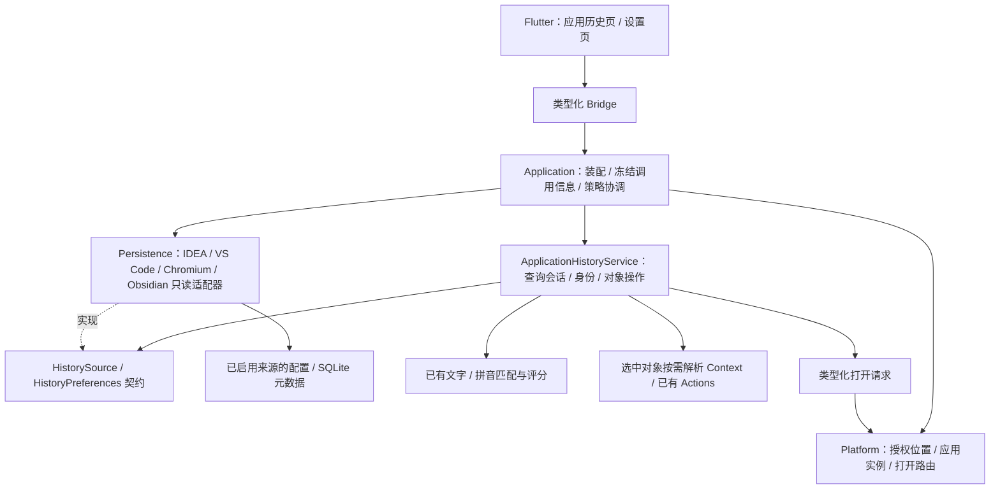

# V0.14 技术方案：应用历史与收藏

状态：**方案阶段，功能尚未实现**。2026-10-25 创建 `codex/dev-0.14`，基于 V0.13 收尾提交 `c76287d`。本轮只整理方案，不修改产品代码、依赖或 App 版本；源码仍为 `0.13.0+11`。产品范围见[应用历史与收藏](application-history.md)，本页明确实现决策、边界和小步交付顺序。

## 1. 本版决策

将应用历史作为一个静态内置模块 `application_history`，提供普通 Action 和 Launcher 二级页面。来源适配器读取已启用应用的最近对象 / 书签，统一检索和打开。第一批覆盖 IDEA、VS Code、Chrome / Edge，Obsidian 先通过本地元数据的可行性门槛。

- 复用主窗口、ToolPageShell、候选行、图标、更多操作、Tab 和 15 秒隐藏规则；不增加 Scope、常驻首页区域或默认全局快捷键。
- Rust 管理来源、授权设置、查询、身份与执行；Flutter 只管理页面呈现、输入、选择和焦点；Platform 管理系统目录、应用身份、访问和打开路由。
- 来源业务数据只读，默认全部关闭。配置中启用的 App / 配置实例 / 集合才可读取；进入页面和执行时都检查有效资格。
- 小列表按需读取，大历史按批查询；不建立永久历史镜像，不启动常驻监听器，不引入 WebView、QuickJS、Companion 或新的搜索服务。
- 首版的“收藏”指来源应用已有的书签。Anywhere 自有收藏、删除外部历史、跨设备同步、Safari / Firefox、远端工作区打开后续单独排期。

## 2. 当前代码可以复用什么

| 已有实现 | 复用方式 / 缺口 |
|---|---|
| `features/module.rs`、`catalog_generated.rs`、`FeatureServices` | 静态注册、类型化服务绑定、启停策略；新增一个模块，不恢复内置热加载 |
| `features/tools.rs` 的 EntrySource | 让入口参与普通 Action 匹配及用户自定义快捷键，不在首页永久追加候选 |
| `core/search` 与 `core/ranking` | 复用文字、多词、拼音匹配及公共评分基础；页面另有来源时间 / 顺序，不能把命令 Usage 当浏览历史 |
| `ToolPageRegistry` / `HostView::NativeTool` / ToolPageShell | 注册一个原生二级页；沿用现有返回、焦点、IME 和材质，不添加应用专用顶层视图类型 |
| `features/clipboard` 的服务 / Flutter backend 分层 | 参考类型化端口和迟到响应守卫；不复用其历史数据库、采集器、TTL 或条数上限 |
| `features/filesystem` 的连续结果经验 | 复用取消、稳定显示和查询期临时存储原则；其 ScanStore / RankedHit 依赖文件路径，不能直接当通用历史存储 |
| `Platform::open_url/open_file/launch_application` | 现有接口不能表达“用指定应用、指定 Profile 打开对象”，需要补类型化路由；不能用默认打开后再切换焦点来冒充来源打开 |

当前没有跨应用历史读取实现。`editor_context.rs` 中 IDEA 路径读取只解释当前窗口明确给出的路径；最近项目不用于推断当前窗口 Context。现有架构门禁禁止 Feature 导入具体 persistence 或 Application，新增模块沿用该规则。

## 3. 总体结构



计划的代码归属：

```text
anywhere-core/src/
  features/application_history/   model、source 契约、service、query、actions、registration
  persistence/application_history/  来源格式适配、只读 SQLite、来源偏好、查询期结果缓冲
  application/application_history/  装配、设置提交与策略失效协调
anywhere-platform/src/application_history/  系统位置发现、访问校验、指定应用打开
anywhere-bridge-flutter/src/api/application_history.rs  DTO 与薄转发
apps/flutter/lib/
  features/application_history/  registration、session、page、列表呈现
  infrastructure/application_history_backend.dart  Rust 端口适配
  settings/                     来源配置界面
```

这些是计划路径，尚未创建。Feature 只依赖来源 / 偏好 / 结果缓冲契约，Persistence 实现契约，Application 注入；通用 Core 不导入应用名称、表名或来源配置。适配器负责某应用的格式，Platform 不解析业务数据库；平台固定目录、bundle ID 和应用启动细节不进入共享 Feature。

入口建议为 `core.application_history.open`，页面为 `application.history`。FeatureServices 持有一个共享服务，适配器代码在启动时一次注册。设置只选择允许读取的来源实例；停用时撤销会话与缓存，不重建或卸载模块。服务即使已创建，也不能绕过功能策略或来源设置。

## 4. 模型、端口与身份

| 模型 | 必须表达的内容 |
|---|---|
| SourceInstance | 适配器、应用安装实例、配置实例、Profile / Vault、集合、授权位置、设置 epoch |
| HistoryEntry | 来源、源对象键、类别、标题 / 可检索元数据、类型化目标、真实时间或来源内顺序 |
| OpenTarget | URL、本地目录、普通文件、工作区文件、Vault 笔记；远端 URI 独立保留且首版不执行，不转成本地路径 |
| ReadSnapshot | 来源身份、schema / 格式、读取代数、完成程度；不是单独一个 mtime |
| HistoryQuery | 服务实例身份、页面会话、查询 revision、App / 集合 / Profile 过滤、取消票据；不能只比对可能重复的数字 generation |
| QueryStatus | Loading、Ready、Partial、PermissionRequired、UnsupportedFormat、Unavailable；空结果另由 Ready + 空列表表达 |
| EntryHandle | 当前会话内的对象句柄，绑定源快照与设置 epoch；Flutter 不能用自填 URL / 路径替换目标 |
| OpenResult | 已提交到指定应用、目标不可用或路由不支持；精确 Profile / Vault 与仅应用级打开分开报告 |

公共端口围绕 `open_session → update_query → read_batch → entry_actions / execute → close_session`，设置另有 `discover → validate → save_sources`。具体函数签名在 H1 两个真实来源闭环后固定，不先发布第三方 SDK。

稳定 ID 区分应用实例、配置实例、Profile / Vault、集合及源对象；源 ID 缺失时可使用类型化目标生成身份。标题、翻译、列表位置不参与身份。数字行 ID 可能被复用，不能单独授予执行资格；句柄还绑定当次目标与源身份，执行前重新读取并比对。

首版不跨 Profile、应用或历史 / 书签聚合去重。同一来源中可按完整目标去除重复记录；URL 不随意删除参数、片段或改写路径。本地路径遵循所在平台的大小写 / 符号链接语义，不统一强转小写。

## 5. 来源接入与开源复用

| 来源 | 读取方案 | 打开与交付边界 |
|---|---|---|
| IDEA | 只读 `recentProjects.xml`，解析已测 schema 的项目路径 / 名称 / 真实时间或顺序 | 绑定明确的 IDE 安装与配置实例，用对应应用打开；菜单不作为主要数据源 |
| VS Code | 只读应用状态存储中的最近记录；区分文件夹、workspace 文件、普通文件与远端 URI | 通过已定位应用的正式入口 / 随包 CLI 打开，不依赖 PATH 中存在 `code`；未知远端 URI 暂不执行 |
| Chrome / Edge 书签 | 解析选定 Profile 的受支持书签文件，保留文件夹与源对象身份 | 在对应浏览器打开；精确 Profile 路由单独实测，不静默回退默认浏览器 |
| Chrome / Edge 历史 | 只读 SQLite 中检索所需的网页元数据，按网页聚合，不展开全部 visit 事件 | 默认仅 HTTP / HTTPS；内部页面、脚本及未知协议不当作普通 URL 执行 |
| Obsidian | 显式选 Vault 与配置目录；只适配能从本地元数据验证的最近列表 | 使用编码后的 Obsidian open URI；无可靠元数据时标为该版本不支持，不扫描正文或以 mtime 伪造历史 |

已核对的上游证据：IDEA 声明 `recentProjects.xml`，VS Code 保存 `history.recentlyOpenedPathsList`，并区分 workspace / folder / file。[IDEA 源码](https://github.com/JetBrains/intellij-community/blob/master/platform/platform-impl/src/com/intellij/ide/RecentProjectsManagerBase.kt)、[VS Code 源码](https://github.com/microsoft/vscode/blob/main/src/vs/platform/workspaces/electron-main/workspacesHistoryMainService.ts)

VS Code 官方 CLI 支持文件夹 / 工作区与 Profile，但指定不存在的 Profile 会创建新配置。因此仅路由到已验证的既有配置，读取数据的配置实例不自动等于打开使用的 Profile。[官方 CLI](https://code.visualstudio.com/docs/configure/command-line)

Chromium 有独立的网页历史表和书签存储实现；这是版本适配的依据，不是公开稳定协议。Chrome 与 Edge 分别维护测试矩阵，未知 schema / 不可读格式不猜测解析。[历史元数据](https://github.com/chromium/chromium/blob/main/components/history/core/browser/url_database.cc)、[书签存储](https://github.com/chromium/chromium/blob/main/components/bookmarks/browser/bookmark_storage.cc)

Obsidian 官方插件 API 提供最近 10 个文件，但不能从外部 App 直接调用；可自定义配置目录。外部本地读取仍是待验证适配，不能仅凭 API 声明已经支持。[插件 API](https://github.com/obsidianmd/obsidian-api/blob/master/obsidian.d.ts)、[配置目录](https://help.obsidian.md/configuration-folder)、[打开 URI](https://help.obsidian.md/Extending+Obsidian/Obsidian+URI)

依赖优先沿用当前仓库：

| 技术 | 选择 |
|---|---|
| SQLite | 现有 `rusqlite 0.32`；需要取消检查时开启 `hooks`，不增加第二套 SQLite 客户端或 ORM |
| JSON / XML | 现有 `serde_json` / `roxmltree`；限制输入、深度和条目长度，未知字段可忽略，未知结构不能冒充空列表 |
| URL / 路径 | 现有 `url` 与 Platform 路径能力；不手写 URI 编解码 |
| 搜索 / 拼音 | 当前 Rust Query / SearchFields / pinyin；不在 Dart 或适配器再维护一套算法 |
| 临时存储 | 现有私有临时目录与 `tempfile`；大历史有需要时用当前 rusqlite 做查询期缓冲 |
| 异步 / 取消 | 当前 Tokio、ExecutionContext、epoch 和 worker admission；不新增运行时 |

`rusqlite` 已提供 progress handler，中断正在执行的 SQLite 工作无需手写 C FFI；本项目当前只启用 bundled，相关 feature 在实施时按需增加。[固定版本实现](https://github.com/rusqlite/rusqlite/blob/v0.32.1/src/hooks/mod.rs)

## 6. 外部数据的读取规则

SQLite 使用独立只读连接、参数化固定 SELECT、短事务和短 busy 等待；不复用剪贴板 / 模块数据库初始化入口，不迁移或修复源库，不改变源 journal 模式，不执行 checkpoint、ATTACH 或来自数据的 SQL。

活跃 WAL 数据不能只复制主文件；`immutable=1` 也不能用于仍会变化的来源来绕过一致性检查。只读 WAL 对旁文件有访问条件，缺少必要访问时返回来源不可用，不偷偷扩大权限。[SQLite WAL](https://sqlite.org/wal.html)

**首版默认不备份整个浏览器历史库**。若特定来源实测必须快照，才用 SQLite Backup API 创建有磁盘 / 时间限额的私有短期快照；Backup 仍需要成功读取源连接，不能解决所有锁或权限问题，也不能作为源库无限膨胀时的默认回退。[SQLite Backup](https://sqlite.org/backup.html)

JSON / XML 打开后有界读取，同一文件句柄检查长度和身份；并发替换、截断或修改时丢弃不完整结果，至多有限重试。文件元信息用于提示失效，不能当作跨重启的执行身份。笔记相对路径不得逃出所选 Vault；授权配置指向位置变化时重新校验，不按旧地址继续读取。

## 7. 查询、排序与性能

小型最近列表 / 书签在页面按需读取，匹配标题、路径 / URL 与来源允许的文件夹信息。浏览历史采用游标批次，先产生可用首批，再继续查找；SQL 预筛选只有在能证明不遗漏最终匹配时才使用。不能先取最近若干条再称为搜索全部历史，也不能让 SQL LIKE 过滤掉只通过拼音命中的标题。

空查询按来源分组，组内用真实最近时间或来源顺序；没有时间的书签不伪装成最近访问。非空查询先按现有匹配质量，再按来源内的真实时间 / 稳定顺序。已显示前缀冻结，后台只整理未显示尾部；选择绑定 ID，追加结果不抢焦点。改变查询 / 过滤才重新排序，不承诺边搜索边维持全局最优排序。

UI 自动连续加载，没有手动分页。小列表先用有界内存；H2 大历史落地时，命中的元数据可进入查询会话专属的临时结果缓冲，Flutter 仅保留滚动窗口。源扫描不能因用户尚未滚动而长时间持有读事务。缓冲不是永久索引，重启不恢复浏览记录。

以下是实现起点，需基准验证后调整，不是当前测量结果或总 RSS 承诺：

| 项目 | 初始预算 / 目标 |
|---|---|
| 全局来源读取 | 最多 2 个 blocking worker；同一配置实例串行；有界待处理队列 |
| 批次 | 每批最多 128 条且不超过 256 KiB，传输队列最多 2 批 |
| SQLite 页缓存 | 每连接目标 2 MiB，禁用不受控 mmap；进度回调检查取消 / 截止时间 |
| 页面驻留 | 最多 512 条摘要；加载 / 释放窗口与滚动位置关联，避免完整结果常驻 Dart |
| 文档输入 | 单个 JSON / XML 暂定 8 MiB 上限；同时最多一个文档解析，记录解析峰值 |
| 临时结果 / 可选快照 | 本功能全局磁盘预算 64 MiB；默认不复制源库；关闭 / 撤销后清理，异常退出遗留下次启动清理 |
| 单源读取截止 | 暂定 5 秒；需要更长时先测量，不以超时冒充搜索完成 |
| 可用首批目标 | 常见项目库 p95 ≤150ms；10 万条合成浏览历史 p95 ≤300ms；分别记录冷 / 热与未命中，不把空加载帧算通过 |

超过预算或截止时间必须报告 Partial / TooLarge 等事实；只在所选来源全部读完后标记完整。全量历史、任意拼音、无自建索引三者同时成立时，不能承诺所有大库都是毫秒级。优先保持输入和取消流畅，再以实测决定优化，不提前复制整个浏览器数据库或常驻拼音索引。

worker 实际退出前仍持有 admission，取消只撤销发布资格并请求 SQLite 中断。退出 / 隐藏立即取消读取并关闭连接；15 秒保留只保留有界页面状态，恢复时复验源与策略，超时销毁。设置撤销、来源删除立即清除其缓存与临时结果，即使页面隐藏也生效。

## 8. 打开、Context 与持久化边界

打开必须经过 Application / Feature 服务复验：功能启用、来源授权、页面会话、源对象仍存在、目标未变和应用安装身份。Platform 接收 `OpenRequest` 之类的类型化请求，构造受支持的系统路由或固定 argv；外部记录不能携带任意可执行命令。

精确 Profile / Vault 路由须验证后声明。只有应用级路由时，界面明确说明“不保证原 Profile”，由用户显式选择该操作；不静默改用默认浏览器。不支持的路由仍可提供适用的复制动作。成功提交到应用与确认目标页面实际加载分开记录，不把进程启动成功当作业务完成。

更多操作仅将当前对象转成现有 URL / File / Directory Context。工作区文件先保持 File，多根目录不随意选第一个；远端 URI 不转成本地目录。来源应用归属不替换冻结 Current App，不把全部历史塞进 Graph。派生 Git / Developer 动作仍复验路径和现有执行资格。

来源启用、配置位置和选择的集合使用现有 ModuleStorageHost 的独立命名空间持久化，带 schema 与保存失败的恢复语义；模块总开关仍使用 FeaturePreferences。源历史 / 查询结果不进入模块 KV、命令 Usage 或日志。普通 Action 只记功能级使用，候选对象 ID 不成为 URL / 路径的另一份持久活动日志；这项约束需要数据库断言测试。

第一方内部的来源配置与第三方 Web grant 分开：不为本功能开放通用 history.read、任意 SQL 或文件读取 SDK，也不扩大现有插件能力。

## 9. 界面与键盘

- 入口：应用历史 / App History，检索别名含最近项目、浏览记录、书签；快捷键由现有 Action 设置自定义。
- 页面：既有搜索头与单列候选，不常驻空白预览。来源应用图标和类别角标共用现有缓存 / 语义图标，不请求远程 favicon。
- 过滤：顶部只保留一排应用筛选，Tab / Shift+Tab 循环；集合、Profile / Vault 放在 ⌘K 的可搜索筛选面板，避免两排分类和第二套快捷键。
- 默认：从 Current App 进入时，以本次冻结应用匹配已启用来源；无法确定时用全部来源，不读取历史反推前台应用。
- 操作：↑↓选择、Enter 打开、⌘K 更多操作；提示放在选中行。Esc 逐层退出操作面板 / 筛选，再返回上层 Launcher，保留上层查询与选择。
- 状态：首次无来源显示一个“配置来源”入口；无匹配、没有记录、来源不可用分开呈现。局部失败收进来源状态，不用技术报错横幅遮住正常候选；配置仍只在设置页管理。
- 中文 / 英文、IME、15 秒恢复沿用现有组件；新增文案走 ARB，Dart 不解析 SQL 错误字符串或决定源格式。

入口的 Current App 提示由 Application 从原会话事实生成并随 NativeTool 输入传递；页面打开后不再读取当前焦点来改变过滤。新增普通模块入口和页面注册即可，主窗口不按 IDEA / 浏览器业务 ID 分支。

## 10. 分步交付与验收

| 顺序 | 范围 | 必须完成后再进入下一步 |
|---|---|---|
| H1a | 最小模型、静态注册、服务绑定、来源设置、IDEA 与主窗口页面闭环 | 合成 XML、空间 / Unicode 路径、目录失效、开关撤销、键盘和旧响应回归；不先搭无消费者的大全框架 |
| H1b | VS Code 本地目录 / workspace / file，验证第二个来源后固定契约 | 多安装 / 数据实例、URI 类型、配置身份和指定应用打开；远端记录明确降级 |
| H2a | Chrome / Edge 书签、Profile 选择与来源打开 | 同 URL 多 Profile 不串线、嵌套文件夹、文件并发替换、未知格式；两个浏览器分开记录 |
| H2b | 浏览器历史、大库流式匹配、会话结果缓冲、取消和限额 | 活跃 WAL 写入、锁 / 权限、1万 / 10万 / 100万条合成数据、拼音覆盖、未命中、稳定追加、主进程 / helper 及临时磁盘样本 |
| H3 | Obsidian 本地元数据可行性验证，再做最近笔记与 URI | 多 Vault、自定义配置目录、最近顺序、路径逃逸、删除 / 重命名；不可靠版本明确不支持，Companion 不自动进入本版 |
| H4 | 当前对象按需 Context、现有二级 Actions、清理与交付 | 旧对象和旧设置不能执行，普通 Usage 不含目标，首轮完整自动化、构建、最后统一 UI 验收 |

每步独立提交，Google / 官方语言规范继续生效。新增共享 DTO 时运行 `scripts/generate-bridge.sh` 并编译 Bridge；完成实现与单元测试再构建，最后集中做真实界面验收。首次本机来源验收使用合成 Profile / Vault / 配置实例；计划本身不授权读取私人历史或新增系统权限。

本轮不重新开启 VoiceOver；V0.13 已知 SDK 关闭消息与 GPU 保留继续单独记录，不混入新功能通过声明。Windows 保留平台端口和 fixture 覆盖，未经 Windows 实机验证不宣称已交付。

进入开发后的状态更新在本页逐工作包记录；目前 H1a–H4 均未开始，不将设计中的类型、端口、预算或性能目标列为现有能力。
