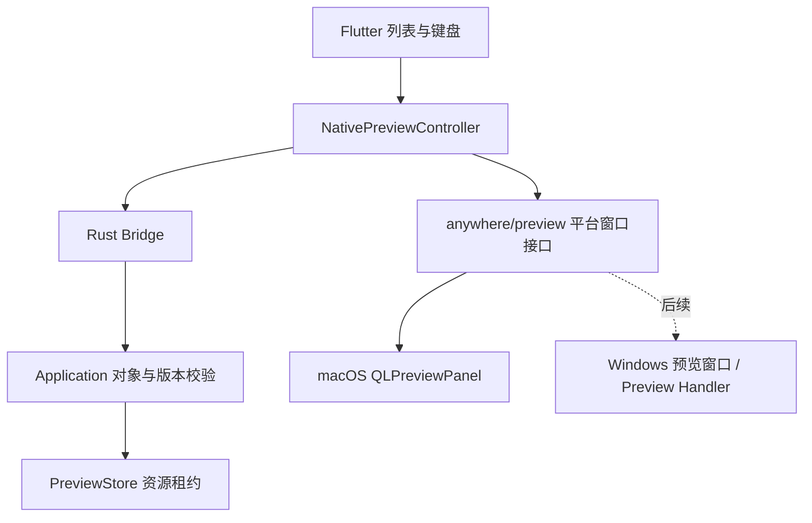

# 按需系统预览

V0.14 Build 30 起，文件搜索、剪贴板历史和悬浮剪贴板使用独立的系统预览窗口，不再保留右侧或下方内容区。当前只接入 macOS Quick Look；Windows / Linux 尚无渲染器。编译与测试不等于实机焦点、输入法、所有文件格式或性能验收，具体证据维护在 [V0.14](mvp-v0.14.md)。

## 操作

- 文件搜索、剪贴板历史和悬浮剪贴板进入或修改查询 / 类型后，默认不选中候选项。第一次 ↑ 或 ↓ 选中第一项，也可点击行选择；未选择时 Enter、对象动作和预览不执行。追加结果或短暂隐藏保留手动选择，目标消失则恢复未选择。
- 查询时空格仍是文字，输入法组合期间不处理预览命令。按 ↑↓ 浏览结果或鼠标选择后，空格可切换预览；修改查询、点击输入框或使用光标编辑键恢复文字输入。
- 选中对象后，macOS 也可用 ⌘Y 预览。Windows 预留 Alt+P，避免占用编辑器的 Ctrl+Y。选中行提供眼睛按钮；剪贴板更多操作中也有预览入口。
- 打开后，原列表中的 ↑↓ 更新当前预览，80ms 合并连续选择；每个展示会话最多一个在途准备请求，等待期间只保留最新目标。默认焦点留在列表；点击系统内容后，其文档、选择与播放器控件优先使用原生按键。
- Space / Esc 先关闭预览，不继续清空查询或返回。⌘L 关闭并返回查询。Enter 使用原列表的默认动作：文件打开、剪贴板复制；悬浮窗沿用显式复制返回规则。
- 查询、选择、类型和滚动位置与预览独立。失焦到同属的原生预览面板不隐藏 Launcher；切到其他应用或应用内其他窗口时关闭旧预览，Launcher 按原规则隐藏。页面状态仍保留 15 秒，恢复不重开预览。
- 不增加 Scope 或全局预览 Action。Git 输出、动作详情和 JSON 编辑器是结果 / 编辑页面，不属于移除范围。应用历史的独立原生预览入口尚未接入，可沿用此接口扩展。

## 职责与接口

Rust `preview_file` 校验当前 Session / Revision、候选身份、目录授权策略和文件对象；`preview_clipboard_entry` 通过历史服务校验开关、期限、删除与内容读取。两者返回统一的 `NativePreviewDto`，包含随机资源 ID、本地路径列表和标题。前端不能以任意路径请求 Rust 读取文件；此接口也不暴露给插件 SDK。

平台窗口接口只包含 `capabilities`、`show`、`close`，更新通过同一个 `show` 替换资源，使用递增 generation 拒绝旧请求。事件包括 `shown`、`closed`、`next`、`previous`、`activate`、`search`，均绑定资源 ID；旧窗口事件不操作新对象；确认执行还需匹配准备资源时的选择版本，选择已改变但新预览未就绪时忽略旧面板的确认。`closed` 可附带 `restoreFocus: true`，只在返回所属窗口时重新连接原输入框，切到其他应用时不抢焦点。公共协议不包含 NSPanel、HWND、COM 或 Flutter 像素布局。

Flutter 协调选择、请求版本、窗口事件和关闭。macOS Host 管理响应链、原生面板、内部焦点和系统控件，进程中最多显示一个 Quick Look 面板。Launcher 与悬浮窗通过各自 engine 的同名通道接入，切换窗口时撤销旧所有者。

## 资源与限制

- 本地文件使用经校验的原路径，不读取正文、不复制文件。原文件删除或无访问资格时拒绝准备；Quick Look 的具体格式与效果依赖系统及其扩展。
- 剪贴板文件引用保留多个原文件。文本、富文本与图片只在明确预览时写入私有临时目录；图片保留原编码，不再在 Rust 解码或通过 Bridge 传缩略图。HTML 仅作为惰性文本显示，不创建网络网页。
- 沿用剪贴板单条 16 MiB 上限，资源路径最多 256 项、租约最多 4 个。只有当前显示和在途更新占用租约，不预热整个列表。
- 原生窗口确认 `shown` 后，Rust 将租约保留到关闭。未确认的在途资源 5 秒过期，在后续准备时回收，防止 engine 退出后无人接收；已显示租约不会按此期限删除。关闭、替换和丢弃迟到响应会显式释放。
- 临时文件在释放后删除；`preview-resources` 专用目录中的崩溃遗留在下一次准备临时预览时清理，不清空剪贴板历史或用户原文件。
- 不支持的格式保留原来的搜索、打开、复制功能，预览失败使用原页面的行内通知。预览不计入 Action 使用频次。

Windows 后续可使用系统 `IPreviewHandler` 承载在独立窗口中，显式卸载处理器，保留系统隔离。当前接口只预留窗口生命周期和对象资源，并不保证 Windows 具有与 Quick Look 相同的格式支持或按键行为。

## 代码与验证

- 资格与资源：`application/file_preview.rs`、`features/preview.rs`、`features/clipboard/service.rs`。
- Bridge：`api.rs`、`api/files.rs`、`api/clipboard.rs`；公开 DTO 变更后生成 FRB。
- 协调与按键：`infrastructure/native_preview.dart`；文件筛选控制器不再读取正文。
- 原生：`NativePreviewHost.swift`，由 Launcher 和 ToolWindow Host 分别注册。

回归覆盖惰性读取、连续选择、迟到响应、关闭与失败释放、未支持平台、输入法组合态、普通空格和原列表操作。实机须额外检查 PDF / 图片 / 文本 / 多文件、原生面板焦点、关闭按钮、系统控件与跨应用切换；不以单元测试或主进程 RSS 证明原生 helper 全部退出。

原生响应链及控制权遵循 Apple 的 [QLPreviewPanel](https://developer.apple.com/documentation/quicklookui/qlpreviewpanel) 契约。原生文本编辑器也会接管 Quick Look，因此展示前暂时将键盘交给 Flutter 内容接收视图，关闭时恢复仍属于原窗口的编辑器。面板先展示再检查控制权，取得控制权后才更新数据源；重复展示时重新连接数据源，不能假设系统会再次调用接管回调。

主动关闭使用同步隐藏，避免 Quick Look 的延迟关闭动画打断下一次展示；系统关闭按钮仍沿用原生关闭事件。系统可能保留隐藏面板的控制器，因此响应链控制器只弱引用宿主，避免保留已关闭窗口的通道与 Flutter 引擎。

`scripts/check-macos-host.sh` 编译原生预览与回归源码，`scripts/check-macos-preview-live.sh` 在可交互桌面中运行独立窗口回归：文本输入竞争、立即关闭重开、对象更新、系统关闭、输入恢复与宿主释放。后者会短暂激活测试窗口，须显式运行，不包含在普通工程检查中。
