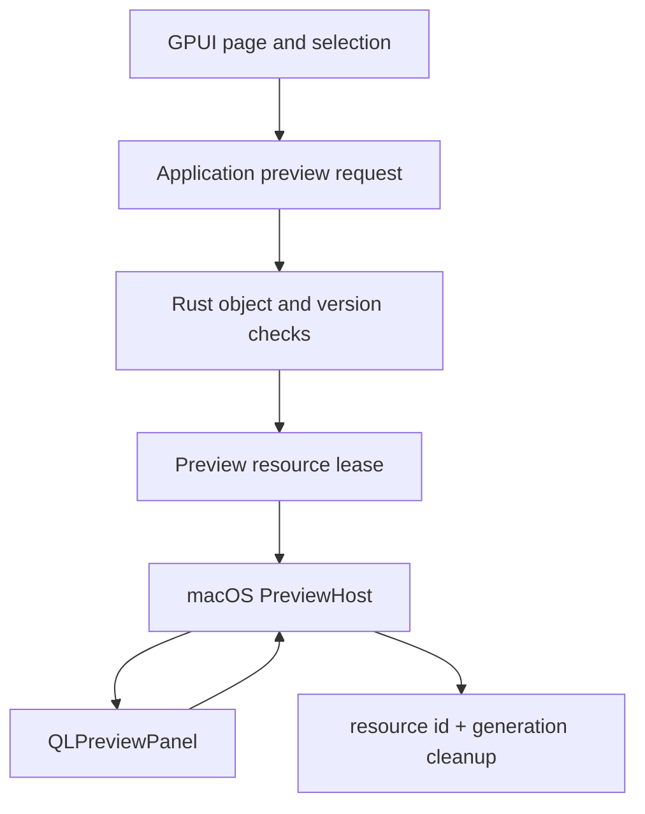

# 按需系统预览

文件搜索、Clipboard History 和 Clipboard Shelf 使用按需系统预览。当前只实现
macOS Quick Look；Windows / Linux 返回明确 unsupported。自动化只覆盖选择和
清理状态，真实焦点、输入法与渲染仍需桌验。最后整理：2026-11-16。

## 操作

- 进入页面或修改查询 / 类型后默认不选中条目。第一次 `↑` / `↓` 或点击选择，
  未选择时 Enter、对象动作和预览不执行。
- 查询中的 Space 是文字；输入法组合期间不处理预览命令。列表已有选中项且不在
  组合态时，Space 切换 Quick Look。只处理首次 key-down；按住产生的 repeat
  不反复开关，文本输入路径产生的 repeat 空格也会回滚，不形成第二次请求。
  Space 只在查询编辑器拥有焦点时归预览；页面按钮聚焦时 Space / Enter 激活
  按钮，不执行背后的候选预览。
- `⌘Y` 在文件、Clipboard History 和 Clipboard Shelf 上开关预览。行内眼睛按钮
  走同一打开路径。连续选择会把预览更新到最新目标；按住 `⌘Y` 只处理首次
  key-down。
- 面板打开后，Space / Esc 关闭预览而不继续清空查询或返回；`⌘L` 关闭预览并
  返回当前查询编辑器。Left / Right / Home / End / Backspace / Delete 或
  `⌘A` 会先退出浏览态并关闭预览，再继续文本编辑。关闭后焦点回到当前页面的
  查询编辑器；切到其他应用时不抢回键盘。
- 隐藏 Launcher、替换页面或应用退出时关闭并释放旧预览。15 秒恢复不重新打开
  预览。
- Quick Look 仅用于文件和剪贴板对象；Git 输出、插件 Detail 和 Web 工具使用
  自己的页面。

## 数据与资源

Rust 在准备预览时校验当前 Session / revision、候选身份、文件授权或剪贴板条目
资格。GPUI 不能把任意路径直接交给系统面板。Rust 生成短期资源 ID；平台适配器
只为当前资源取得原文件路径。

GPUI 从发起请求时冻结页面、Session 代次、请求代次和所选目标；文件还绑定
revision。准备结果返回、排队的原生 show 开始及 show 完成时分别复验，过期资源
立即交回 Rust 释放，旧错误也不覆盖当前提示。按键关闭、系统面板关闭、查询变化、
隐藏和页面替换均可撤销在途请求；迟到结果不能重新打开已经关闭的面板。

约束：

- 本地文件使用经校验的原路径，不复制正文；删除或失去权限后拒绝准备。
- 剪贴板文件引用可包含多个原文件；临时内容只由 Rust 写入私有预览目录。
- 同一页面和同一进程只显示一个 Quick Look 所有者。
- 旧资源、旧 selection 和旧关闭回调不能替换或关闭新预览。
- 关闭、失败、应用失活与页面替换都走同一 release 路径。

## macOS 实现

`apps/gpui/src/platform/preview.rs` 在 AppKit 主线程共享一个 `quicklook::QuickLookPanel`。主窗口和剪贴板架各持有自己的资源身份，任一窗口成功展示时接管面板。

- `show` 要求主线程、应用 active、Launcher 可见和有效资源数量；
- `poll` 检测归属变更、面板隐藏或应用失活，并返回资源 ID 供释放。被替换的窗口跳过焦点恢复。
- 当前所有者执行 `close` 时清空条目、隐藏面板，并在应用仍 active 时恢复对应窗口。旧窗口关闭时只释放自己的资源。
- 隐藏 Launcher 时立即关闭归属于主窗口的面板，剪贴板架仍可使用它自己的预览。

GPUI view 保存当前 preview resource 与 generation。只有当前 generation 的关闭
事件可以清除页面状态和恢复编辑器；旧回调忽略。物理关闭按钮和 `⌘Y` / Space /
Esc 共用同一清理路径。

准备请求的代次与已显示面板的监视代次分开。等待新目标或新目标准备失败时，旧面板
仍由原监视器检测关闭和失活。新目标的原生展示失败时，仍拥有面板的窗口重新启动监视并释放新资源。

## 代码位置

| 区域 | 路径 |
| --- | --- |
| Rust 文件与剪贴板资格 | `crates/anywhere-core/src/application/file_preview.rs`、`features/preview.rs`、Clipboard service |
| Shared runtime 请求 | `crates/anywhere-core/src/application/frontend_runtime/` |
| GPUI 页面状态与键盘 | `apps/gpui/src/launcher/view/` |
| Quick Look 平台宿主 | `apps/gpui/src/platform/preview.rs` |
| 窗口恢复与主循环 | `apps/gpui/src/app.rs`、`apps/gpui/src/platform/macos/` |

## 验证边界

状态测试检查 preview completion 恢复正确编辑器、resource 替换、关闭与页面
teardown。物理验收还必须覆盖：

- PDF、图片、文本、音频、视频和多文件；
- 中文输入组合期间的 Space 与方向键；
- 系统关闭按钮、面板焦点、跨应用切换与唤醒；
- Quick Look 渲染扩展冷启动与失败；
- `Reduce Transparency`、多个显示器和全屏空间；
- Quick Look helper 与主进程 footprint / 对象回收。

当前结果见 [GPUI 技术方案与验收](mvp-gpui.md#物理桌验矩阵)。不能用单测、一次
RSS 或隐藏面板的控制器已创建来证明系统渲染与资源退出。
