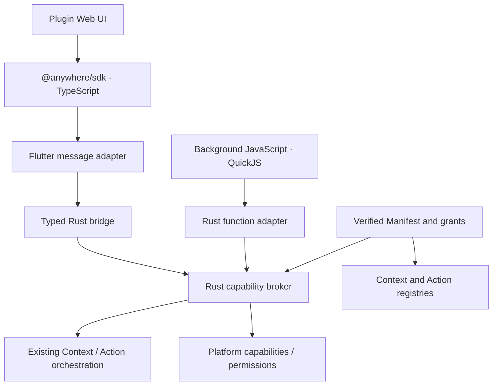

# Third-party runtime refactor

This is the implementation checklist for `codex/plugin-runtime-refactor`.
Existing package approvals, stable action IDs, resource validation, clipboard
consent and transparent Web styling remain the foundation.

## Delivery order

1. Extend the Rust capability broker with Context/Input snapshots, source/live
   application queries and Host-mediated input changes. Push state changes with
   a bounded latest-value subscription; close subscriptions with the document.
2. Publish the typed `@anywhere/sdk` facade, preserving Promise cancellation,
   request IDs, deadlines and retained-page reconnection. Migrate the examples
   and scaffold; plugin authors do not handle transport or theme setup.
3. Add statically declared background resolvers and commands. Create QuickJS
   only for a requested job, with memory, stack, time and cancellation budgets.
   Register resolvers through the existing Context registry. Derived types belong
   to the package namespace and never confer native file/application authority.
4. Exercise API calls, event ordering, teardown, grants, cancellation and invalid
   resolver output. Build both a UI example and a background Context example.
   Run the repository gates before native acceptance and packaging.

## Boundaries

WebView and QuickJS do not communicate directly. Source application means the
application captured before Launcher activation; frontmost means a fresh OS query.
Automatic resolvers cannot perform user-visible side effects. They receive only
approved projected input, not the native Context graph or paths. UI-only packages
create no QuickJS runtime. TypeScript is compiled when building packages.

The stages above are implemented. Repository gates and standalone UI/background
package conformance passed; native GUI acceptance is still pending. Evidence is
recorded in [Build 21](benchmarks/plugin-runtime-v0.14-build21-2026-10-27.json).
Supported API, budgets and package format are documented in [plugin-development.md](plugin-development.md).
