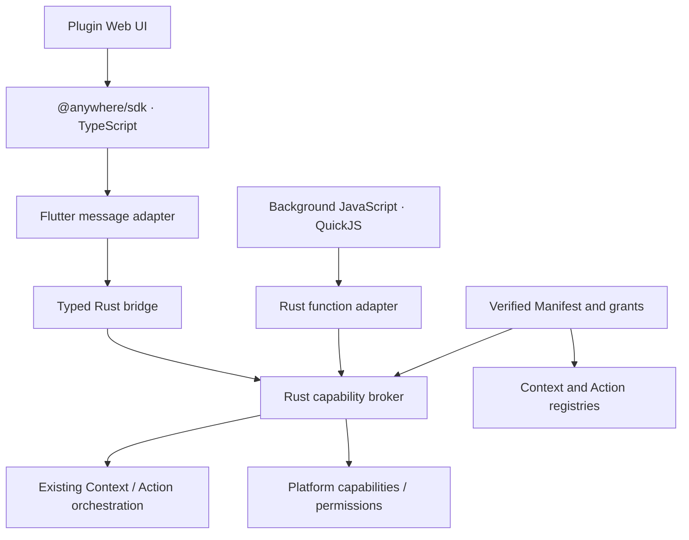

# Third-party runtime refactor

This is the implementation checklist for `codex/plugin-runtime-refactor`.
Existing package approvals, stable action IDs, resource validation, clipboard
grants and transparent Web styling remain the foundation.

## Delivery order

1. Extend the Rust capability broker with Context/Input snapshots, source/live
   application queries and Host-mediated input changes. Push state changes with
   a bounded latest-value subscription; close subscriptions with the document.
2. Publish the typed `@anywhere/sdk` facade, preserving Promise cancellation,
   request IDs, deadlines and retained-page reconnection. Migrate the examples
   and scaffold; plugin authors do not handle transport or theme setup.
3. Add statically declared background resolvers and commands. Create QuickJS
   only for a requested job, with memory, stack, time and cancellation budgets.
   Register resolvers through the existing Context registry. Derived types belong
   to the package namespace and never confer native file/application authority.
4. Exercise API calls, event ordering, teardown, grants, cancellation and invalid
   resolver output. Build both a UI example and a background Context example.
   Run the repository gates before native acceptance and packaging.

## Acceptance status

Build 25 / JSON 0.7.1 passes the current native clipboard routes: all three copy
commands complete without opening an editor or requesting per-operation approval,
and native paste verifies their output. Escaped output matches the same JSON
Context again. Workspace receives the decoded document and copies query results
without leaving the editor. See the [Build 25 acceptance record](benchmarks/direct-clipboard-v0.14-build25-2026-10-27.json).

Settings close/discard decisions, the footer-free editor, both formula modes,
IDEA/VS Code history navigation and object menus were exercised in the earlier
[Build 24 acceptance](benchmarks/acceptance-fixes-v0.14-build24-2026-10-27.json).
Those historical clipboard confirmation and Unescape observations describe the
previous contract. Physical-input retention, the full source/platform matrix and
memory were not remeasured in Build 25.

## Boundaries

WebView and QuickJS do not communicate directly. Source application means the
application captured before Launcher activation; frontmost means a fresh OS query.
Automatic resolvers cannot perform user-visible side effects. They receive only
approved projected input, not the native Context graph or paths. UI-only packages
create no QuickJS runtime. TypeScript is compiled when building packages.

The stages above are implemented and covered by repository gates, standalone
UI/background package conformance and the scoped native acceptance above.
JSON Workspace uses package-owned Context for both editor and headless commands;
the adapters share preferences through `anywhere.storage`. Context-only commands
use `requireContext`; ordinary keyword search still opens an empty workspace.
JSON publishes a single `plugin.dev.anywhere.json-workspace.json` Context
with decoded JSON text. Workspace and all three copy commands accept this type;
the redundant Unescape route is removed. Build-by-build evidence is indexed in
[V0.14](mvp-v0.14.md). Supported API, budgets and package format are documented in
[plugin-development.md](plugin-development.md).

Build 25 changes clipboard policy: installation still reviews read/write grants,
but qualified calls execute without per-operation confirmation. Headless commands
finish in Rust before ActionResult is returned; no Web tool route is published.
Flutter no longer owns background execution or clipboard consent panels.
