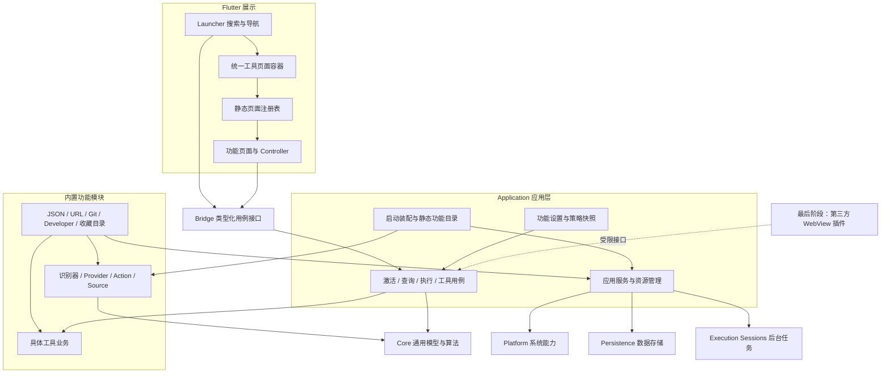

# 内置功能模块架构：取消第一方热加载模型

日期：2026-10-14。方案核对基线 `dev-0.9@e4dbedc`。用户已确认并按 [迁移路线图](../feature-module-roadmap.md) 分阶段实施；当前完成情况见 [MVP](../mvp-v0.9.md)。第一方不实现热加载，热加载只在最后阶段的第三方 WebView 插件中实现。本文替代前一份方案的第一方 Runtime / NativeProcessRuntime 方向。

2026-10-16 补充：本文建议的首个 JSON 原生工具已被用户取消，JSON 整体延期到 WebView 插件机制完成后实现。当前范围与待清理项以 [V0.9 MVP](../mvp-v0.9.md) 为准，其余模块架构决策继续有效。
## 1. 命名与目标

第一方称为内置功能模块（Feature Module），第三方扩展称为插件（Plugin）。模块编译进 App，随 App 一起发布；没有安装、卸载、加载、重载、独立版本协商或原生二进制热更新。

`Feature` 表达产品功能；`Permission` / 系统授权表达可调用的系统操作，避免都叫 Capability。模块化保留，插件运行机制从第一方移除。内部无需再设计一份 Native Plugin SDK 或预留原生 sidecar。

目标：新增功能主要修改自己的模块和页面；公共流程只认识贡献接口和执行资格，不依赖 JSON / Git / Developer 等具体实现。保持 Context → Action → Candidate → Ranking 的主流程和当前交互契约。

## 2. 整体分层



图中是逻辑边界，不要求现在建立同数量的 crate。先沿用现有 workspace，把职责和依赖整理清楚；模块需要独立依赖管理时再拆包。

## 3. 职责

| 层 | 负责 | 约束 |
|---|---|---|
| Core | Context Graph、Action / Candidate、Ranking、执行契约与公共身份 | 不列模块、不读 Manifest、不认识具体功能页面 |
| Application | 启动装配、用例、配置策略、会话 / 版本协调 | 知道如何组装，不复制具体业务算法 |
| 功能模块 | 自己的识别、动作、Source、工具业务和类型化服务状态 | 不导入 Application 或持久化实现，不自己抓取另一个前台环境 |
| 应用服务 | 平台操作、存储接口、任务调度与取消等共享资源 | 用途明确，避免变成到处可取任意对象的服务容器 |
| Flutter 功能页面 | 输入、局部展示状态、焦点和工具交互 | JSON 处理、Git / 项目逻辑仍在 Rust |
| 页面容器 | 通用返回、状态、窗口、保留时间与主题 | 不解释外部 UI DSL，不按业务 ID 写分支 |
| Platform / Persistence | OS 差异及数据库 / 文件适配 | 模块通过窄接口调用，保存 namespace 与事务边界 |

## 4. 静态注册

现有 `FeatureContribution` 是可复用的基础。将它整理为启动时一次提交的贡献：

```text
FeatureDescriptor
  id、名称、描述、默认设置、是否基础功能
FeatureContribution
  轻量 InputRecognizers
  ContextProviders
  ActionBundles / ContextActionFactories
  CandidateSources
  工具页面 ID 与元数据
```

描述使用 Rust 类型常量，不再为每个内置模块解析第三方式 TOML 协议、维护独立插件版本或批准令牌。Native 页面仍由编译后的 Dart factory 注册。

保留编译期生成目录的自动注册：模块提供固定名称的 contribution 入口，生成器收集、排序并检查冲突，生成 Rust 模块目录和 Dart 页面目录。运行期不扫描模块源码、动态库或配置寻找新功能。新 crate 仍需加入构建依赖。

Application 创建一次稳定 FeatureCatalog 和所需服务。查询时产生菜单 / npm scripts / Cargo targets 等 Context 动作，属于日常业务结果，不重建 Feature Module。成本高的服务和页面按需创建，缓存有界。

不要求所有模块实现统一的 load / unload / start / stop / restore_state。模块拥有类型明确的业务服务，例如 SavedDirectoriesService；取消工作归属具体搜索、请求、页面或任务。

## 5. 设置即时生效

FeatureCatalog 的定义集合稳定；可用功能由 `FeaturePolicySnapshot` 筛选。

功能开关变更：验证并保存配置 → 原子发布新策略 generation → 取消该功能的待处理工作并失效旧会话 / 执行资格 → 同步候选、识别资格、Scope 与快捷键目录。

不重新创建所有模块，不替换整套静态定义。执行仍检查当前策略、Session / Revision、真实资源与 OS 权限；不以 UI 隐藏作为执行权限。

自动选区 / 剪贴板填入必须使用当前策略下的轻量识别器，沿用 15 秒剪贴板期限；关闭 JSON / URL 模块后不能靠该模块触发内容页。基础路径 / Text 等服务根据原产品契约保留。

关闭功能取消待执行调用，已启动任务继续由 ExecutionSessionManager 管理。Launcher / 工具页面保留 15 秒，配置改变后恢复资格仍需验证。

## 6. 数据与资源

移除跨重载的 `Arc<dyn ExtensionState>` / Any 状态箱，改为模块自己的类型化 service / repository。数据库连接、事务、缓存和故障恢复是正常数据服务的职责。

Storage namespace、键 / 字节额度、原子写入、损坏只读恢复和数据库重连保留。数据刷新使用具体功能的 refresh / retry，不需要“重新加载全部模块”。原 namespace 和数据文件可继续使用，不为名称变化强迫用户迁移数据库。

搜索取消、Source 缓存失效、AX 菜单重扫、旧回调拒绝、应用退出清理、任务停止，以及 worker 真正结束前不释放 admission 等机制必须保留。它们保护性能和执行正确性，不随第一方重载机制删除。

## 7. 具体移除与替换

| 当前实现 | 调整 |
|---|---|
| FirstPartyExtension | FeatureModule / FeatureContribution，启动装配 |
| FirstPartyManifest + include_str / OnceLock | 类型化 FeatureDescriptor，统一 App 发布版本 |
| runtime / runtime_with_state / ExtensionRuntime | 启动建立贡献和业务 service；不保留通用插件运行状态 |
| ExtensionState.refresh + Any downcast | 具体 repository 的读取 / 刷新 / 恢复 |
| approved(id) 模块分支 | 应用装配注入窄服务；正常系统权限与执行访问策略保留 |
| Native 与外部共用 ExtensionManager | FeatureCatalog / FeaturePolicy；外部兼容独立 |
| first-party 插件 Reload / 全局 runtime 重建 | 功能设置即时发布与具体数据刷新 |
| pluginDetail Controller / Screen 分支 | 静态 ViewRegistry + ToolPageShell；Detail 作为内部组件 |
| NativeProcessRuntime / 原生热加载预留 | 取消，不设计 IPC / 原生 ABI |

`replace_extension_runtime` 中的第一方重装配用途退役；其中会话失效、epoch 与取消原则分别落入设置 / 查询生命周期，不能连同正确性保护一并删除。

第三方旧 TOML 从第一方架构中分离，只留独立启动兼容入口；安装 / 修改后通过重启生效，不继续保留外部运行期 Reload / UI DSL 扩展。用户文件和批准数据保留，未来 Web 插件阶段单独迁移。第三方 WebView 的热加载管理器到最后阶段再实现。

## 8. 代码组织建议

```text
anywhere-core/src/
├── core/             模型、算法、公共贡献契约
├── application/      用例、composition、feature_catalog、feature_policy
├── features/
│   ├── json/          识别、动作、工具业务
│   ├── url/
│   ├── git/
│   ├── developer/     Maven / Gradle / Node / Rust / Spring 共用基础
│   ├── saved_directories/
│   ├── filesystem/
│   └── applications / app_actions / text
└── persistence/       数据适配

apps/flutter/lib/
├── launcher/          主窗口和导航
├── tools/             ToolPageShell、静态 ViewRegistry
├── features/          各原生工具的页面与 Controller
├── settings/          功能设置；旧第三方入口独立
├── ui/                样式、图标与可复用组件
└── infrastructure/    系统通信和窗口
```

采用按功能纵向组织，避免重复 features / extensions 两套内置目录。现有小模块先合并目录，Developer 保留公共实现。公共组件只在多个真实功能使用后提取；不能为了将来插件化把简单调用全部变成消息总线。

## 9. 第一方功能开发范式

新增功能：定义输入与 Context → 实现 Rust 业务服务和贡献 → 必要时提供 Flutter 工具页面 → 编译期自动进入目录 → 补业务和交互测试。

已有 ActionId、ProviderId、ContextType、Scope、快捷键与 Storage namespace 保持稳定。Feature 的显示名称变化不迁移业务身份。Bridge 按功能提供类型化用例，通用 Launcher 不为每个工具新增分支。

首个实际工具建议 JSON 原生页面：编辑、格式化、压缩、复制、错误定位和原查询返回，复用现有 Rust 逻辑。Context Detail 迁为内部组件，不作为外部 DSL 产品继续发展。下一批再做 IDEA Recent Projects 等列表工具，不把它们塞进本轮架构改造。

## 10. 实施顺序与验收

1. 建立 FeatureDescriptor / 静态贡献目录，迁移 9 个内置模块；新增测试模块不改 Launcher 或业务清单。
2. 拆分功能设置与外部兼容，移除第一方重载流程、泛型状态箱和 Manifest 解析；数据迁移保留原文件，损坏 / 未知版本不得覆盖。
3. 策略变更统一影响识别、候选、Source 和快捷键；执行和恢复拒绝旧资格，后台任务独立。
4. ToolPageShell / ViewRegistry，迁移 Detail 并实现 JSON 原生工具页；焦点、IME、Esc 和 15 秒恢复验证。
5. 清理旧接口 / 无用代码、更新路线图与架构文档，全量回归、打包与实机验证；测量启动 / 查询 / 页面切换和内存。

验收核心：新增功能局部修改、旧功能身份和行为稳定、功能开关无需重新装配模块、执行安全和取消预算保持、无第一方热加载运行机制或预留接口。
