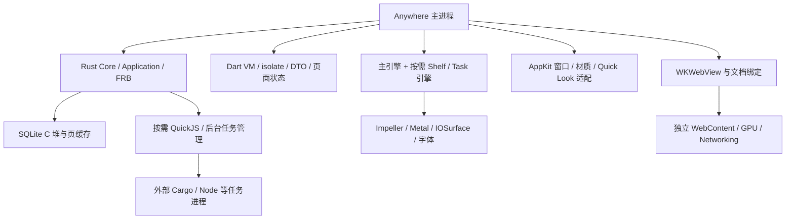
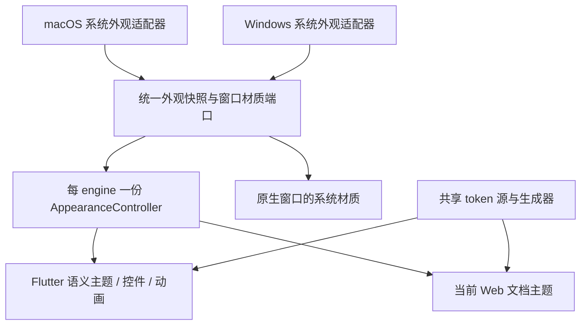

# Flutter 3.50 升级与内存调研实施方案

调研日期：2026-11-12。对象为 `origin/main` 的 Flutter 产品，基线提交
`81c523cdb95031ac00cfcdc25360eefb48f85b21`，版本 `0.14.0+46`，macOS arm64。
本分支从该提交新建，不包含 GPUI 实验分支、未提交改动或界面迁移。
本文区分源码事实、当次测量与后续方案；资源现行契约仍以[性能指南](../performance.md)为准。

## 1. 结论与交付范围

1. 将 SDK 固定版本从 3.47.8 升至 3.50.0；CI、检查和打包均读取根目录
   `.flutter-version`，不另建一套版本配置。升级不等同于内存优化，收益需同机对照。
2. 内存由 Rust / SQLite、Dart 对象、Flutter VM / 引擎、Metal / IOSurface、
   AppKit / Quick Look，以及进程外 WebKit 等共同组成。现有数据不足以给出可信的
   “Dart 占 X%、Rust 占 Y%”饼图；必须把分配归因和物理内存指标分开测。
3. 优先治理随数据量增长的文件结果及跨桥副本，其次评估独立窗口的增量成本、
   大载荷转换峰值和内存压力下的非活跃缓存。图标已有预算，降低其预算只能得到局部收益。
4. 保留 Impeller、15 秒隐藏恢复、权限与执行版本检查。设置页已经共享引擎，
   后台任务也已经独立于窗口存活；不重复实施已有优化。
5. 本次已实现显式诊断、文件结果共享与执行索引、64 行有界结果窗口、Web HTML 单次拼接，
   以及系统内存压力下的非活跃缓存清理。100,000 个可用命中时，生产会话只保留当前页的
   Candidate、presentation 和可执行窗口；隔离夹具稳定为 77,946 Rust 请求字节。独立 Release
   GUI 也已对 100k 文件完成首页→下一页→上一页和 15 秒内恢复。这不是 RSS，也不代表查询
   临时磁盘、Dart、Flutter、GPU 或 Web 缓存同步下降。
6. 系统玻璃 / 外观适配 A1–A3 已实现并通过自动化：窗口内实时明暗、对比度、透明度、
   动态效果、系统强调色、Flutter 两套设计库和 Web 文档共享同一版本。A4 的核心真实系统
   设置矩阵已在 macOS 27.2.1 实机通过，VoiceOver、物理中文 IME、Quick Look 和多显示器 /
   DPI 仍待单独验收。
7. P6 已补近 1 MiB 本地 JSON、近 1 MiB Text Pad、5 次新 origin reload、跨插件替换和关闭
   回落。JSON 功能路径通过；重载暴露出并修复“先关闭整个 invocation 再重绑”的生产缺陷。
   WebKit 的进程外峰值远大于主进程 footprint，近限 JSON 的 WebContent RSS 达
   262.05–278.19 MiB，不能用 1 MiB 输入额度替代整 App 预算。
8. 插件 SDK 在首次启动时让早期订阅等待 `lifecycle.ready`，避免订阅快照与就绪请求并发；
   51 项 SDK 回归通过。测试期间 Text Pad 页面曾显示 `INACTIVE`，修复后的最终 WebKit
   实机复测仍须在桌面解锁后完成。
9. Windows 尚未有 Flutter runner。本次交付平台中立外观 / 压力端口、强制色 Web 规则和
   降级语义；A5/A6 必须等 Windows Host 接入后再接公开 Win32 / DWM 信号与实机验收。
   详细边界见第 8 节。

## 2. Flutter 3.50 升级方法

### 2.1 版本与隔离

官方于 2026-11-11 发布 Flutter 3.50，配套 Dart 3.14；核验入口为
[官方发布说明](https://flutter.dev/blog/whats-new-in-flutter-3-50)和
[迁移索引](https://docs.flutter.dev/release/breaking-changes)。
本机独立 SDK 使用官方 Git 标签 `3.50.0`，framework revision
`ab2912035e160d9cad6306df307576da6128ebdb`，engine revision
`371f77202a73e8dff57a8b3bff75bca55c090aee`。标签 checkout 的 channel 显示
`[user-branch]`，不冒充通过 `flutter channel stable` 安装；版本及 revision 已核对。
SDK 放在本 worktree 被忽略的 `.tools/flutter-sdk/flutter`，不覆盖全局 3.47.8 SDK。

```bash
export PATH="$PWD/.tools/flutter-sdk/flutter/bin:$PATH"
flutter --version --machine
python3 scripts/check-flutter.py
flutter --no-version-check precache --macos
```

SDK 下载清单及预构建 ZIP 在本次环境返回 404，改从官方标签 bootstrap Dart 与引擎。
CI 仍使用现有 `subosito/flutter-action` 按 `.flutter-version` 安装，远端 CI 的实际下载
与执行结果须单独验证。本机可构建不自动证明 CI 安装路径可用。

### 2.2 需要重点核对的兼容点

| 项目 | 检查与处理原则 |
|---|---|
| SDK 与依赖 | `pub get` 由新 SDK 解析并提交必要 lockfile 变更；不顺带执行全量 `pub upgrade` |
| Material / Cupertino | 官方在 3.50 弃用 SDK 内设计库；先以 analyzer 的实际结果决定必要迁移，避免仅更改版本号而遗留门禁失败 |
| 本地化 | 如迁移独立设计库，同时核对 delegates、生成本地化代码和第三方插件类型；不手改生成文件 |
| FRB 2.13.0 | SDK 升级不改变桥协议，维持运行库与生成器四处版本一致；执行真实 dylib 测试 |
| 手工 macOS 打包 | 验证 Flutter assemble、Release 框架路径、swiftc、原生 WebView 插件框架重编译和签名 |
| 表面缓存保护 | `NativeFlutterSurfaceGuard` 依赖内部 Flutter 选择器，必须运行真实框架测试；ABI 不同或上游修复后重新决定移除方式 |
| AX 状态与嵌入 WebView | 核对 FlutterEngine 通知、晚建引擎语义树与原生子树连接；单元测试不能替代 VoiceOver / 实机 AX |
| Tooltip | 重放 `launcher_semantics_lifecycle_test.dart`；SDK 升级本身不证明旧问题消失，不贸然删除语义隔离 |
| 多窗口 | 现有 ToolWindowController 创建独立引擎；不在这次升级中改用实验多窗口 API |

[独立设计库迁移指南](https://docs.flutter.dev/release/breaking-changes/material-ui-and-cupertino-ui)
说明了导入和主题类型边界：第三方公开 API 如果仍暴露旧设计库类型，兼容桥不能解决所有
类型不匹配。因此迁移必须同时检查 `flutter_inappwebview` 调用、测试和本地化，不能只机械替换导入。

本仓库 main 没有 `scripts/check-gpui.sh`；该门禁属于实验分支，本分支运行 Flutter main
已有的 `scripts/check.sh`。这不需要引入 GPUI 脚本或源码。

## 3. 内存构成与代码证据

### 3.1 进程内外关系



这个图表示所有权和依赖，不表示内存字节可沿箭头相加。共享映射、压缩页和驱动记账会使
“所有 RSS 相加”重复计数；外部构建工具的工作集也应与启动器自身常驻成本分别呈现。

### 3.2 分层清单

| 层 | 主要内容与生命周期 | 入口与现有限额 | 待量化部分 |
|---|---|---|---|
| Rust 常驻 | Application、Feature / Action 注册表、应用目录、Usage 快照、Tokio 及线程栈 | `application/application_index.rs`、`session_model.rs`；空排除集共享 full / visible 的同一 Arc | 开启排除后目录副本、旧扫描快照共存、线程实际驻留 |
| Rust 会话 | Context、匹配候选、执行校验表、菜单、文件结果 | `application/snapshot.rs`、`file_workspace.rs`；异步发布与执行前校验版本 | 多套集合的浅拷贝 / 深拷贝、全量 DTO 构造峰值 |
| 持久化 | SQLite 页、语句、BLOB 转换、读入源文件 | `persistence/clipboard.rs` 页缓存 512 KiB；`module_storage.rs` 256 KiB；历史 SQLite 2 MiB | SQLite C 堆、同时存活连接和临时表，不由 Rust 分配器完全统计 |
| Dart | DTO、StableList、ViewState、Controller、监听器、编辑文本 | `launcher_session_coordinator.dart`、`launcher_view_state.dart`；旧版本响应被丢弃 | 有效结果总量、保留路径、GC 后 live heap 与 heap capacity 的差异 |
| 图标 | 原始编码字节、解码图像、GPU 纹理 | 编码 128 项 / 2 MiB；每引擎 ImageCache 128 项 / 8 MiB，单项编码 256 KiB，4 个加载并发 | live image、解码在途和 GPU 纹理不属于 8 MiB 硬上限 |
| Flutter 引擎 | VM / isolate、调度、语义树、字体、渲染器、消息通道 | Launcher / Settings 共用主引擎；Shelf / Task 按需独立引擎 | 每开一窗口的净增量、关闭后的高水位与长期趋势 |
| 图形 / AppKit | surface、backing store、材质模糊、文字与 IOSurface | `LauncherWindowCoordinator.swift` 隐藏时缩至 64 高；ToolWindow 关闭解绑 | 多缓冲、Retina 比例、窗口服务器和引擎缓存的物理归属 |
| Quick Look | 当前预览、临时文件与资源租约、系统渲染进程 | 按需准备，80 ms 合并选择，最多 4 租约，未确认 5 秒过期 | PDF / 图片 / 视频格式差异、关闭后的系统保留 |
| WebKit | WKWebView、JS 堆、DOM、资源、共享进程池及 helper | 文档替换清理；插件 `WKProcessPoolManager` 静态共享池 | helper 可被系统保留，须核对归属而非只看进程名 |
| QuickJS | 历史转换或后台插件每次创建的 VM / 输入输出 | 两类 VM 各自配置 32 MiB；后台 VM stack 256 KiB | 多个工作域同时执行时的总峰值，以及 VM 外输入 / JSON 解析副本 |
| 外部任务 | Cargo / Node / Git 子进程及输出 | 最多 4 活跃 / 32 保留，stdout、stderr 各 128 KiB | 子进程可大于主 App，输出额度不限制整个任务 RSS |

以上 Rust 路径以 `crates/anywhere-core/src/` 为前缀；Flutter 路径以
`apps/flutter/lib/` 为前缀。预算控制对象内容，而非所有语言对象头、分配器碎片或系统图形资源。

对于图形层，可以先用尺寸解释量级：假设 Retina 2×、RGBA8，一张 648×600 逻辑像素的
surface 原始像素约 5.93 MiB，920×600 约 8.42 MiB；多缓冲再叠加纹理、字体和材质中间结果。
隐藏窗口缩至 648×64 时同一公式约 0.63 MiB。这只是像素预算估算，实际有像素格式、行对齐、
压缩、共享及引擎保留差异，不能把窗口尺寸变化直接换算为已释放 footprint。
同理，常见 36 逻辑像素图标在 2× 下的 RGBA 像素仅约 20 KiB；应先看缓存实际填充和
live image 数，再决定是否值得进一步压缩现有 8 MiB 缓存额度。

### 3.3 文件搜索是最明确的增长方向

扫描器通过查询局部磁盘记录、64 KiB buffer 和外部排序避免把整个磁盘目录放入内存。
`features/filesystem/result_store.rs` 已限制排序块为 512 项 / 1 MiB、16 路归并。
P2 又收紧了可见窗口：

- `file_workspace.rs::load_file_page` 使用查询编号、提交边界和排序位置编码的 opaque cursor，
  按页重读；新页替换 Session 的 Candidate 与 presentation 窗口，不再累计所有已访问页。
- 执行表只索引当前页。切换页面后旧页目标不能凭旧快照执行；新页仍按 session、revision、
  catalog、文件和权限版本重新验证。
- FRB 只传输当前 64 行页面。Dart 页面替换为新快照，不会无限累积所有已浏览 DTO。
- 尚未冻结时，扫描进度只更新稳定首页；用户选择或滚动后冻结当前页，新覆盖信息以
  `needs_refresh` 表示。上一页 / 下一页使用 cursor 重读，查询变化后旧 cursor 失效。
- ListView 本来只创建视区附近的行；P2 现在也让 Rust 与 Dart 的底层候选窗口保持有界。

隔离夹具在 10,000 与 100,000 总命中上都只构造 64 行窗口，三者同时存活时为 77,946
请求字节。该结果不包含查询临时文件、Dart / FRB 页面 DTO、Flutter Widget、Metal 或 OS 页；
整 App RSS、翻页延迟和 100k 桌面交互仍需另行测量。

### 3.4 隐藏、关闭与 GC 的区别

Launcher 隐藏后保留有效输入 / 页面 15 秒，期间立即撤销副作用；到期清理会话和非活跃图像。
主引擎仍驻留以保证下次快捷键唤醒。设置页通过原生视图移动共享引擎，不额外创建一套。
Shelf / Task 显式关闭后执行页面卸载握手、拆卸 native content、解绑专用引擎。
Rust 任务不随任务窗口销毁，避免关闭监控界面终止命令。

清掉集合引用只说明对象可回收；Dart GC、malloc 保留页、Flutter surface cache 和系统压缩
决定物理数值何时变化。不能以 `dispose()` 已调用推断 RSS 应立即回到冷启动。
Flutter 的[ImageCache 文档](https://api.flutter.dev/flutter/painting/ImageCache-class.html)
也明确区分缓存条目和 live references；现有 `releaseIdleDesktopImages()` 只清 pending / keepAlive。

### 3.5 WebKit 和大内容的峰值

`flutter_inappwebview_macos 1.1.2` 的 `InAppWebView.swift` 使用静态
`WKProcessPoolManager.sharedProcessPool`。这解释了池对象的常驻引用，不能单独证明所有 GPU
helper 保留由其导致。关闭页面应验证 WKWebView、文档绑定、订阅与排队请求是否回落；
系统 helper 是否退出另行记录。强杀 helper 会破坏实验条件，也可能影响共享服务。

本次近限 JSON 夹具把这一点量化了：输入为 1,046,501 字节、45,500 个数组元素和 45,501 个
解析节点，格式化结果 227,502 字节；主进程 RSS 为 102.22–111.25 MiB、footprint 约
93.5 MiB，但进程外 WebContent RSS 为 262.05–278.19 MiB，GPU 为 17.83–22.11 MiB。
这说明 Host 的 1 MiB 文本额度只限制一次协议传输，不限制 WebKit 的文本存储、解析树、DOM、
自动格式化副本、JavaScript 引擎和渲染高水位。5 次新 origin reload 后，仍打开空白文档的
WebContent 保留约 49.1 MiB 高水位，说明关闭旧文档可回收绑定，却不能要求 WebContent 进程
在仍服务同一窗口时立即归还全部页。完整原始值和限制见
[P6 大文档矩阵](../benchmarks/flutter-3.50-web-matrix-2026-11-12.json)。

剪贴板 128 MiB 是持久内容预算，不等于启动就加载 128 MiB；列表查询只取摘要。
单条 16 MiB 载荷在采集、SQLite 比较、按需预览及原生剪贴板写回中可能形成不同阶段的峰值。
历史来源有 8 MiB 输入、2 MiB 输出、4096 条结果上限，但源字节、解析树、QuickJS 值、
序列化输出、Rust Item 和 Dart DTO 可在转换阶段重叠；32 MiB VM 限额也不包住这些宿主对象。

## 4. 测量方法与本次证据

### 4.1 指标不能互换

| 指标 | 适合回答 | 不能直接回答 |
|---|---|---|
| 主进程 RSS | 当前驻留页随场景如何变化 | 真实私有成本、压缩页、所有 helper、语言占比 |
| Physical footprint | 相同平台与场景下的内存压力 / 记账趋势 | 每种语言的精确拆分、与所有 RSS 的相加 |
| vmmap 分类 | MALLOC、匿名 VM、映射文件、图形区域的变化 | MALLOC 全归 Rust 或全归 Dart；分类可能跨组件 |
| Rust requested live / peak bytes | Rust 分配热点和副本量 | SQLite C 堆、allocator overhead、Dart、Metal |
| Dart heap snapshot / retained path | 哪个根持有 DTO、页面或回调；GC 后对象增长 | Release 整 App footprint、Swift / Rust 堆 |
| 引擎 / WebView 对象计数 | 窗口关闭后是否残留多套实例 | 对象为 1 就证明缓存小或长期无泄漏 |

[Flutter DevTools Memory](https://docs.flutter.dev/tools/devtools/memory)提供 heap / external
曲线、diff snapshot 和 retaining path；应在 profile / 可诊断构建中定位对象，另用正常 Release
包测用户成本。[Apple 内存分析指南](https://developer.apple.com/documentation/xcode/gathering-information-about-memory-use)
介绍 vmmap、Memory Graph 与 Allocations。附加诊断、强制 GC、malloc stack logging 的结果
必须标注，不能混入普通 Release 的 A/B 基线。

### 4.2 本次可复跑的 Rust 合成夹具

在上述 main 基线、新 worktree 中用 Rust `1.100.0-beta.7` Release 编译既有
`memory_measure`，macOS 27.2.1 / arm64，独立进程重复运行三次。
夹具只使用临时 SQLite、16 MiB 合成剪贴板和 1024 条合成历史，不读取个人历史正文。

```bash
cargo run --release -p anywhere-core --example memory_measure --locked
```

| 观测项 | 本次首份结果（Rust 请求字节） |
|---|---:|
| 16 MiB 重复载荷的额外峰值 | 125 |
| 1024 条历史查询额外峰值 | 2,536,515 |
| 查询结果与服务同时存活的增量 | 2,339,920 |
| 释放结果并取消会话后的增量 | 64 |

三次独立运行的四项结果均一致。这些值验证既有 Rust 副本优化仍在，不是本次 SDK 升级带来的节省。
尤其 125 字节排除了已准备好的 16 MiB 输入，也排除了 SQLite / C 分配，不能表述为
“复制一张 16 MiB 图片只消耗 125 字节”。完整结果、源码 / 二进制 SHA-256 和环境记录见
[本次基准 JSON](../benchmarks/flutter-3.50-rust-memory-2026-11-12.json)。

### 4.3 本次 Release 初始隐藏进程样本

在全量检查和最终签名构建结束后，从本 worktree 的明确 App 路径直接启动一个新进程，
使用空的独立数据目录、默认关闭历史采集，不操作现有其他开发实例。启动后等待 20 秒，
请求 60 秒采集，实际末个采样时间 60.06 秒，共 13 份 RSS；随后读取 vmmap 和 heap。
未进行首次用户唤醒，也未单独核对 Dart ready / 首帧，因此这是初始隐藏启动观察，
不能当成使用后隐藏、S0 ready 完成或标准交互负载的结果。

| 观测 | 本次值 |
|---|---|
| 主进程 RSS 首 / 末 | 109.70 / 96.30 MiB |
| 主进程 RSS 范围 | 96.30–109.70 MiB |
| Physical footprint 首 / 末 | 43.2 / 43.2 MiB，采集器以系统输出换算，原值有舍入 |
| vmmap 当时 / 进程历史峰值 footprint | 原始 `43.2M` / `79.9M`；峰值包含采样前启动过程 |
| malloc zone 汇总 | 原始 allocated `14.8M`、resident `17.0M`、swapped `5984K`；不是 Rust 独占 |
| Stack | 原始 virtual `64.0M`、resident `752K`，35 个 region；虚拟栈预留不等于占满物理内存 |
| IOAccelerator (graphics) | 原始 resident `1664K`、swapped `1648K`，不是全部图形资源 |
| 原生对象 | FlutterEngine、FlutterViewController、FlutterVSyncWaiter、WindowMaterialController 各 1 个 |
| 子进程 / WebKit | 13 份样本 PID 子进程为空，目标 XPC 域的 WebKit 运行实例均为空，无 unknown |

RSS 回落而 footprint 不变，正说明页驻留 / 系统记账口径不可互换；本次不能归因为代码优化。
vmmap 的映射库 region 包含共享驻留，不能与 ps RSS、malloc zone 或 footprint 相加。
这些证据能说明当前初始实例有一套主引擎、malloc 与图形开销，但不能可靠拆成各语言比例。
样本结束后只向自己启动的 PID 发送 SIGTERM，确认退出；不作为 GUI 正常退出验收。
其他开发实例和主机压力未控制；未在采样期间启动编译 / 全量门禁。完整脱敏数据见
[初始进程记录](../benchmarks/flutter-3.50-desktop-initial-2026-11-12.json)。

### 4.4 标准场景矩阵

每个 SDK 至少 3 个全新 Release 进程；保持相同 App 代码、架构、分辨率、缩放、语言、权限、
数据、签名方式和 fixture，交替运行 3.47.8 / 3.50.0。测量时不同时编译或跑测试。
先分别记录冷启动、预热，然后进入以下状态；关闭后先等待超过 15 秒，再空闲观察 5 分钟。

| 场景 | 负载与步骤 | 必须记录 |
|---|---|---|
| S0 冷启动隐藏 | 空隔离目录；采集关闭；未打开 Web 或预览 | 首次 ready、30 秒、5 分钟 RSS / footprint；引擎数 |
| S1 主搜索 / 设置 | 固定应用和动作集合，20 次输入、设置进入返回 | 净增量、瞬时峰值、输入到帧 p50 / p95 |
| S2 文件搜索 | 10k / 100k 命中，分别只取首批和加载全部 | 每万条斜率、跨桥条数 / 字节、旧快照、取消回落 |
| S3 应用历史 | 4096 条，包含长路径；20 次进入 / 返回 | Rust / Dart 峰值、离页后的 retained path |
| S4 剪贴板 | 1000 摘要、单条 16 MiB、多格式；采集 / 重复 / 预览分开 | C 堆与 Rust 峰值、临时文件、恢复 / 删除正确性 |
| S5 独立窗口 | Shelf / Task 分别开关 20 次；再同时打开 | 峰值引擎数、关闭后对象数、每批结束 footprint |
| S6 Quick Look | 文本、图片、PDF 分开；快速切换并关闭 | 预览租约、系统进程与图形占用、晚到回调 |
| S7 Web | JSON 示例或零权限合成文档，5 次重载 / 20 次开关 | 主进程与可归属的三类 helper，未知样本数 |
| S8 背景任务 | 无外部依赖的合成任务；关闭监控窗后继续运行 | 主 App 与子进程分开；输出上限与任务存活 |
| S9 长期隐藏 | 完成上述路径后固定隐藏 30 分钟 | 分段末值、增长趋势、内存压力与外部干扰 |

固定主进程 PID、启动路径和启动时间；系统 PID 可能复用，重新启动后重新绑定测量。
现有采集器只在首尾读取 footprint，RSS 按 interval 采样；不能把两份 footprint 当成峰值，
短时峰值须用 Instruments / 更细粒度诊断单独采集。

```bash
mkdir -p build/memory-3.50-data
ANYWHERE_DATA_DIRECTORY="$PWD/build/memory-3.50-data" ANYWHERE_PROFILE_UI=1 \
  build/Anywhere.app/Contents/MacOS/Anywhere

# 在另一终端填入该隔离实例的实际 PID；不要按名称任选一个开发进程。
python3 scripts/measure-desktop.py --pid 12345 \
  --log build/memory-3.50-data/launcher.log \
  --output build/memory-3.50-hidden.json \
  --duration 300 --interval 5 --footprint --webkit-helpers
vmmap -summary 12345
heap --noContent 12345
```

GUI 场景仍需真实桌面验收，不能用合成单元测试替代中文 IME、焦点、Quick Look、材质或 VoiceOver。
XPC 查询失败记录 unknown / null，不视为零。原始 vmmap、heap 和运行日志留在被忽略的 `build/`；
提交的证据只包含脱敏数值、fixture 规模、源码与二进制摘要和方法边界。

## 5. 后续实现路线

下表记录已完成部分与仍需实机证据的部分。估时保留为初始工程判断，不是本次交付承诺。

| 阶段 | 修改点 / 做法 | 预期作用与风险 | 验收 / 退出条件 | 粗估 |
|---|---|---|---|---|
| P0 可观测性（已实现） | 在现有显式诊断开关下输出候选数、DTO 批量、图标 retained bytes、ImageCache current / live / pending、引擎 / 文档计数及可达原生 WebKit 对象数；只记数字 | 得到归因证据；避免诊断自身持有快照或正文 | 默认零任务 / 零采集；场景结束计数可核对；日志不含路径 / 查询 | 已实现 |
| P1 文件结果共享（已实现） | Rust 会话共享不可变候选数组，文件执行仅保存索引；去重先借路径；DTO 延续尾部 Delta | 每行减少一份完整 Candidate 执行副本；索引仍需 key 与边界验证 | 24 项文件 MVP、10,000 行分配夹具及旧 revision / 撤销回归通过 | 已实现 |
| P2 有界结果窗口（生产与页级计时已实现） | Rust 查询句柄 + opaque page cursor；每页替换 Candidate / presentation / 执行索引，Dart 只持有当前页；扫描未冻结时更新首页，导航后保留当前页；上一页 / 下一页分别产生提交到对应列表帧的数字诊断 | 100k 不再线性持有完整 DTO 状态；底层扫描记录仍在查询临时目录，翻页需要磁盘重读 | 131 行真实扫描 64/64/3 分页、旧页执行撤销、旧 cursor 拒绝；100k Release GUI 首页 `000000`→`000064`→上一页 `000063`，15 秒内恢复 query / page / selection；诊断 Candidate 恒为 64 | 生产路径、单次 100k GUI 与页级计时通道完成；多进程 p50/p95 待桌面解锁后采集 |
| P3 大载荷管线（部分实现） | HTML 保护不再先 decode 成整份 String；先无分配校验 UTF-8，再一次分配前缀 + 正文 + 后缀 | 去除大 HTML 的中间 Unicode 字符串和再编码副本；Rust / FRB / WebKit 自己仍持有各自阶段 | Unicode / 无效 UTF-8 / CSP / 主题回归通过；整进程峰值仍待采样 | 已降低已知 Dart 峰值 |
| P4 压力感知缓存（已实现） | macOS `DispatchSourceMemoryPressure` 经 MethodChannel 发送 warning / critical；各 engine 清 ImageCache 的非 live 项，主引擎还清可重建图标缓存 | 缓解长驻高水位；压力后可见图标会按需重载 | 事件与畸形数据测试、图标 epoch、原生编译门禁通过；不清活动 Widget / 15 秒会话 / 文档 | 已实现 |
| P5 专用引擎成本（已测量，保留独立引擎） | 当前 3.50 Release 中 Shelf / Task 打开分别增加一套 engine、ViewController、VSync、材质和外观对象；关闭后对象回落 | 打开增量为约 24–27 MiB Physical footprint；共享需要处理两个工具的页面状态、任务寿命和生命周期 | 各 5 次开关后均为 1 套对象；Shelf 同进程前后 footprint 回落，Task 只保留较小小驻留高水位；不引入实验多视图 API | 已完成当前基线决定 |
| P6 Web / 图形（大文档、多插件和 reload 已完成） | 本地 JSON Workspace / Text Pad 记录 main、WebContent、GPU、Networking；性能样本另数可达 `WKWebView`、user content controller、data store；大文档执行 5 次新 origin reload、跨插件替换、关闭与 heap 回落检查 | Web helper 的大头在进程外，系统保留 GPU 与进程池；reload 必须先绑定新 epoch 再释放旧文档，否则 close 会删除整个 invocation | 1,046,501 字节 JSON 和 999,928 字符 Text Pad 可加载；5 次 reload 各获新 origin 且无 unavailable；关闭后 WebContent / Networking 退出、主进程 WKWebView 和 data store 归零，GPU 保留 | 本地大文档基线完成；网络资源、系统锁屏后的最终 SDK 包功能复测和长期 helper 保留仍待 |

### 5.1 P1 的具体落地约束

`SessionResolution.search_candidates` 现由 `Arc<Vec<Candidate>>` 共享，快照阶段的只读读取
不再复制整表；文件搜索提交移动已验证的候选数组。`SessionExecution` 不再为每个文件保存
第二份 Candidate，而保存 ID 到 resolution 下标的索引。执行入口仍同时检查 session、
revision、catalog、文件和权限版本，索引不是永久执行凭证。旧快照可读与仍可执行继续分离。

当前页提交先把该页 Candidate 移入 resolution，再构造有界 presentation 和 ID→索引执行表。
路径去重只在该页内构造借用 `&Path` 的集合，不再扫描全部已展示页。跨桥分页响应是完整
64 行替换；普通快照订阅继续携带 session、revision、list version 和 base count，基底不匹配
时走正确重同步。兼容 append 测试路径仍存在，但生产 Flutter backend 使用显式 page API。

去重表若移入扫描器，必须定义提交 / 失败 / 重试的原子边界：磁盘读取成功但发布被撤销时，
不能提前标记成“已经展示”而在下次漏项。改动的受控排序测试应覆盖读取阻塞期间换查询、
改授权、取消、开二级菜单以及相同对象的重复批次。

### 5.2 P2 的窗口与恢复契约

页面不是永久丢弃的结果。Rust 的 `ScanStore` 保留查询局部记录及外部排序文件，cursor 绑定
query id、已提交边界、排序键和页号；上一页 / 下一页从该事实源重读。Flutter 进入下一页后
回到顶部，返回上一页后落到页尾；方向键跨越边界时选择下一页首项或上一页末项。

扫描仍在增长时，cursor 的旧边界会标记 `needs_refresh`，不会假装窗口覆盖了全部最终结果。
查询 revision、筛选或 Session 改变后，旧 cursor 和旧页执行目标立即失效。15 秒内隐藏恢复
保留当前页、选择、草稿与 Web handle；超过 15 秒按既有契约结束工作区后重新进入首页。
Rust 执行继续复验当前版本；文件、目录、workspace 与 remote URI 的类型边界不变。

`ANYWHERE_PROFILE_UI=1` 另记录 `file_page_next` 与 `file_page_previous`。计时从 cursor
请求提交到替换后的列表完成一帧，保留 rows / Candidate / 传输计数，但不保留 cursor、路径
或文件名。Flutter 回归确认下一页和上一页分别产生独立数字事件；实际多进程 p50 / p95 仍须
在同一 100k 夹具上采集，不能用本次单次 `file_query=282780us` 代替。

### 5.3 不优先采用的做法

- 把 ImageCache 从 8 MiB 降到更小，只能影响非 live 的局部解码缓存，可能增大重解码次数；
  应先证明这一项实际接近上限，再比较 2 / 4 / 8 MiB 与唤醒延迟。
- 隐藏立刻销毁主引擎会改变 15 秒保留和热键响应，不作为默认低内存方案。
- 定时强制 GC、循环 flush、换 allocator 或降低并发不能替代持有路径分析；先测峰值和吞吐。
- 不更换渲染器、不改为 GPUI、不关闭辅助功能、不强杀 WebKit helper 来制造较小数字。
- 不把 128 MiB 剪贴板存储额度或 32 MiB 单 VM 额度直接当成 App 常驻内存。

### 5.4 已实现的压力响应边界

macOS Host 每个按需 engine 保留一个有生命周期的 `DispatchSourceMemoryPressure`，只发送
`warning` / `critical` 枚举。Dart 收到后调用公开 `ImageCache.clear()`，其 live entries 仍由
当前 Widget 持有；主引擎同时清空应用编码图标缓存。图标请求 epoch 使旧请求完成后不能写入
新缓存，已有真实并发名额仍要到物理工作结束才释放。清理不触碰查询、剪贴板正文、Web
文档 handle、15 秒恢复资格或执行表。Windows Host 后续可把同一通道接到公开内存压力信号；
没有该 Host 时不存在轮询。

### 5.5 P5 当前基线结论

2026-11-12 在独立 Release 3.50 进程实测：Tasks 打开时 Physical footprint 从 106.0 MiB
升到 133.1 MiB，Shelf 打开时从 133.9 MiB 升到 158.1 MiB；两者都新增第二套
`FlutterEngine` / `FlutterViewController` / `FlutterVSyncWaiter`，并各自创建一套
`WindowMaterialController`、`AppearanceHost` 和 `MemoryPressureHost`。关闭后对象均回到
一套；Shelf 的一对打开 / 关闭样本使 RSS 与 footprint 回到打开前值，Tasks 关闭后仍有
页驻留高水位。各连续开关五次都没有留下一套以上引擎或材质对象。

这只说明当前独立按需引擎的成本与基本释放，不证明长期无泄漏。由于共享 engine 需要同时承担
两个工具的页面状态、后台任务寿命、文本输入、AX 和关闭握手，而现有对象没有累积，暂不采用
实验性多视图 API。验证见
[窗口内存记录](../benchmarks/flutter-3.50-window-memory-2026-11-12.json)。

P6 使用仓库内本地 Text Pad 包完成了单文档生命周期测量。无文档时主进程没有
`WKWebView`；热打开时 main footprint 为 111.6 MiB，进程外 WebContent / GPU / Networking
RSS 分别约 41.67 / 17.30 / 7.45 MiB。关闭后 main footprint 为 104.7 MiB，WebContent 与
Networking 退出，主进程 `WKWebView` 归零，仅保留约 16.83 MiB 的 GPU helper、共享
process pool 和 user content controller。连续 5 次开关没有增加 helper 或 handler；退出时
也观察到文档、WebView、channel delegate 和 message listener 的 deallocation。

随后的大文档矩阵使用独立 Bundle ID 和数据目录。JSON Workspace 输入 1,046,501 字节并生成
227,502 字节结果，主进程 RSS 102.22–111.25 MiB，WebContent / GPU / Networking RSS 分别为
262.05–278.19 / 17.83–22.11 / 2.33–4.17 MiB。5 次 reload 均清空文档并获得新 origin，
没有再次出现“工具不可用”；每次都重新输入近限 JSON。完成第 5 次并保持空白文档时，
WebContent / GPU / Networking 仍约 49.1 / 23.7 / 4.81 MiB，这是进程高水位，不是泄漏证明。

跨到 Text Pad 后，999,928 字符页面打开时 WebContent / GPU / Networking 约
47.63–47.75 / 15.69–16.23 / 5.06 MiB。关闭后 WebContent 与 Networking 退出，主进程
`WKWebsiteDataStore` / 诊断可达 WKWebView 归零；仅系统 GPU helper 约 8.97 MiB、
`WKUserContentController` 和共享进程池保留。主进程 RSS 末次从约 98.06 降至 91.78 MiB。
Text Pad 页面在该轮显示 `INACTIVE`，所以其大内容只能计为 WebKit 内存与 DOM 生命周期证据，
不能冒充完整业务功能通过。SDK 已将首次订阅延后到 ready 后并通过自动化，但最终打包页面的
实机复测仍未完成。近限 JSON 的 WebContent 峰值也表明，大载荷优化不能只盯 Rust 或 DTO；
后续需要为插件提供输入规模提示并考虑分段、虚拟化编辑器或明确的产品上限。helper RSS 是
独立进程指标，不能和 main footprint 相加成精确整 App 总量。

## 6. 验收与回退

每阶段单独提交、保留同 fixture 的前后原始结果。建议优化进入生产的门槛为：
目标场景的中位 footprint 或增长斜率有稳定收益，三次重复不与噪声完全重叠；
查询 / 唤醒 p95 无超过 10% 的持续回退，功能、排序、权限和旧结果隔离测试全通过。
10% 是初始工程判据，须与测量噪声一起审阅，不是产品性能承诺。

SDK 回退需同时恢复 `.flutter-version`、新 SDK 产生的 lockfile / 必要兼容修改，再执行
`pub get` 和完整门禁；Release、原生 WebView 框架及 Flutter assemble 产物重新生成，
不复用不同 SDK 的缓存产物。内存优化按各自提交回退，不把数据 schema 改动夹在 SDK 升级中。

本次验证结果在收尾时记录于下节；未执行的 GUI、远端 CI 和长期负载仍保留为待验。

## 7. 本次实现与验证记录

### 7.1 已实现内容

- `.flutter-version` 固定为 3.50.0。现有 CI 和构建入口继续读取此文件。
- 运行官方 `dart fix --code=migrate_design_widgets` 迁移设计库导入；最终涉及 84 个 Dart 文件；
  44 个产品文件中的改动主要为导入替换，其他为现有测试的同类迁移。
- 固定 `material_ui 1.8.0`、`cupertino_ui 1.1.6`；保留原 FRB 与 WebView 版本，
  lockfile 同步新设计库及 SDK 测试依赖。附带三个新包的 BSD 许可文本。
- 首轮迁移后中文页面实际报 `No MaterialLocalizations found`，修复共享
  `LocalizedApp.localizationsDelegates`，使用新设计库的 Global delegates 加应用 delegate。
  不修改 gen-l10n 生成代码；更新直接创建 MaterialApp 的测试入口，并增加两种设计库中英
  “复制 / Copy”实时切换回归，避免只有英文默认委托通过而中文运行失败。
- 保留 surface guard、Tooltip 语义隔离和晚建引擎 AX 状态适配。官方 3.50 的真实 Release
  框架测试仍复现错误尺寸 surface 复用；保护后错误尺寸被拒绝，匹配 / 空 / in-use 路径通过。
  源码核对 AX 通知名和 `AXEnhancedUserInterface` key 保持一致；不代替实机 AX 验收。
- 新增 `DesktopAppearanceController` 与 macOS `AppearanceHost`：每窗口来源 / 绑定 token、
  revision、完整快照、公开系统通知、恢复复核和旧消息拒绝。Launcher、Settings、Shelf、
  Task 不再固定 `.darkAqua`；Swift 测试与新窗口链路通过。
- 扩展设计 token 为 dark / light / contrast 四套调色板，Flutter Material / Cupertino、
  菜单、焦点、图标、系统强调色、Web CSS / bootstrap 与减少动态同步。根外观变化仅重建呈现，
  controller、IME、选择、滚动、草稿和 Web document 保持；晚回 Web 主题不能覆盖新版本。
- P0 诊断在 `ANYWHERE_PROFILE_UI=1` 下记录候选 / 分块 / 图标 / ImageCache / engine /
  document / DTO 尾部数字；macOS 还从 App 自有 view tree 统计可达 `WKWebView`、
  `WKUserContentController` 与 `WKWebsiteDataStore` 对象数。Native 只导出允许列表，
  关闭时不创建计时任务。
- P1 将文件搜索候选数组改为 Arc 共享，执行表改 ID→索引，尾部替换已验证数组并用借用路径
  去重。新增可指定行数的 `file_result_memory` 夹具；10,000 行的执行副本中位请求峰值为
  6,138,890 字节，新索引为 629,570 字节，Arc 共享峰值增量为 0。100,000 行若全部驻留，
  Candidate、presentation 与执行索引仍分别约 61.50 / 53.49 / 5.31 MB；该对照保留为
  P2 的回归上界。
- P2 新增 `load_file_page` Bridge 端点并重新生成绑定。新页替换 Session 窗口，64 行
  Candidate、presentation 与执行索引同时存在时为 77,946 请求字节；10,000 / 100,000 总命中
  三次 Release 结果一致。真实扫描回归覆盖 131 条结果的 64/64/3 页、上一页重读、旧页执行
  撤销、旧 cursor 失效，以及 Flutter 键盘和滚动一次只跨一页。
  独立 arm64 Release 对 100,000 个本地文件显示 `100000` 总数，诊断 `candidate_count=64`、
  `elapsed_us=282780`。滚动后窗口从 `report-000000.txt` 切到 `report-000064.txt`；方向键
  返回上一页并选中 `report-000063.txt`。切到 TextEdit 后在 15 秒内唤醒，query、页窗口和
  选择保持不变。主进程 footprint 样本为 130.4–136.2 MiB、恢复后 122.9 MiB，扫描峰值
  180.1 MiB；这是单次全扫描和高水位，不当作稳定增量或 P2 节省百分比。方法、原始日志和
  限制见[100k 分页实机记录](../benchmarks/flutter-3.50-file-pages-macos-2026-11-12.json)。
- P2 追加 `file_page_next` / `file_page_previous` 诊断，计时到 replacement 列表完成帧；
  metrics、Native 白名单、桌面采样器和页面方向回归已覆盖。多进程 p50 / p95 尚未采集。
- P3 HTML 保护改为先无分配校验 UTF-8，再一次构造前缀 + 原字节 + 后缀的 `Uint8List`，
  不再把整页 decode 为 String 后再编码。P4 新增系统内存压力事件和非 live 图像 / 编码图标
  清理，测试及原生编译门禁通过。
- P5 在 Release 3.50 中完成 Task / Shelf 当前基线：两窗口打开均增加一套按需引擎与材质，
  约增加 24–27 MiB footprint；关闭后对象回落，各 5 次开关无累积。结论是保留按需独立
  engine，不为此引入实验性共享多视图。
- P6 的无文档基线为 0 个 `WKWebView`，Settings 仍与主窗口共享 engine；Web helper 和关闭
  回落已用本地 Text Pad 测试包测量。后续新增近限 JSON、Text Pad 大文本、5 次 reload 和
  跨插件替换：JSON 功能通过，reload 各产生新 origin；关闭后 WebContent / Networking 与
  主进程 WKWebView / data store 回落，仅系统 GPU、user content controller 和共享池保留。
  应用内诊断新增原生 WebKit 对象计数，原生测试证明单个 view 对应 1/1/1 个 view、user
  content controller 和 data store；进程池 API 在目标 macOS 已弃用，继续只用外部 heap 归因。
- `WebDocumentLifetime.openAndAccept` 修正 reload / resume 顺序：先在同一个 invocation 上
  绑定新 epoch，再关闭旧 binding。旧实现先 close，会让 Core 删除整个 invocation，导致所有
  reload 进入 unavailable。SDK 同时把 `definePlugin` 的早期订阅推迟到 `lifecycle.ready`
  成功，隐藏时注册仍立即抛 `INACTIVE`；SDK 51 项通过。
- 新增本调研、三次 Rust 合成证据、文件结果分配夹具以及开发 / 性能导航。P2 生产窗口、
  FRB 页面端点、Dart 前后页导航及回归已完成；P6 的完整 WebKit / Metal 整进程对照仍保留
  在后续阶段。

### 7.2 验证结果

2026-11-12，本 worktree 使用独立 3.50.0 SDK：

| 项目 | 本次结果 |
|---|---|
| 受影响的本地化 / 页面 / 语义测试 | 65 项通过；随后新增的设计库语言回归由全量套件覆盖 |
| `scripts/check.sh` | 退出 0；包含样式、生成物、文档、Native、Rust、Clippy、SDK / 示例、架构、Flutter |
| Rust Core / MVP / Platform | 分别 351 / 195 / 72 通过，分别 1 / 4 / 1 既有忽略；另有其他集成和 workspace 测试通过 |
| 插件 SDK / JSON 示例 | 分别 51 / 30 通过；真实 Rust broker、浏览器 / 后台分块和 QuickJS 文本上传互通通过 |
| Flutter analyze / test | analyzer 无问题；544 通过、1 跳过。跳过项是需要显式 dylib 的真实 FFI 回归 |
| 真实 FRB 动态库测试 | 编译 bridge 后显式传入 dylib，1 项通过，补上普通套件的 FFI 跳过项 |
| macOS 原生 Host | Window material、Appearance Host 快照 / 能力 / 事件 / refresh / stale-source、AX、焦点和窗口生命周期门禁通过 |
| 内存与外观回归 | 文件结果 24 项 MVP（含 64/64/3 分页与上一页重读）、10k/100k 三次有界窗口分配夹具、Flutter bounded page 键盘 / 滚动 / 15 秒恢复回归、图标 epoch、ImageCache 压力清理、四套 token、系统色、减少动态、Web 晚回主题和状态保留通过 |
| 100k 文件结果窗口 | 三次 Release 结果一致；全量诊断状态约 120.31 MB 请求字节，生产 64 行窗口固定为 77,946 字节。独立 GUI 找到 100,000 项、显示 64 行、前后页和 15 秒内恢复通过；当前 footprint 与峰值单独记录 |
| 窗口与 Web 生命周期采样 | Task / Shelf 打开时 Flutter engine 与材质对象 1→2，关闭后 2→1；各 5 次无累积。近限 JSON / Text Pad 建立一主进程 WebView，5 次 reload 各换 origin；关闭后 WebContent / Networking 退出，WKWebView / data store 归零 |
| macOS A4 外观实机 | 深 / 浅色、增强对比、降低透明度、减弱动态、系统强调色和 Liquid Glass 色调两端现场切换；同一 Web 文档 URL / Unicode 文本和光标保持。Settings、Shelf、Tasks 及 15 秒内外隐藏恢复分别通过 |
| A4 engine 复用 | 同进程深色 → 浅色 → 深色，`FlutterEngine` / `FlutterViewController` / `VSync` / 材质 / 外观 / 压力 Host 始终保持 1 套；footprint 变化受页驻留影响，不作主题内存差结论 |
| `scripts/build-macos.sh` | arm64 Release App 构建成功；包含新依赖许可，深度严格签名校验通过 |

FRB、本地化、token 和资源策略生成物均由各自源文件与生成器同步；本次新增
`load_file_page` 公开函数并重新生成绑定，没有改变持久化 schema。
第三方 WebView 的 Swift 弃用告警以及 `-ld_classic` 已不支持的链接器告警仍存在；
不能把成功退出描述为所有工具零警告。版本、方法、包内二进制摘要见
[本次验证记录](../benchmarks/flutter-3.50-validation-2026-11-12.json)。

未运行远端 CI、真实中文候选 / 物理快捷键、跨应用焦点、VoiceOver、物理中文 IME、
Quick Look 和多显示器 / DPI 的交互验收；当前环境只连接一个 2560 × 1440 显示器。P2 已用
100k 本地目录完成首页、下一页、上一页和 15 秒内恢复，并落地页级诊断；多进程 p50 / p95、
Dart heap 归因、云目录或与 preview / Web 同时存在的组合矩阵仍待采集。A4 已在系统
设置中实际切换外观并在结束后恢复；没有 3.47.8 / 3.50 同场景 A/B，不能给出 SDK 内存改善
百分比。S1–S9 仍不完整；本次初始隐藏进程、P2、P5、大 Web 文档和 A4 结果分别记录，
不覆盖网络资源、长期负载或完整矩阵。最终 Text Pad SDK 修复尚未做 WebKit 实机复测，因为
macOS 在更新测试包后锁定；不得把自动化通过当作该轮 GUI 通过。

## 8. 系统外观与跨平台材质适配

**状态：A1–A3 已实现，A4 核心 macOS 实机矩阵已通过；A5–A6 等待 Windows Host。**
macOS 主窗口、Shelf 和 Task 已实时消费系统外观；Windows runner 尚不存在。实施维持 Flutter
页面、Rust 业务及薄原生宿主的分工，也不引入 GPUI 实验。

### 8.1 目标与现状缺口

“完整适配”包含系统材质、自绘内容、辅助功能和生命周期四部分：系统设置变更后，无需
重启 App 或关闭工具窗口，所有已存在 / 新创建的窗口和当前 Web 文档都应得到一致且可读的
外观；不重建 engine、不丢失输入 / 选择 / 未保存草稿、不改变任务和 15 秒会话保留契约。
系统动态玻璃的具体光学参数继续由系统管理，不通过截图或私有偏好模拟。

| 实现前缺口 | 本次结果 |
|---|---|
| 各窗口 controller 固定 `.darkAqua` | 固定值已移除；窗口继承 effective appearance，并在恢复显示时复核 |
| `AppStyle.theme` / Cupertino 固定深色 | 由快照选择 light / dark / 两种增强对比色板，系统强调 / 焦点色进入语义控件 |
| 背景能力只在入口读取且与系统偏好混在一起 | 独立快照区分能力、当前偏好和实际表面；完整事件 + 恢复刷新 |
| token 和 Web 仅有深色 / `color-scheme: normal` | 已生成四种 Flutter / Web 色板、动态 CSS 变量、reduce-motion 与 forced-colors |
| Web 主题只在打开时注入 | 当前文档按 revision 更新；旧 native / JS 回复不能覆盖新版本 |
| Windows Host | 共享契约和 Web forced-colors 已就绪；runner、Win32 / DWM 适配与实机证据仍待接入 |

### 8.2 完整适配的行为要求

| 用户 / 系统变化 | 必须达到的结果 |
|---|---|
| 系统玻璃清透 / 着色偏好，或系统版本提供的强度滑块 | 原生材质自动跟随；Flutter 的底色不得覆盖到效果不可见；不把设置映射成自定模糊半径 |
| 浅色 / 深色 / 自动切换 | 窗口、Flutter 主题、菜单 / 弹层、文字、图标、文本选择和 Web 主题一起更新 |
| 减少透明度 / 关闭透明效果 | 所有共享内容使用可读的不透明表面；原生禁用 / 降级按平台要求处理，不留下白字白底 |
| 增强对比度 | 使用增强对比色板和清晰焦点 / 选择边界；信息不能只由玻璃、颜色或透明度表达 |
| Windows 对比度主题 | 使用系统提供的成对语义颜色；不能仅把普通深色主题的 contrast 标志设为 true |
| 减少动态效果 / 关闭动画 | Flutter 和 Web 的非必要动画、转场同步减弱；焦点、加载、错误反馈仍清晰 |
| 系统强调色或对比度主题颜色变更 | 更新对应语义 token；禁用、危险和成功状态保持独立语义与可读性 |
| 窗口变为非活动、显示器 / DPI 变化、隐藏后再显示 | 原生重算当前材质与有效外观；共享层使用最新快照，不恢复过期状态 |

macOS 的 `NSGlassEffectView.Style.regular` 是开发者选择的材质变体，与系统设置中的
清透 / 着色偏好不是同一个开关。继续使用适合当前内容的系统材质，不靠切换 `.clear` 去
“模拟跟随”。Apple 说明系统材质会适配用户的外观、透明度、对比度和动态效果偏好，
自定义内容仍需自行检查，见[材质指南](https://developer.apple.com/design/human-interface-guidelines/materials)
及[采用 Liquid Glass](https://developer.apple.com/documentation/technologyoverviews/adopting-liquid-glass)。

### 8.3 平台中立的接口与所有权

外观是展示层契约，沿用现有 Host / MethodChannel 边界，不进入 Rust Context、排序、授权
或执行协议。`DesktopEnvironment` 保留字体、命令键等平台能力；独立的可监听
`DesktopAppearanceController`，不再用可变全局 `hasBackdrop` 代表所有外观状态。



现行最小数据模型与调用语义如下：

| 模型 / 端口 | 内容 |
|---|---|
| `DesktopAppearanceCapabilities` | 协议版本、可观察的设置项、是否支持系统材质；能力不等于当前已启用 |
| `DesktopAppearanceSnapshot` | 明暗、对比度、减少透明度、动态效果、系统强调色 / 语义色、native source ID、opaque window token、递增 revision，以及实际 `opaque` / `systemManaged` 表面 |
| `watchAppearance` / `appearanceChanged` | 同一绑定先接收事件再原子登记 / 读取最新快照；初始快照和事件携带相同版本字段，消除读取与订阅间的空隙 |
| `refreshAppearance` | 仅用于重连、恢复、检测版本间隙和失败重试；从系统重新读取全量快照，不常驻轮询 |
| 窗口材质策略 | 共享层只表达跟随系统、偏好原生表面、窗口用途；原生返回应用结果与降级原因 |

window token 是 Host 为绑定分配的不透明身份，不向 Dart 暴露 NSWindow / HWND；native
source ID 标识本次适配器寿命，重连后不拿新源 revision 和旧源数值直接比较。同一绑定内
只提交更新的 revision；旧窗口、旧 engine、旧订阅的消息一律丢弃。
通知必须包含完整快照，不靠累加零散开关推断状态。

共享页面只读 `light/dark`、语义色、`reduceMotion` 和最终表面状态，不出现 `.darkAqua`、
`NSGlassEffectView`、Mica、Acrylic 或 Windows build 分支。平台材质名称只允许在原生实现
和显式诊断记录中出现。不把 Apple 的玻璃强度、Windows 透明效果和材质变体塞进一个
跨平台 `glassOpacity: 0..1` 字段。

### 8.4 macOS 原生适配器

1. 以窗口 / view 的有效 appearance 为准解析明暗；默认移除当前 `.darkAqua` 覆盖，
   包括 Launcher / Settings 共享容器、Shelf、Task 和嵌入 Web 的关联链。
2. 用 `viewDidChangeEffectiveAppearance()` 接收有效外观变化；辅助功能变化通过
   `NSWorkspace.shared.notificationCenter` 上的
   `accessibilityDisplayOptionsDidChangeNotification` 接收，再全量读取当前透明度、
   对比度与动态效果偏好。不能误注册到默认 NotificationCenter 后认为已收到变化。
3. 液态玻璃清透 / 着色 / 强度偏好由系统材质自己管理；没有公开数值 API 时将该细节
   留在 native，不读取私有 defaults key、不模拟系统折射、不增加定时查询。
4. 旧 SDK / 系统使用现有 NSVisualEffectView 兼容路径，进一步不支持或禁用效果时使用
   不透明回退。一次窗口只保留一个材质宿主；切换模式复用 Flutter 内容，不重新创建引擎。
5. 原生主题变化与 Flutter 配色更新之间可能存在帧差；转换期间先保持可读不透明底色，
   同一版本颜色准备完成后再放开透明内容，避免亮底白字闪烁。

公开接口依据：
[有效外观回调](https://developer.apple.com/documentation/appkit/nsview/viewdidchangeeffectiveappearance())、
[辅助功能显示通知](https://developer.apple.com/documentation/appkit/nsworkspace/accessibilitydisplayoptionsdidchangenotification)。
系统玻璃自动响应不等于已证明整棵 Flutter / Web 内容树完成适配，必须运行下方实机矩阵。

### 8.5 Windows 原生适配器与降级

先实现不透明、明暗、对比度主题和动画偏好的正确性，材质能力为可选。后续 Windows runner
复用上述端口和同一 Flutter 页面；不为接入背景增加第二套 XAML / WinUI 产品页面。

| 能力 | Windows 实现方向与限制 |
|---|---|
| 系统配色 / 强调色 / 动态效果 | 在 Win32 Host 的消息循环 / 适当线程读取公开系统设置；采用 UISettings 的颜色 / AdvancedEffects 事件及 WM_SETTINGCHANGE、WM_THEMECHANGED、WM_SYSCOLORCHANGE 等有效信号，合并后回到 UI 线程全量读取 |
| 对比度主题 | 以公开高对比检测和 GetSysColor 等语义颜色为基础，覆盖背景 / 正文、按钮、链接、选中前后景；同时测试自定义配色，不假定一定黑底白字 |
| 减少动画 | 查询系统动画偏好并映射 reduceMotion；不把关闭透明效果等同于关闭所有动画 |
| 系统材质 | 首选评估公开 DWM system backdrop 接口；Windows 11 build 22621+ 才具备这里引用的枚举，检查实际 API 调用结果与 Flutter 窗口合成兼容性 |
| 失败 / 老系统 / 禁用效果 | 未知能力、API 失败、对比度主题、系统不允许效果时统一用不透明语义色；远程桌面、节能等导致的系统回退也必须可读 |

DWM 的 MAINWINDOW 对应长驻窗口材质，TRANSIENTWINDOW 对应临时窗口材质；在当前
Windows 11 文档中分别映射到 Mica 与 Desktop Acrylic，未来系统可改变具体效果。
Launcher 的临时交互与 Settings / Shelf / Task 的长驻用途应分别评估，不为了跨平台相似
外观把所有窗口强制成同一种材质。共享层只传窗口用途。

不依赖未文档化的 SetWindowCompositionAttribute 等兼容技巧，不将某个 WinRT 高对比事件
在 UWP 中可用视为在 Win32 runner 中也可靠；以实际 Host 事件矩阵验收。DWM 请求成功表示
配置被接受，不证明所有环境都在显示透明材质；系统允许性未知时保守采用不透明内容。
只有完整通过该平台的渲染 / 焦点测试后，才把该窗口的表面从 opaque 切换为 systemManaged。

依据：[DWM system backdrop 类型与最低版本](https://learn.microsoft.com/en-us/windows/win32/api/dwmapi/ne-dwmapi-dwm_systembackdrop_type)、
[AdvancedEffects 变更事件](https://learn.microsoft.com/en-us/uwp/api/windows.ui.viewmanagement.uisettings.advancedeffectsenabledchanged)、
[Windows 对比度主题与语义配色](https://learn.microsoft.com/en-us/windows/apps/design/accessibility/high-contrast-themes)。

### 8.6 Flutter、token 和 Web 同步

- **Token 源**：扩展 `resources/design-tokens.json` 与现有生成器，覆盖 light、dark、
  increased-contrast 的语义色板；Windows forced-colors 由系统色对覆盖这些 token。
  保留单一来源，生成 Dart、Host Web CSS 与 SDK CSS；不手改生成文件或在 Feature 写平台色。
- **Flutter**：把 `AppStyle.theme` 的静态深色依赖改为由 appearance snapshot 解析主题；
  Material / Cupertino、菜单、编辑工具栏、Tooltip、焦点 / 选择、代码区、状态及错误页一起
  适配。主题变化只通知呈现，不重建 LauncherController、查询会话或后台服务。
- **边界与透明**：能力可用、系统允许、当前窗口已配置系统表面同时成立，内容才可透明。
  高对比 / 禁用透明时使用实色，不再让 `hasBackdrop=true` 单独决定整页背景。
- **Web**：Host 从同一版本快照更新 CSS 变量、color-scheme、减少动态效果规则及可读
  画布；修复当前固定 dark / normal 的规则。业务 JS 无需请求主题权限，不创建新 Web 文档，
  不通过新插件业务 RPC 传递平台材质。第三方自定义绘制不承诺自动适配，但 Host 提供的
  主题变量、普通控件和容器必须正确，并明确记录第三方覆盖的限制。
- **Web 生命周期**：更新同时校验当前 document handle、native view 绑定代数和 appearance
  revision；旧 evaluateJavascript 返回不能覆盖新文档。尚未 ready 的文档只保留最新主题，
  新建文档第一份 bootstrap 自带当前主题，避免先白后黑。
- **动态图标**：应用图标位图与主题无关，继续按候选 ID / 像素尺寸复用；动作和文件类型
  图标是运行时着色的矢量 glyph，每次呈现读取当前色板，不另建一套主题位图缓存。外观变化
  不重扫应用索引，压力清理时只丢弃可重建的编码图标。

### 8.7 订阅、并发与资源生命周期

每个 engine 只有一份外观 controller 和一个窗口 `AppearanceHost`；主窗口与 Settings
共享同一 engine / source，新 Shelf / Task 注册后立即取得自己的初始快照。Host 将同一批
系统通知合并后全量读取，不逐项累计开关；事件回调统一在 main queue 处理，Flutter 更新
合并到正常帧，重复快照不重绘。

同一瞬间的多类通知合并为一次重新读取和一次版本发布，不依赖通知的到达顺序。隐藏期间
仅保留最新状态，不积压颜色事件；恢复前复核系统状态。关闭窗口时撤销通道、observer /
WinRT token 与待完成回复；迟到任务只释放自己的资源，不能更新复用过的窗口身份。

断线或未知协议时回退到可读不透明主题，再在重连 / 激活时有界重试，不创建常驻轮询。
改变外观不访问剪贴板、Context 或历史内容，不刷新 Feature catalog，不写 Usage，也不修改
原有焦点与执行授权。默认日志关闭；诊断只记录 revision、表面模式、降级类别和耗时。

### 8.8 实施顺序与交付条件

| 阶段 | 实施内容 | 交付条件 |
|---|---|---|
| A1 共享契约（已实现） | Appearance DTO / 端口 / 解析器、可观察 controller 与 fake Host；兼容现有启动能力 | 订阅与初读竞争、旧 revision / 重连隔离、畸形数据降级测试通过 |
| A2 macOS 实时源（已实现） | 清除固定 appearance、公开通知、生命周期、恢复复核与原生表面回退 | 主 / 设置共享 engine；Shelf / Task 不增加 engine；Host 单测与编译通过 |
| A3 内容一致性（已实现） | 多配色 token / 生成器、Flutter 两套设计库、系统强调色、Web bootstrap / CSS / 动态主题、图标主题化 | 同版本更新各层，状态保留；Web 晚回和减少动态测试通过；生成物门禁通过 |
| A4 macOS 完整验收（核心矩阵通过，扩展矩阵待验） | 系统设置组合、跨窗口、隐藏恢复、辅助功能及材质现场切换已执行；VoiceOver、物理 IME、Quick Look、多显示器与 material A/B 未执行 | 2026-11-12 的 Dark/Light、contrast、transparency、motion、accent、glass tone、15 秒和四类窗口证据见专项记录 |
| A5 Windows 先行主题（未交付） | runner 接入端口、公开设置与 Win32 通知、对比度语义色、不透明路径 | 当前无 Windows runner；Windows 实机矩阵通过前不算完成 |
| A6 Windows 可选材质（未交付） | 按窗口用途适配 DWM、版本门禁与合成兼容、失败回退 | 支持环境和无材质环境均可读，GUI / 内存证据齐全 |

A1–A4 不以交付 Windows App 为前置；Windows 适配必须通过同一套共享契约测试。
A1–A3 若分批落地，未覆盖部分保持现状并明确标注，不能在只有原生背景变化时宣称整 App
完成外观适配。实施完成后把稳定契约归并进 UI / 跨平台专题，本节保留日期明确的方案证据。

### 8.9 验收矩阵与内存验证

| 维度 | 必测范围 |
|---|---|
| macOS 外观 | 支持 Liquid Glass 的系统，清透 / 着色或可用滑块两端；浅 / 深 / 自动；强调色 |
| macOS 辅助功能 | 减少透明度、增强对比、减少动态分别开关与组合，VoiceOver 下的焦点与可操作性；旧系统普通材质回退 |
| Windows 外观 | 支持的 Win11 系统材质环境及不支持 / 调用失败环境；明暗、透明效果、动画、对比度主题和用户自定义颜色；断开 / 恢复远程会话 |
| 窗口与状态 | Launcher / Settings 共享移动，Shelf / Task 晚建与同时存在，Web 文档、弹层、错误页，失焦、最小化、隐藏 15 秒内 / 外恢复 |
| 有状态内容 | 中文 IME 组合中切主题，保留光标 / 选择 / 未保存草稿 / 滚动；任务继续运行；Web 编辑内容和 handle 不变 |
| 受控并发 | 初读期间发生变更、同帧多个通知、旧读晚回、重复 revision、关闭重开、源重连 / 代数替换、旧文档晚回 |
| 可读性 | 深浅桌面、复杂背景、不同 DPI / 显示器；正文、禁用项、链接、错误、选中前后景、键盘焦点边界均可辨认 |

2026-11-12 的实际设置轮次完成了深 / 浅色、Liquid Glass 色调 0 / 1 两端、橙色强调色再恢复
多色、增强对比、降低透明度和减弱动态的独立切换及组合切换。Web 文档在明暗和组合无障碍
设置下保持相同 URL、16 字符中英文内容与光标；Settings、Shelf、Tasks 打开期间均能实时
换肤。隐藏不足 15 秒时恢复最新外观并保留 Web 内容；隐藏超过 15 秒时按既有契约回到空白
Launcher。测试结束已通过系统 UI 和 `defaults` 恢复深色、多色、默认高亮、原玻璃色调和三项
辅助功能关闭状态。截图、逐项结果和未测项见
[macOS A4 外观验收记录](../benchmarks/flutter-3.50-appearance-macos-2026-11-12.json)。

同一进程的 heap 对照进一步确认：深色 → 浅色 → 深色前后，`FlutterEngine`、
`FlutterViewController`、`FlutterVSyncWaiter`、`WindowMaterialController`、
`AppearanceHost` 和 `MemoryPressureHost` 始终各 1 个。该次 footprint 从 137.3 MiB 降到
69.9 / 68.8 MiB，受启动高水位、页回收和先前 heap 采样影响，不能据此声称浅色主题节省了
固定内存。

所有要求支持的切换应在 App 运行中生效，不依赖重启；系统通知到达至共享 UI 在下一份可用
正常帧提交时记录时延，Web 的异步应用单独计时。给出实际最大值与失败情况，不把视觉同步
声称为跨进程 / 跨 engine 的物理同帧原子性。

材质内存单独对照：macOS 液态玻璃 / 普通系统模糊 / 不透明，Windows 原生材质 / 不透明，
保持同一尺寸、DPI、代码、数据与操作顺序，各至少三个全新进程。系统偏好优先，诊断模式
不得强行覆盖减少透明度或对比度主题。记录主进程 footprint / RSS、图形分类及可归属 helper，
循环切换后检查材质宿主、engine、observer 和待回复数量回落；Windows 使用自身进程提交量、
私有工作集及图形工具记录口径，不直接与 macOS footprint 相加或比较成统一百分比。
只有形成同场景数据后，才能量化“原生玻璃增加多少内存”；不以 import AppKit 或单个 view
的浅对象字节估算全部图形开销。
