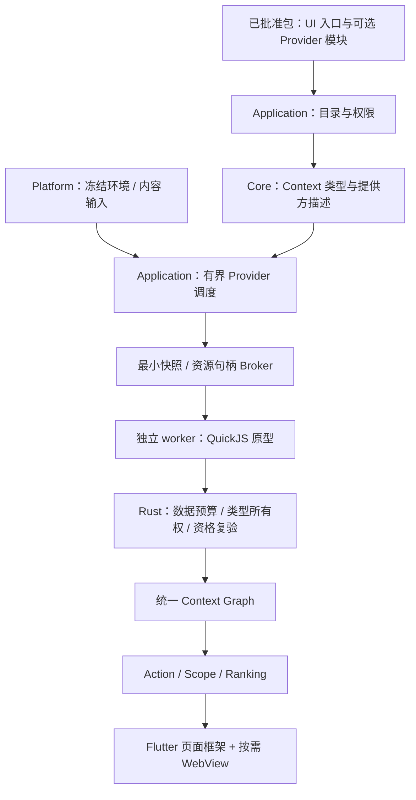

# 第三方 Context 注册与运行方案

日期：2026-10-20。状态：调研与建议，**尚未开放第三方 Provider API，未引入 QuickJS / Wasm 依赖**。当前实现及边界见 [架构](../architecture.md)、[Context 模型](../context-model.md)和[Web 插件](../web-plugin-design.md)。

## 结论

第三方可以扩展 Context，但应该区分类型声明、输入识别、Context 派生、环境采集和 UI。建议共享 Context / Action / Scope / Ranking 主流程，在类型所有权、输入权限、执行环境、输出校验与撤销上隔离。不要复制一套第三方 Context Graph，也不要把任意 JS 放在 Flutter 或核心匹配循环中。

UI 继续 WebView。复杂的无界面 Provider 可研究 **独立 worker 进程 + QuickJS / rquickjs**；宿主传入有界快照，worker 只返回数据，Rust 负责校验并提交。先建立契约与性能原型，再决定是否引入运行时。现有 JSON 输入识别继续由有界的宿主模式完成，不为它启动 JS 引擎。

## 当前代码实际支持什么

| 能力 | 现状 / 代码依据 |
|---|---|
| 第一方类型与派生 | `core/context/provider.rs` 的 ContextProvider / ProviderDescriptor 接受、产生类型；engine / registry 调度；features 贡献静态 Provider |
| 第三方包声明 Action 输入 | `anywhere-protocol/web_plugin.rs` 的 commands.accepts；这只声明匹配类型，不注册类型或 Provider |
| JSON / 转义 JSON 自动识别 | inputMatchers 是封闭枚举，由 `core/context/input_patterns.rs` 执行；它是宿主识别条件，不是第三方脚本 |
| 第三方读取选中对象 | `application/web_plugins/projection.rs` 根据 context.read 投影；当前支持 text / URL / file / directory / file selection；文件只给句柄与名称 |
| 注册新类型 / 派生节点 | Manifest 没有此字段，RPC 没有 register / derive 方法；不能在网页里调用现有接口完成 |
| 任意已有类型输入 | accepts 的类型名可以通过语法校验，但不代表能获得对应内容；未知 / 未授权类型投影为空，不能据此宣称支持项目目录等完整 Context 数据 |
| 当前信任信息 | ResolvedContext 有 source / provider_id / source_context_id 及类型和值，但没有适用于不可信 Provider 的完整 principal / grant / output schema 模型，不能把它直接作为第三方返回 DTO |

现有 ContextProvider 是内部 Rust Trait，不是 Native ABI；不能让下载插件实现后直接载入 App。当前 Web 页面只在显式 Action 执行后创建，因此用它识别每次输入会引入额外页面 / helper 生命周期，并把隐式读取混进显式调用授权。

## 应如何隔离

1. **类型所有权**：维护 ContextTypeRegistry。宿主拥有 core.text / core.file / git.repository / project.* 等已有类型；第三方类型使用 `ext.<packageId>.<localType>`，例如 `ext.dev.example.tracker.issue`。所有权由已批准目录记录，不能仅从字符串推断。包只能产生自己的类型，不能覆盖、冒充或修改第一方节点。
2. **数据与能力分开**：第三方返回 JSON 数据、标题和自身类型；文件 / 目录 / 当前应用等能力只通过宿主签发、当前会话有效的只读句柄引用。返回一个绝对路径字符串，不能自动升级成 core.file、Git 或可执行项目能力。
3. **读取显式批准**：新增 Provider 的输入权限，不沿用显式打开页面的 context.read 作为后台读取授权。用户能看到“唤醒 / 输入时自动识别选中文本”等用途；默认不提供整个 Graph、剪贴板历史、窗口内容或全盘访问。第一阶段只派生已获准的 core.text / core.url，不新增环境采集源。
4. **来源由宿主记录**：principal、包摘要、注册代数、输入父节点、Session / Revision 与源应用由 Rust 生成。第三方不能自行声称来自 Finder、系统 Provider，不能把用户输入标成受信任的目录，也不能修改捕获来源。
5. **派生权限不扩张**：第三方输出保留输入来源、拥有者与敏感性；再派生 / 再投影时重新检查消费者的类型读权。包 A 的自定义 Context 默认仅 A 可用；跨插件消费必须另行批准，不默认共享数据。第一方 Action 默认不消费第三方类型；未来适配器需要明确映射、资源复验和能力检查。
6. **同一主流程**：通过边界校验后进入统一 Graph / Action / Ranking，UI 标明提供方；不增加“第三方专用 Scope”或改变 Current App 菜单逻辑。第三方不能自行设置最高优先级 / 可信来源来压过宿主结果。
7. **撤销与寿命**：安装 / 更新绑定包摘要和完整 Provider 定义，启停 / 撤销推进目录代数，取消任务、删除缓存结果与节点引用。提交前复验 Session / Revision / 输入身份 / 注册代数 / grant，晚到数据丢弃。节点不写 Usage 正文，不建立全局明文输入缓存。

只分命名空间无法构成权限隔离；只分 JS Context 也无法构成进程隔离。第三方注册的是一种产生受限数据的贡献，不是任意向 Graph 写入的权限。

## 技术方案比较

下表是设计取舍，不是本项目的实测内存或延迟排名。

| 方式 | 适合用途 | 限制 / 结论 |
|---|---|---|
| Manifest 引用已有有界识别器 | JSON、URL、文件扩展名等简单条件 | 不执行第三方代码，最容易保持冷启动轻；不发展任意表达式 / 正则规则语言，以免形成另一套 DSL 或 ReDoS 入口 |
| WebView 内派生 | 用户已打开工具后的临时解析与展示 | 复用 UI 的 JS 环境，但自动识别必须额外创建 / 保留 WebView；不推荐作为后台 Provider 主运行时 |
| App 进程内 QuickJS | 受信任脚本或验证原型 | 可设置堆 / 栈 / 中断，但解释器缺陷仍影响主 App；不作为下载代码正式运行的唯一隔离边界 |
| 独立 worker + QuickJS / rquickjs | 普通 JS / TS 编译出的纯数据 Provider | 推荐做首选原型；不需要 DOM / Node，能与 WebView 共用业务包、类型和构建工具；需要进程 IPC、取消、限额与跨平台适配 |
| Wasm / Extism | 多语言、计算密集、强约束 ABI | Wasm 内存和 Host Functions 边界清晰，可设 fuel / epoch；编译与调试链更重，不在第一轮同时引入第二种运行时 |
| Node 子进程 | 依赖完整 npm / Node 系统功能的插件 | 平台 API 与依赖面更广，还需独立权限机制；当前纯识别需求不值得引入常驻 Node |

QuickJS 官方介绍其为小型可嵌入引擎，并提供内存、栈与执行中断控制；这说明它适合做轻量原型，不能直接推导本项目的 RSS 数字或安全保证。[QuickJS 手册](https://bellard.org/quickjs/quickjs.html)

rquickjs 的 Runtime 提供 interrupt handler、memory limit 和 stack limit。**当前文档明确说明 rust-alloc / allocator 等自定义分配器会使 set_memory_limit 成为空操作**。原型必须锁定版本 / features，验证真实分配失败和无限循环中断；若使用自定义分配器，应由分配器实现配额。不要仅用 Tokio timeout 包住 spawn_blocking：超时不代表 JS 或 native 调用已经停止。[rquickjs Runtime](https://docs.rs/rquickjs/latest/rquickjs/struct.Runtime.html)

Extism 采用字节缓冲传入 / 返回，并管理宿主与插件之间的内存；Wasmtime 支持 fuel / epoch 执行中断。若今后确有多语言 / 重计算需求，可在相同 Provider 边界后替换运行适配器，不扩张核心模型。[Extism Memory](https://extism.org/docs/concepts/memory/)、[Host Functions](https://extism.org/docs/concepts/host-functions/)、[Wasmtime 中断](https://docs.wasmtime.dev/examples-interrupting-wasm.html)

## 推荐的分层与调用

- protocol：新增 ProviderManifest / ProviderInput / ProviderOutput 数据模型与 schema，不提供执行器或全局注册表。
- core/context：声明与结果类型、来源 / 所有者标签、Graph 合并和普通 Action 匹配；不导入 QuickJS、WebView、进程创建或磁盘包仓库。
- application：PackageContribution 装配、ProviderCatalog 选择、准入 / 调度 / 取消 / 资格复验；通过 RuntimePort 调用 worker。
- runtime adapter / worker 可执行文件：锁定 JS 引擎、模块加载、内存 / 栈 / 时间限制、协议编解码；不与 App 共用 OS 对象，不向脚本暴露 std/os/FFI/Node/任意网络 / 文件 API。
- persistence：批准收据与包资源；不运行 Provider 或发布 Context。
- Flutter：批准页面、状态 / 来源展示、Action 导航；不判断 JSON / 目录 / Git 业务类型，不决定读取权限。

worker 进程并不自动等于 OS 沙箱。正式提供下载插件前，必须实现 / 验收目标平台的文件与网络限制，或明确产品信任范围；IPC 只传有界字节、只开放明确 Host 操作。解释器线程的无限循环可以由中断停止，进程异常 / 中断失效由父进程结束 worker；Host I/O 另有超时和准入。

首轮只允许**同步纯函数**处理传入快照，不提供 Promise / timers / Host I/O。JS / TS 编译成单个受检 ESM / IIFE 源文件，加载器只允许已批准包中的模块；不接受外部 QuickJS 字节码，不假定它能跨引擎版本安全复用。每次调用建立并销毁独立 Runtime，或在实测后使用按包隔离的有界缓存；禁止多个插件共用一个全局对象堆。不打开 WebView 也可完成 Provider 执行。

作为原型起点，可测试输入 16 KiB、输出 32 KiB / 8 节点、32 级嵌套、32 MiB JS 堆、单任务 20 ms JS 预算、单 worker / 有界队列和短空闲退出。这些数值是待验证的设计参数，不是已达成指标；进程启动 / 模块加载 / JSON 编解码另计总墙钟时间。首屏不等待第三方，结果作为有界迟到结果补充；自动填入只由宿主同步识别或已完成的有效识别决定，慢 Provider 不强制劫持用户已开始的搜索。

## 建议推进顺序

1. 先为受信任内部测试贡献定义类型目录、所有者 / grant、结果 DTO 和提交校验，复用既有 Graph；补类型冒充、目录字符串越权、跨插件读取、更新撤销、晚到结果测试。
2. 再做单独 QuickJS worker 原型，覆盖无限循环、堆 / 栈超限、超大返回、无匹配、异常、崩溃和取消。测 App + worker 总 RSS、冷 / 热延迟与连续输入；当前 WebView 方案作基线，不先宣称 QuickJS 更快 / 更省。
3. 达到预算后开放第三方 JS / TS Provider SDK，例如 `defineContextProvider({derive(input) { ... }})`；作者只写业务派生，宿主生成身份与权限。页面仍使用 definePlugin，两种入口属于同一包的不同贡献，不共用页面生命周期和授权。
4. 最后按具体需求扩展受限 metadata/read Host Functions、跨插件共享和 Wasm 适配。环境采集、写文件、进程和任意系统能力均不随“可注册 Context”自动开放。

本轮仅交付现有代码边界修复和以上调研，不修改公开 Manifest / RPC，也不提前将第一方改回动态插件。
