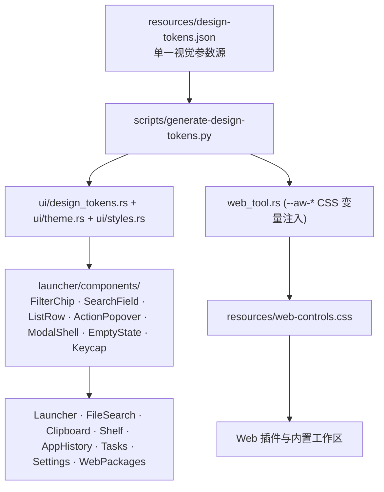

# Anywhere GPUI 界面与交互优化方案

本文档基于当前 GPUI 前端实现（[apps/gpui/src/](../apps/gpui/src/)）、共享设计令牌（[design-tokens.json](../resources/design-tokens.json)）、Web 默认样式（[web-controls.css](../resources/web-controls.css)）以及视觉契约文档（[ui-design.md](ui-design.md)）的全量代码走查编写，围绕**更美观、更便捷人性化、全方位一致**三大目标给出可落地的演进方案。

---

## 一、设计原则与架构护栏

所有视觉与交互优化均严格遵守项目既有架构契约（[AGENTS.md](../AGENTS.md)）：

1. **原生材质优先，绝不叠加整窗蒙层或二层模糊**：继续由 macOS `NSGlassEffectView` / `NSVisualEffectView` 与 Windows DWM/Composition 承载窗口外框、折射高光与阴影；`#launcher-root` 以外的页面背景保持透明，仅模态遮罩与不透明菜单浮层（`action_menu_surface`）阻断底层透字。
2. **克制抽象，不引入第二套 UI 框架或通用表单 Schema**：优先复用 `gpui_kit` 标准控件、[styles.rs](../apps/gpui/src/ui/styles.rs) 语义样式与 [components/mod.rs](../apps/gpui/src/launcher/components/mod.rs) 公共组件；仅对多页重复且语义完全相同的结构提取轻量构造函数。
3. **单一真相源与生成器同步**：所有字号、间距、圆角、尺寸与语义色统一收敛至 [design-tokens.json](../resources/design-tokens.json)，新增文案统一写入 `resources/localization/`，通过既有生成脚本同步 Rust 与 Web `--aw-*` 变量，绝不手改生成文件。
4. **守住核心领域边界**：保持主 Launcher 紧凑无常驻底栏、窗口尺寸无动画瞬时收敛、三种历史记录（Usage / 应用历史 / 剪贴板历史）职责独立、Clipboard History 与独立置顶窗口 Clipboard Shelf 定位清晰。

---

## 二、现状全面诊断

通过对非测试源码的逐文件审计，当前 UI 存在以下主要短板：

| 维度 | 核心痛点 | 典型代码位置 |
| --- | --- | --- |
| **系统一致性** | 非测试代码中仍散落 **160+ 处 `px(...)` 硬编码字面量**；各页面列表左右内边距存在 `10px / 8px / 6px / 4px` 四种规格，切换页面时图标与文字基线跳动 | [mod.rs](../apps/gpui/src/launcher/view/mod.rs#L2356-L2369)、[settings.rs](../apps/gpui/src/launcher/view/settings.rs#L61-L65)、[web_packages.rs](../apps/gpui/src/launcher/view/pages/web_packages.rs#L18-L19) |
| **系统一致性** | **筛选胶囊栏四套实现**：Launcher/FileSearch（26px 高 / 10px 圆角 / Semibold）、Clipboard（24px 高 / 8px 圆角 / Medium）、Tasks 输出 Tab（32px 高 / 6px 圆角 / 11.5px 字号）、AppHistory 设置（主次按钮切换）各自手写 | [page_shell.rs](../apps/gpui/src/launcher/view/page_shell.rs#L449-L534)、[clipboard.rs](../apps/gpui/src/launcher/view/pages/clipboard.rs#L196-L228)、[tasks.rs](../apps/gpui/src/launcher/view/pages/tasks.rs#L882-L949) |
| **系统一致性** | **快捷键提示两套形态**：行内预览/更多操作直接拼接裸文本 `"␣"` 与 `"⌘K"`，而候选槽位与底栏使用带边框的 `keycap()`；主窗口 `esc` 键帽不可点击，子页面 `esc` 却可点击 | [candidate_row.rs](../apps/gpui/src/launcher/view/candidate_row.rs#L87-L111)、[mod.rs](../apps/gpui/src/launcher/view/mod.rs#L2671)、[page_shell.rs](../apps/gpui/src/launcher/view/page_shell.rs#L388-L403) |
| **系统一致性** | **操作浮层实现与契约脱节**：文档规定使用锚定浮层 `row_popup` / `page_popup`，但 Clipboard、AppHistory、Tasks、WebTool 全部采用 `action_candidates` **整页替换正文**，导致打开菜单时原列表与终端输出瞬间消失 | [ui-design.md](ui-design.md)、[clipboard.rs](../apps/gpui/src/launcher/view/pages/clipboard.rs#L8-L12)、[tasks.rs](../apps/gpui/src/launcher/view/pages/tasks.rs#L50-L66) |
| **视觉美观度** | **副标题与关键词高亮层次偏弱**：候选副标题 `来源 · 路径` 混用同色字符串，匹配高亮仅改字色未提字重；Windows 方形应用图标无圆角修饰；设计文档图标底板尺寸（`26px`）与 Token（`30px`）不一致 | [candidate_row.rs](../apps/gpui/src/launcher/view/candidate_row.rs#L48-L54)、[highlight.rs](../apps/gpui/src/launcher/components/highlight.rs) |
| **视觉美观度** | **Clipboard 检查器内容被裁切、加载态缺 Spinner**：检查器正文容器设为 `overflow_hidden` 不可滚动，长文本无法阅读；Clipboard 与 AppHistory 加载态显示静态图标而非动态 `Spinner` | [clipboard.rs](../apps/gpui/src/launcher/view/pages/clipboard.rs#L83-L107)、[clipboard.rs](../apps/gpui/src/launcher/view/pages/clipboard.rs#L266-L279) |
| **视觉美观度** | **Settings 表单密度失衡**：标题字重在 `Normal` 与 `Medium` 间摇摆；Search 页同时常驻大号 `Textarea` 与结构化 Chips 造成视觉冗余；AppHistory 来源卡片底部堆砌 4 个无选中态区分的按钮 | [layout.rs](../apps/gpui/src/launcher/view/settings/layout.rs#L154)、[search.rs](../apps/gpui/src/launcher/view/settings/search.rs#L412-L493)、[application_history.rs](../apps/gpui/src/launcher/view/settings/application_history.rs#L270-L351) |
| **便捷人性化** | **键鼠协同缺口**：Launcher 与 FileSearch 搜索框不支持点击 `×` 一键清空（`cleanable(false)`），也不支持鼠标右键打开对象动作（Clipboard/AppHistory 却支持）；`⌘1`~`⌘9` 快速执行在主列表毫无视觉线索 | [mod.rs](../apps/gpui/src/launcher/view/mod.rs#L2596)、[candidate_row.rs](../apps/gpui/src/launcher/view/candidate_row.rs#L179-L206)、[input.rs](../apps/gpui/src/launcher/view/input.rs#L104-L133) |
| **便捷人性化** | **Settings 保存心智分裂**：外观、剪贴板开关、内置功能“点击即保存”，而语言、开机自启、Context 开关、文件搜索开关却需“手动点保存”，用户极易误解是否已生效 | [general.rs](../apps/gpui/src/launcher/view/settings/general.rs#L184-L189)、[controller.rs](../apps/gpui/src/launcher/view/settings/controller.rs#L186-L217) |
| **便捷人性化** | **跨平台路径缩写失效 & 破坏性操作保护不一**：`format_path_middle_truncated` 仅检查 `HOME` 与 `/`，导致 Windows 下 `C:\Users\...` 无法缩写为 `~\...`；Shelf 删除需确认，Clipboard History 删除却直接销毁且无撤销 | [presentation.rs](../apps/gpui/src/launcher/presentation.rs#L54-L63)、[clipboard_shelf.rs](../apps/gpui/src/launcher/view/pages/clipboard_shelf.rs#L220-L318) |

---

## 三、核心优化方案详述

### 专题一：设计令牌收敛与公共组件标准化（全方位一致性基石）

1. **补齐缺失语义 Token，清零业务页魔法数字**
   - 在 [design-tokens.json](../resources/design-tokens.json) 中补充少量高频缺失度量：`settingsSidebarWidth` (`172px`)、`tasksSidebarWidth` (`256px`)、`settingsRowMinHeight` (`58px`)、`searchFieldHeight` (`34px`)、`modalWidthCompact` (`360px`)、`modalWidthPicker` (`440px`)、`listPaddingX` (`10px`)。
   - 清理 [mod.rs](../apps/gpui/src/launcher/view/mod.rs)、[settings.rs](../apps/gpui/src/launcher/view/settings.rs)、[shortcuts.rs](../apps/gpui/src/launcher/view/settings/shortcuts.rs)、[tasks.rs](../apps/gpui/src/launcher/view/pages/tasks.rs)、[web_packages.rs](../apps/gpui/src/launcher/view/pages/web_packages.rs) 中的硬编码像素值（如 `11.5`、`18.`、`22.`、`42.`、`0.7`），统一走 `metrics::*` 与 [styles.rs](../apps/gpui/src/ui/styles.rs) 的 `AppStyle` trait。
2. **统一 6 类跨页面基础组件**
   - **统一筛选胶囊 `components::filter_chip`**：合并 `scope_button`、`file_filter_button`、`render_clipboard_filter_bar` 与 Tasks 输出 Tab，统一采用 `FILTER_HEIGHT (26px)`、`FILTER_RADIUS (10px)`、选中态 `selected_surface()` + `SEMIBOLD`、未选中态 `hover()`，消除四个页面胶囊圆角与高度各异的割裂感。
   - **统一页内搜索框容器 `components::search_field`**：为 Tasks 侧栏、Action 快捷键选择器、Context 路由搜索、AppHistory 设置过滤提供统一的带左侧放大镜图标、一键清空按钮及**聚焦态 `selection_outline()` 高亮外框**（`:focus-within` 等效焦点态）的输入框容器。
   - **统一列表容器边距**：主窗口 Launcher、FileSearch、Clipboard、AppHistory、WebPackages 列表横向内边距统一对齐 `metrics::ROW_PADDING_X`，保证从首页进入任意子页时左侧图标与标题垂直对齐线纹丝不动（仅窄窗 Clipboard Shelf 保持紧凑 `SPACE_SM`）。
   - **统一行内动作与键帽展示**：在 `row_action_button` / `primary_row_action` 中内置紧凑 `keycap` 渲染选项，将 [candidate_row.rs](../apps/gpui/src/launcher/view/candidate_row.rs#L87-L111) 与 [clipboard_shelf.rs](../apps/gpui/src/launcher/view/pages/clipboard_shelf.rs#L455) 中裸露的 `"␣"`、`⌘K` 收敛为微型键帽，并在右侧多个行内动作间统一添加 `SPACE_XS (4px)` 间距。
   - **统一空态与加载态 `components::empty_state` / `components::loading_state`**：补齐带动态 `Spinner` 的 `loading_state`，替换 Clipboard History 与 App History 加载时的静态图标，并将 Clipboard History 与 Shelf 的手写空状态统一收归公共组件。
   - **统一模态对话框外壳 `components::modal_shell`**：将 [settings.rs](../apps/gpui/src/launcher/view/settings.rs#L247-L345) 的 `render_settings_modal_shell` 提取为公共组件，复用于 Settings 关闭提示、Clipboard 清空/期限确认、Shelf 删除确认以及 [web_interaction.rs](../apps/gpui/src/launcher/view/controllers/web_interaction.rs#L197-L288) 的外部链接授权框；底部按钮改为符合桌面直觉的**右对齐水平双按钮（取消在左、主动作/危险动作在右，三按钮时左置次要项）**，视觉更轻盈干练。

---

### 专题二：操作浮层（`⌘K` / `…`）重构——保留页面上下文

当前在 Clipboard History、Application History、Running Tasks 与 Web Tool 中按 `⌘K` 或点击 `…` 会把整个页面内容替换为 `action_candidates` 列表，造成强烈的视觉跳变与上下文丢失。

- **改为真正的锚定不透明浮层（`ActionPopover`）**：
  - 对齐 [ui-design.md](ui-design.md) 的设计契约，在页面根部覆盖透明点击拦截层（点击外部即关闭浮层并恢复原输入框焦点），在右上角或跟随选中行安全坐标绘制 `metrics::MENU_WIDTH (264px)` 宽、最大高度 `metrics::POPOVER_MAX_HEIGHT (260px)`、`100%` 不透明 `theme::action_menu_surface()` 的圆角阴影菜单面板。
  - **统一浮层内部视觉**：顶部可选显示当前作用对象单行截断标题（`MENU_HEADER_HEIGHT`），列表项统一使用 `MENU_ROW_HEIGHT (30px)`，左侧配语义图标（破坏性操作如“删除条目”、“移除结果”统一使用 `theme::danger()` 红色图标与文字），右侧展示对应快捷键 `keycap`（如 `↵`、`␣`、`⌘R`、`⇧⌫`），支持 `↑`/`↓` 循环导航、`Enter` 执行、`Esc` 关闭且底层列表、右侧预览检查器和实时终端输出**全程保持可见**。
  - *注*：主窗口 Launcher 因窗口高度动态贴合内容（紧凑时仅 `72px` 高），其 `⌘K` 对象动作与菜单层级继续保持现有的列表下钻 + 搜索头返回箭头模式，避免撑破极矮浮窗。

---

### 专题三：Launcher 主窗口与文件搜索体验升级（更美观 + 更顺手）

1. **增强候选列表的视觉精致度与信息扫读效率**
   - **副标题层次分离**：将 [candidate_row.rs](../apps/gpui/src/launcher/view/candidate_row.rs#L44-L54) 中原本揉成一段纯文本的 `source · subtitle` 拆分为**柔和来源标签（`theme::muted()` 或微型胶囊）+ 主副标题（`theme::secondary()`）**，一眼区分“来自哪个应用/插件”与“具体路径/说明”。
   - **关键词高亮提振**：升级 [highlight.rs](../apps/gpui/src/launcher/components/highlight.rs)，匹配片段同时应用 `theme::accent()` 与 `FontWeight::SEMIBOLD`，在深浅玻璃材质下均清晰锐利。
   - **应用图标边缘修饰**：真实应用图标（[candidate_row.rs](../apps/gpui/src/launcher/view/candidate_row.rs#L227-L230)）统一纳入 `ROW_ICON_SLOT (32px)` 居中并添加轻微圆角裁切（`6px`），解决 Windows 方形 `.exe` 图标边缘生硬的问题。
2. **补齐高频键鼠便捷细节**
   - **可点击的 `esc` 与输入框一键清空**：为 Launcher 搜索头的 `esc` 键帽（[mod.rs](../apps/gpui/src/launcher/view/mod.rs#L2671)）补齐与子页面一致的点击事件、`cursor_pointer` 及当前层级动态 Tooltip（如“清空输入 Esc” / “返回全局搜索 Esc” / “隐藏窗口 Esc”）；在查询非空时开启 Launcher 与 File Search 输入框的清空按钮。
   - **全列表统一鼠标右键（Context Menu）**：在 [candidate_row.rs](../apps/gpui/src/launcher/view/candidate_row.rs#L179-L206) 增加 `on_mouse_down(MouseButton::Right, ...)`，右键点击任意候选自动选中该行并打开其对象动作（`⌘K`）或子菜单，与 Clipboard、AppHistory 行为完全一致。
   - **`⌘1`~`⌘9` 快捷直达提示**：主窗口已支持主键修饰符 + 数字键 `1~9` 直接执行对应行（[input.rs](../apps/gpui/src/launcher/view/input.rs#L104-L133)），在未选中的前 9 行末尾（当无自定义动作快捷键占用时）以低对比度 `muted` 键帽轻量展示 `⌘1`…`⌘9` / `Ctrl+1`…`9`，让高效快捷键自然被用户发现。
   - **模式切换器可发现性增强**：左上角模式按钮下拉面板（[navigation.rs](../apps/gpui/src/launcher/view/controllers/navigation.rs#L321-L366)）中，在“全局搜索”与“当前应用”右侧直接展示用户当前绑定的全局唤起热键键帽及切换提示（`⌘↵`）。
3. **人性化空状态脱困引导**
   - 当 Launcher 在特定 Scope 下无匹配结果且查询非空时，在空状态下方提供一键可点且支持回车/快捷键的引导按钮：**“切换到全部范围搜索 (`Tab`)”**；当全局搜索无匹配应用/动作且文件搜索已启用时，提供轻量提示入口**“在文件中搜索 ‘{query}’”**，消除搜索死胡同。
4. **修复 Windows 路径人性化缩写**
   - 修复 [presentation.rs](../apps/gpui/src/launcher/presentation.rs#L49-L85) 的 `format_path_middle_truncated`：兼容读取 Windows `USERPROFILE`（或通过 `anywhere_platform` 主目录能力）并同时支持 `/` 与 `\` 分隔符前缀匹配，使 `C:\Users\<name>\Documents\Github\Anywhere` 在 Windows 上同样优雅地展示为 `~ › Documents › Github › Anywhere`，悬停 Tooltip 保留原始完整路径。

---

### 专题四：工具页面（Clipboard / Shelf / App History / Tasks / Web）体验打磨

1. **Clipboard History & Clipboard Shelf**
   - **检查器全文可滚动与代码友好排版**：修复 [clipboard.rs](../apps/gpui/src/launcher/view/pages/clipboard.rs#L266-L279) 检查器预览框的 `overflow_hidden()`，改为带独立 `ScrollHandle` 与细滚动条的可滚动区域（`whitespace_normal` 保留换行）；当检测到多行代码/JSON/终端命令时自动使用 `fonts::FONT_MONO` 提升可读性；颜色色块旁展示标准化 HEX 与 RGB 值并提供一键复制。
   - **统一破坏性删除保护**：统一 Clipboard History 与 Clipboard Shelf 的单条删除体验——删除后弹出带语义图标的底部 HUD Toast，或在删除动作旁明确红色警示，消除两处剪贴板视图操作反馈不一致的问题。
2. **Application History**
   - 当启用多个历史来源时，页头来源切换下拉按钮（[application_history.rs](../apps/gpui/src/launcher/view/pages/application_history.rs#L141-L171)）与左侧标题当前会重复显示同一个来源名称（例如标题是 `Visual Studio Code`，右侧下拉按钮也是 `Visual Studio Code`）；优化为页头模式小标签显示“应用历史”，主输入框聚焦搜索，右侧胶囊仅在多来源时以紧凑图标+切换箭头展示，释放横向搜索宽度。
3. **Running Tasks**
   - **侧栏卡片对齐系统语言**：为侧栏选中任务卡片补齐左侧 `3px` 状态语义色指示条（运行中蓝色、成功绿色、失败红色），将硬编码 `86px` 卡片紧凑优化至 `76px` 以在同屏容纳更多任务。
   - **命令与输出快捷操作**：展开“命令详情”时，在命令行与工作目录旁分别提供一键复制图标按钮与“在文件管理器中打开目录”入口；修复页脚孤立的 `⌘F`、`⌘.` 键帽（[tasks.rs](../apps/gpui/src/launcher/view/pages/tasks.rs#L203-L205)），统一改用 `footer_bar` + `footer_action_button`（带文字说明如 `查找 ⌘F`、`停止 ⌘.`）。
4. **Web 插件与包管理（WebTool & WebPackages）**
   - 在 [web_packages.rs](../apps/gpui/src/launcher/view/pages/web_packages.rs) 中，将内置（Built-in）与已启用状态用 `components::status_badge` 可视化呈现；卸载第三方插件按钮使用语义警告/危险样式并接入统一确认框，防止误点直接移除插件。
   - 检查并对齐 [web-controls.css](../resources/web-controls.css#L196-L197) 中 `.aw-tab` 的圆角、字重与 GPUI `filter_chip` 完全一致。

---

### 专题五：Settings 设置中心交互减负与精致化重构

1. **统一保存心智模型：低风险项即刻生效 + 草稿项清晰可控**
   - 将无输入校验冲突风险的离散控件（**界面语言下拉框、开机自启开关、Context 三个采集源开关、文件搜索总开关/隐藏文件开关/搜索引擎选择**）与现有的“外观主题”、“内置功能开关”对齐为**变更即保存生效**，成功后弹出轻量 HUD Toast（文案明确为“已保存设置”而非笼统的“操作已完成”）。
   - 仅对多行路径文本编辑、全局快捷键录制、复杂 Context 路由构建保留草稿态；当处于未保存草稿态时，顶部工具栏同时提供 **`放弃更改（还原）`** 与 **`保存更改 (⌘S)`** 两个按钮，并在侧栏对应分类右侧显示一枚醒目的 `6px` 警告色未保存圆点，用户无需关窗触发拦截弹窗即可随时回退草稿。
2. **侧栏导航与键盘无障碍增强**
   - 为 [settings.rs](../apps/gpui/src/launcher/view/settings.rs#L482-L598) 侧栏分类按钮补齐选中态左侧强调指示条、清晰的键盘 `:focus` 轮廓以及侧栏聚焦时的 `↑` / `↓` 方向键切换分类能力。
   - 统一所有分类卡片的行标题字重为 `FontWeight::MEDIUM`（修正 [layout.rs](../apps/gpui/src/launcher/view/settings/layout.rs#L154) 中的 `NORMAL`），拉开标题（`13px Medium Primary`）与说明文案（`11px Normal Secondary`）的视觉对比。
3. **逐分类界面精修**
   - **通用（General）**：升级外观预览卡片（[general.rs](../apps/gpui/src/launcher/view/settings/general.rs#L62-L144)），在卡片内绘制微缩的“顶部搜索栏 + 2 条模拟结果行 + 强调色指示条”迷你 UI 示意图，直观展现跟随系统、浅色玻璃与深色玻璃的真实质感。
   - **搜索（Search）**：重构 `settings_list_editor_card`（[search.rs](../apps/gpui/src/launcher/view/settings/search.rs#L412-L493)），默认展示整洁的**结构化标签列表（Chips）+ 快捷添加行**，将多行原始 `Textarea` 收起在“批量文本编辑”折叠开关内（按需展开），消除同一份数据上下重复渲染两遍的杂乱感；Windows 应用搜索路径列表同步改用相同的结构化移除芯片样式。
   - **快捷键（Shortcuts）**：在全局热键录制按钮旁增加悬停可见的清空/恢复默认按钮；录制快捷键时展示脉冲/高亮焦点边框与“按 Esc 取消”内联提示；若录制的组合键冲突或缺少修饰键，直接在当前录制行下方内联显示原因，而非仅闪现顶栏横幅。
   - **剪贴板（Clipboard）与应用历史（App History）**：将剪贴板“保留期限”与“暂停录制”从卡片外突兀展开的面板改为标准 `dropdown_menu` 下拉选择器，将“清空历史”按钮设为明确的危险次要样式；将应用历史来源卡片底部的 4 个平铺按钮重构为紧凑的 **3 段式模式分段控件（`自动` | `自定义` | `停用`）**，仅在选中“自定义”时平滑展开路径输入框与保存按钮。

---

## 四、分阶段实施路线图

为保证每次改动小步可测、零回归风险，建议分 **4 个阶段**推进：

| 阶段 | 核心交付内容 | 涉及主要模块 |
| --- | --- | --- |
| **Phase 1：设计令牌与公共组件收敛** | 补齐 `design-tokens.json` 度量并重跑生成脚本；提炼 `filter_chip`、`search_field`、`loading_state`、`modal_shell`、行内键帽按钮；统一各页面列表边距与字重，清理魔法数字 | `resources/design-tokens.json`、`ui/styles.rs`、`launcher/components/`、`page_shell.rs` |
| **Phase 2：操作浮层重构与主窗口体验升级** | 实现锚定式 `ActionPopover` 替代工具页整页替换；升级 Launcher 副标题层级、关键词加粗高亮、应用图标微圆角、可点击 `esc`、一键清空、鼠标右键菜单、`⌘1~9` 提示、空态脱困按钮及 Windows `~` 路径缩写 | `launcher/view/mod.rs`、`candidate_row.rs`、`navigation.rs`、`presentation.rs`、`pages/file_search.rs` |
| **Phase 3：工具页深度打磨** | Clipboard 检查器全文滚动与等宽代码排版、颜色值快捷复制、统一删除保护；AppHistory 页头去重；Tasks 侧栏指示条、命令/目录一键复制及标准 `footer_bar`；WebPackages 状态徽章与卸载确认 | `pages/clipboard.rs`、`pages/clipboard_shelf.rs`、`pages/application_history.rs`、`pages/tasks.rs`、`pages/web_packages.rs` |
| **Phase 4：Settings 减负精修与契约同步** | 收敛即刻生效与草稿回退体验、未保存圆点；重绘外观微缩预览卡、Search 折叠式标签编辑、Shortcuts 录制内联反馈、Clipboard 下拉菜单与 AppHistory 分段模式控件；同步 `web-controls.css` 与 `docs/ui-design.md` | `launcher/view/settings.rs`、`settings/*.rs`、`resources/localization/`、`resources/web-controls.css`、`docs/ui-design.md` |

---

## 五、验证与验收标准

1. **生成物与静态检查**
   - 更新令牌与多语言词条后执行对应生成脚本，确保 `design_tokens.rs` 与 `l10n/generated.rs` 零手工差异。
   - 通过全套自动化门禁：`scripts/check-gpui.sh` 与 `scripts/check.sh`，并更新涉及 DOM ID / 测试选择器的视图单元与回归测试（`apps/gpui/src/launcher/view/tests/`）。
2. **交互与状态一致性核验**
   - 模态框与新建 `ActionPopover` 打开期间：遮罩阻断底层误触，`Esc` 仅退出当前浮层并精确恢复原编辑器焦点，浅色与深色玻璃下文字对比度 ≥ 4.5:1 且底层文字零透出。
   - Settings 即刻生效项与草稿项切换、保存、还原、关闭拦截测试全部通过，无异步陈旧状态覆盖（Generation 校验保持完整）。
3. **跨平台桌面实机验收**
   - 对照 [test-acceptance-windows.md](test-acceptance-windows.md) 与 [test-acceptance-macos.md](test-acceptance-macos.md)，分别在浅色/深色主题、开启/关闭透明材质（Reduce Transparency）、高对比度（Increase Contrast）及中文输入法组合态下核验视觉表现与焦点流转。
