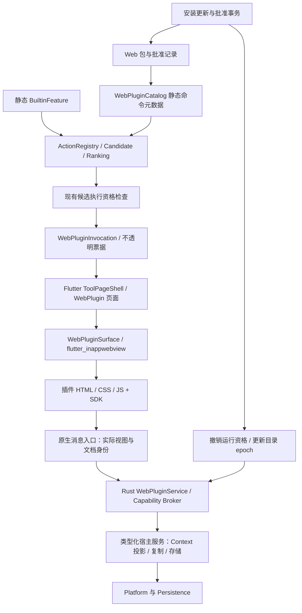

# 第三方 Web 插件：架构与实施方案

日期：2026-10-19。代码基线：`codex/refactor-open-source@214e6ba`，既有正式功能基线为 V0.10 / Build 11，当前开发预览为 V0.11 / Build 15。**用户已确认第三方统一使用 WebView；完整插件平台按下文逐阶段实施，不代表全部能力已交付。** Terminal 延后；第一方继续是静态编译的内置功能模块，JSON 在 Web 机制建立后实现。

## 1. 结论与范围

确定采用：**本地 Web 包 + flutter_inappwebview + 版本化 TypeScript SDK + Rust 能力代理**。通过 WebPluginSurface 封装库依赖；关键接口缺口才补薄原生适配。不引入 QuickJS、Node 或独立 Wasm 运行时，也不将第三方 UI 改回宿主 DSL。

- React / Vue / Svelte / 原生 JS 均可；用户安装的是构建好的静态资源，无须安装 Node，不在安装时运行 npm 或脚本。
- Manifest 描述身份、命令入口、Context 匹配和权限；HTML / CSS / JS 决定页面。不继续设计 List / Form / Table UI DSL。
- 入口继续进入 Action → Candidate → Ranking → 快捷键 → 执行资格链；用户执行入口后才创建 WebView。
- 插件在页面中处理自己的交互和计算；宿主业务、系统访问、权限与持久存储通过少量明确的 SDK API 完成。
- V0.11 先交付本地工具页、安装启停、Context 输入、复制、隔离存储、主题 / 键盘桥和安全更新。联网、文件正文访问等逐项扩展。
- 后台插件、第三方搜索源 / ContextProvider、任意进程、PTY、Marketplace、远程网页插件不进入首版。

“所有扩展都需要统一 Runtime”不再成立。内置模块与外部 Web 插件只共享稳定的产品模型和宿主服务，装配及生命周期各自管理。

## 2. 现有基础与缺口

| 已核对代码 | 当前事实 | 新方案如何接入 |
|---|---|---|
| [FeatureContribution](../crates/anywhere-core/src/features/contribution.rs) / [composition](../crates/anywhere-core/src/application/composition.rs) | Provider / Bundle / Factory 编译内装配 | 保持原模型；不恢复内置模块 Reload |
| [ActionExecutor](../crates/anywhere-core/src/core/action/descriptor.rs) | Native、Declarative、ScopedDeclarative、WebCommand | P2 已加入带注册资格的 Web 命令引用；不将 Web 命令伪装成内置领域 Action |
| [HostView](../crates/anywhere-protocol/src/lib.rs) | FileSearch、NativeTool、PluginDetail、WebPlugin | P2 的 WebPlugin 只携带宿主生成的不透明调用票据，不在页面目标中嵌入 Context 或磁盘地址 |
| [ToolPageRegistry](../apps/flutter/lib/tools/tool_page.dart) / [ToolPageShell](../apps/flutter/lib/tools/tool_page_shell.dart) | 静态页面工厂、通用布局和焦点逻辑 | 静态注册一个 WebPlugin 页面适配器，插件包不生成 Dart 工厂 |
| [HostServices](../crates/anywhere-core/src/core/action/capabilities.rs) | 显式检查 Clipboard / URL / 文件等能力 | 复用具体操作；外面增加 Web 调用身份、资源范围、额度与撤销检查 |
| [anywhere-plugin](../crates/anywhere-plugin/src/lib.rs) / [现行协议](plugin-protocol.md) | TOML 受限操作 / Detail 数据，无 JS 执行器 | 旧协议继续独立兼容，增加 Web 包解析与校验，不扩大旧 v1 委托权限 |
| [pubspec](../apps/flutter/pubspec.yaml) / [构建脚本](../scripts/build-macos.sh) | 无 WebView 依赖；macOS 手工 assemble / swiftc 打包 | WebView 嵌入、资源交付、原生链接与签名须有真实构建验证 |

关键缺口不是“渲染 HTML”，而是包内容身份、跨边界调用资格、原生焦点，以及安装 / 更新 / 撤销的一致性。

## 3. 调研依据与技术选择

### 3.1 可借鉴的做法

| 来源 | 官方资料确认的事实 | 对 Anywhere 的启发 |
|---|---|---|
| Raycast | 通过 Node 子进程 / worker 执行扩展，提供限定 API；文档也明确 Node 文件与网络操作没有进一步沙箱 | 借鉴命令入口、SDK、开发工具和审查流程；其 React / Node 扩展不等于 WebView 插件，不能直接兼容 |
| Tauri | 用 capability 限定窗口 / WebView 能调用的宿主命令，默认不为远程页面开放 IPC | 借鉴按运行实例和资源范围授权；无需把 Flutter Host 迁成 Tauri |
| Apple | WKWebView 可用 WKURLSchemeHandler 提供自定义协议资源，用带回复的消息处理器桥接 JS | 可构建本地资源加载与异步调用，平台差异封在 Host 适配器 |
| Microsoft | WebView2 要校验文档来源、消息和导航，推荐明确 API 而非通用代理；本地内容可使用虚拟域名或资源请求响应 | Windows 使用同一逻辑协议，不要求与 macOS 的资源 URL 完全相同 |

来源：[Raycast 安全与运行模型](https://developers.raycast.com/information/security)、[Tauri Capabilities](https://v2.tauri.app/security/capabilities/)、[WKURLSchemeHandler](https://developer.apple.com/documentation/webkit/wkurlschemehandler)、[WKScriptMessageHandlerWithReply](https://developer.apple.com/documentation/webkit/wkscriptmessagehandlerwithreply)、[WebView2 安全](https://learn.microsoft.com/en-us/microsoft-edge/webview2/concepts/security)、[WebView2 本地内容](https://learn.microsoft.com/en-us/microsoft-edge/webview2/concepts/working-with-local-content)。以上是接口与运行方式依据，不是 Anywhere 已验证的性能结论。

### 3.2 WebView 集成选择

| 方式 | 优点 | 当前项目的代价 | 建议 |
|---|---|---|---|
| flutter_inappwebview | 官方项目文档列出 macOS / Windows，提供丰富 WebView 封装 | 现有手工构建缺少常规插件注册 / 原生依赖流水线；关键安全 API 的覆盖需要验证 | **已选首选依赖**；P0 先验证实际构建、消息身份、键盘和生命周期 |
| 薄 Host 补充：macOS WKWebView / Windows WebView2 | 可补充具体资源、消息来源或原生键盘缺口 | 两个平台各有少量原生接线 | 仅补必要缺口，不重写通用 WebView 库 |
| webview_flutter | Flutter 官方维护，macOS 使用系统 WebKit | 官方包列出的实现没有 Windows；两端仍要另补能力 | 不视为开箱即用的桌面统一方案 |
| wry | Rust 封装系统 WebView，支持 child WebView | NSView / HWND、Flutter 布局、主线程生命周期仍需协调 | 后备实现；不因此让 Core 持有 UI 对象或引入第二套事件循环 |
| Electron / 整体 Tauri 迁移 | 自带完整应用框架 | 改动既有宿主、窗口与发布链，超出接入插件需要 | 不采用 |

官方参考：[InAppWebView 平台说明](https://inappwebview.dev/docs/intro/)、[webview_flutter](https://pub.dev/packages/webview_flutter)、[wry child WebView](https://docs.rs/wry/latest/wry/)。支持列表不证明在本仓库的透明窗口、输入法、层叠和打包方式下可用；P0 验证选定依赖及需要补充的接口。优先核对稳定版，beta 新增接口不得当作稳定版已有能力。

统一的是 `WebPluginSurface` 和 SDK，不是把所有 OS 行为移进 Rust。WebView 创建、窗口层叠与焦点必须在平台 UI 线程上完成。

### 3.3 开源能力复用

- 复用仓库已有 `serde_json`、`url`、`sha2`、`rusqlite` 及既有 worker / 日志基础，不重新实现 JSON、URL、摘要或数据库。
- P1 复用 [zip-rs](https://docs.rs/zip/latest/zip/) 9.0.5 解析与校验 ZIP 头、CRC、重叠；在创建库的元数据表前限制目录大小 / 数量，再叠加无链接 / 额度 / 路径冲突规则，不直接调用通用 `extract`。Deflate 使用纯 Rust 后端。
- Manifest 的 [JSON Schema](../resources/web-plugin-manifest.schema.json) 通过可选开发依赖 [schemars](https://docs.rs/schemars/latest/schemars/) 从 Rust 类型生成，并进入漂移检查。Schema 描述 JSON 结构；字节额度、ID、路径、版本等语义由 Rust 验证器最终检查。TypeScript SDK 和消息 schema 在 P3 接入。
- 开发模板可用 Vite；运行时只接受它的生产静态输出。目录 watch、签名、HTTP 等依赖在有实际消费者的阶段再加入。

P1 已接入 zip、semver、sha2、Unicode 归一化 / 大小写折叠与 png；包图标复用 PNG 解码库，schema 生成依赖不进入默认运行构建。版本已锁定，新引入依赖的许可随资源保留；发布包增量在正式接入时测量。

## 4. 总体架构



### 4.1 模块职责

| 模块 | 负责 | 不负责 |
|---|---|---|
| `anywhere-protocol` 新增 `web_plugin` | Manifest / SDK 请求响应 / 版本 / 错误 schema、WebPlugin HostView | 平台对象、安装与业务实现 |
| `anywhere-plugin` 新增 `web/` | 包解析、路径 / 资源清单验证、摘要、协议兼容检查 | JS 执行、业务服务或应用总状态 |
| `anywhere-core/application/web_plugins/` | Catalog、安装更新协调、Invocation、能力代理、撤销与目录发布 | HTML 渲染和原生 WebView |
| `anywhere-core/persistence/web_plugins/` | 安装记录、批准、当前版本指针、插件 KV | 重复业务算法或原生 UI |
| `anywhere-core/core/action/` | 类型化 Web 命令引用与现有资格模型 | 插件安装器、SDK 方法大分支 |
| `anywhere-bridge-flutter` | 管理 / 页面 DTO、受信任 Host 调用入口 | 重新校验另一套业务规则 |
| Flutter `plugins/web/` | 页面状态、加载 / 失败 UI、主题和布局协调 | 批准判定、目录扫描、插件 API 实现 |
| Host `WebPluginSurface` | 系统 WebView、本地资源、文档 / frame 身份、键盘、进程失败 | Context 识别、排序、Shell 命令 |
| `packages/plugin-sdk/`（拟新增） | TypeScript Promise API、类型、开发模板、可选 CSS tokens | 宿主授权决策、UI DSL |

先在既有 crate 内建立小目录，不先拆出许多空 crate。若安装 / 验证后续确有独立 CLI 消费者，再拆包管理 crate。

### 4.2 两条桥的界线

- Flutter ↔ Rust 沿用 FRB；Flutter ↔ Native Host 沿用现有桌面接口。
- Web JS ↔ Native Host 使用平台消息 API；原生入口附上可信的视图 / 文档绑定，再进入 Rust 能力代理。实现上可经受信任 Flutter 转发，但不要把整个 FRB API 暴露给 JS。
- `Platform: Send + Sync` 中不加入 WKWebView / HWND。主线程 `WebPluginSurface` 是独立 UI 端口。
- 源头身份来自实际消息处理器和 frame；JS 包中的 `pluginId`、`origin`、`grant` 等字段一律不能决定权限。
- 首选具体调用链是 Web SDK → 库的原生消息桥 → Dart 校验与转发 → FRB → Rust 能力代理。Dart 转发宿主绑定的文档 / frame 元信息，不相信消息正文自报身份；原生接口不够时补适配，不退化为仅验证页面提交的 URL。

## 5. 包格式、身份与注册

### 5.1 包布局与 Manifest 草案

```text
example.awplugin                 ZIP 容器，扩展名只用于识别
├── manifest.json
├── dist/
│   ├── index.html
│   └── assets/...
├── icon.png
├── LICENSE
└── README.md                     安装说明，作为普通文本展示
```

```json
{
  "schemaVersion": 1,
  "id": "dev.example.json-tools",
  "name": "JSON Tools",
  "version": "1.0.0",
  "apiVersion": "1",
  "platforms": ["macos", "windows"],
  "entry": "dist/index.html",
  "permissions": [
    { "name": "context.read", "types": ["core.text"] },
    { "name": "clipboard.writeText" },
    { "name": "storage.local" }
  ],
  "commands": [
    {
      "id": "open",
      "title": "JSON Tools",
      "keywords": ["json", "format", "validate"],
      "accepts": ["core.text"],
      "inputMatchers": ["json"],
      "entrypoint": "workspace"
    }
  ]
}
```

这不是 UI 描述。命令的 `entrypoint` 只是交给同一个页面的路由参数；不执行 Manifest 中的代码，也不允许远程 HTML 入口。JSON 示例使用通用 Web 工具框架，不恢复已撤下的原生 JSON Provider。

- Manifest schema、SDK API、包 SemVer、App 版本分开。未知能力 / 不支持的 API 主版本拒绝激活，未知字段按 schema 严格检查；扩展字段使用预先约定的容器。
- 命令可在全局按名称搜索；`accepts` 决定有对象时是否提供该命令，不要求每个入口都必须有 Context。无对象进入空工作区，不能把搜索关键词偷偷当作选中文本。
- 最多 32 个命令 / 包；标题、关键词、图标尺寸与字节长度有上限；不允许插件设置任意基础 Ranking 权重。
- 可选 `inputMatchers` 由宿主识别输入格式，当前支持 `json`：严格对象 / 数组，最大 16 KiB / 128 层，拒绝标量、注释与不完整内容。要求 `accepts` 和已批准 `context.read` 均包含 `core.text`。同一输入与同类规则的识别结果在一次匹配内复用；不构造文档树、不执行 JS、不启动 WebView、不写入正文。格式化 / 校验业务仍由插件执行；关键词打开工作区不受该自动识别限制。

### 5.2 三种身份必须分开

1. **逻辑身份**：`pluginId + commandId` 形成带保留前缀的稳定 ActionId，例如 `web:dev.example.json-tools:open`。具体编码适配现有 ID 校验；不带版本、摘要和运行实例 ID。命令改名须显式迁移，删除后留下不可执行绑定，不重定向到另一个命令。
2. **安装内容身份**：Host 对规范化文件清单、相对路径、文件字节与 Manifest 计算摘要，批准绑定摘要、权限和来源身份。只改 JS / CSS 也形成新内容身份；包内自己提供的 hash 不作为信任依据。
3. **运行身份**：`InvocationId + RuntimeId + DocumentEpoch + GrantEpoch`，用于每次调用复验；更新、页面重载、撤销后旧实例不能继续调用。

包 ID / 作者名是自报信息，不等于可信发布者。首版手工安装显示“未验证来源”，同 ID 不同来源的包拒绝覆盖，须用户明确替换并重置信任；Usage / 快捷键不自动跨来源继承。摘要证明内容一致，不能证明作者身份。

### 5.3 自动注册与现有 Scope

```text
包验证与批准 → Catalog 元数据 → ActionRegistry → 现有查询 / Scope / Ranking
用户执行命令 → 创建 Invocation → 打开 WebView → 交付本次 Context
```

- 安装后无需改 Launcher 领域分支；所有 Web 包共用一个页面工厂。
- 每次查询只匹配已验证的命令元数据，不启动 JS，不要求 WebView 响应排序请求。
- 不新增“Plugins”常驻栏，不给每个包默认增加 Scope，也不重做 Current App / Global 的语义。Context 命令按现有适用性加入聚合结果；领域分组复用现有规则，首版不允许任意创造 Scope。
- 命令入口不固定挂在空查询首屏。继续按现有搜索 / 推荐资格决定展示，用户可给命令设置现有 Action 快捷键。
- 首版不允许 Web 注册 Provider / CandidateSource。以后需要外部搜索时另设计预算、取消与调度协议，不在输入热路径中运行任意 JS。

## 6. Context 是调用输入，不是环境监控接口

页面拿到的是**用户执行该动作时选定对象的最小投影**，不拿完整 ContextGraph、SessionFacts、AX 树、全量剪贴板历史或当前所有应用信息。

| 输入 | 传递方式 | 限制 |
|---|---|---|
| 文本 / URL | 类型、来源说明、允许的值 | 声明并批准 `context.read`；只投影声明类型；超限返回明确状态，不静默截断后当完整内容 |
| 文件 / 目录 / 多选 | 显示名称、类型、不透明 ResourceHandle；完整路径另受授权 | 知道路径不等于能读正文；首版不开放正文读取或目录遍历 |
| 无适用 Context | 空输入 + reason | 页面可让用户手动粘贴；不退而读取别的来源 |
| 页面自身输入 | Web 内存 | 不自动重新采集桌面 Context，不进入 Usage / 日志 |

`accepts` 决定适用性，`context.read` 决定可见数据，两者分别检查。全局命令和全局快捷键只得到本次明确调用允许的 Context，不因此有后台读取权。

调用创建时锁定对象及来源；切换应用不会让页面悄悄换对象。隐藏恢复重新发放实例资格，但沿用原对象投影；如需“使用当前对象”，必须由用户明确触发新调用。文件 Handle 后续访问要复验身份和 OS 授权，不能只对路径做一次字符串前缀判断。

来源或功能策略变更也要失效对应的 Context 访问资格。撤销能阻止后续宿主调用，不能撤回已经交付给 JS 的字节；因此必须先最小投影，再交付数据，而不是先给全量环境再隐藏控件。

现有“选中文本 / 15 秒新复制内容无法识别则不进入内容页”的规则保持；已启用 Web 命令声明的宿主 `inputMatchers` 也参与资格判断。匹配仅生成候选，用户执行命令后才交付原文，停用 / 卸载 / 撤销立即移除识别资格。第三方 JS 不加入自动输入识别器。

## 7. SDK 与消息协议

### 7.1 最小 SDK

```ts
import { host } from '@anywhere/plugin-sdk';

const invocation = await host.invocation.get(); // 已脱敏、按批准投影
const app = await host.context.getCurrentApp(); // 本次唤醒前冻结的应用，不是前台的 Anywhere
const preferences = await host.storage.get('preferences');

// 由用户点击“复制”或对应键盘操作触发。
await host.clipboard.writeText(formattedText);
await host.storage.set('preferences', { indent: 2 });

const stop = host.theme.subscribe(applyTheme);
host.lifecycle.subscribe(handleVisibility);
// 页面释放时调用 stop；返回操作由宿主保留自己的可靠入口。
```

最小 SDK 的当前进度：P3 已实现调用输入、当前应用、剪贴板与 KV、ready、取消和文本分块；主题 / 生命周期事件、`navigation.back`、`actions.set` 随 P4 的页面接入实现。下列接口总表仍是 P3 / P4 的完整目标。

首版方法：`invocation.get`、单独授权的 `context.getCurrentApp` / `clipboard.readText`、`clipboard.writeText`、有额度的 `storage.get/set/remove`、theme / lifecycle 事件、`navigation.back`、`actions.set`。`actions.set` 仅注册当前页按钮的 ID / 标题 / 可用性 / 默认项，Host 回传用户选择事件；它不是任意 Widget DSL，不写入全局 ActionRegistry，不覆盖系统保留快捷键。

当前应用返回 Invocation 绑定快照；主动读取剪贴板返回请求时的内容，采用 `clipboard.readText` 独立批准，并由宿主明确的“读取剪贴板”操作产生一次性读取资格，不能把 JS 自称的 click 当用户手势。无后台监控、轮询或历史查询。自动填入的 15 秒时效不限制主动读取；隐藏后交互资格仍立即撤销。图片 / 文件等多格式读取另通过格式描述及有界 ResourceHandle 扩展，不一次跨桥复制完整载荷。

后续独立增加：HTTP(S) 打开、用户选择文件和受限读写、Host HTTP、Secrets、二进制 / 流。没有 `invoke(anyMethod)`、完整 Platform 对象、Rust 任意方法名或 `shell.exec`。

### 7.2 控制通道

请求示意：`{ protocol: 1, requestId, method, params }`；响应：`{ requestId, result }` 或 `{ requestId, error: { code, message, retryable } }`。实际 Runtime / Document 身份由原生接收端补充，JS 不提供授权令牌。错误不包含宿主绝对路径、正文或完整堆栈。

P3 已实现的控制与数据预算（页面动作在 P4 接入；后续按实际测量调整）：

| 项目 | 首版预算 |
|---|---|
| 单个 JSON 控制帧 | 64 KiB，编码后检查；限嵌套深度与字段数 |
| 每实例进行中的请求 | 8；等待队列最多 16；超出返回 `BUSY` |
| 普通调用超时 | 5 秒；Host 确认最多 30 秒；初始化 ready 最多 10 秒 |
| 复制文本 / 初始文本对象 | 1 MiB；超过单帧走有界分块，同一实例最多 1 个组装对象 |
| 分块传输 | 每块原始 UTF-8 ≤ 4 KiB、编码后 ≤ 32 KiB；先申请 ticket，序号 / 总长复验；结果 JSON 编码后 ≤ 2 MiB；5 秒过期，每秒主动清理，隐藏立即释放 |
| 插件 KV | 值合计 1 MiB，单键值 JSON ≤ 64 KiB，最多 256 个键；还受帧限制，一次事务提交 |
| 页面动作 | 最多 16 个，Host 控制显示数量与快捷键冲突 |

分块只服务有明确消费者的文本输入 / 复制，不提前实现通用高吞吐流框架。未来 Terminal 的二进制流控是独立协议，不逐字符走本控制通道。

所有大小是字节而非 JS 字符数。重复 requestId / 迟到响应 / 未知方法 / 旧版本返回正常错误；取消中止排队和未产生副作用的工作，不能声称撤销已完成的复制。副作用不因超时自动重试；写存储用事务和操作 ID 防重复。传入网页的数据通过结构化消息发送，不拼接到 evaluateJavaScript 源码。

### 7.3 资格检查顺序

```text
原生实际 WebView / 主 frame / 文档地址
 → Runtime 与 DocumentEpoch 是否仍有效
 → 安装摘要与 GrantEpoch 是否仍有效
 → Invocation 是否可交互、请求是否超额
 → 方法能力与具体资源范围
 → worker 开始副作用前再次检查
 → 执行具体 HostService
```

初始 Action 执行继续检查 Launcher Session / Revision / Candidate / catalog 资格；页面内后续操作使用 Invocation 资格，不因编辑器每输入一个字就复用并失效旧的 Launcher Revision。隐藏 / 返回 / 撤销则明确撤销交互资格。主 frame 以外的消息不进入代理。

Usage 记录稳定入口命令，不保存 Context 正文。建议“Web 页面首次 ready 且 Invocation 仍有效”才记录一次入口使用；握手失败不计成功，隐藏 / 恢复和 HMR 不重复计数。不得把它与入口执行成功同时双计，需调整该执行器的记录时点并有回归。

## 8. 权限、安全与系统边界

### 8.1 能力分层

| 能力 | 首版 | 用户可理解的批准范围 |
|---|---|---|
| 当前调用的文本 / URL | 支持 | 仅交付给当前命令的声明类型 |
| 唤醒前当前应用 | 支持 | `context.currentApp`，仅应用 ID / 名称等批准字段，不默认给 AX 树或窗口标题 |
| 主动读取纯文本剪贴板 | 支持 | `clipboard.readText`，宿主明确操作触发的一次读取；不包含历史 |
| 写纯文本剪贴板 | 支持 | 当前页明确复制；不允许后台读取 / 轮询 |
| 隔离 KV | 支持 | 本插件来源身份 + pluginId 的固定 namespace |
| 打开 HTTP(S) URL | 后续小阶段 | 用户主动打开；域名和完整 URL 可审查；拒绝自定义 scheme |
| 文件读写 | 后续小阶段 | OS 选取 / Context Handle + 单资源权限；无全盘通配 |
| 联网 | 后续小阶段 | Host HTTP 代理的精确域名 / 方法范围；不开放远程 JS |
| Secrets | 后续小阶段 | 平台 Keychain / Credential Manager；不放普通 KV |
| 进程、Shell、PTY、菜单 AX、历史全文、其他插件存储 | 不开放 | 后续有具体需求再定协议 |

App 获得的辅助功能或磁盘权限不会自动下放给插件。首版不为插件读取触发新的磁盘授权；以后由明确的“选择文件”操作触发 OS 授权，并且只授予选中的资源。

后续 Host HTTP 代理需要逐跳重验重定向、限制请求 / 响应大小与时间，默认拒绝 localhost、私网和元数据地址，避免将“允许访问一个域名”变为内网代理；Secrets 也要独立批准。文件读写使用已打开资源或安全目录句柄，考虑符号链接和校验后替换，不能只 `canonicalize` 一次。细节在对应能力有真实消费者时单独验收，不先加入首版权限集合。

### 8.2 WebView 自身也必须受约束

只限制 SDK 不足以限制页面自己的网络和导航：`fetch`、图片、表单、iframe、WebSocket 等可能根本不经过 SDK。CSP 各指令覆盖不同通道，不能只设置 `connect-src`。依据见 [CSP 规范](https://www.w3.org/TR/CSP/)。

首版采用本地离线页面，宿主生成页面外壳和强制资源策略，插件只提供固定本地入口与资源。建议策略基线：

```text
default-src 'none'; script-src <本包资源来源>;
style-src <本包资源来源> 'unsafe-inline';
img-src <本包资源来源> data: blob:; font-src <本包资源来源>;
connect-src 'none'; frame-src 'none'; object-src 'none';
worker-src 'none'; base-uri 'none'; form-action 'none';
```

- 不允许 eval / 远程脚本 / 内联事件处理器；普通生产 Vite 构建应能适配，不兼容的依赖明确报错。生产模式不启用 DevTools、任意下载、弹窗、摄像头、麦克风、定位、通知或浏览器剪贴板权限。
- macOS 使用包专属资源协议、WKContentRuleList / 导航回调与独立非持久 WebsiteDataStore；Windows 使用独立逻辑 origin、受控本地资源响应与非持久 profile。具体 API 可用性和 header / CSP 行为在 P0 逐项证明。
- 不直接给 WebView 整个用户目录的 `file://` 访问；原生资源端只提供当前摘要包中已验证的文件。即使路径经过多次 URL 编码，也不能逃出包根或跳到另一插件。
- 资源端在同一次有界读取中核对文件长度与已批准清单中的文件摘要，再将这份字节交付 WebView；不能先检查路径、再读取可能已被替换的内容。摘要校验失败不继续执行新资源。
- 全部页面导航、新窗口、子 frame 请求必须受 Host 控制。普通外链交给明确的 Host 操作；禁止将外部网页加载在仍持有特权 bridge 的视图内。
- 浏览器文件选择、拖入本地文件、下载和原生权限请求默认拒绝；将来通过明确的 Host 文件操作接入，不能绕开 ResourceHandle。用户主动选择文本并使用系统复制属于普通编辑操作，不等于授予页面后台剪贴板读取权。
- Origin 不单独承担权限；还绑定实际 WebView 与当前文档。macOS 的 `anywhere-plugin://…` 与 Windows 的受控 `https://…` 只是底层地址，不进入业务身份或插件持久键。
- CSP 要在插件脚本执行前由 Host 强制生效，不信任包自己声明的可删除 meta。优先平台响应策略；若自定义协议不支持可靠强制，则使用 Host 生成的受控 bootstrap，并验证全部文档载入路径。**此项未通过就不能开放第三方代码安装**，不能改成“请插件自觉遵守”。

[WebKit 内容规则](https://webkit.org/blog/3476/content-blockers-first-look/)提供资源阻断机制，但这不等于已证明任意 JS 都处于 OS 级网络隔离。浏览器引擎漏洞、WebRTC 等额外通道和 API 差异必须纳入 P0 的边界验证；SDK 的权限承诺只覆盖通过验证的能力，不宣传“第三方代码绝对无法外传”。如产品要求对恶意网页提供全面 OS 级断网保证，需要另外评估独立受限容器，不能靠一段 JS 覆盖函数实现。

### 8.3 文件与包安全

解压拒绝绝对路径、`..`、符号链接 / 硬链接、重复路径、大小写 / Unicode 归一冲突、Windows 盘符 / UNC / 特殊设备名和超长路径。检查文件数量、压缩与解压总量、单文件大小、压缩比；先限制再解压，不只解压后统计。

P1 已实现的限制：ZIP ≤ 20 MiB、解包 ≤ 80 MiB、≤ 2,000 个条目（含目录）、单资源 ≤ 16 MiB、Manifest ≤ 128 KiB、单文件压缩比 ≤ 200。包图标须为非动画 PNG，≤ 256 KiB、宽高各 ≤ 512 像素，并在有限解码预算内通过实际解码。仅允许静态 Web / 文本 / 图片 / 字体资产，拒绝原生动态库、可执行安装脚本；扩展名允许列表只是减小范围，不构成脚本安全证明。

包采用受限普通 ZIP：Stored / Deflate、UTF-8 路径、无密码、无 ZIP64、多卷或归档注释。中央目录 ≤ 4 MiB，每项名称 / 扩展字段 / 注释均先限额；扩展字段只允许时间戳和 UID 元数据。路径不修复、不解码，大小写 / Unicode 归一 / 文件目录冲突均拒绝。先检查头部声明额度，再逐个有界读取验证 CRC 和 SHA-256；包摘要按稳定排序覆盖 Manifest 与全部文件内容，不受 ZIP 顺序、压缩方式或时间戳影响。

当前 `VerifiedWebPackage` 只持有安装期的有界压缩快照、Manifest 与资源清单，不解压落盘、不注册、不批准也不执行代码。`read_asset` 按精确资源名和 Host 给定字节限额读取同一快照，并再次核对文件摘要。未来安装器和资源端必须沿用这些边界。

生产包复制进应用管理的不可变内容目录，运行时不指向下载文件夹或作者工作区。安装后外部篡改导致摘要不一致时隔离该包，撤销运行资格和入口，保留数据供恢复。

## 9. 页面与键盘交互

```text
统一搜索 → 搜到普通插件 Action → Enter
 → 同一个 Launcher 的二级工具页
    Host：返回、标题 / 面包屑、统一材质、Actions 与错误
    Web：工具内容、编辑器、预览、领域交互
```

- 不在主搜索框下面常驻插件按钮，不叠加“插件搜索框 + 主搜索框”。工作区是否需要搜索由插件自身内容决定，Host 不重复提供输入框。
- `ToolPageShell` 管标题、边距、窗口尺寸与 Footer；插件背景默认透明，获得字体、颜色、圆角、间距、明暗和 reduced-motion tokens。复杂编辑器用自己的内容表面保证对比度，不在 Web 内重复绘制玻璃 / 窗口边框。
- 首版给一套可选 CSS / 示例组件，不强制 React，不定义 Host 渲染控件协议。宿主页面操作元数据只用于现有 Actions 面板。
- Host 保留 `⌘K`、返回、隐藏及既有窗口操作；页面默认动作沿用宿主二级页面规则。只有当前焦点需要文本编辑时，普通字符、光标、选择、复制粘贴交给 Web。
- 不新增裸 Tab 产品操作；Scope / 类型切换沿用现行快捷键，不把 Web Tab 变成切换工具页的按键。DOM 可访问性 / 表单焦点另遵循系统设置，不让它触发宿主导航。
- Esc 先处理输入法组合 / Host Actions 面板。插件如有需要 Esc 的临时弹层，通过受限状态声明让 Host 将一次 Esc 交给它；否则 Esc 返回原候选与查询。Back 始终可用，插件失去响应仍可返回 / 隐藏。
- 原生 WebView 获得焦点后，Flutter Focus 可能收不到键盘事件；保留键必须由 Host 原生层路由到统一键盘协调器，不能只写 JS keydown 或 Flutter Shortcuts。IME 组合中不抢 Enter / Esc，预留快捷键与菜单命令路径必须一致。
- 页面加载 / 失败 / 不兼容用现有 UI 展示，正文错误在插件页局部显示。内部堆栈不变成主搜索的黄色横幅。

## 10. 生命周期、热加载与撤销

### 10.1 运行状态

```text
Registered → Opening → Ready / Active
                         ↓ 隐藏
                  Retained（最多 15 秒）
                    ↙ 恢复       ↘ 超时
                 Active          Disposed

任一状态 → Revoked / Crashed / Disposed
```

- 默认一个 Launcher Web 实例；安装多少插件不影响常驻 WebView 数量。首版不支持多个插件同时独立悬浮运行。
- 隐藏立即撤销交互调用、取消排队请求，并发送 suspend；页面 DOM 可保留 15 秒。恢复不重新运行 command，不重新计 Usage，而是建立新的可交互绑定。
- suspend 是协作通知，不能保证 JS 停止计时器 / CPU。超过 15 秒 dispose WebView、注销 handler、释放分块缓冲和资源引用；系统内存压力可提前释放并明确告知状态未保留。
- 返回主页面按现行导航保留查询 / 选择；Web 内容状态只在该页面会话存活期间保留，不默认持久化用户输入。
- 崩溃显示 Retry / Back；重建前撤销旧 Runtime。连续初始化失败不自动无限重试。宿主 / 引擎失败的诊断要区分，不把所有失败归咎于插件。

WebView2 官方说明渲染进程可能被多个实例共享，关闭控件也不代表浏览器 / GPU 进程立即退出。不能承诺“一包一进程”或靠销毁控件精确回收某个 RSS 数字。[进程模型](https://learn.microsoft.com/en-us/microsoft-edge/webview2/concepts/process-model)

### 10.2 生产安装 / 更新

```text
选择本地包 → staging 校验 / 摘要 → 展示来源与权限 → 用户批准
 → 准备新目录与 Registry 快照 → 持久提交当前版本 / 批准
 → 撤销旧 Invocation → 发布新目录 epoch → 下次打开新版本
```

新安装、启停和已批准更新无需重启 App；这就是本阶段需要的第三方动态装载。不再扫描并热重建所有内置模块。

- 安装和批准作为可恢复事务：唯一提交点是安装账本中的 active digest / grant；磁盘 staging 与 Registry 发布靠 journal 恢复，不能假定文件 rename 和内存发布天然跨层原子。
- 同一次 catalog 发布包含全部命令与权限，不先加入半个包。失败保持旧版本；进程中途退出，重启按账本恢复旧或新的一致状态。
- 有正在编辑的页面时，新包先标记“更新已就绪”，用户返回 / 明确重载后替换；若权限已撤销或旧内容被篡改，则必须立即停止，不能为保留编辑状态继续授权。
- 撤销先增加 GrantEpoch、阻止新副作用、注销旧 handler，再销毁页面和移除候选 / 全局快捷键；已完成副作用不回滚。卸载默认保留数据可选删除，身份冲突不能继承旧 namespace。
- 首版所有内容变化都需要确认，复用内容摘要批准思路。不要凭相同 `pluginId`、相同能力或自报作者自动批准新版代码。
- 签名发布者、自动更新源和 Marketplace 是后续层。届时签名证明包来自哪个已信任密钥，密钥更换和权限扩大均重批；不可将 SHA-256 当作签名或审核结论。

旧 TOML 定义继续走现有受限执行器，不自动转为可执行 Web 包，也不继承其批准。设置页区分内置模块、旧声明式定义和 Web 包；Web 管理与内置 Refresh 不混用。等兼容使用情况核对后再制定旧 DSL 退役计划，不在接入 Web 时顺手删除现有配置 / Usage。

### 10.3 开发热重载

首版可先提供“重新加载开发包”，之后增加目录 watch / Vite HMR。生产更新与开发模式分开：

- 用户明确导入开发目录，信任的是本次开发工作区中的可变代码，界面持续标注开发模式；不是声称每次 HMR 都有已批准的不可变摘要。
- 每次全文重载递增 DocumentEpoch，清空旧 pending 请求，再握手；HMR 保留的文档也不能提升已批准能力或动态改变入口元数据。
- localhost dev server 只在开发模式、明确来源 / 端口下开放，默认独立临时 profile，不共享生产 Context 历史、Secrets 或 Cookie。需要额外开发网络策略，不能沿用离线生产安全结论。
- Manifest 权限 / 命令变化暂停热更新，重新验证和批准。生产包资源变化不按 HMR 处理。

## 11. 数据、性能与可观测性

- 插件目录与数据目录分离：当前本地预览落盘为 `<data>/web-packages/<digest>/`、安装 / grant 账本、独立命名空间 KV。路径由系统 Host 提供，不在共享代码拼用户目录。
- 不复用旧 TOML 的精确 Manifest 批准记录给 Web 可执行包；Web 新记录使用独立 schema，旧文件保留兼容和可恢复迁移，不整批重命名现有扩展存储。
- 第三方存储 namespace 绑定安装来源和稳定 ID，不允许 JS 自传 namespace；限制由 Host 设置。普通 KV 不保存 Secrets；当前卸载删除该安装来源的 KV，独立重置数据入口留待后续。
- 浏览器 Cookie / localStorage 不作为稳定 SDK 持久化契约。使用非持久 store / profile，跨次数据走 Host KV，避免开发和生产、插件之间共享浏览器状态。
- Storage I/O 在有界 worker 上；资源转发跨页面共享 2 个读取槽 / 16 个等候名额，超限拒绝，不因重载放大缓冲。安装 / 启动验证在设置服务锁内串行执行，不进入查询或原生主线程；尚未支持并发安装；原生主线程只处理视图和小消息。Worker 实际退出前不提前释放 admission。
- 查询热路径没有 JS 执行与 WebView 创建；首次打开延迟、ready、桥延迟、销毁和失败有阶段事件。事件不记录 Context 正文、复制内容或完整请求参数。
- 内存必须同时测主 App、WebContent / WebView2、GPU / Network helper；区分冷启动、活跃、隐藏 15 秒内、销毁后和反复打开。不能把 App RSS 小当作总内存小。
- 控制帧 / 缓冲 / 队列可以设硬额度；Web 页面 JS 堆与浏览器进程内存没有统一的、公开可用的逐插件硬上限。以惰性创建、实例数限制、销毁和故障恢复控制，不承诺严格隔离的堆配额。

建议验收预算：未打开插件时零 WebView 实例；64 个已安装简单包（当前安装上限）的查询 p95 相对基线增加不超过 5 ms；1 MiB 文本往返正确且不阻塞输入；连续打开 / 返回 30 次，活动实例和 handler 数回到 0，无单调增长的宿主对象 / 传输缓冲。冷打开及整个进程树内存先测 P0 基线再定发布阈值，不先写“低于 50 MB”等无证据指标。

## 12. 分阶段实施与退出条件

每步独立提交，先完成功能与单元 / 协议测试，再进行 UI 验收。每一阶段在文档中记录已完成 / 未验证内容，不用后续大阶段掩盖当前阻塞。

### 当前执行进度

2026-10-18：已开始 P0，独立 [探针工程](../experiments/web_plugin_probe/README.md)及 [构建脚本](../scripts/build-web-plugin-probe.py)接入锁定的 flutter_inappwebview 稳定版。已构建 Release App 并通过 deep / strict 签名；实际启动后的自定义协议页面完成 Unicode 回显、未开放能力拒绝，原生 frame / origin 经接收层验证。具体单元 / 导航回归和最新运行结果以探针记录为准。

P0 仍未整体验收：真实中文 IME / 保留快捷键、15 秒恢复、连续创建销毁的资源基线、完整网络 / iframe 攻击矩阵和 Windows 实机待验证。`connectBlocked` 不当作全面断网证据。正式 Launcher 尚无 Web 包安装入口，探针不接真实用户内容或 Rust 业务能力。

P1 包基础已实现：协议类型位于 `anywhere-protocol::web_plugin`，校验位于 `anywhere-plugin::web`。Manifest、稳定 `web:<pluginId>:<commandId>`、全部资源摘要、包限额、路径 / 链接 / ZIP 异常与图标校验新增 21 个回归测试。权限使用严格类型，未知字段 / 权限不会被默默接受；声明不授予访问能力。CLI 可检查 [无权限 Text Pad 示例](../plugins/examples/web-text/README.md)，输出明确标记未安装、未批准。P0 的剩余验证仍是正式开放安装的前置条件。P2 已接入下述 Rust 主链路及 HostView 协议；以下保留 P0–P3 分阶段记录；P4–P6 的 macOS 本地开发预览实现与验收见文末，公开分发仍未开放。

```sh
cargo test -p anywhere-plugin --locked
cargo run -p anywhere-protocol --features web-schema --example generate_web_plugin_schema --locked -- --check
```

P1 阶段验证（2026-10-18）：`scripts/check.sh` 完整通过，Rust 508 项通过 / 6 项既有 ignored，Flutter 273 项通过；Clippy、架构边界、生成物漂移、文档链接与 macOS 原生检查均通过。另对开启 `web-schema` 的协议生成器运行 Clippy，通过。Text Pad 实际打包后经 CLI 读取，4 个资源 / 1,720 字节，稳定 Action ID 为 `web:dev.example.text-pad:open`；明确未安装、未批准。完整门禁日志为本机忽略文件 `build/web-plugin-p1-check.log`。本轮不改页面，未新增 UI 验收结论，P0 尚余事项仍保留。

#### P2 已实现的接入边界

- `application/web_plugins/catalog.rs` 只接收可信 Host 提交的已验证包与精确批准信息。核对 ID、摘要、权限和平台；发布前完整构造新 Registry，重复 ID / 动作冲突 / 来源变更失败保留旧目录与调用。最多 64 个包，只保留元数据，不常驻压缩包字节。
- Web 入口复用现有 `features::tools::EntrySource` 和 `core.launcher` 工具执行目标，与文件搜索 / 剪贴板一致；不新增 Scope 或常驻首屏按钮。Global 名称搜索、既有快捷键绑定、Current App 聚合与对象候选继续走原链。对象候选优先于同命令的空工作区；Web 不消费普通搜索文字，也不进入文本兜底。
- `ActionExecutor::WebCommand` 产生调用计划。Application 在创建 Invocation 前持有 Session 边界锁，再检查查询 / 目录 / 策略资格；排队的旧执行不能在隐藏或撤销后重新创建票据。`HostView::WebPlugin` 经 FRB DTO 只传 opaque Invocation ID；没有源码地址、磁盘路径或 Context 正文。
- `invocation.rs` 管理 Host 生成的随机调用 / Runtime 身份、文档 epoch 与目录注册资格。消息读取必须匹配实际 Host 绑定、主 frame、Runtime、文档 epoch 与精确 origin；这些元信息将由 P3 原生接收路径提供，不能取自网页消息正文。重载、替换页面、目录更新 / 撤销、来源策略或功能策略变更使旧资格失效。
- `projection.rs` 只投影当前动作的单个对象，`accepts` 与 `context.read` 分别检查。文本 / URL ≤ 1 MiB，文件集合 ≤ 128 项；超限返回明确 reason。文件只给名称、种类和随机句柄，路径只在 Rust 内持有；未知选择类型不通过同步 stat 猜测。无权限、无对象或不支持的类型不会退而给其他 Context。
- 当前应用是执行时从 Launcher 唤醒快照冻结的 ID / 名称，不包含 PID、进程身份、窗口标题或 AX 数据；须单独具有 `context.currentApp`。此阶段只提供可信 Rust Host 调用端口，尚未把任何系统能力暴露给 JS。
- 隐藏立即撤销调用资格，沿用原有 15 秒保留；恢复 / 重载须由 Host 重新绑定，不能复用旧文档请求。首次有效 ready 才记录一次入口 Usage，重载 / 恢复不重复。生产 `WebPluginSurface` / 页面工厂及 SDK 消息接线在 P3 / P4 完成前不开放包安装。

P2 验证（2026-10-18）：新增 10 个 Rust 目录 / 调用集成用例及 1 个桥转换用例。`scripts/check.sh` 完整通过：Rust 519 项通过 / 6 项既有 ignored，Flutter 273 项通过；Clippy、架构边界、生成物、文档和 macOS 原生检查通过。日志为本机忽略文件 `build/web-plugin-p2-check.log`。其中 15 秒边界使用受控时钟、业务输入为合成数据；不代表已完成真实 WebView、IME、安装权限或 Windows 验收。本轮未新增 UI 验收结论。

#### P3 已实现的 SDK / Rust 代理

- [SDK](../packages/plugin-sdk/README.md) 是浏览器 ESM，运行时无 npm 依赖；只有具体方法，没有通用 Host invoke。请求类型、输入 DTO、错误码与配额从 Rust 生成 [协议 schema](../resources/web-plugin-bridge.schema.json) 和 TypeScript contract，生成物漂移纳入完整检查。SDK 有 8 / 16 请求调度、AbortSignal 与 dispose，不自动重试复制或写入。
- `anywhere-plugin::web::wire` 只解析有界控制帧；Envelope 和方法参数严格检查未知 / 重复字段、嵌套与条目数，不信任 `pluginId`、`approved`、`userGesture`。Rust 从 Host 另行提供的文档身份判定权限；每文档最多 4,096 个请求 ID，防重放集合不无限增长。
- Application 的 `broker.rs` 规划明确能力，`rpc_dispatch.rs` 管理 blocking worker / 取消 / Host 确认，`rpc_state.rs` 和 `transfer.rs` 管理请求与一个有界文本缓冲。排队任务在执行前复验资格，读结果在交付前再次复验；隐藏 / 返回 / 重载 / 撤销取消旧文档请求。已开始的 OS I/O 不承诺可以撤回，错误也不承诺可安全重试。
- 剪贴板读取 / 写入分别检查声明与批准；请求只产生原生 `WebConfirmation`，不能序列化给页面当授权令牌。Host 决定是否批准，Rust 一次性消费已捕获的操作与正文；重复确认、取消或失效后确认均不能再次执行。测试宿主的确认仅作用于合成剪贴板，正式确认 UI 仍在 P4。
- `storage.local` 复用 `ModuleStorageHost`。Host 依据插件 ID + 来源身份绑定散列命名空间，不接受网页提供 namespace；配额与修改在同一事务内。Web 上限为值 1 MiB / 256 键，第一方仍保留原 256 KiB / 128 键。读写失败输出固定错误，SQLite 路径和底层堆栈不发给插件；更新同来源包可保留偏好，不同来源不继承。
- 文本 UTF-8 分块支持输入 / 剪贴板结果与复制；拒绝错序、超长、错误票据与过期传输。结果 JSON 另受编码后 2 MiB 约束，控制字符密集等内容超过该限制时返回 `TOO_LARGE`，不静默截断。当前实例最多一个缓冲；有 Native 确认待处理时不再分配第二个传输。弱引用维护任务每秒释放过期缓冲 / 确认，不需等下一次 RPC；重载 / 隐藏立即丢弃旧请求与缓冲，未 ready 文档最多 10 秒。

P3 验证（2026-10-18）：完整 `scripts/check.sh` 通过，Rust 532 项通过 / 6 项既有 ignored，Flutter 273 项通过，SDK 9 项通过，其中 3 项直接连接 Rust `web_sdk_conformance` 合成宿主，验证 Invocation / KV、Unicode 大文本往返及拒绝确认。新增 10 项 Rust broker 用例和 3 项 wire 用例，覆盖持久化、跨插件 / 来源隔离、配额回滚、隐藏后排队复制拒绝、定时释放及错误脱敏；日志为本机忽略文件 `build/web-plugin-p3-check.log`。开启 schema 特性的全部新代码另通过 Clippy。

本轮没有生产 WebView 或 GUI 验收结论；没有接真实系统剪贴板或用户内容。正式 FRB / 原生消息转发、Host 确认界面、主题与生命周期事件、Navigation / Actions、ToolPageShell 及焦点处理在 P4 接入；安装批准与持久存储工厂接线在 P5。P0 的完整网络 / frame / IME / Windows 验证仍是开放第三方安装的前置条件。

| 阶段 | 改动范围 | 必须通过的验收 |
|---|---|---|
| **P0 适配验证** | 独立开发探针，复用 flutter_inappwebview / 手工构建链；只使用合成数据，无用户内容能力 | release 包可启动；透明 / 不透明内容、缩放、中文 IME、真实键盘、⌘K / Esc、15 秒恢复、进程终止、主 frame 身份、资源 / CSP / 断网测试；确定实际支持的 OS / API 下限 |
| **P1 包与协议** | Manifest / SDK schema、包校验、稳定 ID、内容摘要；先无系统权限 | 路径穿越 / 链接 / ZIP bomb / 重复 ID / 版本不兼容 / JS 单独变化测试；校验失败零注册 |
| **P2 注册与调用** | Web 命令接 Action / Hotkey / HostView，Invocation 和 Context 投影 | Global / Current App / 对象动作沿现有逻辑；查询不执行 JS；旧候选、旧文档、错来源不能打开或读 Context |
| **P3 能力代理** | 最小 SDK、当前应用快照、主动读取 / 写入剪贴板、KV、文本分块、限额和撤销 | 伪造 pluginId、越权资源、跨插件存储、超限、超时、隐藏 / worker 前撤销均拒绝；用户手势不能自报，副作用不重复 |
| **P4 页面闭环** | ToolPageShell 集成、tokens、Actions、键盘 / IME、崩溃恢复 | 真键盘输入、复制 / 返回、查询选择恢复、浅 / 深色与白背景对比、无障碍标签；插件卡死仍可退出 |
| **P5 安装更新** | 设置入口、手工安装、批准、启停 / 撤销 / 卸载、回滚及开发重载 | 正在编辑时更新、App 中断安装、摘要变更、权限扩大、重载旧请求、连续开关；无 App 重启完成批准后的装载 |
| **P6 JSON 验证与收尾** | 用普通 Web 包实现 JSON 编辑 / 校验 / 格式化 / 复制，不添加 JSON 专用 Host API | 与一个不使用同框架的简易文本工具交叉验证 SDK；大文本错误与额度明确；全量门禁、资源基线、独立包构建和文档 |

P0 不能靠“页面显示成功”验收。网络 / Context 隔离或原生键盘有关键缺口时，停在开发模式，不面向用户开放第三方代码安装；协议、包校验等独立工作仍可继续。

macOS 先交付；Windows 从 P0 就保留接口与兼容矩阵，不以 Rust 编译通过代替 WebView2 实机验收。Web 包平台字段只有在对应平台真实跑通后才列入官方支持。

## 13. 下一版 MVP 与后续路线

**V0.11 的最小闭环：安装一个本地第三方 Web 包 → 授权 → 全局 / Context Action 搜索到它 → 打开统一二级页 → 得到最小输入 → 在网页操作 → 复制 / 保存偏好 → 返回 / 隐藏恢复 → 撤销或更新立即隔离旧实例。**

P0–P5 属于平台基础；P6 作为 JSON Web 工具验证切片跟进，在没有真实复杂工具验收前不宣称插件平台完整。JSON 不是 Core 特例，首个官方示例与第三方包使用同一权限和调用路径。

再根据真实工具需求加入 Host HTTP / Secrets / 用户选文件。后台执行与第三方 CandidateSource 单独提案，不为了 API 看起来完整一次性开放。

Terminal / PTY 延后，继续复用现有 Process Sessions；以后需要终端时单独设计输入 / 输出 / resize / 背压与执行授权，Web 页面可以复用本阶段的 surface / 主题 / 键盘基础。Marketplace、签名自动更新、Code Agents / ACP 不成为当前 MVP 的前置工程。

## 14. 仍待原型证明的事项

1. 最低 macOS 12 与实际 WebKit 对自定义 origin、ES modules、强制 CSP、网络通道阻断的组合行为。
2. 当前透明窗口内原生 WebView 的层叠、缩放、可访问性和输入法；平台层不应覆盖 Flutter 的 Actions 浮层，必要时通过隐藏 / 裁剪 native surface 处理。
3. 可复用的 Flutter WebView 封装是否覆盖关键安全 / 焦点 API，以及手工发布链的真实接入成本。
4. Windows 非持久 profile / 本地资源响应、WebView2 Runtime 缺失提示、输入焦点与 DPI 的实机矩阵。
5. 页面 ready / Usage 的时点调整，不破坏现有成功副作用记账；冷热延迟和包含 helper 的实际内存。

这些不是已发现并修复的代码缺陷，而是进入执行前的技术门槛。实现以 P0 测量作最后选型依据，不将研究中的可能性写成已交付承诺。


## P4–P6 本地开发预览（2026-10-18）

### 已实现代码

- `apps/flutter/lib/web_plugins/`：单一 InAppWebView、ToolPageSession / ToolPageShell、透明页面及共享排版、原生消息身份转发、Host 单次剪贴板确认、10 秒 ready 失败提示、崩溃提示、⌘K 重载 / 返回、Esc 与组合输入保护。原生 Edit 命令按 Flutter / WebKit / 原生文件选择器的实际目标分发。
- `anywhere-bridge-flutter::api::web`：只有可信 Flutter Host 能管理包、绑定、资源和确认票据；JS 仍只能使用关闭枚举的 broker 方法。随机 origin、main-frame、runtime / epoch 与内容摘要共同检查，错误不携带内部路径。
- `application/web_plugins/packages.rs` 协调批准与目录发布，`persistence/web_packages.rs` 隔离磁盘读写：先捕获 / 校验，再精确批准；批准不重开导入路径。摘要目录保存压缩包与展开资源，启动校验压缩包、请求读取时核对资源大小 / SHA-256；常驻元数据，不常驻 ZIP。最多 64 包；批准内容写入原子 receipt 后发布，失败恢复原目录；禁用 / 撤销立即失效，保留上一批准版本供回滚，卸载清理包及私有 KV。
- 15 秒隐藏仍保留同一个 WebView / 编辑内容；恢复只允许 Host 持有的旧绑定重新签发 runtime / epoch，并保留文档 origin。旧请求、旧确认和旧传输不能因恢复而获得资格。超时由既有 Launcher 销毁页面。
- Entry HTML 由 Host 在所有包标记前插入 CSP；仅允许包内脚本 / 样式 / 图片，禁止 connect、frame、worker、object、base 和表单；原生还阻止非初始导航、弹窗、下载、权限与 JS 对话框。WebRTC / WebTransport 构造器在包脚本前移除，HTTP(S) 内容规则拦截作为补充。以上是 WebKit / Host 策略，**不等于 OS 网络沙箱或完整的恶意代码隔离**。
- `plugins/examples/json-workspace/`：Preact + jsonc-parser，严格校验、token 保真格式化 / 压缩、双栏编辑、复制、错误位置、1 MiB / 128 层边界；正文不保存，缩进偏好使用 SDK KV。JSON 无专用 Rust 分支。Text Pad 使用无框架 JS，复用同一 SDK。

### 构建与使用

```sh
python3 scripts/build-web-examples.py
# build/web-examples/*.awplugin
ANYWHERE_APP_OUTPUT="$PWD/build/Anywhere-0.11-preview-build12.app" scripts/build-macos.sh
```

设置 → Features → Web tools → Import，使用原生文件选择器，核对 ID / 版本 / SHA-256 / 权限后批准。每次本地更新均重新批准，无隐式增权，无 App 重启；⌘K 的重载只加载当前已批准版本，不监视任意开发目录。尚无签名发布者身份、自动更新 / 商店、Windows 生产适配、通用二进制通道或 Terminal。

### 验证记录

自动化与真实界面证据在本节后续记录；前述 P0–P3 是各阶段历史证据，不能用于代替生产 WebView 的验收。公开第三方安装 / 分发仍受 P0 完整安全与原生输入矩阵约束；当前界面明确标注本地开发预览。


### 本轮验收结果与未覆盖边界

- 自动化：Rust 工作区 538 项通过 / 6 项既有 ignored；SDK 9 项通过（3 项实际 Rust broker 互通）；JSON 5 项通过；Flutter 280 项通过（包含资源池 2 项、平台编辑页保留 2 项补测）。完整门禁以 `build/web-plugin-final-check.log` 为准。
- 实际 V0.11 / Build 12：原生文件选择、摘要 / 权限检查、批准后 Action 可搜索、重启后仍可搜索、打开 Web 工具、系统粘贴与 `⌘↵` 格式化已观察成功。合成 JSON 的 21 位整数原样出现在格式化输出。
- 复现并修正了 Impeller 下 Flutter physical-shape 裁剪遮住 AppKitView 的黑屏；平台视图页面改由原生窗口裁剪，普通页面继续原有裁剪。桥脚本在原生 listener 之后注入，避免初始化顺序依赖。
- GUI 使用相同构建资源的最小权限验收变体（`dev.anywhere.json-validation`，只有 copy / KV），没有为验证增加真实系统剪贴板读取权限。标准 JSON 示例保留显式 Paste 请求，真实读取未做 GUI 验证；合成 broker 测试已覆盖读 / 写确认。
- 首次连续验收被系统锁屏中断。2026-10-19 重试已跑通键盘复制 → Host 批准 → 页面显示 Copied output、⌘K 面板、设置快速返回保留正文及 Esc 恢复查询。随后定位并修复鼠标点击被前景边框阻断，最新构建的鼠标格式化 / Use as input / 复制确认和 Esc 取消已观察成功。详见下面补充记录；不等于完整 P4 发行验收通过。
- Windows、真实中文 IME / VoiceOver、完整网络 / frame 攻击矩阵、持续 30 次打开 / 返回及全进程树内存基线仍未完成。当前桌面 AX 树没有暴露 Web 正文，VoiceOver 是公开发行前的明确待办。不能据此宣布完整第三方安全平台已验收。


### 2026-10-19 生命周期收尾

- Settings 复用 Launcher 引擎时，平台编辑页留在稳定的 Offstage 槽位；不会因打开设置提前销毁。恢复继续使用同一个编辑器；15 秒过期仍销毁页面，不重建设置草稿。两项 Flutter 回归分别覆盖保留正文 / 查询和设置打开期间超时销毁。
- Native 页面延迟关闭改为在 Rust 服务锁内核对文档 epoch。重载 / 恢复后，旧绑定的销毁通知不能删除新文档；当前隐藏绑定仍可以正常销毁。新增确定性 Rust 测试覆盖这三条路径。
- 完整检查、最新 App 构建和 ZIP 打包日志分别为 `build/web-plugin-final-check.log`、`build/web-plugin-final-build.log`、`build/web-plugin-final-package.log`。2026-10-19 最初尝试时系统锁定，后续用户解锁后的新增 GUI 结果见下节。


### 2026-10-19 解锁后 GUI 重试

- 在同一 Build 12 的本地验证包中，合成 JSON 输入、键盘格式化、鼠标格式化 / Use as input 均成功。键盘复制请求进入 Host 确认，点击 Allow once 后页面显示 Copied output；鼠标 Copy output 也进入同一个 Host 确认，Esc 取消后页面显示 USER_CANCELLED。
- ⌘K 打开宿主 Actions，Esc 关闭；从设置快速关闭并唤醒时，原 JSON 正文 / 输出仍保留，返回搜索恢复 JSON Workspace 查询。自动焦点未恢复的问题已补页面加载、恢复和窗口 presentation 后的焦点同步，后续验证再次被系统锁定中断，尚未实机复验。
- 鼠标缺陷根因：平台页面的 Material 前景边框生成全尺寸 Flutter overlay，原生 hitTest 返回 FlutterView，WebKit 没有收到事件。平台页改为 borderOnForeground=false 后，按钮实际响应；保留原生窗口裁剪。临时点击 / 视图树诊断已删除，未保留无效的 EagerGestureRecognizer 尝试。
- 排查对照了 Flutter 3.47.4 的 [原生命中排除区域实现](https://github.com/flutter/flutter/blob/3.47.4/engine/src/flutter/shell/platform/darwin/macos/framework/Source/FlutterMutatorView.mm)。此记录以本机复现及修改后的实际按钮响应为依据，不把所有 Flutter / WebView 组合都归因为同一个问题。
- 最新 Flutter analyze 无问题、280 项测试通过；点击修复构建记录为 `build/web-click-build.log`，全量检查和重新打包记录为 `build/web-plugin-final-check.log` 与 `build/web-plugin-final-package.log`。当时独立隐藏后 15 秒边界、设置返回后的键盘继续输入尚待验收；后续结果见下面的连续生命周期补验。实际中文 IME / VoiceOver、攻击矩阵与内存循环仍是待验收项。


### 2026-10-19 连续生命周期补验

- 同一已签名 Build 12，设置往返 2,377 ms 后保留原文稿 / 输出，直接键入空格和 ⌘↵ 格式化成功；这次确认了恢复后的自动焦点。
- Universal Search 菜单明确执行隐藏，761 ms 内唤醒后继续编辑成功。恢复后的 SDK 复制仍经 Host 确认，Right → Enter 批准后页面显示 Copied output。
- 菜单隐藏后等待超过 15 秒，实际观察间隔 48,730 ms；唤醒得到空查询的新 Current App 页面，再打开 JSON 的输入 / 输出均为 0 bytes。精确 15 秒边界由受控时钟测试证明，不从此 GUI 样本推断精确销毁时间。
- ⌘K → Enter 重载使页面回到空白且编辑器获得焦点；Esc 恢复原 JSON Workspace 查询。
- 验收工具读取隐藏应用的 AX 状态会触发应用 reopen，不能先读取 Anywhere 再等待过期。Finder 的后台按键 / 点击尝试没有可靠的失焦隐藏证据，未计为真实点击桌面的验收；本轮改用菜单明确隐藏，并在等待期间完全不读取 Anywhere。
- 本轮未改业务代码，不重复构建或全量单测；现有全量门禁仍是 Rust 538 / Flutter 280 / SDK 9 / JSON 5 通过，文档链接检查另行通过。当前仍是本地开发预览，Windows、实际中文 IME / VoiceOver、完整攻击矩阵和全进程树内存循环未验收。


### 连续资源采样进度

生命周期补验通过后，退出 / 重启本地 Build 12 记录已有 WebKit PID，并按新增 PID 采样（XPC 的 PPID 为 launchd）。主 App 与本轮新增 WebKit helper 的 total footprint：冷搜索页 128.80 MiB，打开 JSON 192.11 MiB，返回 5 次后 152.58 MiB，返回 10 次后 152.77 MiB。打开时 GPU / WebContent / Networking 各一，返回采样时只剩一个 GPU helper。原始数据为 `build/web-cycle-samples.jsonl`，各阶段 footprint JSON 同目录保存。

完成 10 次打开 / 合成文本输入 / 返回并校验原查询后，下一批第 11–15 次操作被系统锁定中断。没有据此宣称 30 次验收完成或完全排除泄漏；这里只能说明已完成样本中未见 WebContent 数量累积。大型文档、长时间运行及最坏峰值没有被此小文本样本覆盖。


### 资源循环补验完成

解锁后保持同一 App PID 14465，先补完至累计 30 次，随后额外执行不间断 30 次（单批交互脚本 34,175 ms），累计确认 60 次。每次均确认 Web 页面打开、Esc 返回原查询；合成文本与格式化按键按相同步骤发送，没有逐次视觉校验格式化输出。该进程日志中 Action 执行开始共 61 次，对应一次预热和 60 次循环。

20 / 30 / 60 次返回后的 App + 新增 WebKit helper 合计 footprint 分别为 136.31 / 145.80 / 143.61 MiB；采样中仅保留同一个 GPU helper，没有累积 WebContent 或 Networking。最后一组满足不间断 30 次的循环项，但不代表长时 / 大文稿 / 最大负载均已证明无泄漏。跨锁屏阶段的数值下降受系统压缩与回收影响，不能归因为代码优化。本轮没有改业务代码，新增实机证据已同步 V0.11 MVP。

## Build 13：公共样式与 GPU helper 生命周期

Flutter AppStyle 与 Web 插件改为从 `resources/design-tokens.json` 生成同一套颜色 / 透明度、字号 / 字重、间距、圆角和控件参数。Host 在插件资源之前注入主题；SDK 的可选 `styles/controls.css` 提供透明按钮、卡片、输入框、键帽与交互状态，JSON / Text Pad 复用它。玻璃仍由原生窗口提供，不增加 Web 模糊层。当前深色主题，无动态主题 API；第三方可自定义 CSS，因此不能强制其界面完全一致。

关闭工具会销毁其 WebView / 文档资格，不直接终止应用共享的 GPU helper。WebKit 的 GPUProcessProxy 复用现有图形进程，并有临时保留机制；当前上游源码含一分钟保留窗口，但不能将其当作本机 OS 版本的固定退出时限。创建独立 WKProcessPool 也不能保证独占进程；Apple 已说明此属性不再影响进程分配。[WebKit 实现](https://github.com/WebKit/WebKit/blob/main/Source/WebKit/UIProcess/GPU/GPUProcessProxy.cpp)、[Apple 文档](https://developer.apple.com/documentation/webkit/wkwebviewconfiguration/processpool)。

此前 Build 12 的本机证据：60 次开关只保留同一个 GPU helper，正常退出主 App 后该 helper 消失。该证据不扩展为所有系统版本或长期运行的无泄漏保证；Build 13 的样式变更不加入主动杀 WebKit 进程的逻辑。

画布透明度由 Host 的平台适配结果控制，默认使用公共深色底色，防止默认白画布与白字冲突。macOS 的 WebView 库 1.1.2 仅清除 scroll-bounce 的 `underPageBackgroundColor`；当前另以存在性检查保护 WebKit 的 `drawsBackground` SPI，并隔离在 `NativeWebAppearance`，不修改 pub 缓存或 Rust。该兼容路径不是公开 Apple API，后续 SDK / OS 升级必须重新验收；接口不可用时保留可读的深色回退。原生测试覆盖真实 WKWebView 透明开关、焦点与接口缺失分支。

### 透明 WebView 的背景层次

```text
原生窗口玻璃（唯一模糊层）
  └─ Flutter：统一的窗口底色 / ToolPageShell
       └─ WebView：关闭原生不透明画布
            └─ HTML / body：透明
                 └─ 按钮、输入框、卡片：共享参数的局部半透明表面
```

原生画布配置通过单独的 `configureWebAppearance` 通道返回实际支持情况，不依赖窗口是否为 key，也不改变 first responder。编辑焦点仍走单独的 `focusWeb`，并保留 key-window 检查。macOS 从本窗口的 content root 查找 WKWebView，兼容 Flutter 将平台视图放在渲染视图旁边的结构；不遍历其他窗口。Dart 检查页面代数、可见性和 Host 弹层后再更新 `--aw-web-canvas`，过时回调不能改新页面。支持时复用 Flutter 背景，不支持时保持共享深色回退，不让白字落在默认白画布上。

Build 14 将画布配置从焦点恢复回调中移出：加载完成后直接设置原生背景与 `--aw-web-canvas`。Flutter 空闲时，post-frame 回调不保证被及时调用；编辑焦点恢复现在显式请求帧。原生视图是否存在与透明支持布尔值进入不含内容的诊断日志，便于区分不支持、视图尚未附着和 CSS 覆盖。JSON 卡片内的编辑器保持透明，避免两层半透明色叠加。

SDK 6.1.5 / macOS 1.1.2 的创建与加载回调可持有不同 Dart facade；判断同一 WebView 要比较底层 `platform` 对象。该行为有使用真实 SDK facade 的回归测试，不依赖同一个 Dart 包装对象恰好被复用。

Build 14 实机已确认原生透明配置生效（`web_view_found=true`、`transparent=true`），正文透出同一 Flutter / 原生玻璃背景；输入、键盘格式化、鼠标 Use as input、Esc 保留查询和重新打开通过。详细证据范围见 V0.11 MVP 的 Build 14 实机补验。

## Host 背景适配的模块边界（Build 15）

| 模块 | 职责 |
|---|---|
| `web_document_theme.dart` | 注入公共参数、根画布与默认文字规则，生成背景应用脚本 |
| `web_document_policy.dart` | CSP / 来源 / 资源限制；将框架主题加入受保护文档 |
| `web_view_appearance.dart` | 查询平台透明能力、统一回退、异步有效性检查、SDK facade 身份 |
| `web_tool_surface.dart` | 在加载与恢复时调用背景模块，提供当前页面生命周期条件 |
| `NativeWebAppearance.swift` | 隔离 macOS WebKit 透明兼容；不介入键盘焦点或插件业务 |
| SDK `styles/controls.css` | 可选公共控件；卡片内编辑器单层底色，与根画布适配独立 |

背景是所有 Web 工具的默认 Host 能力，不是插件权限或插件 API。插件无需导入背景代码 / CSS，普通 HTML 与常见框架挂载根自动处理。html / body / `#app` / `#root` / `#__next` 的画布与默认文字归 Host，普通内部组件仍保留各自样式。加载时以 Host 样式和内联 important 声明确保前端模板背景不遮住宿主；这不是阻止恶意脚本修改 DOM 的安全边界。恢复已有页面也重新应用背景，不依赖再次触发 load 事件。

使用固定数量根节点选择器，不遍历全部 DOM，不增加 observer、后台任务或持续轮询；不读取插件文本内容。所有原生结果在修改文档前重新检查可见性 / owner / generation / 平台视图身份。

Build 15 已通过无公共控件 CSS、根节点自带 inline important 白底的普通 HTML 实机验证，以及无背景业务代码的 JSON / Preact 页面和设置往返恢复验证；回归包只用于测试，验收后已卸载。详见 V0.11 MVP 的 Build 15 验证。


### Build 17：原生回复保真修复（2026-10-19）

JSON 自动匹配后空白输入在生产 WebView 中复现。已提交候选和 Rust 投影保留原文，但固定版本 macOS 依赖的字符串回复经过 JavaScript 字面量插值时丢失反斜杠，网页 JSON 响应解码失败并超时。宿主增加 `web_message_transport.dart`，统一将控制回复编码为受限 UTF-8 `ArrayBuffer`；`webBootstrap` 校验字节预算并严格解码，SDK 接口仍接收字符串帧，插件无需修改。此适配不开放通用二进制 API。

通过实际启动脚本与 SDK 的自动化回归覆盖转义 / Unicode / 存储值 / 错误 / 非法帧 / 隐藏恢复；Flutter 另验证原生 WebMessage 使用二进制及 64 KiB 的 UTF-8 预算。完整工程检查通过；Build 17 使用已安装 JSON 0.1.1 实机验证自动填入 108 bytes、格式化输出 129 bytes 成功。细节见 [V0.11 MVP](mvp-v0.11.md)。


### SDK 与独立插件工程解耦（2026-10-19）

- JSON 示例业务源码改用 `@anywhere/plugin-sdk` 与公开 CSS 导入，不再跨目录引用仓库中的编译文件；仓库开发的 npm `file:` 连接只属于构建装配。
- SDK 可导出为 `.tgz`，只包含浏览器产物 / 类型、公共 CSS、最小工程模板和开发用打包器。第三方工程将 SDK 安装包保存在自己的 `vendor/`，无需依赖 Anywhere 的目录、Flutter / Rust 源码或运行时 Node。
- `tools/package.py` 是不依赖仓库的开发工具：只打包明确选定的运行资源，按块写入、限制文件数量与预算、拒绝符号链接，并在失败时保留旧输出。完整 Manifest / 资源验证和批准仍由 Host 负责，没有第二套授权实现。仓库示例也使用同一打包器。
- `scripts/check-plugin-starter.sh` 从导出的 SDK 在仓库外新建工程，按开发指南安装 vendor 依赖、构建与打包，并用真实 Host 验证器检查产物；该检查加入完整门禁。插件作者的操作步骤见 [开发指南](plugin-development.md)。
