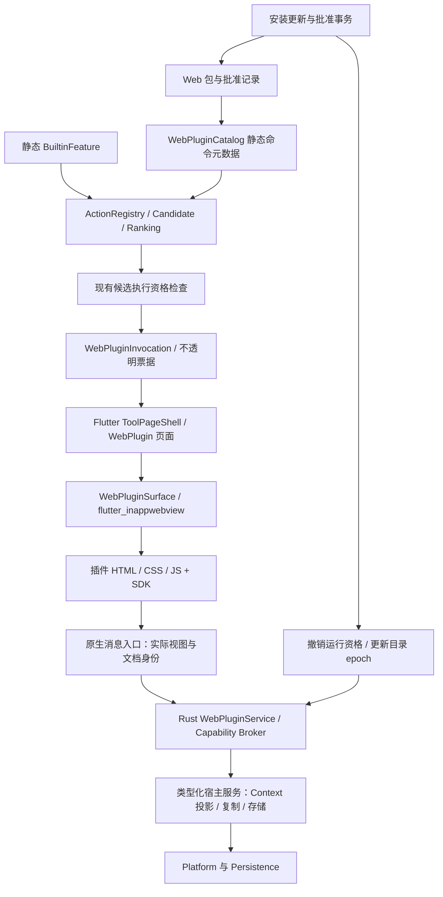

# 第三方 Web 插件：架构与实施方案

现行 Web 插件架构；文档整理：2026-10-25。第三方采用 WebView，第一方为静态内置模块；JSON 已作为普通 Web 包接入。本文说明架构与设计边界，实际 Manifest / SDK 用法以[开发指南](plugin-development.md)和生成的协议为准；逐构建证据见[历史实施记录](archive/web-plugin-development-records.md)。Terminal 延后，Windows 与完整发行矩阵尚未交付。标为“后续”或“验收要求”的内容不代表已有实现。

## 1. 结论与范围

确定采用：**本地 Web 包 + flutter_inappwebview + 版本化 TypeScript SDK + Rust 能力代理**。通过 WebPluginSurface 封装库依赖；关键接口缺口才补薄原生适配。不引入 QuickJS、Node 或独立 Wasm 运行时，也不将第三方 UI 改回宿主 DSL。

- React / Vue / Svelte / 原生 JS 均可；用户安装的是构建好的静态资源，无须安装 Node，不在安装时运行 npm 或脚本。
- Manifest 描述身份、命令入口、Context 匹配和权限；HTML / CSS / JS 决定页面。不继续设计 List / Form / Table UI DSL。
- 入口继续进入 Action → Candidate → Ranking → 快捷键 → 执行资格链；用户执行入口后才创建 WebView。
- 插件在页面中处理自己的交互和计算；宿主业务、系统访问、权限与持久存储通过少量明确的 SDK API 完成。
- 本地工具页、安装启停、Context 输入、复制、隔离存储、主题 / 键盘桥和更新批准已进入 macOS 开发预览。原生交互与安全发行矩阵仍需验收；联网、文件正文访问等尚未开放。
- 后台插件、第三方搜索源 / ContextProvider、任意进程、PTY、Marketplace、远程网页插件不进入首版。

“所有扩展都需要统一 Runtime”不再成立。内置模块与外部 Web 插件只共享稳定的产品模型和宿主服务，装配及生命周期各自管理。

## 2. 实现入口与边界

| 已核对代码 | 当前事实 | 当前接入方式 |
|---|---|---|
| [FeatureContribution](../crates/anywhere-core/src/features/contribution.rs) / [composition](../crates/anywhere-core/src/application/composition.rs) | Provider / Bundle / Factory 编译内装配 | 保持原模型；不恢复内置模块 Reload |
| [ActionExecutor](../crates/anywhere-core/src/core/action/descriptor.rs) | Native、Declarative、ScopedDeclarative、WebCommand | P2 已加入带注册资格的 Web 命令引用；不将 Web 命令伪装成内置领域 Action |
| [HostView](../crates/anywhere-protocol/src/lib.rs) | FileSearch、NativeTool、PluginDetail、WebPlugin | P2 的 WebPlugin 只携带宿主生成的不透明调用票据，不在页面目标中嵌入 Context 或磁盘地址 |
| [ToolPageRegistry](../apps/flutter/lib/tools/tool_page.dart) / [ToolPageShell](../apps/flutter/lib/tools/tool_page_shell.dart) | 静态页面工厂、通用布局和焦点逻辑 | 静态注册一个 WebPlugin 页面适配器，插件包不生成 Dart 工厂 |
| [HostServices](../crates/anywhere-core/src/core/action/capabilities.rs) | 显式检查 Clipboard / URL / 文件等能力 | 复用具体操作；外面增加 Web 调用身份、资源范围、额度与撤销检查 |
| [anywhere-plugin](../crates/anywhere-plugin/src/lib.rs) / [现行协议](plugin-protocol.md) | TOML 受限操作 / Detail 数据、Web 包解析与校验；crate 本身不执行 JS | 旧协议独立兼容，Web 页面在 WebView 执行，不扩大旧 v1 委托权限 |
| [pubspec](../apps/flutter/pubspec.yaml) / [构建脚本](../scripts/build-macos.sh) | flutter_inappwebview 已接入；macOS 使用 assemble / swiftc 打包 | WebView 原生框架及许可随 App 签名交付 |

关键缺口不是“渲染 HTML”，而是包内容身份、跨边界调用资格、原生焦点，以及安装 / 更新 / 撤销的一致性。

## 3. 调研依据与技术选择

### 3.1 可借鉴的做法（2026-10-18 选型依据）

| 来源 | 官方资料确认的事实 | 对 Anywhere 的启发 |
|---|---|---|
| Raycast | 通过 Node 子进程 / worker 执行扩展，提供限定 API；文档也明确 Node 文件与网络操作没有进一步沙箱 | 借鉴命令入口、SDK、开发工具和审查流程；其 React / Node 扩展不等于 WebView 插件，不能直接兼容 |
| Tauri | 用 capability 限定窗口 / WebView 能调用的宿主命令，默认不为远程页面开放 IPC | 借鉴按运行实例和资源范围授权；无需把 Flutter Host 迁成 Tauri |
| Apple | WKWebView 可用 WKURLSchemeHandler 提供自定义协议资源，用带回复的消息处理器桥接 JS | 可构建本地资源加载与异步调用，平台差异封在 Host 适配器 |
| Microsoft | WebView2 要校验文档来源、消息和导航，推荐明确 API 而非通用代理；本地内容可使用虚拟域名或资源请求响应 | Windows 使用同一逻辑协议，不要求与 macOS 的资源 URL 完全相同 |

来源：[Raycast 安全与运行模型](https://developers.raycast.com/information/security)、[Tauri Capabilities](https://v2.tauri.app/security/capabilities/)、[WKURLSchemeHandler](https://developer.apple.com/documentation/webkit/wkurlschemehandler)、[WKScriptMessageHandlerWithReply](https://developer.apple.com/documentation/webkit/wkscriptmessagehandlerwithreply)、[WebView2 安全](https://learn.microsoft.com/en-us/microsoft-edge/webview2/concepts/security)、[WebView2 本地内容](https://learn.microsoft.com/en-us/microsoft-edge/webview2/concepts/working-with-local-content)。以上是接口与运行方式依据，不是 Anywhere 已验证的性能结论。

### 3.2 WebView 集成选择

| 方式 | 优点 | 当前项目的代价 | 建议 |
|---|---|---|---|
| flutter_inappwebview | 官方项目文档列出 macOS / Windows，提供丰富 WebView 封装 | macOS 原生框架构建、注册与随 App 签名已接入；Windows 宿主未交付 | **已接入**；正式宿主继续承担消息身份、键盘、生命周期和安全矩阵验收 |
| 薄 Host 补充：macOS WKWebView / Windows WebView2 | 可补充具体资源、消息来源或原生键盘缺口 | 两个平台各有少量原生接线 | 仅补必要缺口，不重写通用 WebView 库 |
| webview_flutter | Flutter 官方维护，macOS 使用系统 WebKit | 官方包列出的实现没有 Windows；两端仍要另补能力 | 不视为开箱即用的桌面统一方案 |
| wry | Rust 封装系统 WebView，支持 child WebView | NSView / HWND、Flutter 布局、主线程生命周期仍需协调 | 后备实现；不因此让 Core 持有 UI 对象或引入第二套事件循环 |
| Electron / 整体 Tauri 迁移 | 自带完整应用框架 | 改动既有宿主、窗口与发布链，超出接入插件需要 | 不采用 |

选型时参考：[InAppWebView 平台说明](https://inappwebview.dev/docs/intro/)、[webview_flutter](https://pub.dev/packages/webview_flutter)、[wry child WebView](https://docs.rs/wry/latest/wry/)。支持列表不证明本仓库的透明窗口、输入法、层叠和打包方式已经验收。早期 P0 探针已退役，当前以正式宿主与对应构建的验收记录为准；选型资料也不代替仓库锁定版本的 API 检查。

统一的是 `WebPluginSurface` 和 SDK，不是把所有 OS 行为移进 Rust。WebView 创建、窗口层叠与焦点必须在平台 UI 线程上完成。

### 3.3 开源能力复用

- 复用仓库已有 `serde_json`、`url`、`sha2`、`rusqlite` 及既有 worker / 日志基础，不重新实现 JSON、URL、摘要或数据库。
- P1 复用 [zip-rs](https://docs.rs/zip/latest/zip/) 9.0.5 解析与校验 ZIP 头、CRC、重叠；在创建库的元数据表前限制目录大小 / 数量，再叠加无链接 / 额度 / 路径冲突规则，不直接调用通用 `extract`。Deflate 使用纯 Rust 后端。
- Manifest 的 [JSON Schema](../resources/web-plugin-manifest.schema.json) 通过可选开发依赖 [schemars](https://docs.rs/schemars/latest/schemars/) 从 Rust 类型生成，并进入漂移检查。Schema 描述 JSON 结构；字节额度、ID、路径、版本等语义由 Rust 验证器最终检查。TypeScript SDK 和消息 schema 在 P3 接入。
- 开发模板可用 Vite；运行时只接受它的生产静态输出。目录 watch、签名、HTTP 等依赖在有实际消费者的阶段再加入。

P1 已接入 zip、semver、sha2、Unicode 归一化 / 大小写折叠与 png；包图标复用 PNG 解码库，schema 生成依赖不进入默认运行构建。版本已锁定，新引入依赖的许可随资源保留；发布包增量在正式接入时测量。

## 4. 总体架构



### 4.1 模块职责

| 模块 | 负责 | 不负责 |
|---|---|---|
| `anywhere-protocol::{web_plugin, web_bridge}` | Manifest / SDK 请求响应 / 版本 / 错误 schema、WebPlugin HostView | 平台对象、安装与业务实现 |
| `anywhere-plugin/web/` | 包解析、路径 / 资源清单验证、摘要、协议兼容检查 | JS 执行、业务服务或应用总状态 |
| `anywhere-core/application/web_plugins/` | Catalog、安装更新协调、Invocation、能力代理、撤销与目录发布 | HTML 渲染和原生 WebView |
| `anywhere-core/persistence/web_packages.rs` | 安装收据、包归档与有界资源读取；KV 复用独立 SQLite 模块存储适配器 | 目录发布、批准决策或原生 UI |
| `anywhere-core/core/action/` | 类型化 Web 命令引用与现有资格模型 | 插件安装器、SDK 方法大分支 |
| `anywhere-bridge-flutter` | 管理 / 页面 DTO、受信任 Host 调用入口 | 重新校验另一套业务规则 |
| Flutter `web_plugins/` | 页面状态、加载 / 失败 UI、主题和布局协调 | 批准判定、目录扫描、插件 API 实现 |
| Host `WebPluginSurface` | 系统 WebView、本地资源、文档 / frame 身份、键盘、进程失败 | Context 识别、排序、Shell 命令 |
| `packages/plugin-sdk/` | TypeScript Promise API、启动 / 恢复封装、类型与开发模板；默认样式由 Host 注入 | 宿主授权决策、UI DSL |

先在既有 crate 内建立小目录，不先拆出许多空 crate。若安装 / 验证后续确有独立 CLI 消费者，再拆包管理 crate。

### 4.2 两条桥的界线

- Flutter ↔ Rust 沿用 FRB；Flutter ↔ Native Host 沿用现有桌面接口。
- Web JS ↔ Native Host 使用平台消息 API；原生入口附上可信的视图 / 文档绑定，再进入 Rust 能力代理。实现上可经受信任 Flutter 转发，但不要把整个 FRB API 暴露给 JS。
- `Platform: Send + Sync` 中不加入 WKWebView / HWND。主线程 `WebPluginSurface` 是独立 UI 端口。
- 源头身份来自实际消息处理器和 frame；JS 包中的 `pluginId`、`origin`、`grant` 等字段一律不能决定权限。
- 首选具体调用链是 Web SDK → 库的原生消息桥 → Dart 校验与转发 → FRB → Rust 能力代理。Dart 转发宿主绑定的文档 / frame 元信息，不相信消息正文自报身份；原生接口不够时补适配，不退化为仅验证页面提交的 URL。

## 5. 包格式、身份与注册

### 5.1 包布局与当前 Manifest

```text
example.awplugin                 ZIP 容器，扩展名只用于识别
├── manifest.json
├── dist/
│   ├── index.html
│   └── assets/...
├── icon.png
├── LICENSE
└── README.md                     可选说明资源；安装器当前不展示其正文
```

```json
{
  "schemaVersion": 1,
  "id": "dev.example.json-tools",
  "name": "JSON Tools",
  "version": "1.0.0",
  "apiVersion": "1",
  "platforms": ["macos"],
  "entry": "dist/index.html",
  "permissions": [
    { "name": "context.read", "types": ["core.text"] },
    { "name": "clipboard.writeText" },
    { "name": "storage.local" }
  ],
  "commands": [
    {
      "id": "open",
      "title": "JSON Tools",
      "keywords": ["json", "format", "validate"],
      "accepts": ["core.text"],
      "inputMatchers": ["json"],
      "entrypoint": "workspace"
    }
  ]
}
```

这不是 UI 描述。命令的 `entrypoint` 只是交给同一个页面的路由参数；不执行 Manifest 中的代码，也不允许远程 HTML 入口。JSON 示例使用通用 Web 工具框架，不恢复已撤下的原生 JSON Provider。

- Manifest schema、SDK API、包 SemVer、App 版本分开。未知能力 / 不支持的 API 主版本拒绝激活，未知字段严格拒绝；当前没有任意扩展字段容器。协议可描述 Windows 平台，但现有可运行模板只声明 macOS。
- 默认命令可在全局按名称搜索；`accepts` 决定有对象时是否提供该命令，不要求每个入口都必须有 Context。无对象进入空工作区，不能把搜索关键词偷偷当作选中文本。
- 最多 32 个命令 / 包；标题、关键词、图标尺寸与字节长度有上限；不允许插件设置任意基础 Ranking 权重。
- 可选 `inputMatchers` 由宿主识别输入格式，支持 `json` 与 `json_escaped`：严格对象 / 数组，最大 16 KiB 原文 / 解码后 128 层；转义输入最多 4 层，可省略外层引号。拒绝标量、注释与不完整内容。要求 `accepts` 和已批准 `context.read` 均包含 `core.text`。同一输入与同类规则的识别结果在一次匹配内复用；不构造文档树、不执行 JS、不启动 WebView、不写入正文。Invocation 保留原文，具体解码、格式化与校验由插件执行；默认关键词打开工作区不受自动识别限制。声明 `requireInputMatch: true` 的命令必须提供匹配器，不注册无对象入口；即使命中名称，也仅在匹配到有效内容时显示，执行前复验。

### 5.2 三种身份必须分开

1. **逻辑身份**：`pluginId + commandId` 形成带保留前缀的稳定 ActionId，例如 `web:dev.example.json-tools:open`。具体编码适配现有 ID 校验；不带版本、摘要和运行实例 ID。命令改名须显式迁移，删除后留下不可执行绑定，不重定向到另一个命令。
2. **安装内容身份**：Host 对规范化文件清单、相对路径、文件字节与 Manifest 计算摘要，批准绑定摘要、权限和来源身份。只改 JS / CSS 也形成新内容身份；包内自己提供的 hash 不作为信任依据。
3. **运行身份**：Invocation、Runtime、DocumentEpoch 与当前注册 / 批准 token 共同限定调用资格；更新、页面重载、撤销后旧实例不能继续调用。它们是 Host 持有的资格，不接受 JS 自报授权。

包 ID / 作者名是自报信息，不等于可信发布者。首次安装生成本地来源身份，同 ID 的再次导入按明确批准的本地更新处理，沿用该身份与 KV；安装器没有验证作者或下载来源。底层目录拒绝直接替换同 ID 的来源身份，但这不等于安装器能识别不同发布者。摘要证明内容一致，不能证明作者身份。

当前 ActionId 仅包含 pluginId / commandId：卸载重装会生成新的存储来源并清除旧 KV，旧 Usage / 快捷键仍可能关联同 ID 命令。已验证发布者、来源替换流程及跨来源使用记录 / 绑定隔离属于后续加固，不能作为现有安全保证。

### 5.3 自动注册与现有 Scope

```text
包验证与批准 → Catalog 元数据 → ActionRegistry → 现有查询 / Scope / Ranking
用户执行命令 → 创建 Invocation → 打开 WebView → 交付本次 Context
```

- 安装后无需改 Launcher 领域分支；所有 Web 包共用一个页面工厂。
- 每次查询只匹配已验证的命令元数据，不启动 JS，不要求 WebView 响应排序请求。
- 不新增“Plugins”常驻栏，不给每个包默认增加 Scope，也不重做 Current App / Global 的语义。Context 命令按现有适用性加入聚合结果；领域分组复用现有规则，首版不允许任意创造 Scope。
- 命令入口不固定挂在空查询首屏。继续按现有搜索 / 推荐资格决定展示，用户可给命令设置现有 Action 快捷键。
- 首版不允许 Web 注册 Provider / CandidateSource。以后需要外部搜索时另设计预算、取消与调度协议，不在输入热路径中运行任意 JS。

## 6. Context 是调用输入，不是环境监控接口

页面拿到的是**用户执行该动作时选定对象的最小投影**，不拿完整 ContextGraph、SessionFacts、AX 树、全量剪贴板历史或当前所有应用信息。

| 输入 | 传递方式 | 限制 |
|---|---|---|
| 文本 / URL | 类型、来源说明、允许的值 | 声明并批准 `context.read`；只投影声明类型；超限返回明确状态，不静默截断后当完整内容 |
| 文件 / 目录 / 多选 | 显示名称、类型、不透明 ResourceHandle；完整路径另受授权 | 知道路径不等于能读正文；首版不开放正文读取或目录遍历 |
| 无适用 Context | 空输入 + reason | 页面可让用户手动粘贴；不退而读取别的来源 |
| 页面自身输入 | Web 内存 | 不自动重新采集桌面 Context，不进入 Usage / 日志 |

`accepts` 决定适用性，`context.read` 决定可见数据，两者分别检查。全局命令和全局快捷键只得到本次明确调用允许的 Context，不因此有后台读取权。

调用创建时锁定对象及来源；切换应用不会让页面悄悄换对象。隐藏恢复重新发放实例资格，但沿用原对象投影；如需“使用当前对象”，必须由用户明确触发新调用。文件 Handle 后续访问要复验身份和 OS 授权，不能只对路径做一次字符串前缀判断。

来源或功能策略变更也要失效对应的 Context 访问资格。撤销能阻止后续宿主调用，不能撤回已经交付给 JS 的字节；因此必须先最小投影，再交付数据，而不是先给全量环境再隐藏控件。

现有“选中文本 / 15 秒新复制内容无法识别则不进入内容页”的规则保持；已启用 Web 命令声明的宿主 `inputMatchers` 也参与资格判断。匹配仅生成候选，用户执行命令后才交付原文，停用 / 卸载 / 撤销立即移除识别资格。第三方 JS 不加入自动输入识别器。

## 7. SDK 与消息协议

### 7.1 最小 SDK

```js
import {definePlugin} from '@anywhere/plugin-sdk';

// 页面渲染后连接；SDK 处理 ready、输入交付和隐藏后的重新绑定。
const input = document.querySelector('textarea');
const plugin = definePlugin({
  onLaunch({input: initial}) {
    if (initial.kind === 'text') input.value = initial.text;
  },
});
// 在业务按钮的异步处理器中调用，并处理取消 / 失败。
// await plugin.host.clipboard.writeText(input.value);
// await plugin.host.storage.set('preferences', {indent: 2});
```

当前推荐入口是 `definePlugin`，同时兼容导出的 `host` 门面与低层 `createHost`；进阶集成需自行管理启动 / 恢复生命周期。底层方法由[生成的契约](../packages/plugin-sdk/src/contract.ts)限定：`invocation.get`、`lifecycle.ready`、单独授权的 `context.getCurrentApp` / `clipboard.readText`、`clipboard.writeText`、`storage.get/set/remove`，以及 SDK 内部的取消 / 文本分块方法。

`lifecycle.onVisibility` 提供显示事件；`environment.language` / `onLanguageChange` 提供语言状态。主题与背景由 Host 自动注入，当前没有 `host.theme.subscribe`、`navigation.back` 或 `actions.set`。返回 / 重载 / 工具选项由 Host 提供，业务操作由页面自己实现，不注册到 Host Actions 面板。

当前应用返回 Invocation 绑定快照；主动读取剪贴板返回请求时的内容，采用 `clipboard.readText` 独立批准，并由宿主明确的“读取剪贴板”操作产生一次性读取资格，不能把 JS 自称的 click 当用户手势。无后台监控、轮询或历史查询。自动填入的 15 秒时效不限制主动读取；隐藏后交互资格仍立即撤销。图片 / 文件等多格式读取另通过格式描述及有界 ResourceHandle 扩展，不一次跨桥复制完整载荷。

后续独立增加：HTTP(S) 打开、用户选择文件和受限读写、Host HTTP、Secrets、二进制 / 流。没有 `invoke(anyMethod)`、完整 Platform 对象、Rust 任意方法名或 `shell.exec`。

### 7.2 控制通道

请求示意：`{ protocol: 1, requestId, method, params }`；响应：`{ requestId, result }` 或 `{ requestId, error: { code, message, retryable } }`。实际 Runtime / Document 身份由原生接收端补充，JS 不提供授权令牌。错误不包含宿主绝对路径、正文或完整堆栈。

当前控制与数据预算：

| 项目 | 首版预算 |
|---|---|
| 单个 JSON 控制帧 | 64 KiB，编码后检查；限嵌套深度与字段数 |
| 每实例进行中的请求 | 8；等待队列最多 16；超出返回 `BUSY` |
| 单文档请求 ID | 最多 4,096 个，避免无限保留去重记录 |
| 普通调用超时 | 5 秒；Host 确认最多 30 秒；初始化 ready 最多 10 秒 |
| 复制文本 / 初始文本对象 | 1 MiB；超过单帧走有界分块，同一实例最多 1 个组装对象 |
| 分块传输 | 每块原始 UTF-8 ≤ 4 KiB、编码后 ≤ 32 KiB；先申请 ticket，序号 / 总长复验；结果 JSON 编码后 ≤ 2 MiB；5 秒过期，每秒主动清理，隐藏立即释放 |
| 插件 KV | 值合计 1 MiB，单键值 JSON ≤ 64 KiB，最多 256 个键；还受帧限制，一次事务提交 |

分块只服务有明确消费者的文本输入 / 复制，不提前实现通用高吞吐流框架。未来 Terminal 的二进制流控是独立协议，不逐字符走本控制通道。

所有大小是字节而非 JS 字符数。重复 requestId / 迟到响应 / 未知方法 / 旧版本返回正常错误；取消中止排队和未产生副作用的工作，不能声称撤销已完成的复制。副作用不因超时自动重试；存储更新使用 SQLite 事务，请求 ID 重复校验不等于跨重连的 exactly-once 保证，当前没有独立 operationId 接口。传入网页的数据通过结构化消息发送，不拼接到 evaluateJavaScript 源码。

### 7.3 资格检查顺序

```text
原生实际 WebView / 主 frame / 文档地址
 → Runtime 与 DocumentEpoch 是否仍有效
 → 安装摘要与注册 / 批准 token 是否仍有效
 → Invocation 是否可交互、请求是否超额
 → 方法能力与具体资源范围
 → worker 开始副作用前再次检查
 → 执行具体 HostService
```

初始 Action 执行继续检查 Launcher Session / Revision / Candidate / catalog 资格；页面内后续操作使用 Invocation 资格，不因编辑器每输入一个字就复用并失效旧的 Launcher Revision。隐藏 / 返回 / 撤销则明确撤销交互资格。主 frame 以外的消息不进入代理。

Usage 记录稳定入口命令，不保存 Context 正文。当前实现于有效 Invocation 的首次 ready 记录一次，握手失败不计成功，重复 ready 与隐藏 / 恢复不重复计数；入口执行器不提前双计。相应回归位于 `application/web_plugins/tests.rs`。

## 8. 权限、安全与系统边界

### 8.1 能力分层

| 能力 | 首版 | 用户可理解的批准范围 |
|---|---|---|
| 当前调用的文本 / URL | 支持 | 仅交付给当前命令的声明类型 |
| 唤醒前当前应用 | 支持 | `context.currentApp`，仅应用 ID / 名称等批准字段，不默认给 AX 树或窗口标题 |
| 主动读取纯文本剪贴板 | 支持 | `clipboard.readText`，宿主明确操作触发的一次读取；不包含历史 |
| 写纯文本剪贴板 | 支持 | 当前页明确复制；不允许后台读取 / 轮询 |
| 隔离 KV | 支持 | 本插件来源身份 + pluginId 的固定 namespace |
| 打开 HTTP(S) URL | 后续小阶段 | 用户主动打开；域名和完整 URL 可审查；拒绝自定义 scheme |
| 文件读写 | 后续小阶段 | OS 选取 / Context Handle + 单资源权限；无全盘通配 |
| 联网 | 后续小阶段 | Host HTTP 代理的精确域名 / 方法范围；不开放远程 JS |
| Secrets | 后续小阶段 | 平台 Keychain / Credential Manager；不放普通 KV |
| 进程、Shell、PTY、菜单 AX、历史全文、其他插件存储 | 不开放 | 后续有具体需求再定协议 |

App 获得的辅助功能或磁盘权限不会自动下放给插件。首版不为插件读取触发新的磁盘授权；以后由明确的“选择文件”操作触发 OS 授权，并且只授予选中的资源。

后续 Host HTTP 代理需要逐跳重验重定向、限制请求 / 响应大小与时间，默认拒绝 localhost、私网和元数据地址，避免将“允许访问一个域名”变为内网代理；Secrets 也要独立批准。文件读写使用已打开资源或安全目录句柄，考虑符号链接和校验后替换，不能只 `canonicalize` 一次。细节在对应能力有真实消费者时单独验收，不先加入首版权限集合。

### 8.2 WebView 自身也必须受约束

只限制 SDK 不足以限制页面自己的网络和导航：`fetch`、图片、表单、iframe、WebSocket 等可能根本不经过 SDK。CSP 各指令覆盖不同通道，不能只设置 `connect-src`。依据见 [CSP 规范](https://www.w3.org/TR/CSP/)。

当前 macOS 宿主使用本地离线页面：`WebDocumentPolicy.protectHtml` 将 Host CSP 放在解析顺序最前，原生 WebView 设置非持久浏览、HTTP(S) 资源阻断、后续导航取消、弹窗 / 权限拒绝。策略代码与 Widget 回归不等于恶意页面的完整系统验收；正式开放不可信分发前仍需完成下列安全矩阵。当前 CSP 的主要限制为：

```text
default-src 'none'; script-src <本包资源来源>;
style-src <本包资源来源> 'unsafe-inline';
img-src <本包资源来源> data:; font-src <本包资源来源>;
media-src 'none'; connect-src 'none'; frame-src 'none'; child-src 'none'; object-src 'none';
worker-src 'none'; base-uri 'none'; form-action 'none';
script-src-attr 'none'; upgrade-insecure-requests;
```

- 不允许 eval / 远程脚本 / 内联事件处理器；普通生产 Vite 构建应能适配，不兼容的依赖明确报错。生产模式不启用 DevTools、任意下载、弹窗、摄像头、麦克风、定位、通知或浏览器剪贴板权限。
- macOS 通过包资源协议、内容规则 / 导航回调和非持久 WebView 设置接入。Windows 的独立逻辑 origin、受控资源响应与非持久 profile 仍是接入要求，尚无已交付宿主；不能把设计写成两端已验证。
- 不直接给 WebView 整个用户目录的 `file://` 访问；原生资源端只提供当前摘要包中已验证的文件。即使路径经过多次 URL 编码，也不能逃出包根或跳到另一插件。
- 资源端在同一次有界读取中核对文件长度与已批准清单中的文件摘要，再将这份字节交付 WebView；不能先检查路径、再读取可能已被替换的内容。摘要校验失败不继续执行新资源。
- 全部页面导航、新窗口、子 frame 请求必须受 Host 控制。普通外链交给明确的 Host 操作；禁止将外部网页加载在仍持有特权 bridge 的视图内。
- 浏览器文件选择、拖入本地文件、下载和原生权限请求默认拒绝；将来通过明确的 Host 文件操作接入，不能绕开 ResourceHandle。用户主动选择文本并使用系统复制属于普通编辑操作，不等于授予页面后台剪贴板读取权。
- Origin 不单独承担权限；还绑定实际 WebView 与当前文档。macOS 的 `anywhere-plugin://…` 与 Windows 的受控 `https://…` 只是底层地址，不进入业务身份或插件持久键。
- 验收必须证明 CSP 在插件脚本前生效，不受包内 meta / HTML 重写绕过，并覆盖全部文档载入路径。当前使用 Host 前置 CSP 外壳，不宣称已完成所有绕过验证；未通过该安全矩阵前，不开放不可信第三方的公开分发，不能以“插件自觉遵守”代替。

[WebKit 内容规则](https://webkit.org/blog/3476/content-blockers-first-look/)提供资源阻断机制，但这不等于已证明任意 JS 都处于 OS 级网络隔离。浏览器引擎漏洞、WebRTC 等额外通道和 API 差异必须纳入 P0 的边界验证；SDK 的权限承诺只覆盖通过验证的能力，不宣传“第三方代码绝对无法外传”。如产品要求对恶意网页提供全面 OS 级断网保证，需要另外评估独立受限容器，不能靠一段 JS 覆盖函数实现。

### 8.3 文件与包安全

解压拒绝绝对路径、`..`、符号链接 / 硬链接、重复路径、大小写 / Unicode 归一冲突、Windows 盘符 / UNC / 特殊设备名和超长路径。检查文件数量、压缩与解压总量、单文件大小、压缩比；先限制再解压，不只解压后统计。

P1 已实现的限制：ZIP ≤ 20 MiB、解包 ≤ 80 MiB、≤ 2,000 个条目（含目录）、单资源 ≤ 16 MiB、Manifest ≤ 128 KiB、单文件压缩比 ≤ 200。包图标须为非动画 PNG，≤ 256 KiB、宽高各 ≤ 512 像素，并在有限解码预算内通过实际解码。仅允许静态 Web / 文本 / 图片 / 字体资产，拒绝原生动态库、可执行安装脚本；扩展名允许列表只是减小范围，不构成脚本安全证明。

包采用受限普通 ZIP：Stored / Deflate、UTF-8 路径、无密码、无 ZIP64、多卷或归档注释。中央目录 ≤ 4 MiB，每项名称 / 扩展字段 / 注释均先限额；扩展字段只允许时间戳和 UID 元数据。路径不修复、不解码，大小写 / Unicode 归一 / 文件目录冲突均拒绝。先检查头部声明额度，再逐个有界读取验证 CRC 和 SHA-256；包摘要按稳定排序覆盖 Manifest 与全部文件内容，不受 ZIP 顺序、压缩方式或时间戳影响。

`VerifiedWebPackage` 只持有安装期的有界压缩快照、Manifest 与资源清单，本身不落盘、不注册或执行代码。`read_asset` 按精确资源名和字节限额读取同一快照并核对摘要。安装器已通过 `WebPackageRepository.stage` 在私有临时目录写入归档与已验证资产，再移动到摘要目录；运行资源端复用有界读取与摘要校验，不将整包归档常驻 Catalog。

包复制进应用管理的内容目录，运行时不指向下载文件夹或作者工作区。目录按不可变资源使用，但不是 OS 只读沙箱：资源读取发现长度 / 摘要不符就拒绝交付，重复安装也不会悄悄覆盖损坏资产。当前不能据此宣称具备持续篡改监控或自动隔离、撤销整个包的机制。

## 9. 页面与键盘交互

```text
统一搜索 → 搜到普通插件 Action → Enter
 → 同一个 Launcher 的二级工具页
    Host：返回、标题 / 面包屑、统一材质、Actions 与错误
    Web：工具内容、编辑器、预览、领域交互
```

- 不在主搜索框下面常驻插件按钮，不叠加“插件搜索框 + 主搜索框”。工作区是否需要搜索由插件自身内容决定，Host 不重复提供输入框。
- `ToolPageShell` 管标题、边距、窗口尺寸与 Footer；插件背景默认透明，获得字体、颜色、圆角、间距、明暗和 reduced-motion tokens。复杂编辑器用自己的内容表面保证对比度，不在 Web 内重复绘制玻璃 / 窗口边框。
- Host 自动注入默认控件样式与 tokens，SDK 模板提供可选布局类；不强制 React，不定义 Host 渲染控件协议。Actions 面板当前只提供宿主工具选项，不接收插件自定义动作注册。
- Host 保留 `⌘K`、返回、隐藏及既有窗口操作；页面默认动作沿用宿主二级页面规则。只有当前焦点需要文本编辑时，普通字符、光标、选择、复制粘贴交给 Web。
- 主搜索的 Tab / Shift+Tab 切换 Scope / 文件类型；Web 内的 Tab 不触发宿主分类或工具页切换。DOM 可访问性 / 表单焦点遵循页面与系统设置。
- Esc 先处理输入法组合 / Host Actions 面板，然后按宿主规则返回原候选与查询。当前没有让插件声明或接管一次 Esc 的 SDK 接口。插件弹层需提供自己的可访问关闭控件，保留宿主返回 / 隐藏路径。
- 原生 WebView 获得焦点后，Flutter Focus 可能收不到键盘事件；保留键必须由 Host 原生层路由到统一键盘协调器，不能只写 JS keydown 或 Flutter Shortcuts。IME 组合中不抢 Enter / Esc，预留快捷键与菜单命令路径必须一致。
- 页面加载 / 失败 / 不兼容用现有 UI 展示，正文错误在插件页局部显示。内部堆栈不变成主搜索的黄色横幅。

## 10. 生命周期、热加载与撤销

### 10.1 运行状态

```text
Registered → Opening → Ready / Active
                         ↓ 隐藏
                  Retained（最多 15 秒）
                    ↙ 恢复       ↘ 超时
                 Active          Disposed

任一状态 → Revoked / Crashed / Disposed
```

- 默认一个 Launcher Web 实例；安装多少插件不影响常驻 WebView 数量。首版不支持多个插件同时独立悬浮运行。
- 隐藏立即撤销交互调用、取消排队请求，并发送 suspend；页面 DOM 可保留 15 秒。恢复不重新运行 command，不重新计 Usage，而是建立新的可交互绑定。
- suspend 是协作通知，不能保证 JS 停止计时器 / CPU。超过 15 秒 dispose WebView、注销 handler、释放分块缓冲和资源引用。当前没有专门的系统内存压力提前回收机制，不承诺该情况下保留编辑状态。
- 返回主页面按现行导航保留查询 / 选择；Web 内容状态只在该页面会话存活期间保留，不默认持久化用户输入。
- 崩溃显示 Retry / Back；重建前撤销旧 Runtime。连续初始化失败不自动无限重试。宿主 / 引擎失败的诊断要区分，不把所有失败归咎于插件。

WebView2 官方说明渲染进程可能被多个实例共享，关闭控件也不代表浏览器 / GPU 进程立即退出。不能承诺“一包一进程”或靠销毁控件精确回收某个 RSS 数字。[进程模型](https://learn.microsoft.com/en-us/microsoft-edge/webview2/concepts/process-model)

### 10.2 生产安装 / 更新

```text
选择本地包 → staging 校验 / 摘要 → 展示来源与权限 → 用户批准
 → 准备新目录与 Registry 快照 → 持久提交当前版本 / 批准
 → 撤销旧 Invocation → 发布新目录 epoch → 下次打开新版本
```

新安装、启停和已批准更新无需重启 App；这就是本阶段需要的第三方动态装载。不再扫描并热重建所有内置模块。

- 包资源先 staging，准备完整 Catalog 后以临时文件写入、flush / sync、原子替换收据文件，再发布目录。发布失败尝试恢复旧收据；启动从收据验证已安装内容。当前没有独立 journal，不将文件替换和内存发布称为跨层 ACID 事务，也不宣称断电矩阵已经通过。
- 同一次 Catalog 发布包含全部命令与权限，不先加入半个包；验证或保存失败保持旧目录与文档。恢复旧收据本身失败时返回错误，需要按实际磁盘状态恢复。
- 真实 Catalog 发布会立即撤销旧 Invocation，包括更新、回滚、启停和卸载；未编辑完成的页面也不能继续旧调用。当前没有“更新已就绪、返回后再替换”模式，更新前应自行保存内容。重复写入相同启用值是幂等操作，不触发目录替换。
- 撤销使旧注册 / 调用资格失效，后续副作用被拒绝，已完成副作用不回滚。卸载先移除目录资格，再删除该安装来源的 KV，没有“保留数据”选项；KV 清理失败可能发生在目录已移除之后，应读回实际状态，不能提示成完全未卸载。
- 首版所有内容变化都需要确认，复用内容摘要批准思路。不要凭相同 `pluginId`、相同能力或自报作者自动批准新版代码。
- 签名发布者、自动更新源和 Marketplace 是后续层。届时签名证明包来自哪个已信任密钥，密钥更换和权限扩大均重批；不可将 SHA-256 当作签名或审核结论。

旧 TOML 定义继续走现有受限执行器，不自动转为可执行 Web 包，也不继承其批准。设置页区分内置模块、旧声明式定义和 Web 包；Web 管理与内置 Refresh 不混用。等兼容使用情况核对后再制定旧 DSL 退役计划，不在接入 Web 时顺手删除现有配置 / Usage。

### 10.3 开发热重载

当前仅支持重新加载已安装、已批准的版本。修改代码须重新构建、打包、导入并批准；Reload 不读取开发目录。以下是尚未实现的开发模式设计，不属于当前 SDK：

- 用户明确导入开发目录，信任的是本次开发工作区中的可变代码，界面持续标注开发模式；不是声称每次 HMR 都有已批准的不可变摘要。
- 每次全文重载递增 DocumentEpoch，清空旧 pending 请求，再握手；HMR 保留的文档也不能提升已批准能力或动态改变入口元数据。
- localhost dev server 只在开发模式、明确来源 / 端口下开放，默认独立临时 profile，不共享生产 Context 历史、Secrets 或 Cookie。需要额外开发网络策略，不能沿用离线生产安全结论。
- Manifest 权限 / 命令变化暂停热更新，重新验证和批准。生产包资源变化不按 HMR 处理。

## 11. 数据、性能与可观测性

- 插件目录与数据目录分离：当前本地预览落盘为 `<data>/web-packages/<digest>/`、安装 / grant 账本、独立命名空间 KV。路径由系统 Host 提供，不在共享代码拼用户目录。
- 不复用旧 TOML 的精确 Manifest 批准记录给 Web 可执行包；Web 新记录使用独立 schema，旧文件保留兼容和可恢复迁移，不整批重命名现有扩展存储。
- 第三方存储 namespace 绑定安装来源和稳定 ID，不允许 JS 自传 namespace；限制由 Host 设置。普通 KV 不保存 Secrets；当前卸载删除该安装来源的 KV，独立重置数据入口留待后续。
- 浏览器 Cookie / localStorage 不作为稳定 SDK 持久化契约。使用非持久 store / profile，跨次数据走 Host KV，避免开发和生产、插件之间共享浏览器状态。
- Storage I/O 在有界 worker 上；资源转发跨页面共享 2 个读取槽 / 16 个等候名额，超限拒绝，不因重载放大缓冲。安装 / 启动验证在设置服务锁内串行执行，不进入查询或原生主线程；尚未支持并发安装；原生主线程只处理视图和小消息。Worker 实际退出前不提前释放 admission。
- 查询热路径没有 JS 执行与 WebView 创建；首次打开延迟、ready、桥延迟、销毁和失败有阶段事件。事件不记录 Context 正文、复制内容或完整请求参数。
- 内存必须同时测主 App、WebContent / WebView2、GPU / Network helper；区分冷启动、活跃、隐藏 15 秒内、销毁后和反复打开。不能把 App RSS 小当作总内存小。
- 控制帧 / 缓冲 / 队列可以设硬额度；Web 页面 JS 堆与浏览器进程内存没有统一的、公开可用的逐插件硬上限。以惰性创建、实例数限制、销毁和故障恢复控制，不承诺严格隔离的堆配额。

建议验收预算：未打开插件时零 WebView 实例；64 个已安装简单包（当前安装上限）的查询 p95 相对基线增加不超过 5 ms；1 MiB 文本往返正确且不阻塞输入；连续打开 / 返回 30 次，活动实例和 handler 数回到 0，无单调增长的宿主对象 / 传输缓冲。冷打开及整个进程树内存先测 P0 基线再定发布阈值，不先写“低于 50 MB”等无证据指标。


## 实施与验收

P1–P6 已进入 macOS 本地开发预览。安装批准、更新 / 回滚、SDK、JSON 工具与运行时的版本证据见[实施归档](archive/web-plugin-development-records.md)及[V0.11 验收](archive/mvp-v0.11.md)。当前阶段状态与未验收项见[V0.12 MVP](mvp-v0.12.md)。早期独立 P0 探针已从源码移除，日常开发与回归使用正式宿主、SDK 和 Web 示例。
