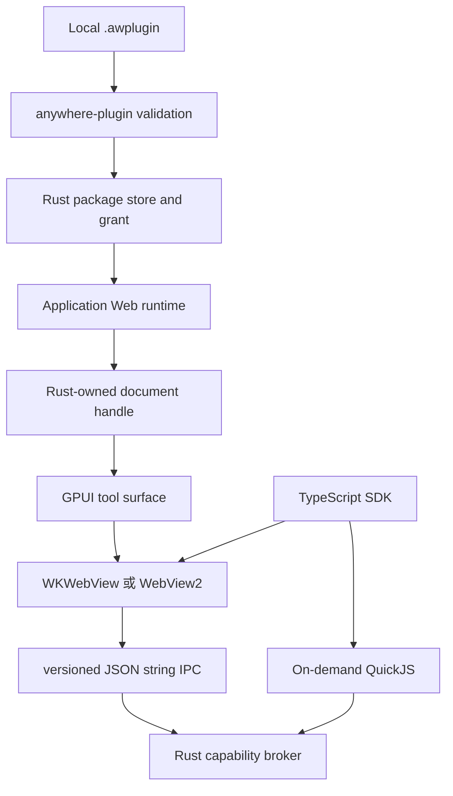

# Web 插件架构

当前采用本地 `.awplugin` 包、系统 WebView、版本化 TypeScript SDK 和 Rust 能力
代理。WebView 承载 UI；按需 QuickJS 承载有限 Context / 后台命令。两者不直接
互调，统一通过 Rust broker。macOS 使用 WKWebView，Windows 使用 WebView2。

开发步骤见[插件开发](plugin-development.md)，整体模块与运行时分工见
[架构](architecture.md)。

## 目标

- 用户无需安装 Node、Rust 或独立 Web 服务即可运行已批准插件。
- 安装时显式审查来源、摘要、资源和权限；撤销后新执行立即失效。
- Web 页面只看到最小 Context / Input 投影，不获得任意文件或进程权限。
- GPUI 拥有产品页面、窗口和焦点；Rust 拥有文档身份、授权、请求预算和生命周期。
- SDK、Web Controls 和宿主主题来自同一版本化契约。

## 分层

| 层 | 职责 | 不承担 |
| --- | --- | --- |
| `anywhere-protocol` | Manifest、grant、IPC、Context 与资源 DTO | OS 对象、页面执行 |
| `anywhere-plugin` | 包结构、路径、资源与 schema 校验 | 页面批准、业务执行 |
| Persistence | 包记录、摘要、偏好与私有 KV | 运行 WebView 或决定权限 |
| Rust Application | 安装审查、批准、撤销、调用、预算与 document 生命周期 | 像素布局 |
| `packages/plugin-sdk` | 类型、主题、消息和后台 adapter | 直接文件 / 进程权限 |
| `apps/gpui/src/web_tool.rs` | HTML 策略、origin、bootstrap 和 IPC framing | 复制业务权限判断 |
| GPUI surface | 加载、错误、焦点、返回与 teardown 展示 | 解析插件业务 |

## 包与安装

Manifest 声明包 ID、版本、入口、资源、命令、Context resolver、后台 module 和
所需权限。安装流程：

1. 用户选择本地包，Rust 在有限预算内读取和验证。
2. 返回本次 inspect 的不可变摘要、资源列表和权限说明。
3. 用户批准或取消；批准使用精确 review token。
4. Rust 将包记录、哈希和 grant 原子写入存储。
5. GPUI 失效已安装列表并允许启用；执行资格来自当前批准。

过期或重复取消为无操作，不能撤销替换后的新审批。包损坏只移除对应 Web 能力，
不阻止 Launcher 启动。更新后资源变化必须重新审查；旧实例不能继续使用新权限。

## 文档身份与 origin

每次打开生成 Rust-owned document handle。有效文档绑定：

- 包 ID 与摘要；
- tool / action 身份；
- 批准与权限快照；
- 固定 origin；
- 输入投影；
- 已提交执行请求的 session / revision；
- 资源预算、取消状态和 generation。

WebView 只允许加载该 handle 的入口和已验证资源。导航到其他 origin 被拒绝。
GPUI 不自行拼资源路径，也不把任意本地路径暴露给页面。Windows 宿主通过
WebView2 将内部 scheme 映射到对应的 HTTPS origin，资源仍由同一固定文档策略
校验。Windows 运行依赖和范围见 [Windows 指南](windows.md)。

首次 Web state 以执行请求冻结的 revision 为启动基线，不从选定 Context 自身
推导。名称搜索得到的 Launcher Entry 可以是 revision 0，而实际执行属于当前
session revision；只有后者能区分“启动输入”和“启动后的新输入”。相同 revision
的 `snapshot_seq` 更新只表示宿主快照变化，不能把搜索词重新投影成正文。

替换文档推进 generation。旧页面的资源请求、IPC、ack、状态事件、崩溃和关闭
回调都不能操作新 surface。文档关闭、应用退出或执行资格撤销会取消待处理请求并
释放资源。

## IPC

页面与 Rust 使用版本化、带请求 ID 的受限消息：

- Context / Input：初始投影与后续值事件；
- 剪贴板：只允许 grant 声明和 broker 实现的请求；
- Host 调用：能力名、参数和 schema 校验；
- 后台事件：与 UI 请求分离，不把订阅错误报告为已完成操作；
- ack / close：绑定 resource ID 与 document generation。

字符串帧传输和 HTML bootstrap 由 `apps/gpui/src/web_tool.rs` 生成并验证（文档侧同时保留 `ArrayBuffer` 解码兼容）。消息大小、
并发、等待时间和输出都有上限。JS 不直接访问 Rust API 或文件系统。

请求在 worker admission 时等待取消；已经开始的实际 I/O 保持自己的许可至结束。
过期回复不能写入新文档。资源读取只取得有界描述，释放管理锁后核对 SHA-256，
发布前再复验文档资格。

## Context 与后台运行

Manifest 可声明 `background.resolvers`。自动解析：

- 只生成 `plugin.<package-id>.*` 类型；
- 使用 `ContextValue::Extension`，不转换为原生文件权限；
- 由现有 ProviderRegistry / ContextGraph 调度；
- 不发布工具页、不启动 WebView、不允许副作用。

显式后台命令使用同一 Rust broker 和安装权限，在按需 QuickJS VM 中执行并返回
有限结果。当前 VM 仍为进程内 worker；进程隔离尚未交付。包批准后只保留脚本
校验描述符，启动时不常驻脚本、档案或 VM。

## SDK 与主题

`@anywhere/sdk` 提供 Context、Input、剪贴板、来源与消息类型。构建条件为 Web
adapter 或 QuickJS adapter，两种运行时共享类型而不是直接通信。

文本上传使用 UTF-8 字节计数、Unicode 校验和按标量边界分块。begin / chunk /
commit / cancel 是事务；失败后释放待回复名额并继续允许后续请求。浏览器与后台
各自保留适配层的直接写入阈值、分块预算和取消调度。

Web 页面自动获得 `resources/web-controls.css` 和
`resources/web-bootstrap.js`。插件通常不导入基础控件 CSS；局部 CSS 只处理业务
布局。Web token 与 GPUI 同源，但系统 WebKit 与 GPUI 的文字栅格允许细微差异。
macOS 的 `lb-wry` 编译启用 `transparent`，原生 WebView 不再额外绘制白底。
普通控件继承文档根 `color-scheme`；固定深色 menu / dialog / tooltip 局部指定
`dark` 并使用 `--aw-on-dark-*`。SDK 静态 token 默认深色，生产 Host 按当前
材质外观覆盖当前文档。

## 页面生命周期

- 打开和返回由 typed `HostView` 路由，未知 NativeTool 明确失败。
- 返回只关闭当前工具，保留 Launcher query、Scope 和 selection。
- Launcher 隐藏立即撤销页面执行资格；页面状态按产品规则保留。
- WebView 获得焦点后，页面内部键盘由 WebKit 处理；宿主返回和清理使用显式
  app 路径。
- 页面替换、关闭和退出清空消息、资源、ack、焦点与文档状态。
- Reload 保留旧文档直到替换绑定成功；不能先关闭当前绑定并删除重载所需的
  invocation。打开 / Reload 和恢复各有请求代次，重入被拒绝；迟到文档只释放
  自己的 handle，旧关闭失败不发布到新页面。
- 保留隐藏窗口时，在途绑定只能保留元数据。Core 绑定要求 Session 仍可交互；
  隐藏撤销的文档须在恢复后换取有效 epoch，再挂载或恢复 WebView IPC。
  以显式恢复意图区分初次等待 ready 与隐藏恢复，不因普通快照重复发起恢复。
  关闭响应通道也须结束 busy 并提供重试，旧响应不能覆盖替换后的页面。

## 安装与管理

Settings 中展示包来源、版本、权限、启用状态和错误。安装 / 卸载提交失败后重新
读取实际安装状态，不把旧列表当权威。打开适配文件夹不发布配置变更。文件选择
期间防止重入；取消选择不清除初始列表。

## 验证边界

自动化覆盖：

- 包路径、资源、摘要、schema 和 grant 校验；
- HTML policy、固定 origin、bootstrap 和受限字符串帧 IPC；
- 旧 document generation 的迟到回复、状态和关闭；
- 安装 review token、取消、更新与撤销；
- SDK 文本上传、Unicode、1 MiB 边界和失败后恢复；
- Web teardown 清空文档拥有的全部字段。

WKWebView 和 WebView2 均需在对应桌面验证加载、IPC、ack、焦点、IME、返回、
崩溃、页面替换及 helper 回收。Windows 额外覆盖运行库缺失及恢复。见
[macOS 桌面验收](test-acceptance-macos.md)和 [Windows 桌面验收](test-acceptance-windows.md#webview2-与插件)。
