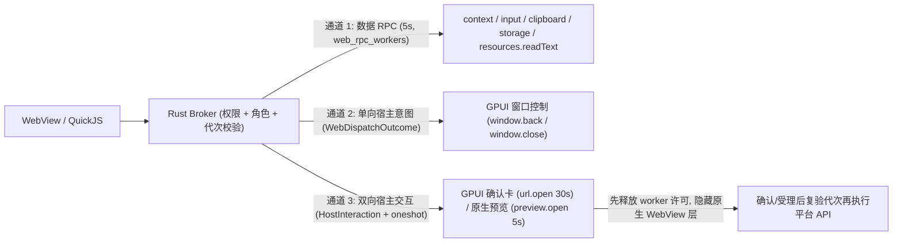

# 第三方 Web 插件架构审查与 V0.15 定案

2026-11-27，审查基线为 `964dd1e1`。本文记录源码审查结论与 V0.15 最终架构定案。现有包的开发步骤、权限和额度仍以[插件开发指南](plugin-development.md)及[运行时契约](web-plugin-design.md)为准。

准备开工时，按[Phase 1 实施手册](web-plugin-phase-1.md)的版本、权限与任务顺序执行。**当前生态仅有仓库内的三个参考包（`json-workspace`、`web-text`、`background-context`），本轮明确不承担历史兼容包袱**：Manifest、桥协议、SDK 门面与打包工具一次性收口到单一当前契约（`apiVersion: "2"`、`protocol: 2`、全线 `camelCase`、零依赖 Node 22 CLI），仓库内全部示例与模板同步迁移。

**架构结论：保留 WebView、按需 QuickJS 与 Rust 能力代理，聚焦局部重构。** 当前基础已能支撑离线文本与混合工具，真正制约交付的是四类问题：一是缺少统一作者工具链与隔离 Mock；二是 `Invocation` 生命周期、单向/双向宿主交互与 WebView 遮挡边界未拆清；三是后台命令缺少干净的完成反馈与可定位诊断；四是外链交接、单文件原生身份与原生预览尚未贯通。

## 当前作者能做到哪一步

| 用户入口 | 现有能力 | 对作者的实际意义 |
| --- | --- | --- |
| 搜索命令、Action 快捷键、Current App 适用动作 | Manifest 静态命令进入 `ActionRegistry`，按 Context 匹配并沿用 Launcher 排序与用户绑定；来源应用与实时前台应用可按权限读取 | 空输入命令与 `requireContext` 命令均可声明，JSON 已有静态匹配器；尚无第三方首页动态结果贡献点。[命令注册](../crates/anywhere-core/src/application/web_plugins/catalog.rs#L120) |
| 打开工具页或独立窗口 | WKWebView / WebView2 加载本地资源；SDK 提供启动、Context / Input 订阅、取消、语言和共享样式；宿主提供独立工具窗口与文档身份 | HTML / React 等直接承载业务，作者无需处理窗口、主题或底层 IPC。[SDK 门面](../packages/plugin-sdk/src/api.ts#L15) · [窗口绑定](../crates/anywhere-core/src/application/web_plugins/invocation.rs#L84) |
| 自动识别或显式运行后台命令 | 自动 resolver 只读获准 Context / Input / 应用信息，仅产出 `plugin.<id>.*` 数据；显式命令额外可使用剪贴板文本与包私有 KV；QuickJS 进程内按需创建 | `json-workspace` 已在单个普通包中组合解析、无界面复制与 Web 编辑并共享偏好。[解析器权限](../crates/anywhere-core/src/application/web_plugins/background_provider.rs#L182) · [混合包](../plugins/examples/json-workspace/manifest.json) |
| 安装、更新、停用、回滚 | Rust 校验归档字节、平台与权限；批准绑定本次审查摘要，同 ID 更新保留安装来源与上一份获批内容 | 快捷键绑定稳定命令 ID，执行时仍按当前安装与摘要复验资格。[安装记录](../crates/anywhere-core/src/application/web_plugins/packages.rs#L115) · [命令身份](../crates/anywhere-core/src/core/action/web_command.rs#L12) |

## 源码审查发现与本轮架构修正

| 优先级 | 源码实测发现 | V0.15 定案处理 |
| --- | --- | --- |
| P0 必改 | 批准同摘要包时仅当摘要变化才写 `previous`，导致 A → B → B 丢弃 A；缓存资产损坏时存储层已采用 fail-closed 拒绝覆盖。[批准与回滚](../crates/anywhere-core/src/application/web_plugins/packages.rs#L168) · [缓存校验](../crates/anywhere-core/src/persistence/web_packages.rs#L125) | `approve` 先 `stage` 验证完整性：损坏资产维持 fail-closed；完好且已启用时做幂等 no-op（保留 `previous` 与在用窗口）；完好但已停用时在审查卡以“批准并启用”显式恢复并保留 `previous`。 |
| P0 必改 | 后台命令先伪造 `lifecycle.ready` 提前记 Usage 并丢弃返回值；`invocation.rs` 对所有调用套用 10s ready 超时，会误杀 30s `url.open` 确认；`suspend()` 取消会误杀交接默认浏览器后的 JS 尾声。[后台执行](../crates/anywhere-core/src/application/web_plugins/background_action.rs#L143) · [超时清理](../crates/anywhere-core/src/application/web_plugins/invocation.rs#L423) | 拆分 `RuntimeLifecycle::Webview` 与 `RuntimeLifecycle::Background`（无 10s ready 清理）；由 `execute.rs` 在合法返回后记一次 Usage；浏览器受理外链后进入 `HandoffCompleted`，失焦仅拒绝新宿主调用、保留剩余 250ms CPU 尾声完成返回。 |
| P0 必改 | `dispatch_web_frame` 仅返回 JSON 字符串，无法区分普通回复与宿主窗口动作；原生 WebView 浮于 GPUI 像素之上，若通过 `visibility_script(false)` 隐藏会令 `web-bootstrap.js` 立刻以 `INACTIVE` 中止确认中的 RPC。[回复交付](../apps/gpui/src/launcher/view/controllers/web.rs#L41) · [前端挂起](../resources/web-bootstrap.js#L142) | 引入三通道模型：数据 RPC、结构化单向 `WebDispatchOutcome`、双向 `HostInteraction`（确认等待前释放 `web_rpc_workers` 许可）；弹出确认卡时仅调原生 `view.set_visible(false)` 而不派发 `visibility_script(false)`，确认或取消后恢复可见。 |
| P0 必改 | 桥帧存在 `request_id`/`plugin_id`/`type_id` 与 camelCase 混用；Rust 默认 `BTreeMap` 反序列化会静默覆盖重复 JSON 键；SDK 未区分只读 resolver 门面，且含历史别名与 Python 打包脚本。[桥协议](../crates/anywhere-protocol/src/web_bridge.rs#L14) · [后台 SDK](../packages/plugin-sdk/src/background.ts#L60) | 一步升级至 `apiVersion: "2"`、`protocol: 2` 全线 `camelCase`；Rust 直反序列化 DTO + `unique_map` 拒绝重复键；`anywhere-protocol` 维护单一 `MethodSpec` 驱动生成物；SDK 拆出只读 `defineResolver` 并删除历史别名；退役 `package.py`，统一到零依赖 Node 22 CLI。 |
| P0 必改 | 选区采集会对多选展开子项，且 `projection.rs` 仅存路径并用 `path.is_file()` 跟随符号链接；独立工具窗使用空 `PreviewStore::default()` 导致无快照目录。[选区采集](../crates/anywhere-core/src/application/context_capture.rs#L276) · [工具窗预览](../crates/anywhere-core/src/application/tool_window.rs#L44) | 读/预览严格限定 Finder / Explorer 原始单文件选区（`depth == 0`），按平台实现防链接/重解析点校验与稳定文件身份；15s `resume` 保持句柄稳定、`tool_window` 重签并共享父 `PreviewStore`，采用 16 MiB 私有只读快照。 |
| P1 补齐 | `background_runtime.rs` 将所有异常折叠为单一 `RuntimeError`，静默 resolver 失败无处排查；包内 `manifest.json` 跨平台 CRLF/LF 曾破坏逐字节门禁。[异常出口](../crates/anywhere-core/src/application/web_plugins/background_runtime.rs#L124) · [逐字节门禁](../scripts/check-web-examples.sh#L12) | 通过 `ctx.catch()` 与中断原子状态输出结构化错误类，增加每包 10 条、零正文内容的内存诊断环缓冲展示于设置页；Node CLI 写归档统一 UTF-8 + LF + 末尾换行，并产出确定性 ZIP。 |
| 下一阶段 | 一次目录发布会清空全部在用 invocation 与子窗口资格。[目录发布](../crates/anywhere-core/src/application/web_plugins/application.rs#L43) | 本轮使用 `ANYWHERE_DATA_DIR` 隔离开发实例，待多包并行编辑成为高频需求后再按 `(package_id, digest, generation)` 缩窄撤销粒度。 |

## 用候选插件决定能力范围

| 插件与一次完整操作 | 已能复用 | 做完这件事还缺什么 | V0.15 定位 |
| --- | --- | --- | --- |
| 时间戳、Base64、JSON 转换：选中文本后按快捷键复制结果 | 自有 Context、后台命令、文本剪贴板、Usage | 补齐本地 Mock、后台沙箱测试与错误诊断 | 零新增权限基准 |
| 工单跳转、站内文档入口：识别工单号，回车交默认浏览器打开 | 只读 resolver、显式 Action | 宿主确认后由默认浏览器打开获准 HTTP(S) URL | 必做试点，贯通识别→确认→交接 |
| Markdown 阅读器、CSV 检查器：选中单个本地文件查看渲染或预览 | 文件名、类型与句柄，Web UI，独立窗口 | 单文件原生身份租约、UTF-8 文本读取与原生预览 | 必做试点，两端验证原生身份后开放 |
| 片段库、离线词典：在命令内列表筛选并执行动作 | KV / 包内词库、Web 搜索、剪贴板写入 | 命令内原生列表、稳定对象 ID、分页与对象动作 | 下一阶段验证 |
| 翻译、远端工单查询：拉取远端结果 | Context、Web 页、显式命令 | 受限 HTTP、取消超时、按站点授权与系统凭据库 | 后续单独设计 |
| 图片 OCR、项目构建、浏览器标签切换、笔记写入 | 已有内置领域入口 | 各自受控预算、会话身份或授权目录写入契约 | 后续逐项评估；浏览器沿用[独立规划](browser-feature.md) |

## V0.15 目标架构与三通道宿主交互

现有桥接把所有插件调用塞进“单向字符串回复”模型，导致窗口关闭、30 秒外链确认与原生预览都无法安全落地。V0.15 将插件 → 宿主调用明确拆成三条通道，均由 `anywhere-protocol` 的封闭 `MethodSpec` 表驱动权限、角色与超时预算：

- **通道 1（数据 RPC，5 秒）**：`context`、`input`、`clipboard`、`storage`、`app`、`resources.stat`、`resources.readText` 沿用 `web_rpc_workers` 线程池与现有分块传输。
- **通道 2（单向宿主意图）**：`dispatch_web_frame` 改为返回结构化 `WebDispatchOutcome { reply_frame, host_action: Option<WebHostAction> }`，绑定 `(handle, document_epoch, request_id, window_generation)`，杜绝前端伪造 JSON 回复字符串触发窗口关闭或返回。
- **通道 3（双向宿主交互）**：`url.open`（30 秒确认）与 `preview.open`（5 秒平台受理）经窗口/会话级异步通道发往 GPUI 并以 `oneshot` 回传，同时满足四条铁律：等待交互前立即释放 `web_rpc_workers` 许可；单文档/单窗口互斥锁防并发确认（第二个请求返回 `BUSY`）；`rpc_state.rs` 与 SDK `client.ts` 按 `MethodSpec` 对齐方法级超时；WebView 上展示 GPUI 确认卡时仅调原生 `view.set_visible(false)` 而**绝不**派发 `visibility_script(false)`，避免 `web-bootstrap.js` 误中止等待中的 RPC。

### 1. 作者工具链与双 Mock

1. **统一零依赖 Node 22 CLI（`anywhere-plugin`）**：提供 `init [--ts | --background | --hybrid]`、`validate [dir] [--built]`、`pack [dir] --output <file.awplugin>`、`test [dir]`，彻底退役 `package.py`。
2. **严格校验与确定性 ZIP**：`validate` 在源码阶段即带轻量级重复 JSON 键扫描器（与 Rust 共用夹具）；`pack` 仅使用 `node:zlib`（`deflateRawSync` + `crc32`），生成 UTF-8 标志 `0x0800`、**不含 Bit 3 Data Descriptor**、**不含额外扩展字段**、固定时间戳 `(2026,1,1,0,0,0)` 与权限 `0o100644`、LF 换行、压缩比超 200 倍自动回落 Stored 的确定性归档，直接匹配 `archive.rs` 与 `preflight.rs`。
3. **双 Mock 与零噪音开发循环**：
   - `@anywhere/sdk/mock`：浏览器 UI 预览与单测 transport，支持切换平台/语言/主题、无对象、选区、拒绝、超限、隐藏恢复、外链确认与文件读取，正式产物零注入。
   - `@anywhere/sdk/mock/background`：基于 `node:vm` 剥离 globals 的纯 ES2023 沙箱，主动暴露 QuickJS 不存在的 `URL`、`TextEncoder`、`fetch`、`setTimeout`、`console`，同时校验导出函数名、resolver 只读约束与后台返回值格式。
4. **精简 vendor 与真实宿主隔离**：`vendor/plugin-sdk/` 只打包 `dist/`、`styles/`、`schemas/`、`tools/`、`package.json`、`README.md`、`LICENSE`（不复制 `templates/`）；单源 Agent Skill 投影到 `.agents/skills/anywhere-plugin-dev/`；双平台均通过 `ANYWHERE_DATA_DIR` 启动隔离开发实例验证真实导入与撤销。[现有 transport](../packages/plugin-sdk/src/client.ts#L17) · [仓库外模板验收](../scripts/check-plugin-starter.sh)

### 2. 外链与选中文件读取

`url.open`、`resources.read`、`preview.open` 彼此独立声明与批准，**全部禁止自动 resolver 调用**。宿主通过 `WebInvocation.capabilities` 与 `WebResource.{readable, previewable}` 提供只读 UI 提示，真正产生副作用或交付数据前仍由 Rust broker 逐次复验资格。

| 契约 | 打开站点链接（`url.open`） | 读取选中文本文件（`resources.stat` / `resources.readText`） |
| --- | --- | --- |
| 权限与参数 | `{ "name": "url.open", "origins": ["https://..."] }`，最多 16 个精确 `http`/`https` origin（拒绝路径、尾部斜杠、查询、片段、userinfo、通配子域、空数组），或单独 `["*"]`（不可混用）。运行时 URL ≤ 8 KiB | 需同时具备 `context.read`（含 `core.file`）与 `resources.read`；仅接受本次启动选区签发的单文件句柄。`readText` 支持 `maxBytes`（1 字节至 1 MiB，默认 1 MiB） |
| 用户交互与风险提示 | 每次均由宿主弹出确认卡，高亮 Rust 规范化后的 `scheme://host[:port]`（非 ASCII 域名同步展示 Punycode）、完整路径/查询参数及展开项；支持 `Enter` 确认、`Esc` 取消；V0.15 不设“记住此站点”。审查卡对 `resources.read`/`clipboard.readText` + `url.open` 外泄组合、`["*"]` 与明文 `http://` 给出醒目警告 | 首版仅限用户从 Finder / Explorer 明确选中的**单个普通本地文件**（`source == FinderSelection && depth == 0 && source_context_id.is_none()`）；拒绝多选展开项、目录、符号链接、重解析点与脚本自造数据。File Search `⌘K` 留待后续扩展 |
| 宿主实现与身份验证 | 确认卡展示与系统打开共用同一份 Rust 规范化 `url.as_str()`，页面保持 `connect-src 'none'`。[平台接口](../crates/anywhere-platform/src/traits.rs#L279) · [页面策略](../apps/gpui/src/web_tool.rs#L365) | macOS 检查祖先链接后 `O_RDONLY \| O_NOFOLLOW \| O_NONBLOCK`，拒绝 `SF_DATALESS` iCloud 占位并记录 `(st_dev, st_ino)` 与短期只读 FD；Windows 使用 `FILE_SHARE_READ \| FILE_SHARE_WRITE \| FILE_SHARE_DELETE` + `FILE_FLAG_OPEN_REPARSE_POINT`，按 reparse tag 放行已落盘 OneDrive 云标签、拒绝符号链接/挂载点/未下载占位，取 128 位 `FileIdInfo`（不支持稳定 ID 的 FAT32/exFAT/SMB 安全降级为仅元数据） |
| 句柄、额度与错误 | 一次确认只交接一次；区分 `USER_CANCELLED`、`BUSY`、`EXPIRED`、`PERMISSION_DENIED`；外链打开后失焦不中断后台返回，SDK 永不自动重试 | 15s `resume` 保持同句柄稳定（由新 `document_epoch` 与底层身份复验把关），仅 `tool_window` 重签新句柄。上限 +1 字节判超限，允许空文件，拒绝非法 UTF-8、含 NUL 字节及 JSON 编码后超传输上限项 |

## V0.15 锁定决策（无历史兼容包袱）

本轮全部按“单一当前版本、零历史包袱”落地；解包开发模式、自定义宿主动作菜单与第三方首页动态搜索明确留待后续阶段。

| 决策域 | 最终定案与验收要点 |
| --- | --- |
| **版本、字段与防重键** | 一步收口到 `schemaVersion: 1`、`apiVersion: "2"`、`protocol: 2`，权限上限升至 16 项；导入 `apiVersion: "1"` 旧包直接返回带重建指引的明确错误。桥帧统一全线 `camelCase`（修正 `requestId`、`pluginId`、`commandId`、`typeId`）。源 Manifest 允许顶层 `$schema`，`pack` 剔除并规范化 LF 归档。Rust 严格直反序列化 DTO（`deny_unknown_fields`）并为 `localizedTitles` 等 `BTreeMap` 使用自定义 `unique_map` 拒绝重复键（禁止先经 `serde_json::Value` 折叠）；Node CLI 同步提供重复键扫描器并共用夹具。[Manifest DTO](../crates/anywhere-protocol/src/web_plugin.rs#L9) · [桥与 SDK 生成器](../crates/anywhere-protocol/examples/generate_web_sdk_contract.rs) |
| **角色门面与能力探针** | `anywhere-protocol` 维护唯一 `MethodSpec`（方法、角色、权限、超时档位、参数与返回 schema），同步生成 `web-plugin-bridge.schema.json` 与 `contract.ts`（含 `methodTimeouts`）。SDK 移弃 `plugin.host`、`context.getCurrentApp` 历史别名，区分三套类型门面：WebView（`definePlugin`）、显式后台 Action（`anywhere-background`，无 `window`/`preview`）、只读 resolver（`defineResolver`，编译期仅暴露只读读取）；`WebInvocation.capabilities` 与 `WebResource.{readable, previewable}` 提供非权威 UI 提示，Rust 逐次执行权威校验。[只读分派](../crates/anywhere-core/src/application/web_plugins/background_provider.rs#L182) |
| **后台生命周期、返回值与诊断** | 拆分 `RuntimeLifecycle::Webview`（保留 10s ready 超时）与 `RuntimeLifecycle::Background`（`Running \| AwaitingInteraction \| HandoffCompleted`，无 10s ready 清理）。外链由 OS 受理后标为 `HandoffCompleted`，失焦仅拒绝新宿主调用，允许剩余 250ms CPU 尾声正常返回；显式取消/停用/卸载/目录发布仍立即硬取消。返回值仅接受 `null`/`undefined` 或 `{ message?, closeWindow? }`（`deny_unknown_fields`，纯文本 ≤ 512 字节）；因 V0.15 无 OS Toast，**`message` 非空且未显式指定 `closeWindow` 时默认 `false`**（留在搜索页展示），无 `message` 默认 `true`，同时传非空 `message` 与 `closeWindow: true` 由 CLI / Mock 发出告警。`execute.rs` 在有效返回后记一次 Usage（写入失败按已有 `warning` + `close_window = false` 处理）。`ctx.catch()` 细分错误类别并写入每包最近 10 条、零用户正文内容的内存诊断环缓冲（设置页可见，开发/调试模式可附 ≤ 1 KiB 脱敏堆栈）。[后台执行](../crates/anywhere-core/src/application/web_plugins/background_action.rs#L93) · [异常出口](../crates/anywhere-core/src/application/web_plugins/background_runtime.rs#L124) |
| **原生预览与独立工具窗** | 预览需单独 `preview.open` grant，不隐含文本读取权。独立工具窗必须共享父级已配置的 `PreviewStore`（修复 `tool_window.rs` 空 store 缺陷）。宿主从已验证 FD 复制私有只读快照（硬上限 **16 MiB**，超出返 `TOO_LARGE`）到 `<preview-root>/preview-<rand>/<sanitized-name-with-ext>`（保留扩展名供 Quick Look 识别，并剥离 `\|`/`\r`/`\n` 以兼容 Windows QuickLook 窗口标题匹配）。`controllers/preview.rs` 扩展 `PreviewTarget::WebDocument` 与动态 `owner_title`，关闭预览时归还焦点到原 WebView 并释放快照。[内部预览对象](../crates/anywhere-core/src/features/preview.rs#L11) · [GPUI 预览](../apps/gpui/src/launcher/view/controllers/preview.rs) · [Windows 预览](../apps/gpui/src/platform/windows/preview.rs) |
| **跨平台快捷键与元数据** | Host 注入平台信息，`environment.formatShortcut` / `matchesShortcut` 同源处理 `Mod`、精确修饰键、AltGr、长按重复与中文 IME 组词；`json-workspace` 同步迁移键帽、监听、提示与中英文标题。命令支持 `localizedTitles`（Phase 1 渲染 `en`/`zh`，允许合法短 BCP-47 标签保留兼容，≤ 200 字节无控制字符）、`subtitle`（≤ 200 字节，回退插件名）与协议层白名单 `icon`（`catalog.rs` 对未知图标显式回退 `"code"`，CLI 发告警；避免落入 GPUI `presentation.rs` 的默认命令图标）。[搜索字段](../crates/anywhere-core/src/core/action/descriptor.rs#L99) · [图标映射](../apps/gpui/src/launcher/presentation.rs#L416) |
| **四入口安装与防僵尸锁** | 选择器、设置页拖放、`.awplugin` 文件对象动作（Core 校验 `core.file` 后发类型化 `HostView` 到 `ApplicationRuntime::inspect_web_package`）与系统双击统一路由至单一审查卡。隐藏 Launcher 或离开 WebPackages 页自动取消未批准的 `pending`，杜绝僵尸锁阻塞后续双击。macOS `Info.plist` 同时声明 `UTExportedTypeDeclarations`（`dev.anywhere.plugin-package`）与 `CFBundleDocumentTypes`，实施前先核验 `gpui_kit` `on_open_urls` 挂载；Windows 复用 `current_user_sid()` 建立当前用户 DACL 命名管道 `\\.\pipe\dev.anywhere.launcher.handoff.<SID>` 交接单一本地包，拒绝 URL 与多余参数并遵守 `--background` / `ANYWHERE_DATA_DIR`。[审查 UI](../apps/gpui/src/launcher/view/pages/web_packages.rs#L303) · [macOS Info.plist](../apps/gpui/macos/Info.plist) · [Windows 单实例](../apps/gpui/src/platform/windows.rs#L60) |

## 实施顺序、验证与后续演进

按“基线与回滚 → 单一 API 2 / protocol 2 契约 → Node 22 CLI 与双 Mock → 跨平台快捷键与示例 → 后台语义与诊断 → 三通道窗口与外链 → 单文件原生身份 → 原生预览 → 统一四入口安装 → 发行验收”顺序推进，具体依赖、入口与完成条件见[任务清单](web-plugin-phase-1.md#如何接手)。

**升级与状态回归**聚焦单一版本内的真实生命周期：A → B → B → 回滚 A、同摘要已停用包“批准并启用”、损坏缓存 fail-closed、同 ID 更名/删命令/增减权限、卸载重装使用新 KV 命名空间，以及旧候选、旧句柄、旧 `document_epoch` 与迟到回复的可控并发验证。[命令绑定策略](../crates/anywhere-core/src/core/action/descriptor.rs#L201) · [安装与卸载](../crates/anywhere-core/src/application/web_plugins/packages.rs#L193)

**桌面验收**使用同一组参考与试点包（Text Pad、JSON Workspace、工单跳转、单文件 CSV），在 WKWebView 与 WebView2 分别记录安装、撤销、WebView 遮挡确认卡、焦点返回、中文 IME、隐藏恢复、独立窗口、Quick Look 与系统双击冷/热启动实测结果。双平台桌面验收仍为 Pending，工程实现与验证见[Phase 1 实现交接](web-plugin-phase-1.md#实现交接)。[macOS 验收](test-acceptance-macos.md) · [Windows 插件验收](test-acceptance-windows.md#webview2-与插件) · [Windows 证据范围](windows-progress.md)

**下一阶段演进**优先以片段库与离线词典验证命令内原生列表（进入命令后按需查询、稳定对象 ID、分页与对象动作，沿用[候选源契约](../crates/anywhere-core/src/core/search/candidate_source.rs#L168)），再依次评估按包粒度撤销、系统凭据与定域 HTTP、长任务与公开分发。
